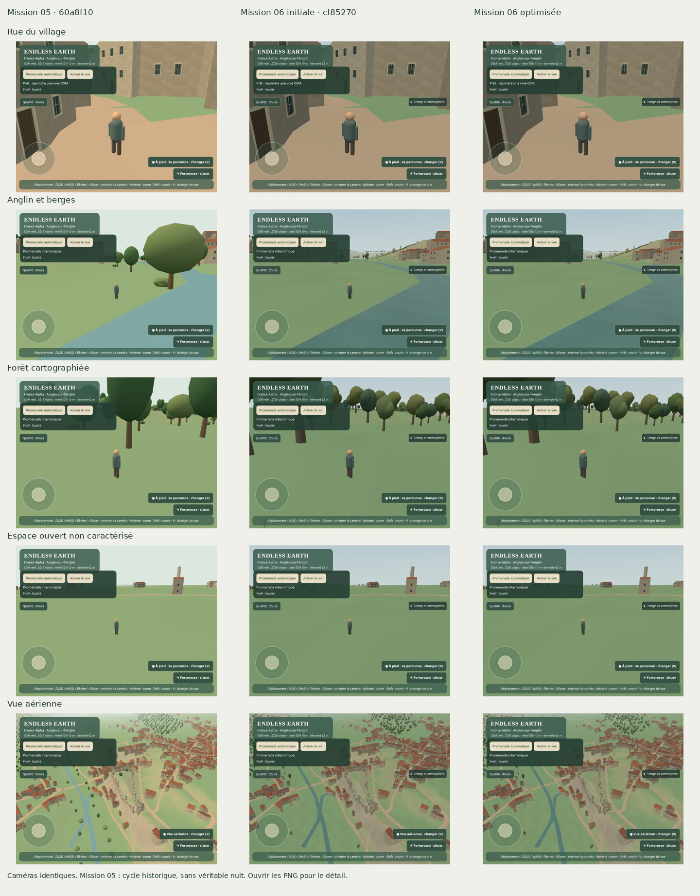
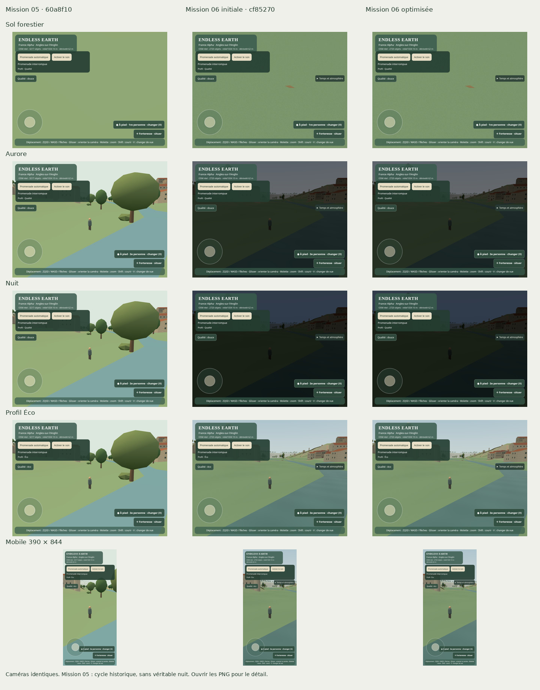

# Mission 06 — La nature extraordinaire

## Dernière optimisation avant fusion

Mission 06.1 sur la même branche et la même PR #10 ; aucune nouvelle PR, fusion ou publication de production. Références : Mission 05 `60a8f10`, Mission 06 initiale `cf85270`, code produit optimisé `71c6300`.

### Diagnostic et protocole

Les instantanés de FPS de la première livraison ne suffisaient pas à attribuer les régressions. Une première exploration a retiré séparément le sol enrichi, les arbres, le vent du feuillage, l’eau et les objets atmosphériques. Les résultats isolés variaient fortement ; ils n’ont pas servi à annoncer un gain de FPS. Le diagnostic du code montre aussi des couronnes soumises hors champ, du vent calculé sur les silhouettes lointaines, des échantillonnages de texture inutiles au loin et des recherches d’habitat/obstacles répétées pour chaque petit décor.

La comparaison répétée utilise trois serveurs issus des références ci-dessus, une seule instance Chromium active et le même jeu de stations de caméra. Résolution 800 × 600, puis 390 × 844 pour mobile, ratio 1, profils identiques, lumière/fog de mesure imposées aux trois versions, météo claire. Les dates de référence de matin/nuit sont explicites. Le dessin est figé pendant les échantillons ; les mises à jour CPU sont mesurées séparément. L’architecture et les détails sont amenés à convergence avant les mesures.

Trois passages indépendants, dans l’ordre **05 / initiale / optimisée**, puis **optimisée / 05 / initiale**, puis **initiale / optimisée / 05**. Chaque station comporte trois dessins de chauffe puis cinq échantillons par passage : quinze échantillons au total, sans assimiler les images corrélées à quinze expériences indépendantes. Le temps mesuré inclut `gl.finish` et la lecture RGBA de toute l’image ; cette copie impose la complétion du travail, mais ajoute un coût commun et ne représente pas directement les FPS du jeu. La simple soumission JavaScript est conservée séparément. Les médianes des trois passages et leur plage doivent être lues ensemble.

Chromium 156 / WebGL2 / ANGLE / SwiftShader, quota de deux CPU, affinité `0,1` identique pour tous les passages. Aucun périphérique GPU matériel n’est exposé dans ce conteneur ; aucune extrapolation à un GPU réel ou à Android. Les compteurs de limitation CPU du conteneur sont conservés avec chaque passage. Même avec ces précautions, la latence logicielle varie beaucoup.

### Corrections retenues

- Culling des lots instanciés d’arbres avec sphères calculées une fois et élargies de 50 cm pour le vent. Aucun arbre retiré des données. Les tests parcourent les sommets instanciés pour vérifier l’enveloppe.
- Couronne proche inchangée : trois volumes, **120 triangles**. Couronne lointaine partagée : mêmes trois volumes à **60 triangles**, sans animation de vent sous le pixel. La teinte saisonnière et les couleurs d’instance restent actives. Distances conservatrices à partir de la sphère de cellule, avec 40 m d’hystérésis ; aucune nouvelle matrice ni géométrie par arbre à chaque image.
- Texture du sol conservée ; l’échantillon du micrograin est évité quand sa contribution devient négligeable au loin. Le cube du terme de réflexion de l’eau remplace une puissance générique, et la normale caméra évite une normalisation constante. Pas de suppression des ondulations ou des détails proches.
- Le ciel est dessiné après les opaques, à profondeur lointaine, pour éviter de peindre inutilement sous le terrain et les maisons. Les matrices de nuages sont mises à jour à 10 Hz, le vent des feuilles reste continu. Couleurs constantes et formateur de date sont réutilisés.
- Habitats présélectionnés et listes locales d’obstacles mises en cache par zone, avec les mêmes prédicats et l’ordre original. Les détails sont préparés par tranches déterministes de **256 candidats par mise à jour**, puis leur buffer est construit une fois. Une préparation quittant le rayon est annulée ; le cache de quatre cellules invisibles reste borné. Les géométries et matériaux proches/lointains sont tous libérés au déchargement, même s’ils ne sont pas actifs.

La vérification sur les données OSM/IGN réelles compare les empreintes de calcul SHA-256 : **mêmes 1 650 arbres, mêmes positions, matrices, couleurs et géométries proches**, ainsi que les recettes de détail sur six cellules documentées. L’index spatial ne change donc pas les exclusions. Les tranches réassemblées donnent exactement la même recette que la génération complète. [Preuve d’équivalence](mission-06-1/ecology-equivalence.json).

### Comparaison mesurée

| Vue | Appels 05 / 06 / opt. | Triangles dessinés 05 / 06 / opt. | Buffers Mo 05 / 06 / opt. |
| --- | ---: | ---: | ---: |
| Rue | 150 / 141 / 113 | 399027 / 424837 / 293117 | 30.83 / 30.73 / 30.73 |
| Anglin | 125 / 116 / 93 | 300656 / 324936 / 231772 | 33.50 / 33.40 / 33.40 |
| Forêt | 81 / 70 / 35 | 253131 / 282993 / 174057 | 32.51 / 33.43 / 33.43 |
| Espace ouvert | 99 / 97 / 86 | 214651 / 228331 / 151511 | 31.34 / 31.24 / 31.24 |
| Aérienne | 309 / 303 / 284 | 349219 / 377603 / 296803 | 31.36 / 31.26 / 31.27 |
| Sol | 74 / 63 / 18 | 251931 / 281637 / 147757 | 31.53 / 32.12 / 32.12 |
| Aurore | 125 / 115 / 92 | 290842 / 315122 / 222858 | 32.53 / 33.12 / 33.13 |
| Nuit | 125 / 115 / 92 | 290842 / 315122 / 222858 | 32.53 / 33.12 / 33.13 |
| Éco | 125 / 116 / 93 | 288250 / 312722 / 215898 | 32.33 / 32.23 / 32.23 |
| Mobile | 92 / 82 / 47 | 268655 / 293127 / 171699 | 32.33 / 32.23 / 32.23 |

Temps de dessin synchronisé : médiane des trois médianes, puis [minimum–maximum des médianes de passage], en millisecondes. **La colonne de variation décrit ces échantillons, pas un gain statistique garanti.**

| Vue | Mission 05 ms | Mission 06 initiale ms | Optimisée ms | Opt. / initiale |
| --- | ---: | ---: | ---: | ---: |
| Rue | 1130 [1080–1470] | 1638 [1265–4559] | 1314 [1029–2719] | -19.8 % |
| Anglin | 658 [647–826] | 960 [794–2043] | 640 [639–706] | -33.4 % |
| Forêt | 439 [415–504] | 585 [579–714] | 720 [438–1140] | 23.2 % |
| Espace ouvert | 1326 [430–1488] | 490 [475–512] | 368 [345–568] | -24.9 % |
| Aérienne | 891 [804–3365] | 983 [946–1134] | 865 [837–1429] | -12.0 % |
| Sol | 245 [222–262] | 404 [352–470] | 231 [221–731] | -42.8 % |
| Aurore | 624 [610–681] | 796 [784–854] | 1536 [734–1544] | 93.1 % |
| Nuit | 651 [645–798] | 823 [797–928] | 641 [624–1004] | -22.1 % |
| Éco | 691 [684–3217] | 1853 [726–3109] | 803 [743–1355] | -56.7 % |
| Mobile | 403 [385–1645] | 962 [454–1183] | 469 [407–483] | -51.2 % |

| Mesure CPU | Mission 05 | Mission 06 initiale | Optimisée |
| --- | ---: | ---: | ---: |
| Soumission GL, médiane / P95 (ms) | 3.70 / 15.40 | 3.00 / 15.40 | 2.70 / 16.00 |
| Atmosphère, médiane / P95 (ms) | 0.00 / 0.20 | 0.10 / 0.90 | 0.00 / 0.20 |
| LOD au repos, médiane / P95 (ms) | 0.20 / 1.60 | 0.20 / 1.50 | 0.20 / 1.20 |
| Génération géographique entière, médiane [min–max] (ms), 9 échantillons | 1466 [934–7053] | 1759 [1421–3128] | 1517 [981–7460] |
| Nature seule, génération Node médiane (ms), 3 répétitions | — | 869 | 364 |
| Nature seule, pics des mises à jour froides Node (ms) | — | 1195 / 763 / 914 | 33 / 118 / 34 |

Les nombres de triangles sont identiques dans les trois répétitions de chaque version. Par rapport à la Mission 06 initiale : **−21 à −48 % de triangles soumis**, **−6 à −71 % d’appels selon la station** ; aucune baisse de densité des 1 650 arbres. Les buffers architecturaux sont strictement identiques dans les 90 stations comparées. Le total des buffers inclut ici géométries uniques et matrices/couleurs d’instances ; il exclut textures, programmes du pilote, tas JavaScript et tampon RGBA du harnais. La seconde couronne partagée ajoute **4 320 octets par zone** : on économise du travail de dessin, pas la mémoire en supprimant les arbres. Les index et préparations CPU sont possédés par la zone et détruits avec elle ; leur tas JS n’est pas chiffré par ces buffers.

Les médianes de dessin synchronisé s’améliorent dans huit stations sur dix face à l’initiale, mais **forêt (+23 %) et aurore (+93 %) restent défavorables dans ces trois passages**. Les plages se chevauchent fortement ; plusieurs valeurs isolées divergent d’un facteur supérieur à deux. Ce n’est pas une restauration uniforme de la fluidité Qualité et aucun gain de FPS matériel n’est établi. Les médianes de rue, forêt, aurore, Éco et mobile restent aussi au-dessus de celles de Mission 05 dans cette série. Les compteurs structurels et les gains CPU sont les conclusions les plus solides.

La génération Node de la nature seule baisse d’environ **58 % en médiane**. Les plus grands pics observés par répétition passent de 763–1 195 ms à 33–118 ms. Le coût LOD au repos reste petit et sans reconstruction ; les P95 du callback d’atmosphère et du LOD chaud diminuent. Les valeurs nulles des chronomètres navigateur signifient « sous la résolution de mesure », pas « calcul gratuit ». Ces callbacks et la soumission GL sont des composantes CPU par image, pas une mesure exhaustive du CPU de l’application : contrôles, DOM et audio ne sont pas inclus dans ce tableau. La génération géographique entière garde de gros écarts, y compris sur Mission 05 inchangée.

Les retraits appariés confirment que les textures de sol et les arbres peuvent peser sur le rendu logiciel ; leurs effets ne sont pas additifs et certains retraits deviennent plus lents, notamment en aérienne. Vent du feuillage et eau n’ont pas un coût isolé stable sur toutes les stations. Les formes proches et les ondulations sont donc conservées ; les calculs prouvés inutiles au loin ont été évités. Un contrôle ciblé de l’ordre du ciel ne donne pas davantage de résultat stable : à l’aurore, le retour à l’ordre historique mesure 714, 731 puis 3 169 ms, contre 897, 744 et 686 ms pour le nouvel ordre dans les mêmes paires. Aucun changement supplémentaire n’est retenu sur la seule base d’un échantillon favorable.

Données complètes : [résumé des trois versions](mission-06-1/summary.json), [CPU de nature isolé](mission-06-1/nature-cpu.json), [retraits appariés](mission-06-1/diagnostic-profile.json), [contrôle ciblé du ciel](mission-06-1/sky-check-profile.json). Les neuf fichiers `*-r1/r2/r3-profile.json` conservent les mesures brutes et les compteurs de limitation CPU.

### Comparaison artistique

Les dix stations ont été revues. Les façades et accès restent lisibles ; les couronnes et détails proches ne montrent pas d’appauvrissement évident dans ces échantillons. La simplification des facettes lointaines est intentionnelle. L’eau, le sol, l’aurore, la nuit, Éco et mobile sont conservés. Ce constat ne garantit pas l’absence de popping ou de scintillement sur tout le territoire.

[Planche 1 — rue, rivière, forêt, espace ouvert et aérienne](mission-06-1/planche-1.jpg) · [Planche 2 — sol, aurore, nuit, Éco et mobile](mission-06-1/planche-2.jpg) · [Galerie HTML avec accès aux PNG](mission-06-1/comparaison.html) (ouvrir localement ; GitHub affiche le code HTML).

Les deux premières colonnes reprennent les références versionnées de Mission 06. La Mission 05 ne possédait pas de véritable nuit : sa colonne aurore/nuit montre son cycle historique. Ces planches artistiques ne doivent pas être confondues avec le banc de mesure à éclairage contrôlé.

### Validation et limites restantes

**61 tests unitaires réussis**, dont enveloppes de culling, LOD proche/lointain hystérétique, préparation annulable, stabilité des buffers et destruction des ressources. `npm run build` réussi : **591,52 ko / 161,10 ko gzip** ; seul avertissement de taille Vite existant. `npm run test:browser`, `browser-camera.mjs`, `browser-safety.mjs` et `browser-living.mjs` réussis : déplacement et repos, trois vues, garde au sol, zoom/pincement, recentrage, rétraction devant mur, cinq obstacles ajoutés après départ, faune existante, audio avec bascules rapides et mobile. Aucun module de navigation, collision ou contrôleur de marche modifié.

Le smoke test attend maintenant plus de 5 cm de déplacement effectivement rendu, avec délai maximal de 60 s, au lieu de relâcher la touche après 1,4 s sous SwiftShader. Cette correction évite un test sans image de mouvement ; elle ne touche ni la vitesse ni le chronomètre du jeu. Les captures attendent aussi la fin des préparations de cellules avant de vérifier la convergence.

**Nouvelle promenade complète : 450,000 m en 1 168,6695 s, soit 19 min 28,67 s**, 1 480 images mesurées ; chronomètre externe 1 169,744 s, relevé moins fréquent 449,759 m. Arrêt « Fin du parcours OSM validé ». Architecture identique du départ à l’arrivée : 921 bâtiments, 10 723 ouvertures, 69 cellules, `builds: 1`. Résolution 640 × 480, Éco automatique, puis 390 × 844 à l’arrivée ; un seul navigateur actif, sans affinité forcée pour cette marche finale. Vitesse et delta plafonné existants inchangés. Moyenne logicielle d’environ **1,27 image/s**, sans interprétation matérielle.

Une première tentative partielle avec affinité forcée a été arrêtée pour contrôler le ciel ; elle ne compte pas comme promenade complète. La durée finale n’est pas déclarée comparable aux 18 min 56 s de Mission 06 : heure réelle de scène, charge du conteneur et historique de cache ne sont pas identiques. Le protocole strictement apparié est celui des rendus figés, pas celui de ces deux longues marches.

Preuves : [validation structurée](mission-06-1/validation.json), [mesure de marche](mission-06-1/promenade.json), [rue](mission-06-1/promenade-rue.png), [ouverture du paysage](mission-06-1/promenade-paysage.png), [arrivée mobile](mission-06-1/promenade-mobile.png). Plusieurs captures de parcours ont été inspectées ; elles ne constituent pas une exploration exhaustive.

Reproduction : servir trois checkouts aux ports 5174 (Mission 05), 5175 (initiale) et 5173 (optimisée), avec les dépendances verrouillées et des caches Vite distincts. `bash scripts/nature-benchmark.sh` reproduit les trois rotations sous Linux avec `taskset` ; l’affinité doit correspondre aux CPU autorisés du conteneur. `node scripts/nature-equivalence.mjs`, puis `taskset -c 0,1 node --expose-gc scripts/nature-cpu-profile.mjs` isolent le placement et les coûts CPU de nature. Les scripts exigent les références Git complètes. `CAPTURE_DIR=docs/mission-06-1 node scripts/browser-nature.mjs optimized`, puis `python3 scripts/nature-comparison.py` régénèrent les vues et planches ; Pillow est nécessaire uniquement pour la preuve graphique.

La construction architecturale différée de la Mission 05 n’a pas été modifiée : ses pics de cellule dense restent une limite existante. Les tranches de nature limitent le nombre de candidats traités, pas le temps total de chaque image ni celui de la création finale d’un buffer. Le tas JavaScript des index, les programmes internes du pilote et la mémoire GPU totale ne sont pas déduits des seuls buffers. Matériel GPU, Android physique et écoute humaine prolongée restent à valider. Les limites fonctionnelles de la météo, de la botanique et de la faune de la Mission 06 demeurent ; aucune fonctionnalité supplémentaire n’est introduite par cette passe.

---

Branche `mission/06-nature-extraordinaire`, base `60a8f104b92f317d84c4c0ff989d31ec6ad16ae2` (`origin/main`). Fusion de la Mission 05, PR #9, vérifiée par Git et par GitHub (`merged: true`) avant les changements. Livraison en une PR en brouillon, sans fusion ni déploiement. Aucun workflow, aucune dépendance ni donnée géographique source modifiés.

## Audit et direction artistique

Lecture de l’architecture, des rapports des Missions 03, 04 et 05, du terrain triangulé IGN, des couvertures et empreintes OSM, du graphe piéton, des collisions, de la caméra, des instances végétales, du LOD architectural différé et de l’audio sérialisé. La référence possède déjà une forêt instanciée, une végétation riveraine illustrative, des buissons, quatre oiseaux et des nuages regroupés. Les insuffisances observées sont les couronnes très similaires, les exclusions incomplètes des petits décors, les surfaces uniformes et le cycle lumineux restant dans une journée de démonstration.

L’intention est une nature plus différenciée et un paysage lisible, avec davantage de profondeur, sans cacher les maisons. Le résultat demeure stylisé : les captures ne constituent pas une restitution photoréaliste ni une observation botanique. Les deux forêts du corpus sont des couvertures OSM, dont certaines descriptions remontent à CORINE 2006. Aucune prairie n’est identifiée dans ce corpus : la vue nommée `prairie` dans les preuves montre un **espace ouvert non caractérisé**, sans prétendre en connaître l’usage.

## Systèmes et provenance

- `src/nature/ecology.mjs` : profil Poitou v1, règles et placement indépendants de Three.js. Échantillonnage déterministe, forêt, jeunes sujets, silhouettes riveraines plus élancées, quelques arbres isolés seulement dans une couverture compatible. Emprises, trous des polygones, eau, routes et chemins, murs et monuments, marges autour des bâtiments et pente maximale de 0,58 sont contrôlés. Relief manquant : pas de plantation. Les arbres cartographiés ne sont pas déplacés ; un conflit avec une exclusion les écarte. Ces règles restent une approximation à la résolution des données disponibles.
- `src/nature/render.ts` : troncs et branches regroupés dans une géométrie partagée, couronnes composées de trois volumes asymétriques, variation de dimensions, orientation et teintes. Deux lots instanciés par cellule d’arbres de 180 m. Pas de draw call par arbre. Les cellules de détail de 128 m sont indépendantes : feuilles, petites branches, pierres, herbes et formes de fougères sobres dans les bois ; fleurs très rares uniquement si un habitat ouvert compatible existe. Le pilote ne reçoit donc pas de tapis de fleurs inventé.
- `src/nature/surfaces.ts` : variations de sol dans le matériau existant, petite texture procédurale originale de 64 × 64 pixels, échantillonnée à deux échelles et orientations pour atténuer la répétition ; micrograin mipmappé et atténué avec la distance. Ondulations et variations de teinte de l’eau par shader, mélange léger suggérant le ciel aux angles rasants. Pas de réflexion de scène, de miroir parfait, de déplacement des cours d’eau ou d’altération de leur relief. Les trous OSM des surfaces d’eau sont conservés.
- `src/nature/climate.mjs` et `sky.ts` : position solaire approximative à partir de l’UTC, de la latitude, de la longitude et du jour de l’année ; affichage civil `Europe/Paris` avec heure d’été. Heure et date réelles par défaut. Mode **Démo ×72** du temps simulé (delta plafonné existant conservé), explicite et séparé, accessible dans « Temps et atmosphère ». Les paramètres `?time=demo` et `?weather=mist` servent à la démonstration. La date fixe utilisée par les captures est signalée comme référence.
- Clair, couvert, brume et régime pluvieux simulés ; interpolation exponentielle d’environ 45 s, sans événement automatique fréquent. Le régime pluvieux est une ambiance couverte, venteuse et sonore, **sans gouttes, ruissellement ou particules de pluie**. Cela évite une pluie traversant les toitures ; ce n’est pas une simulation complète de pluie. Pas de données météo réelles ni de revendication en ce sens. La brume conserve une portée suffisante pour les bâtiments proches.
- Vent partagé entre feuillage, plantes souples et ondulations d’eau. Le poids de flexion des détails au sol est explicite : une pierre ou une branche morte ne se met pas à osciller avec l’altitude du terrain. Les couleurs automnales et hivernales sont approximatives ; il n’y a pas encore de chute des feuilles ni de défoliation complète.
- Données génériques d’un petit passereau, comportement temporel et représentation distincts. Fenêtres de présence brèves, longues absences, début d’envol depuis la couronne et réaction à moins de 7 m du personnage. Les départs varient entre fenêtres temporelles déterministes. Ni orbite permanente autour du joueur, ni observation d’une espèce réellement recensée. Les silhouettes restent minimalistes.
- Audio : synthèse originale uniquement. Bruit filtré plus long et moins aigu, départs décalés du vent et de l’eau, distance aux **segments** de rivière plutôt qu’aux seuls sommets, appels beaucoup plus espacés et suspendus la nuit. Pas par surface, opt-in, deux sources d’ambiance et sérialisation `resume/suspend` conservés. Le bus maître reste le point d’intégration d’un futur ambient original. Pas de musique ni d’enregistrement externe ajouté ; aucune nouvelle licence d’asset.

## Passes artistiques et preuves

Les dix vues de référence ont été réalisées avant l’intégration. La première position de « bois » était hors forêt : elle et le gros plan du sol ont été repris sur une couverture réellement cartographiée, à `x=-430, z=340` mètres locaux. Les réglages, position du personnage, caméra et profil sont enregistrés dans les JSON. Ces positions sont des stations de caméra de diagnostic ; elles ne sont pas toutes des positions piétonnes autorisées. Le script de relevé fixe le mode de vue dans son instrumentation, sans modifier les contrôles ni les exclusions du produit. La marche réelle est validée séparément sur le trajet OSM.

1. **Passe 1**, fichiers `pass1-*` : implantation, ciel et lumière, premiers sols et eau. Inspection des vues de rue, rivière, forêt, sol et nuit. Corrections d’un nom GLSL réservé et d’un regroupement incompatible de géométries d’eau détectés pendant le travail, avant la livraison.
2. **Passe 2**, fichiers `after-*` : suppression d’une trame trop périodique au sol, éclairage plus doux des couronnes, végétation également guidée par les contours réels d’eau. Inspection des dix captures : présence excessive de triangles décoratifs dans le bois et hausse des appels de rendu encore trop forte.
3. **Passe finale**, fichiers `final-*` : cellules d’arbres regroupées à 180 m, branches simplifiées sans supprimer la silhouette, feuilles étroites, petites pierres en volume, fougères à folioles et détails drapés sur le relief. Les détails rigides cessent de bouger au vent. Correction du départ des oiseaux depuis leur perchoir.

| Vue | Position locale / réglage | Référence Mission 05 | Version finale |
| --- | --- | --- | --- |
| Rue | Départ sûr existant, troisième personne | [Avant](mission-06-captures/before-rue.png) | [Final](mission-06-captures/final-rue.png) |
| Anglin | -120, 245 ; yaw 0,9 ; recul 15 m | [Avant](mission-06-captures/before-riviere.png) | [Final](mission-06-captures/final-riviere.png) |
| Bois cartographié | -430, 340 ; yaw 1 ; recul 8 m | [Avant](mission-06-captures/before-bois.png) | [Final](mission-06-captures/final-bois.png) |
| Espace ouvert | 330, -400 ; yaw 1 ; recul 15 m | [Avant](mission-06-captures/before-prairie.png) | [Final](mission-06-captures/final-prairie.png) |
| Ensemble aérien | -100, 155 ; yaw 0,5 ; zoom 210 m | [Avant](mission-06-captures/before-aerienne.png) | [Final](mission-06-captures/final-aerienne.png) |
| Sol forestier | -430, 340 ; première personne, regard abaissé | [Avant](mission-06-captures/before-sol.png) | [Final](mission-06-captures/final-sol.png) |
| Aurore | Vue Anglin, 21 juin 2026, 04:00 UTC | [Ancien cycle](mission-06-captures/before-aurore.png) | [Soleil calculé](mission-06-captures/final-aurore.png) |
| Nuit | Vue Anglin, 21 juin 2026, 23:00 UTC | [Ancien cycle](mission-06-captures/before-nuit.png) | [Nuit](mission-06-captures/final-nuit.png) |
| Éco | Vue Anglin, midi UTC | [Avant](mission-06-captures/before-eco.png) | [Final](mission-06-captures/final-eco.png) |
| Mobile | 390 × 844, Éco | [Avant](mission-06-captures/before-mobile.png) | [Final](mission-06-captures/final-mobile.png) |

Sélection des passes intermédiaires conservée : [bois en passe 1](mission-06-captures/pass1-bois.png), [bois en passe 2](mission-06-captures/after-bois.png), [sol en passe 1](mission-06-captures/pass1-sol.png), [sol en passe 2](mission-06-captures/after-sol.png). Les autres captures intermédiaires restent du travail local ; aucun fichier vidéo ne rejoint le dépôt.

**Limite de comparaison lumineuse :** l’ancienne version ignore le paramètre de date et n’offre pas de véritable nuit. Les images `before-aurore` et `before-nuit` documentent son cycle existant ; elles ne sont pas présentées comme des captures nocturnes équivalentes. Les autres vues finales utilisent le 21 juin à midi UTC, à positions et réglages identiques, mais avec le nouveau calcul de lumière. Les animations continuent : il ne s’agit pas d’un test pixel à pixel figé.

4. **Passe d’optimisation supplémentaire** : une première tentative de promenade est interrompue après environ 15 m et 77 s sous SwiftShader, sans atteindre les 450 m. Elle signale un coût logiciel excessif, sans isoler une cause unique. Le bruit de sol calculé par fonctions trigonométriques dans chaque fragment est remplacé par la texture partagée de 16 384 octets hors mipmaps ; les nuages passent à une géométrie partagée plus simple. Le mélange de ciel dans l’eau utilise aussi l’angle à la normale. La marche complète est reprise à 640 × 480, sans changer le contrôleur, sa vitesse ni le calcul du temps. Le harnais autorise au maximum 30 minutes réelles sous SwiftShader au lieu de 11 ; il conserve les chronomètres `Date.now`/`performance.now`, la distance réelle à chaque image et l’exigence de terminer les 450 m. Le pincement CDP est recentré sur le canevas pour éviter le panneau de météo à cette résolution. Ces changements et la résolution différente empêchent d’attribuer isolément un éventuel gain de durée au shader.

## Coûts, mémoire et chargement

Les mesures ci-dessous concernent Chromium/ANGLE/SwiftShader, 800 × 600 puis 390 × 844, ratio 1. Elles ne sont pas extrapolées à un GPU matériel. Les appels et triangles dessinés couvrent la scène entière. `memory.bytes` additionne les attributs et index des **géométries uniques conservées**, y compris les objets masqués ; il exclut les matrices/couleurs d’instances, les textures, le tas JavaScript et la mémoire interne du pilote. `memory.triangles` compte les triangles des buffers uniques, sans expansion virtuelle des instances. `architectureMemory` conserve le compteur architectural de la Mission 05.

| Vue | Appels avant → final | Triangles dessinés | Triangles des buffers uniques | Buffers Mo | FPS logiciel approximatif |
| --- | ---: | ---: | ---: | ---: | ---: |
| rue | 150 → 141 | 399027 → 424837 | 422653 → 423159 | 30.48 → 30.49 | 0.70 → 0.57 |
| riviere | 126 → 115 | 300656 → 324936 | 456871 → 457377 | 33.14 → 33.16 | 1.83 → 1.26 |
| bois | 81 → 70 | 253131 → 282993 | 444161 → 453189 | 32.15 → 33.19 | 2.50 → 1.86 |
| prairie | 98 → 97 | 214651 → 228331 | 437491 → 437987 | 31.63 → 31.65 | 2.91 → 2.11 |
| aerienne | 310 → 304 | 349379 → 377795 | 454675 → 455171 | 32.97 → 32.99 | 1.55 → 1.08 |
| sol | 75 → 64 | 252511 → 282373 | 434381 → 443409 | 31.39 → 32.43 | 1.96 → 1.49 |
| aurore | 125 → 115 | 290842 → 315122 | 443235 → 452263 | 32.08 → 33.12 | 0.79 → 1.54 |
| nuit | 125 → 115 | 290842 → 315122 | 443235 → 452263 | 32.08 → 33.12 | 1.43 → 1.49 |
| eco | 125 → 115 | 288250 → 312722 | 413435 → 413931 | 29.76 → 29.77 | 1.14 → 1.32 |
| mobile | 92 → 82 | 268655 → 293127 | 413435 → 413931 | 29.76 → 29.77 | 0.96 → 1.05 |

Les buffers architecturaux sont **strictement identiques dans les dix paires** : 27,62 Mo dans la rue, par exemple. Les appels diminuent de 1 à 11 selon la vue ; les triangles dessinés augmentent d’environ **6 à 12 %**. Les arbres passent de 2147 à 1650 : la variété vient des formes et proportions, pas d’une multiplication des individus. Le détail forestier ajoute environ **1,04 Mo** dans les vues bois/sol ; les vues de rue ne prennent qu’environ **18 ko de buffers géométriques** supplémentaires. La texture commune de 16 ko hors mipmaps ajoute un quatrième objet texture au rendu, sans être incluse dans ces Mo.

**Régression observée en Qualité :** plusieurs échantillons logiciels sont plus lents d’environ 19 à 31 %, malgré les appels réduits. Les vues Éco et mobile ne montrent pas de baisse dans cette paire, mais ces mesures uniques ne prouvent aucun gain reproductible de FPS. Elles incluent la convergence et la charge variable de SwiftShader, sans réplication statistique. La préférence est donnée à une densité mesurée et au profil Éco pendant la marche ; le surcoût Qualité reste une limite à profiler sur GPU. Les images aurore/nuit ne sont pas des comparaisons d’éclairage équivalent.

Trois générations synchrones sur les mêmes données, dans le même navigateur : référence **1 483,9 / 1 311,7 / 1 131,5 ms**, final **1 529,5 / 1 242,5 / 1 019,9 ms** ; médianes **1 311,7 → 1 242,5 ms**. L’ordre référence puis final, la compilation et les caches empêchent de présenter les −5,3 % comme un gain statistique établi. Les 921 bâtiments et leur coque restent identiques ; la nature finale compte **42 cellules d’arbres et 168 cellules éligibles de détail**. Le chargement réel initial de cette session à 640 × 480 prend **16,118 s** jusqu’au monde prêt et aux commandes activées, réseau local et compilation compris ; aucune mesure initiale comparable de bout en bout n’est disponible.

L’instrumentation du callback atmosphérique relève **28 échantillons CPU**, médiane **0,20 ms**, maximum **32,70 ms**, avec un coût de démarrage. Cela exclut le dessin, les shaders GPU, le LOD et l’audio : ce n’est ni une borne ni le coût total d’une image. Au repos, cette scène compte une cellule de détail végétal résidente/visible et une construction ; les tests séparés couvrent l’éviction lors des déplacements. Les pics d’approche architecturaux/végétaux ne font pas l’objet d’un percentile exhaustif dans cette mission.

Relevés : [comparaison structurée](mission-06-captures/comparison.json), [génération, horloge, météo et mise à jour](mission-06-captures/generation-climate.json).

Chaque capture attend au moins 20 images rendues, puis huit images consécutives stables pour les positions caméra arrondies au millimètre, les constructions architecturales et la taille des buffers conservés. Un défaut de convergence après 100 images fait échouer le scénario ; les objets permanents ne sont pas régénérés pour la photographie.

Le détail végétal est construit au plus une cellule par mise à jour LOD (4 Hz), seulement à proximité : rayon du centre de cellule 110 m en Qualité, 55 m en Éco, hystérésis de 18 m. Quatre cellules invisibles au maximum sont gardées ; les autres libèrent géométrie et matériau. Les tests vérifient la stabilité au repos et l’éviction. Ce budget en cellules **ne garantit pas un plafond de millisecondes** lors de la première approche. Les arbres ont leurs propres distances hystérétiques. L’architecture différée de la Mission 05 et son cache ne sont pas reconstruits par le vivant.

Le bruit audio de 17 s est partagé entre les deux ambiances et les pas : environ 3,26 Mo à 48 kHz en mono float32, contre 0,58 Mo pour les 3 s précédentes, alloués uniquement à l’activation volontaire. Ce coût audio n’est pas inclus dans les buffers géométriques du tableau.

Le déchargement d’une zone libère chaque géométrie unique et matériau possédé une fois, puis les recettes ; le coordinateur retire ses ancrages de faune/audio. Les matériaux partagés de route/eau et d’architecture sont conservés pour les autres zones. Le pilote normal reste chargé en un seul groupe géographique : ces mécanismes préparent le déchargement, sans démontrer une exploration nationale en streaming. Le chargement initial des arbres et de la coque architecturale reste synchrone.

## Vérifications et reproduction

- Référence : `npm test` **49/49** et `npm run build` réussis avant intégration. Version finale : **58/58** et compilation réussie, bundle de **589,32 ko / 160,41 ko gzip**, contre environ 578,24 / 155,82 ko ; avertissement Vite de taille déjà présent.
- Nouveaux tests : déterminisme, exclusions des routes/bâtiments/eaux, marge des cours intérieures, relief absent et pentes, clairières, habitat, cycle solaire, transition météorologique, longues absences animales, stabilité des buffers au repos, cache végétal borné et destruction unique des ressources par zone.
- `browser-camera.mjs` : réussi ; zoom, glissement, délai de recentrage, rétraction devant un mur et trois modes. `browser-safety.mjs` : réussi ; cinq obstacles injectés après départ (bâtiment, accès privé, eau, mur, ruine), chaque position échantillonnée autorisée. Ces deux contrôles précèdent la dernière optimisation de texture/nuages ; aucun module de caméra, collision ou navigation n’a ensuite changé.
- `browser-living.mjs` : réussi ; marche, trois vues, reprise manuelle, mobile, absence d’erreur JavaScript/HTTP, six cycles et douze bascules rapides, un contexte audio et deux sources d’ambiance. Une attente initiale fixe de 6 s ne garantissait pas 50 cm de déplacement sous SwiftShader ; le test attend maintenant ce déplacement réellement observé, avec une limite de 90 s. Il ne change ni la vitesse ni le temps de simulation.

**Promenade complète : 450,000 m cumulés à chaque image, en 1 136,269 s (18 min 56,27 s), 1 462 images rendues.** Le chronomètre externe donne 1 137,549 s ; le relevé moins fréquent donne 449,946 m et sous-estime légèrement les angles. Arrêt normal « Fin du parcours OSM validé ». Graphe : 939 sommets / 918 segments. Le trajet calculé de 3 787,53 m trouvé par l’heuristique reste une possibilité calculée, pas une marche effectivement réalisée.

Le scénario est exécuté seul en navigateur, à 640 × 480 et profil Éco automatique, puis 390 × 844 à l’arrivée. La vitesse, l’accélération, les virages et le plafonnement existant du delta à 250 ms restent inchangés. Moyenne approximative : **1,29 image/s sous SwiftShader**, sans signification de FPS matériel. La Mission 05 rapportait 383 s sur un autre passage logiciel : **la nouvelle marche est beaucoup plus longue en temps réel**, mais ce chiffre historique ne permet pas d’isoler le changement de code dans cet environnement. Les relevés stationnaires avant/après sur le même environnement servent de comparaison graphique séparée.

Les statistiques architecturales initiales sont strictement conservées à l’arrivée : 921 bâtiments, 10 723 ouvertures, 69 cellules, `builds: 1`. Les constructions différées et évictions de détails à l’approche restent prévues. Inspection de plusieurs étapes en rue et à l’ouverture du paysage : aucune traversée ou obstruction nouvelle évidente dans ces échantillons. Preuves : [mesure complète](mission-06-captures/promenade.json), [rue](mission-06-captures/promenade-rue.png), [paysage](mission-06-captures/promenade-paysage.png), [arrivée mobile](mission-06-captures/promenade-arrivee-mobile.png).

`npm run test:browser` a été relancé après la dernière optimisation graphique : **réussi**, avec déplacement, trois modes, garde au sol, audio, profil et mobile, sans erreur JavaScript. `browser-nature.mjs` : **dix paires validées**, positions et modes identiques, caméra à moins de 2,5 cm, aucune erreur console de shader ou JavaScript. `browser-nature-metrics.mjs` : **réussi**, horloge réelle vérifiée contre l’UTC actuel, mode Démo séparé et transition météo progressive observée. Chromium **156.0.8078.79**, ANGLE/Vulkan/SwiftShader Subzero. [Résumé de validation](mission-06-captures/validation.json).

Démarrer `npm run dev`, puis `node scripts/browser-nature.mjs final` pour les dix vues. La téléportation des vues est injectée **uniquement dans le module servi au navigateur de test** ; aucune commande de téléportation n’est exposée dans le produit. Après détection de la conservation involontaire du mode première personne sur certaines stations de caméra, le script vérifie le mode et la position caméra à 2,5 cm près contre la référence. La séquence de référence complète est reprise sur un checkout isolé de `60a8f10` pour comparer aussi le même historique de cache.

Les JSON [référence](mission-06-captures/before.json), [passe 1](mission-06-captures/pass1.json), [passe 2](mission-06-captures/after.json) et [final](mission-06-captures/final.json) conservent les états.

`node scripts/browser-nature-metrics.mjs` prépare automatiquement un module de mesure de la référence `60a8f10` dans `work/`, mesure trois générations par version sur les mêmes données et teste l’horloge et la météo. La référence utilise les modules d’architecture inchangés et le compilateur de feuillage courant ; ses mesures de génération CPU n’évaluent pas l’ancien shader à l’écran. Le module temporaire est exclu du dépôt. Pour refaire entièrement les images « avant », servir le commit de référence avec le script de capture de cette mission ; ne pas écraser les images avant avec le serveur courant.

## État des objectifs encore partiels

| Objectif | État livré et limite |
| --- | --- |
| Végétation régionale | Silhouettes, règles, exclusions et forêt enrichies ; essences précises, sols pédologiques et exposition non renseignés. |
| Sols et microdétails | Texture originale et détails forestiers ; pas de mousses spécialisées ni de végétation murale supplémentaire. |
| Eau et atmosphère | Ondulations légères, ciel nuancé, soleil réel et brume ; pas de reflets de scène ni de reconstruction des berges. |
| Météo | Régimes progressifs sélectionnables ; pluie visuelle, abris, neige et données météo réelles reportés. |
| Faune et sons | Présences rares, perchoirs et synthèse originale ; insectes, sons nocturnes spécialisés et écoute longue non validés. |
| Performances et territoires | Instances, détails différés et destruction par zone ; GPU matériel, Android et streaming national non validés. |

## Limites, reports et Mission 07

Les proportions, essences et implantations individuelles restent inférées. Le DEM de 10 m ne décrit pas un seuil, une berge détaillée ou chaque talus. Les marges sont conservatrices et peuvent écarter un arbre pourtant présent sur le terrain. Les zones sans couverture ne reçoivent pas une flore inventée pour embellir une capture. Le monde reste visiblement stylisé ; les grands espaces ouverts et certaines berges restent sobres. L’interface historique occupe encore une part importante des captures mobiles.

Sont reportés : botanique précise par espèce, exposition solaire et pédologie des sols, buissons et mousses spécialisés au pied des murs, défoliation saisonnière, insectes et papillons, sons nocturnes spécialisés, pluie avec abris et ruissellement, neige, reflets de scène, météo réelle, musique originale et génération asynchrone nationale. Ces choix évitent une accumulation de simulations superficielles ou de nouvelles dépendances. La simple coloration saisonnière ne constitue pas un cycle biologique complet.

Écoute humaine de vingt minutes sur casque, Android physique, GPU matériel et exploration exhaustive de la carte non réalisés. Les captures et scénarios échantillonnés ne prouvent pas l’absence de défaut partout. Les gains de compteurs et les impressions artistiques doivent rester distincts.

Pour la Mission 07 : prioriser une mesure sur téléphone réel, un budget de génération en temps plutôt qu’en cellules, un couvert du sol plus récent et détaillé, puis des assets régionaux originaux plus fins pour quelques lieux observés. Poursuivre les relevés d’approche et les écoutes longues avant d’accroître la densité. Aucune de ces évolutions n’est développée ici.
