# Mission 07.2 — Les routes du monde réel

## Audit préalable (avant modification)

Base : `cb7325239f836defefc08ef0d5c4f12c6aeab7d9`, dernier `origin/main` vérifié après fusion de la PR #12. Branche : `mission/07-2-routes-matieres`. Captures des missions 07 et 07.1 examinées : aérienne et rue rasante. Les intersections sont continues ; les surfaces semblent peintes, sans profondeur de matière, et les bords restent tranchants.

Le sol et les routes partagent 25 maillages et un MeshLambertMaterial. Les six classes ont des couleurs fixes, stockées dans le dérivé géométrique. Le même atlas de bruit 64², sans anisotropie explicite, donne à toutes les classes une variation presque identique. Le grain répète à 0,59 m ; le pavage shader est une grille régulière 32 × 20 cm, très peu contrastée. Les motifs sont déjà exprimés en mètres, mais l'échelle et l'amplitude du bruit n'évoquent aucun granulat particulier. Le détail disparaît entre 8 et 65 m : au loin, il ne reste que la silhouette et la couleur uniforme.

Il n'y a ni normale de matière ni réponse de rugosité : Lambert est entièrement diffus. L'ajout de spéculaire permanent serait incorrect pour des routes sèches. Une refonte PBR générale n'est pas justifiée ; évaluer un petit relief de normale, filtré, sur ce modèle diffus existant. L'éclairage, la météo et l'atmosphère restent ceux du moteur. Les profils partagent le shader terrain ; Éco réduit résolution/ombres et change les rayons LOD, sans matière spécifique.

La coupure `earthRoadType` exclut la chaussée de la carte d'occupation du sol. Aucune information de distance au bord ne vient adoucir cette séparation. Les grandes faces ne permettent pas une simple interpolation de couleur d'accotement sans risques de triangles visibles : évaluer un champ de distance compact hors ligne, indépendant du maillage.

## Sources et fidélité

Le fichier OSM déjà livré (extraction du 8 novembre 2026, ODbL) contient 138 voies : 30 `asphalt`, 2 `concrete`, 8 `sett`, 1 `unhewn_cobblestone`, 10 `unpaved`, 3 `grass`, 1 `compacted`, 1 `dirt`, 2 `gravel`, 1 `ground` et **79 sans surface**. Ce sont des tags contributifs, pas une inspection physique récente. `concrete` reste groupé avec les surfaces scellées du système existant ; `unpaved` et `grass` sont des sols non scellés interprétés, pas des relevés de terre nue.

Exemples documentés : Rue de la Cueille (203459882), Place Aimé Octobre (239209736) et Rue de l'Arceau : `sett` ; sentier 1421393085 : `gravel`, largeur 2 m ; piste 657662319 : `dirt`. La voie gravillonnée 1149746205 est privée et ne doit pas devenir une destination de promenade. Aucun inconnu ne sera converti en pavé. Aucune nouvelle orthophoto ni photographie locale vérifiée n'a été obtenue ; palette, pierres, grain et patine sont des interprétations procédurales originales. IGN et OSM, coordonnées, hauteurs, largeurs et accès ne sont pas modifiés.

## Réalisation et validation

Trois passes de matériaux et de transitions, seize comparaisons reproductibles, séquences multi-images et validation fonctionnelle sont décrites ci-dessous. Les mesures logicielles sont distinguées des résultats sur GPU matériel non vérifiés.

## Matériaux et coût retenu

Le modèle Lambert existant reste diffus : pas de reflet permanent, pas de nouvelle passe PBR ou de pipeline d'éclairage. Un relief de normale dérivé de la hauteur filtrée évoque une surface sèche : amplitude interprétée de 1,8 mm pour l'asphalte, 6 mm pour les pavés et le gravier, 3 mm pour les sols. Il ne déplace aucun sommet et ne participe pas aux collisions. Les inconnus urbains ont un relief deux fois plus faible, sans joints.

L'atlas original est généré de façon déterministe au démarrage : quatre régions de 256² texels, séparées par des marges périodiques de 16 pixels (image totale 576² RGBA8). Canaux : ton minéral, hauteur, variation de pierre, opaque. L'asphalte répète à 2 m mais se combine à une seconde échelle tournée de facteur 3,71 ; les autres classes utilisent 4 m. Les pavés font environ 20 × 24–31 cm, avec déphasage et nombre de pierres différents selon les rangs, joints légèrement déformés et patine modérée. Le gravier combine cellules de 2–8 cm et matrice fine ; la terre combine plusieurs fréquences, sans ornières ni fissures inventées.

Les UV viennent des coordonnées locales métriques, jamais d'un numéro de sommet. Les dérivées des UV sont prises avant `fract` avec `textureGrad` pour ne pas produire de sauts de mipmap à chaque répétition. Mipmaps trilinéaires, filtre linéaire et anisotropie plafonnée à 8 selon le renderer. La variation de grande échelle reprend le bruit du terrain voisin. Le microdétail et son relief s'effacent progressivement entre 12 et 75 m selon la distance réelle à la caméra ; la couleur, les nuances lentes et l'intégration des bords subsistent.

Coût supplémentaire : deux lectures d'atlas près du joueur, une lecture du champ de distance pour l'intégration. Le grain naturel ancien n'est plus échantillonné sur la route. Les normales utilisent les dérivées de la hauteur déjà lue, sans troisième lecture de matière et sans trigonométrie par fragment. Au loin, les lectures de microdétail sont supprimées. Aucun appel de rendu ou triangle ajouté.

L'atlas coûte environ 1,77 Mo avec mipmaps ; le champ R8 2048², environ 5,59 Mo. Cette carte géographique supplémentaire est justifiée par la continuité des accotements aux carrefours, indépendamment de la tessellation. Elle représente une interprétation douce sur des emprises souvent estimées, pas un relevé de bordure. Un dérivé absent, corrompu ou périmé désactive seulement cette finition : chaussées unifiées, grain et navigation restent utilisables. Le terrain n'est jamais remplacé par des rectangles superposés.

## Passes artistiques

1. Atlas de grain et relief diffus, palette différenciée, premier champ de distance aux frontières externes. Captures `pass1-*.png`. La vue de gravier initiale regardait hors de l'axe du chemin ; le cadrage retenu a été corrigé puis repris à l'identique avant et après.
2. Revue des gros plans et de l'aérien : pierres trop grandes, fins traits parasites aux limites de l'atlas, accotements trop peu visibles. Réduction du module des pavés, joints plus doux, ajout de marges périodiques et atténuation du relief. Les images de la première passe sont conservées comme trace de ces corrections.
3. **Passe finale des accotements** : remplacement du champ de distance absolue par une distance signée. L'interpolation d'une distance absolue en V arrondissait les minima aux bords obliques ; la version signée conserve bien mieux les frontières sous le pixel. L'effet minéral agit désormais légèrement sur les deux régions incidentes, dans le shader du même sol : environ 0,65 m côté voie scellée, 1,10 m côté chemin et 0,80 m côté terrain, avec une atténuation variable. Ce sont des nuances, pas des trottoirs ni des bandes géométriques ajoutées. Les variantes `pass2-*` et la promenade de passe 2 restent conservées ; les `after-*` et séquences `motion-after-*` sont repris avec cette version finale.

## Comparaisons visuelles

Seize stations avant/après : base 07.1 `cb73252` servie indépendamment sur 5175 et travail 07.2 sur 5173. **Mêmes coordonnées, caméra, orientation, hauteur d'œil, date du 21 juin 2026 à 12:00 UTC, viewport et profil pour chaque paire.** Les stations exactes, états et mesures sont dans [before.json](mission-07-2-captures/before.json) et [after.json](mission-07-2-captures/after.json). Le très gros plan utilise un œil à 45 cm ; les vues de marche utilisent 1,65 m. Les stations pavées proviennent de Place Aimé Octobre ; le gravier du sentier OSM 1421393085. Le chemin de terre correspond à la piste `dirt` 657662319. Ces stations de test n'ajoutent aucune API de téléportation au produit.

| Vue | Planche |
|---|---|
| Rue étroite / maisons | [Village](mission-07-2-captures/compare-village.jpg) |
| Rue principale (Rue de Tournon, asphalte) | [Principale](mission-07-2-captures/compare-principale.jpg) |
| Carrefour | [Carrefour](mission-07-2-captures/compare-carrefour.jpg) |
| Trois voies | [Trois voies](mission-07-2-captures/compare-trois-voies.jpg) |
| Rue en pente | [Pente](mission-07-2-captures/compare-pente.jpg) |
| Chemin rural non renseigné | [Rural](mission-07-2-captures/compare-rural.jpg) |
| Pavés documentés | [Pavés](mission-07-2-captures/compare-paves.jpg) |
| Gravier documenté | [Gravier](mission-07-2-captures/compare-gravier.jpg) |
| Terre documentée | [Terre](mission-07-2-captures/compare-terre.jpg) |
| Sol très proche | [Gros plan](mission-07-2-captures/compare-gros-plan.jpg) |
| Rue à angle rasant | [Rasante](mission-07-2-captures/compare-rasante.jpg) |
| Aérienne du centre | [Aérienne](mission-07-2-captures/compare-aerienne.jpg) |
| Aérienne éloignée | [Lointaine](mission-07-2-captures/compare-lointaine.jpg) |
| Raccord de tuile | [Raccord](mission-07-2-captures/compare-raccord.jpg) |
| Éco | [Éco](mission-07-2-captures/compare-eco.jpg) |
| Mobile 390 × 844 | [Mobile](mission-07-2-captures/compare-mobile.jpg) |

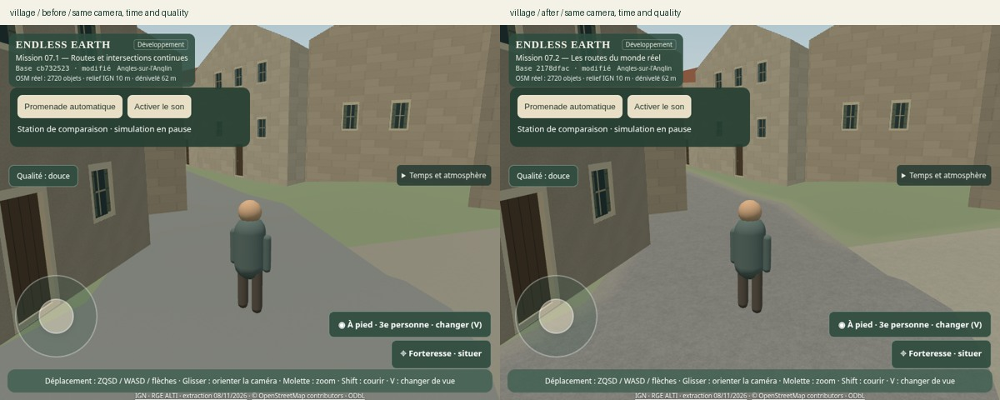
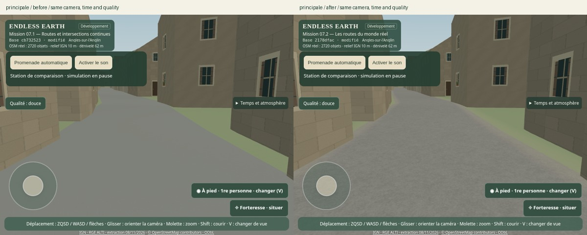
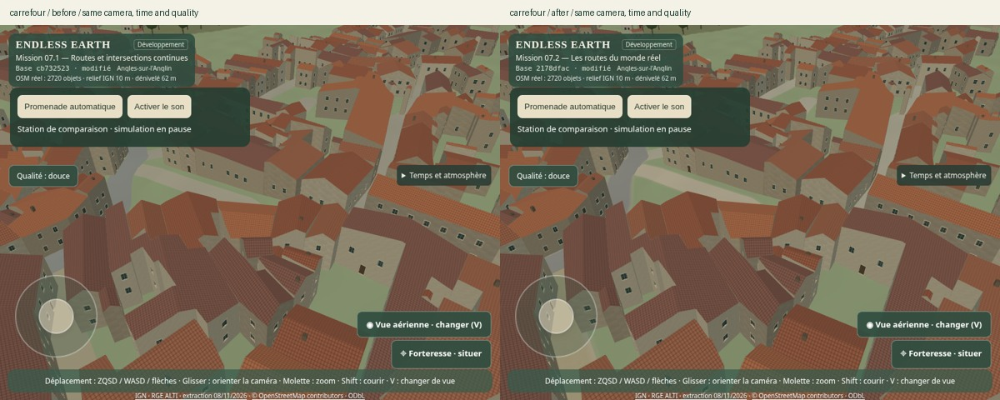
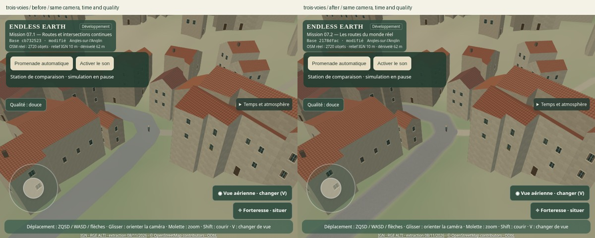
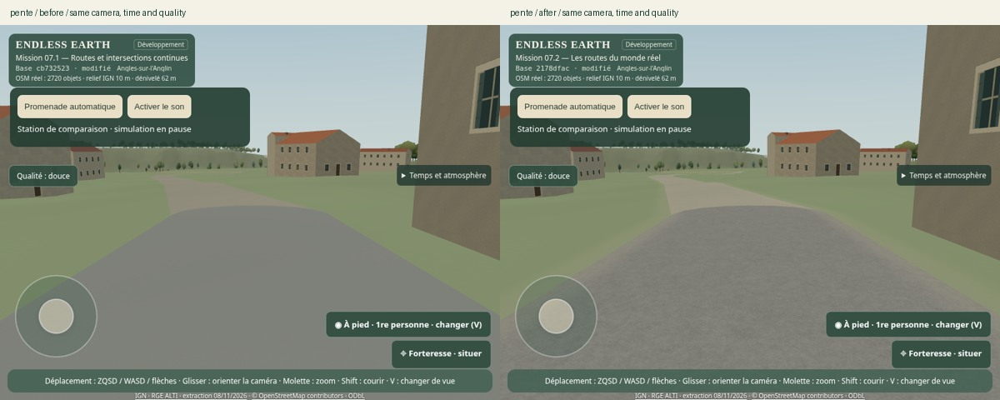
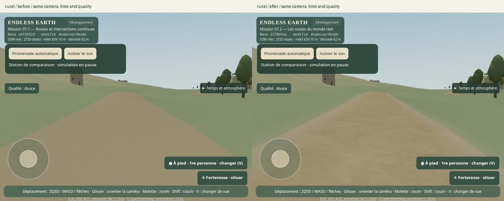
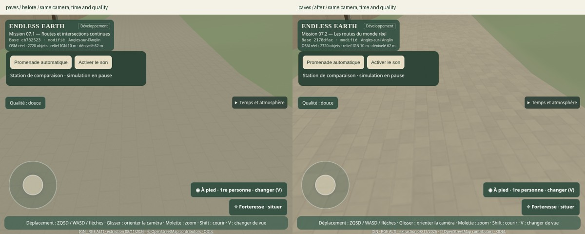
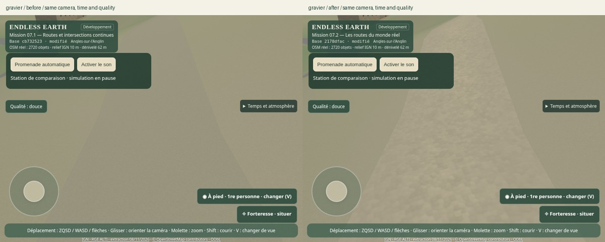
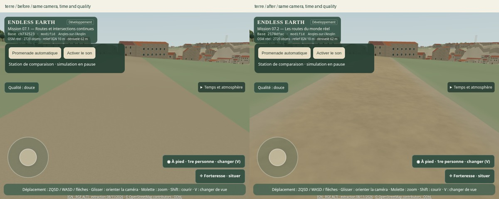
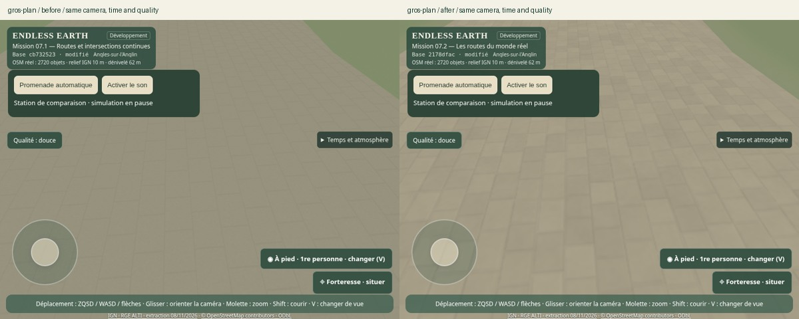
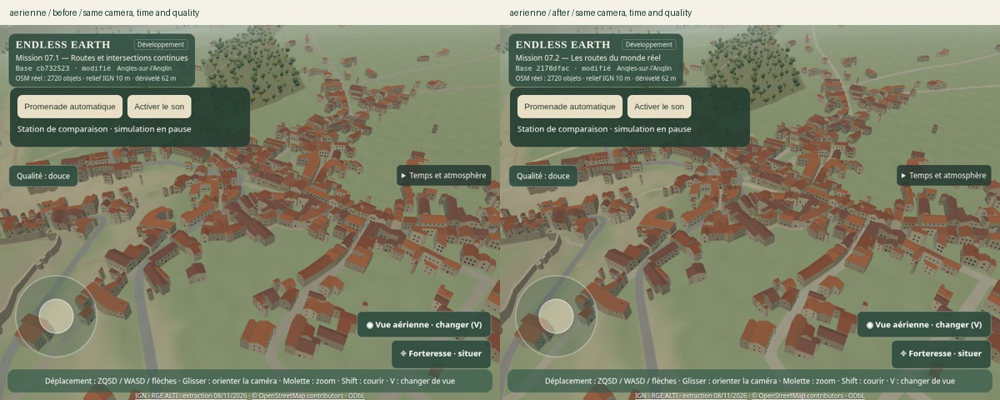
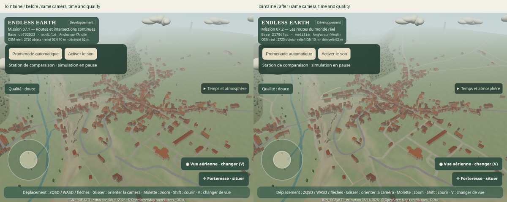
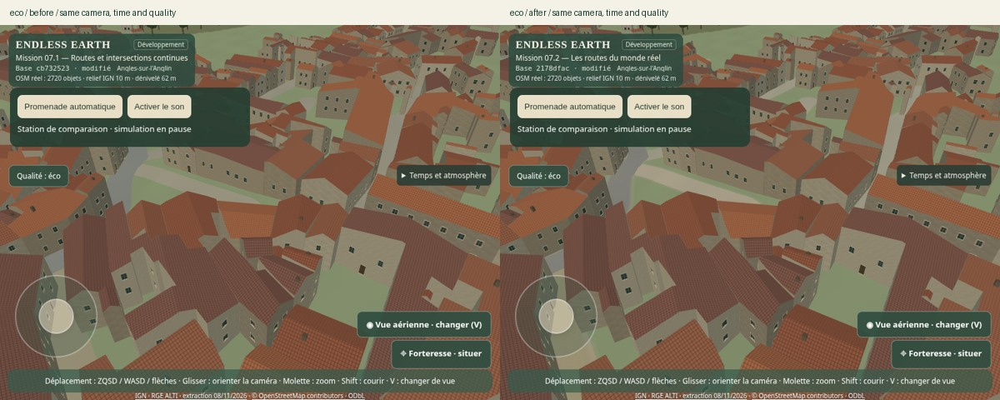
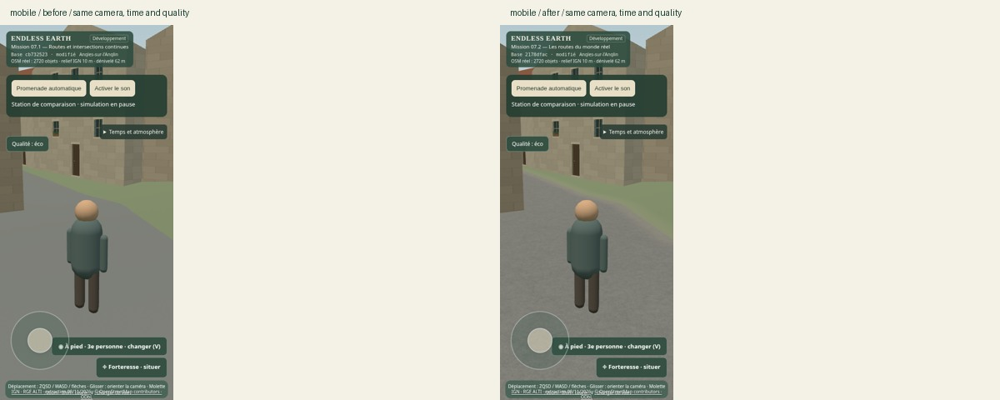

### Lumière

En plus du midi commun aux comparaisons : captures finales à 04:30 UTC (aurore et contre-jour dans la rue principale), 19:30 UTC (crépuscule, rue rasante), et ciel couvert stabilisé par 120 secondes de simulation déterministe. L'orientation et la matière restent celles du jeu, sans éclairage de studio ajouté. Les fichiers `dawn-after.json`, `dusk-after.json` et `overcast-after.json` conservent les paramètres et les erreurs collectées.

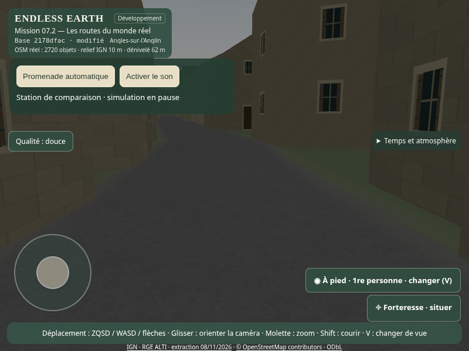
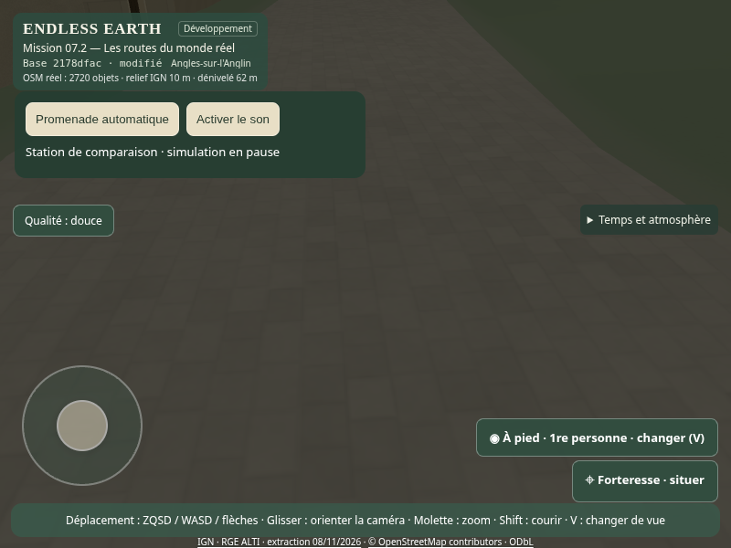
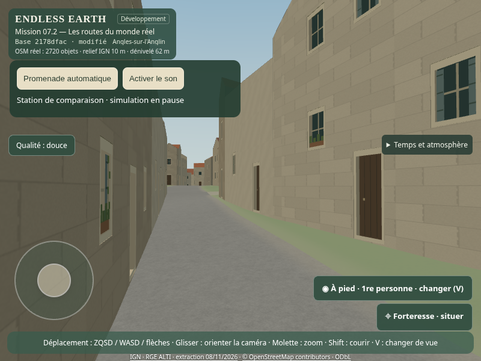

## Stabilité en mouvement

Huit trajectoires, six rendus successifs chacune, **avant et après** : fixe, translation lente de 12 cm/image, rapide de 1,8 m/image, rotation, aérienne mobile, zoom, parcours aérien franchissant les rayons LOD et pavés en gros plan. Les originaux PNG, les animations WebP, les planches et les SHA-256 des pixels WebGL sont conservés. L'atmosphère est immobilisée pour isoler les surfaces ; la promenade utilise séparément la boucle normale du jeu.

La caméra fixe doit donner six hashes identiques ; les sept autres doivent produire des images réellement différentes. Ce contrôle ne remplace pas l'examen visuel : les séquences ont aussi été examinées, notamment les joints, frontières et intersections pendant les rotations et le recul. Pas de retour des plans concurrents, de popping des faces routières ou de moiré excessif constaté dans les trajectoires retenues. Le filtrage raster reste visible sur les détails sous le pixel ; une absence universelle de scintillement sur tout GPU n'est pas démontrée par ces essais logiciels.

| Trajectoire | Avant | Après |
|---|---|---|
| Lente | [Animation](mission-07-2-captures/motion-before-lent.webp) | [Animation](mission-07-2-captures/motion-after-lent.webp) |
| Rapide | [Animation](mission-07-2-captures/motion-before-rapide.webp) | [Animation](mission-07-2-captures/motion-after-rapide.webp) |
| Rotation rasante | [Planche](mission-07-2-captures/sequence-before-rotation.jpg) | [Planche](mission-07-2-captures/sequence-after-rotation.jpg) |
| Aérienne mobile | [Planche](mission-07-2-captures/sequence-before-aerienne.jpg) | [Planche](mission-07-2-captures/sequence-after-aerienne.jpg) |
| Zoom | [Planche](mission-07-2-captures/sequence-before-zoom.jpg) | [Planche](mission-07-2-captures/sequence-after-zoom.jpg) |
| LOD | [Planche](mission-07-2-captures/sequence-before-lod.jpg) | [Planche](mission-07-2-captures/sequence-after-lod.jpg) |
| Pavés proches | [Animation](mission-07-2-captures/motion-before-paves.webp) | [Animation](mission-07-2-captures/motion-after-paves.webp) |

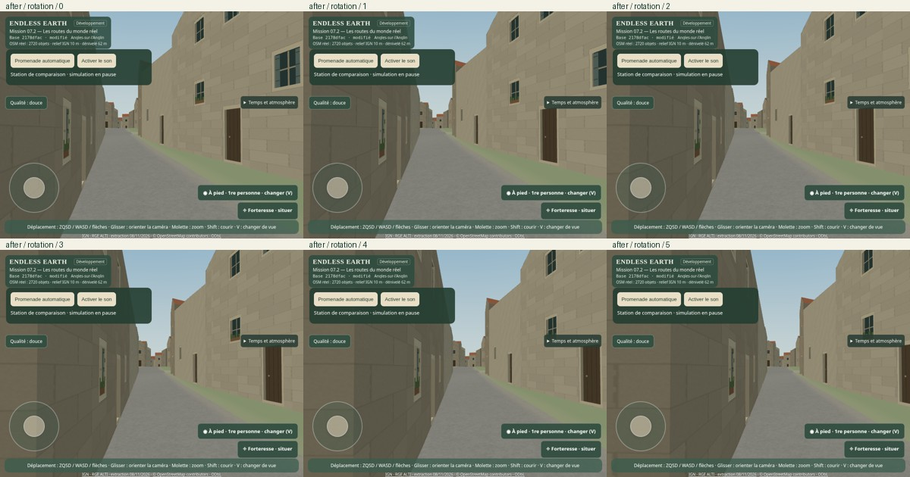
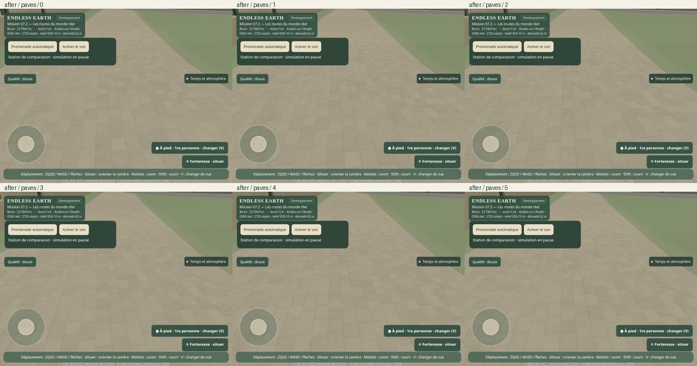

## Tests et invariants

**94 tests Node réussis**, compilation TypeScript/Vite réussie. Les nouveaux tests couvrent la détermination de l'atlas, ses statistiques distinctes, les marges périodiques, les UV métriques indépendants du maillage, l'absence de fausse bordure au centre d'un carrefour, la distance signée sous le pixel, les scanlines hors emprise, les empreintes des sources et du champ livré, les options du shader et la véritable identité 07.2 compilée.

Les tests géométriques 07.1 restent exécutés : partition unique, intersections, non-recouvrement des triangles, normales et hauteurs communes, mêmes faces routières aux deux LOD, intégrité des buffers et coordonnées. [Empreintes comparées à la base](mission-07-2-captures/invariants.json) : `angles-surface.json`, `angles-surface.pack`, `angles-osm.geojson`, `angles-terrain.json` sont identiques octet pour octet. Le champ d'accotement est régénéré à l'identique dans un répertoire temporaire : [preuve](mission-07-2-captures/edge-determinism.json).

Tests navigateur exécutés : chargement, déplacement manuel, garde au sol, immobilité, trois caméras, zoom molette/pincement, retour caméra et collision caméra contre un mur, audio activé/désactivé sans multiplication des contextes/boucles, reprise manuelle, mobile et Qualité/Éco. Le test de sécurité introduit cinq obstacles pendant une promenade (bâtiment, accès privé, eau, mur, ruine) : toutes les positions échantillonnées restent légales. Le test du bundle production vérifie mission, vrai commit, état modifié/propre et quatre formats d'écran.

Dix scénarios de données : nominal ; ancien manifeste absent, ancien LOD corrompu, ancienne source périmée ; surface unifiée absente/corrompue/périmée ; champ d'accotement absent/corrompu/périmé. Dans ces trois derniers cas, les routes unifiées restent visibles et la finition de bord est omise. Aucune erreur JavaScript dans les essais de données ; aucune erreur JavaScript/WebGL dans les captures et séquences finales. [Résultats](mission-07-2-captures/data-validation.json).

## Limites de fidélité et priorités

- La palette, le grain, l'usure, l'agencement des pierres et les nuances d'accotement sont des **interprétations originales**. Les tags OSM donnent une catégorie, pas la teinte ou la pose exacte. Aucune orthophoto ni photo locale supplémentaire n'a été vérifiée.
- Les 1 567 segments à largeur estimée sur 1 580 restent estimés. Le champ de distance suit cette union ; il n'ajoute aucune précision cadastrale. Sa résolution de 0,977 m et sa quantification à environ 2,35 cm sur ±3 m limitent la précision des coins et des chemins très étroits. Les frontières de matériau exactes restent celles de la partition géométrique, pas celles de la carte de finition.
- La catégorie héritée « asphalte » regroupe encore deux voies `concrete`, et « terre » plusieurs types non scellés. Il faut conserver ces différences de provenance plutôt que présenter toutes ces interprétations comme vérifiées sur place.
- Les normales simulées ne créent pas de relief géométrique ; Lambert ne fournit ni BRDF complète ni reflet de rugosité PBR. Ce choix garde une réponse sèche et sobre dans le moteur existant. Le relief IGN à 10 m, les façades et l'occupation du sol environnante limitent toujours la fidélité globale à hauteur humaine.
- La mémoire supplémentaire des textures est réelle. Les profils Qualité/Éco et le viewport mobile ont été testés dans Chromium logiciel ; **aucune performance GPU matériel ni validation physique Android n'est revendiquée**.

Priorités suivantes : confronter la palette à des photographies locales avec licence et provenance claires ; valider le filtrage et le budget des textures sur Android/GPU physique ; mieux distinguer les voies béton et les sols non scellés si les données le permettent ; améliorer l'occupation du sol des abords bâtis avec des sources réelles. Aucune bordure, signalisation, ornière ou réparation historique ne devrait être ajoutée sans preuve ou sans identification explicite comme interprétation.

## Reproduction

```sh
npm ci
npm run geo:road-materials        # champ signé déterministe, aucun réseau
npm test
npm run build
npm run dev                     # port 5173
npm run test:road-materials
node scripts/browser-road-material-motion.mjs after
node scripts/browser-road-material-data.mjs
node scripts/browser-road-material-walk.mjs
npm run test:browser
node scripts/browser-safety.mjs
node scripts/browser-living.mjs
node scripts/browser-camera.mjs
CAPTURE_DIR=work/architecture-07-2 npm run test:architecture
CAPTURE_DIR=work/nature-07-2 node scripts/browser-nature.mjs final
npm run test:build-identity
python scripts/road-material-contact-sheets.py
node scripts/validate-road-material-evidence.mjs
# Une fois les autres navigateurs arrêtés, avec la base sur 5175 :
node scripts/benchmark-road-materials.mjs
node scripts/report-road-material-metrics.mjs
```

Pour l'avant, servir `cb73252` sur 5175 dans un checkout séparé, puis exécuter les scripts `browser-road-materials.mjs before` et `browser-road-material-motion.mjs before` depuis le checkout d'outillage. `CAPTURE_LABEL`, `TEST_VIEWS`, `TEST_DATE`, `TEST_WEATHER`, `TEST_TERRAIN_ONLY` et `TEST_PORT` permettent de rejouer les prises et mesures. Le test d'architecture conserve ses assertions de construction unique ; avec un répertoire de sortie explicite, il ne compare pas les anciennes caméras de Mission 05 au relief courant. Les 16 paires 07.1/07.2 constituent la comparaison géographique de cette mission.

L'identité du build provient du rapport déclaré dans `package.json` : **ENDLESS EARTH — Mission 07.2 : Les routes du monde réel**, commit Git réel et état du build. Les captures de travail portent honnêtement leur commit de base et le statut « modifié » ; le contrôle du bundle production vérifie les métadonnées réellement compilées. Aucune fusion, aucun déploiement, aucun changement direct de `main`.

### Promenade et fonctions conservées

Deux parcours complets ont été exécutés, dont un nouveau avec les matériaux et le champ signé finaux : **450,000 m en 394,38 s**, 2 216 images de déplacement, arrêt normal « Fin du parcours OSM validé ». La première passe complète avait pris 408,23 s sous d'autres charges concurrentes ; cette différence n'est pas attribuée à un gain de shader. Le graphe conserve 939 nœuds et 918 arêtes ; le relevé trouve un parcours admissible de 3 787,53 m avant la limite volontaire de 450 m. Les 921 bâtiments et leurs statistiques restent identiques du départ à l'arrivée, avec `builds: 1`.

La trace finale couvre 2 283 images du démarrage jusqu'à la fin, relevé du graphe et contrôles caméra compris ; elle n'est pas plafonnée. Les autres tests navigateur ont tourné pendant une partie du parcours : les pics sont conservés et signalés, sans les transformer en résultat matériel. [Trace finale](mission-07-2-captures/walk.json), [parcours et graphe](mission-07-2-captures/walk-survey.json), [première promenade complète](mission-07-2-captures/walk-pass2.json).

Les tests de conservation de l'architecture et de la nature ont aussi été exécutés sur six et dix vues respectivement, avec des répertoires de sortie séparés pour préserver les preuves historiques : [architecture](mission-07-2-captures/architecture-validation.json), [nature](mission-07-2-captures/nature-validation.json). Les trois caméras, le mobile, les profils Qualité/Éco, le son et les variations de lumière/météo gardent leurs contrôles existants.

## Performances mesurées

Chromium 156 / WebGL2, ANGLE **SwiftShader logiciel**, pas de périphérique `/dev/dri`. Les captures artistiques ont parfois partagé les CPU avec d'autres tests ; leurs temps ne servent pas au bilan de performance. Le protocole final alterne trois paires de navigateurs isolés avant/après, 15 images mesurées par station et par essai (45 échantillons par version/vue), avec fin GPU et lecture des pixels. Ce temps est celui du rendu logiciel synchronisé de la scène, **pas** un temps GPU matériel. La soumission CPU est chronométrée séparément. [Synthèse et distributions](mission-07-2-captures/metrics.json), fichiers bruts `bench-before-1..3.json` et `bench-after-1..3.json`.

| Station | Appels avant → après | Triangles avant → après | Buffers géométriques avant → après | Rendu logiciel médian avant → après | Soumission CPU médiane avant → après |
|---|---:|---:|---:|---:|---:|
| Village, Qualité | 120 → 120 | 247 134 → 247 134 | 31,01 → 31,01 Mo | 166,4 → 200,0 ms | 1,2 → 1,4 ms |
| Aérienne, Qualité | 151 → 151 | 262 503 → 262 503 | 33,54 → 33,54 Mo | 191,7 → 212,9 ms | 1,2 → 1,2 ms |
| Carrefour, Éco | 79 → 79 | 231 313 → 231 313 | 33,54 → 33,54 Mo | 166,7 → 184,0 ms | 1,0 → 1,0 ms |
| Mobile, Éco | 87 → 87 | 183 560 → 183 560 | 33,54 → 33,54 Mo | 104,7 → 127,1 ms | 1,0 → 1,0 ms |

Le surcoût logiciel médian de la scène est donc **environ 10 à 21 %** selon la vue : la finition n'est pas gratuite. Les p95 logiciels avant/après sont respectivement 190,5/236,2 ms, 205,0/247,3 ms, 181,2/199,4 ms et 123,2/152,0 ms. Aucun gain uniforme de FPS ni 60 FPS n'est revendiqué. La réponse d'un GPU matériel à ces lectures de texture et dérivées reste non mesurée.

Les textures terrain et routes comptabilisées passent de 5,33 à **12,70 Mo estimés avec mipmaps**, soit +7,36 Mo : 1,77 Mo pour l'atlas et 5,59 Mo pour le champ R8. Le compteur du renderer passe de cinq à sept textures. Ce sont les tailles théoriques des ressources connues, pas toute la mémoire du pilote. Le champ ajoute **352 937 octets compressés** au transfert ; l'atlas est original, généré sur CPU (36–99 ms sur les cinq échantillons Node enregistrés, sans coût par image). Le champ est préparé hors navigateur : environ 0,92 s sur la génération finale, 1,55 s lors de la vérification reproductible sous charge.

Chargement local jusqu'à disponibilité : médianes de trois essais 3,808 s → 3,900 s. Construction CPU des objets terrain : médiane 0,9 ms → 0,9 ms sur neuf échantillons par version, hors téléchargement et hors génération initiale de l'atlas. Mise à jour combinée des LOD : médiane proche de 0,1 ms aux quatre stations ; cette résolution ne démontre pas un gain. Les données brutes conservent aussi les p95 et maxima.

La promenade finale donne une médiane CPU avant soumission de **2,4 ms**, p95 **6,5 ms**, maximum **31,7 ms** ; soumission médiane 0,9 ms, p95 4,5 ms, maximum 578 ms. L'intervalle entre images a une médiane de 150,8 ms, un p95 de 410,6 ms et un maximum de 5 162,5 ms. Ces distributions couvrent aussi le démarrage, le relevé bloquant du graphe et les contrôles caméra, et une partie du parcours partageait les CPU avec les tests d'architecture/nature. Elles montrent les pics réels de cette trace logicielle ; elles ne les attribuent pas tous au déplacement ou au nouveau shader.

### Proxy du coût des matériaux

Une mesure complémentaire conserve seulement les maillages de la partition terrain/chaussée et les lumières, avec 15 lectures synchronisées par vue. Le contrôle impose 25 lots au maximum et moins de 117 319 triangles : les groupes parents ne sont pas masqués à la place du terrain et les mises à jour LOD ne peuvent pas réactiver les bâtiments entre le filtrage et le rendu. Cette mesure inclut le shader du sol complet, son occupation du sol et la finition des bords ; ce n’est ni un timer GPU matériel ni une isolation des seuls pixels routiers.

| Vue | Lots / triangles identiques | Logiciel médian avant → après |
|---|---:|---:|
| village | 9 / 43375 | 33,6 → 84,7 ms |
| aerienne | 13 / 63734 | 62,0 → 85,8 ms |
| eco | 8 / 38929 | 32,7 → 60,6 ms |
| mobile | 7 / 35769 | 19,9 → 61,3 ms |

Un essai supplémentaire a limité l'anisotropie de la seule carte d'accotement à 1 (l'atlas restant à 8). Les médianes logicielles obtenues, 204,2 ms en village et 129,6 ms en mobile, n'ont pas montré de gain par rapport aux mesures finales 200,0/127,1 ms. Ce réglage n'a donc pas été retenu ; les données de l'essai restent dans `filter-trial.json`, et le code livré est celui des captures, séquences et promenade finales. Une optimisation plus poussée devra s'appuyer sur un profil GPU matériel, avec une comparaison visuelle des bordures.
