# Mission 07.3 — Optimisation des matières routières

## Audit préalable

PR #13 vérifiée ouverte, en brouillon et non fusionnée : poursuite sur `mission/07-2-routes-matieres`, sans réécriture d'historique ni nouvelle PR. Référence technique 07.1 : `cb73252`. Référence artistique 07.2 figée : `72006e0`. Les deux références sont servies dans des worktrees séparés ; `main` reste inchangé.

Le complément reçu dans le fil confirme les comparaisons à trois versions, séquences en mouvement, promenade intégrale, non-régression et mise à jour de la PR #13. L’identité du build suit le titre explicite demandé ci-dessus.

Le coût ne peut pas être déduit du nombre de triangles : un seul shader traite le terrain naturel et la chaussée. Le champ signé est lu sur tous les fragments du sol ; la normale de détail est recalculée sur toutes les routes, même lorsque la hauteur filtrée ne contribue plus. L'atlas utilise seulement R (ton) et G (hauteur), mais transfère RGBA. La seconde lecture d'atlas influence seulement la couleur. Le produit de couleur du terrain est calculé avant d’être substitué par celui des routes ; le compilateur peut déjà éliminer ce calcul, tandis que les deux lectures de bruit restent utiles à la variation de grande échelle. Ces constats motivent des expériences, pas encore des conclusions de performance.

## Protocole avant modification

Les images et temps 07.2 historiques ne sont pas réutilisés comme mesures fraîches. Reproduire les caméras, profils, midi du 21 juin, résolution et lectures synchronisées ; alterner les versions et répéter les passages. Conserver séparément temps CPU de soumission, durée synchronisée, mémoire et préparation. SwiftShader est le seul renderer actuellement observé ; aucune performance GPU matériel n'est revendiquée.

Ablations testées sur le module servi du worktree **07.2 figé**, sans toucher au produit : suppression de normale, de seconde lecture, de microdétail complet, du champ signé, remplacement de textureGrad par des dérivées implicites, anisotropie 1, champ seulement sur chaussée et suppression du mélange côté sol. Ces variantes volontairement incomplètes servent uniquement au diagnostic. Les effets de compilateur et interactions empêchent de sommer leurs gains comme des coûts indépendants.

Les mesures terrain seul masquent les autres objets après les mises à jour LOD. Deux mesures supplémentaires filtrent temporairement les indices d'origine pour ne dessiner que les pixels routiers ou naturels, sans déplacer les positions. Ces masques de test n'entrent pas dans le produit.

Résultats, choix et limites sont détaillés ci-dessous, après mesures répétées et revue des images.

## Optimisations retenues

- **Atlas RG8 576²** : seuls le ton et la hauteur sont utiles. Les deux octets conservés sont comparés à chacun des texels R/G de l'ancien RGBA8, sans rééchantillonnage, changement de module ou de géométrie des pierres. Les marges périodiques et les UV métriques restent identiques. Mémoire estimée avec mipmaps : 1,77 → 0,885 Mo.
- **Une seule lecture de matière** près du joueur. La variation indépendante du motif principal réutilise les canaux R des deux lectures de bruit mondial déjà nécessaires au terrain. Elle ne fait pas appel à une nouvelle texture ni à un hash trigonométrique par fragment. Sa faible amplitude conserve la palette, le grain et les joints, tout en évitant la seconde lecture anisotrope d'atlas. Les variations ne répètent pas au même pas que le motif minéral.
- **Normales limitées au détail actif** : le microrelief conserve sa hauteur et son enveloppe progressive 12–75 m. Lorsque cette enveloppe est déjà nulle, la reconstruction de normale par dérivées n'est plus appelée. Aucun palier visible ni nouveau changement de couleur au LOD.
- **Filtrage du grain plafonné à 4**, sans dépasser la capacité du device ; celui du champ d'accotement reste plafonné à 8 comme en 07.2. Le gros plan pavé et la vue rasante ont conservé un relief et des joints lisibles. Les deux profils gardent la même matière, avec leurs résolutions et enveloppes de détail existantes ; Éco ne devient pas une matière plate.

Aucun matériau, texture, draw call, sommet ou triangle ajouté au produit. Les six fichiers de source, géométrie et accotement (`angles-osm`, `angles-terrain`, manifeste/pack `angles-surface`, manifeste/pack `angles-road-edge`) sont identiques à `72006e0`. La chaussée reste dans la partition unique ; collisions, largeurs, positions, classes OSM et altitudes ne sont pas modifiées.

## Alternatives testées et rejetées

Les 9 ablations initiales utilisent trois passages dans des ordres différents. Leur tableau brut est dans [profile-summary.json](mission-07-3-captures/profile-summary.json), avec les JSON par vue et essai. Retirer tous les détails ou toutes les normales économise du temps, mais ne constitue pas une optimisation acceptable des matières. Les gains d'ablation ne sont pas des contributions GPU additives : l'élimination de code par le compilateur change aussi le shader.

- **Champ 1024 et 1536** : vraies cartes signées régénérées depuis les mêmes emprises, puis rendues avec le même shader. La réduction de mémoire ne s'accompagne pas d'un gain logiciel général ; le 1024 élargit et simplifie certains raccords étroits. Le champ 2048 d'origine est retenu intégralement, avec ses transitions et son filtrage connus. Les images `edge-1024-*` / `edge-1536-*` et les matrices `candidate-*` restent consultables.
- **Support compact par sommet** : prototype d'un octet normalisé, construit hors ligne par requête conservatrice sur le champ signé, avec une marge de 4 m. Toutes les faces proches reçoivent trois sommets actifs, dans les deux LOD, sans interpoler une fausse distance ni modifier les indices. Il a été testé sur les vrais maillages et sur des triangles dont les seuls sommets manqueraient la bande. Coût : 81 495 octets géométriques ; mémoire de finition à 4,03 Mo avec le champ 1536. Son branchement et son varying n'apportent pas de gain global fiable dans SwiftShader ; il est **retiré du produit**, ainsi que son attribut et ses métadonnées. Le générateur expérimental, les tests de couverture et le pack `prototype-support-1536` sont conservés pour reproduire l'étude.
- **Dérivées implicites à la place de textureGrad** : mesures parfois plus rapides, mais elles font dépendre le calcul des mipmaps du `fract` et des raccords de quadrant. Les dérivées explicites des UV non repliés sont conservées, ainsi que les marges qui avaient corrigé les traits d'atlas.
- **Anisotropie 1 ou 2** : le profilage montre un coût réel du filtrage, mais diminuer davantage ne fournit pas un meilleur compromis sur toutes les vues. Le plafond 4 est retenu après examen des pavés et de la rue rasante ; le champ signé garde 8. Aucune revendication de gain matériel ne découle de ces variantes.
- **Suppression du mélange côté sol ou du champ sur le terrain naturel** : économies faibles et perte de la fonction d'intégration recherchée en 07.2. Ces variantes restent des contrôles de coût, pas des options cachées du jeu.

Les variantes 073 du masque et du champ réduit ont été mesurées sur le prototype intermédiaire `996e32c` et ses ajustements de test ; elles ne sont pas confondues avec le produit final. Le script `prepare-road-finish-prototype.mjs` permet de régénérer le support expérimental. La commande normale `geo:road-materials` garde le champ original 2048.

## Mesures finales des trois versions

Chromium 156 / WebGL2, ANGLE SwiftShader logiciel, sans périphérique GPU matériel observé. Les trois versions ont été mesurées séquentiellement, après arrêt des autres tests navigateur, dans les ordres 071/072/073, 073/072/071 et 072/071/073. Quinze échantillons synchronisés par station et passage, soit 45 par version/vue. Les temps ci-dessous comprennent la fin GL et la lecture des pixels ; la soumission CPU est chronométrée séparément. Ce ne sont ni des timer queries GPU matérielles ni des FPS Android.

| Vue | 07.1 | 07.2 | 07.3 | Écart 07.3/07.2 | Résiduel 07.3/07.1 |
|---|---:|---:|---:|---:|---:|
| village | 164,3 ms | 206,9 ms | 186,2 ms | -10,0 % | 13,3 % |
| aerienne | 182,1 ms | 210,1 ms | 213,6 ms | 1,7 % | 17,3 % |
| eco | 161,2 ms | 185,8 ms | 184,5 ms | -0,7 % | 14,5 % |
| mobile | 102,2 ms | 128,6 ms | 121,5 ms | -5,5 % | 18,9 % |

Le gain est net dans le village (environ 10 %) et plus modeste en mobile (5,5 %). L'Éco est presque neutre et l'aérien ne montre pas de gain net dans cette série. **L'objectif de retrouver partout les temps de 07.1 n'est pas atteint.** Les séries d'expérimentation variaient avec l'ordre et le passage ; le rapport ne choisit pas la meilleure valeur de chaque expérience comme résultat final. Les distributions p95/max et les médianes individuelles des trois passages sont conservées dans [metrics.json](mission-07-3-captures/metrics.json), avec les bruts `final-bench-*-1..3.json`.

| Vue | Appels identiques | Triangles identiques | Géométrie identique | CPU soumission médiane 07.1 / 07.2 / 07.3 |
|---|---:|---:|---:|---:|
| village | 120 | 247 134 | 31,01 Mo | 1,3 / 1,2 / 1,3 ms |
| aerienne | 151 | 262 503 | 33,54 Mo | 1,3 / 1,2 / 1,2 ms |
| eco | 79 | 231 313 | 33,54 Mo | 1,0 / 1,0 / 1,0 ms |
| mobile | 87 | 183 560 | 33,54 Mo | 1,0 / 1,0 / 1,0 ms |

Les textures terrain/routes comptabilisées, mipmaps comprises, passent de 5,33 Mo (07.1) à 12,70 Mo (07.2), puis **11,81 Mo (07.3)**. La finition routière passe de 7,36 à **6,48 Mo**, soit environ 12 % de moins ; l'atlas seul est divisé par deux. Le champ signé reste à 5,59 Mo, sept textures restent résidentes comme en 07.2. Ce sont des tailles logiques estimées des ressources identifiées, pas l'allocation physique complète du pilote. Le transfert du champ reste exactement 352 937 octets compressés ; l'atlas est généré localement.

| Préparation | 07.1 | 07.2 | 07.3 |
|---|---:|---:|---:|
| Chargement local médian (3 passages) | 3,664 s | 3,819 s | 3,786 s |
| Construction des objets terrain, médiane (9 échantillons) | 0,9 ms | 0,9 ms | 0,9 ms |

La construction des objets ne comprend pas le téléchargement ni la génération initiale d'atlas. Les mises à jour combinées terrain/nature/architecture LOD sont mesurées à chaque station ; leur médiane reste proche de la granularité de 0,1 ms de l'horloge. Les p95 et maxima restent dans le JSON.

### Isolation du sol et des pixels routiers

Le terrain seul est gardé avec ses lumières, puis ses indices d'origine sont filtrés pour les deux sous-ensembles, routier et naturel. Ce sont des masques de test, absents du produit. Les nouvelles mesures permettent de séparer leur couverture ; leurs temps ne s'additionnent pas au temps de la scène, car le remplissage des pixels et la visibilité changent.

| Vue | Terrain seul 07.1 / 07.2 / 07.3 | Routes seules 07.1 / 07.2 / 07.3 | Sol naturel seul 07.1 / 07.2 / 07.3 |
|---|---:|---:|---:|
| village | 33,5 / 79,4 / 60,9 ms | 14,2 / 45,2 / 30,6 ms | 19,5 / 28,4 / 26,5 ms |
| aerienne | 63,9 / 84,0 / 84,9 ms | 10,5 / 13,6 / 12,1 ms | 50,3 / 73,0 / 68,6 ms |
| eco | 30,7 / 57,4 / 55,6 ms | 9,8 / 15,4 / 13,6 ms | 25,4 / 34,3 / 31,9 ms |
| mobile | 22,4 / 55,5 / 34,3 ms | 11,7 / 33,9 / 20,1 ms | 14,7 / 16,7 / 16,4 ms |

Le coût supplémentaire du sol naturel confirme que les opérations communes au shader comptent même hors chaussée. Le masque compact a tenté de réduire cette couverture, mais son surcoût propre ne justifie pas sa conservation dans les mesures disponibles. Un profil GPU matériel demeure nécessaire avant une autre architecture de shader ou un format compressé : le meilleur choix SwiftShader n'est pas automatiquement le meilleur choix mobile.

## Comparaisons artistiques et stabilité

Les 16 stations sont rejouées sur **07.1 `cb73252`**, **07.2 `72006e0`** et **07.3 finale**, depuis trois serveurs séparés. Midi du 21 juin 2026 UTC, mêmes positions, orientations, caméra, hauteur d'œil, profil, éclairage et dimensions PNG vérifiées. Les cartes, géométrie et hauteurs identiques sont contrôlées par leurs SHA-256. Les captures de travail affichent un vrai commit de base et l'état « modifié » ; l'identité propre du bundle est vérifiée séparément à la livraison.

| Station | Planche à trois versions |
|---|---|
| Rue étroite / maisons | [Village](mission-07-3-captures/compare-village.jpg) |
| Rue principale | [Principale](mission-07-3-captures/compare-principale.jpg) |
| Carrefour | [Carrefour](mission-07-3-captures/compare-carrefour.jpg) |
| Intersection à trois voies | [Trois voies](mission-07-3-captures/compare-trois-voies.jpg) |
| Pente | [Pente](mission-07-3-captures/compare-pente.jpg) |
| Pavés documentés | [Pavés](mission-07-3-captures/compare-paves.jpg) |
| Gravier documenté | [Gravier](mission-07-3-captures/compare-gravier.jpg) |
| Terre documentée | [Terre](mission-07-3-captures/compare-terre.jpg) |
| Chemin rural non renseigné | [Rural](mission-07-3-captures/compare-rural.jpg) |
| Sol très proche | [Gros plan](mission-07-3-captures/compare-gros-plan.jpg) |
| Angle rasant | [Rasante](mission-07-3-captures/compare-rasante.jpg) |
| Aérienne du centre | [Aérienne](mission-07-3-captures/compare-aerienne.jpg) |
| Aérienne éloignée | [Lointaine](mission-07-3-captures/compare-lointaine.jpg) |
| Raccord entre tuiles | [Raccord](mission-07-3-captures/compare-raccord.jpg) |
| Profil Éco | [Éco](mission-07-3-captures/compare-eco.jpg) |
| Mobile 390 × 844 | [Mobile](mission-07-3-captures/compare-mobile.jpg) |

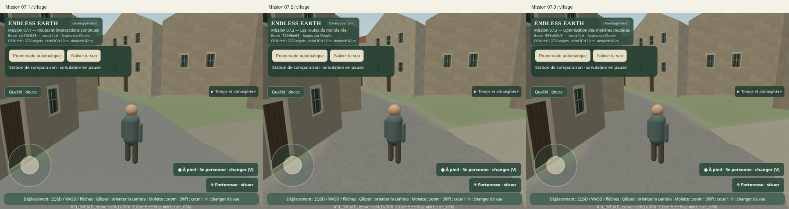
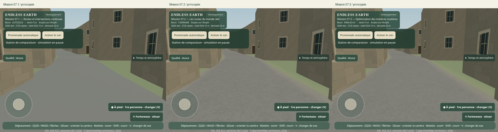
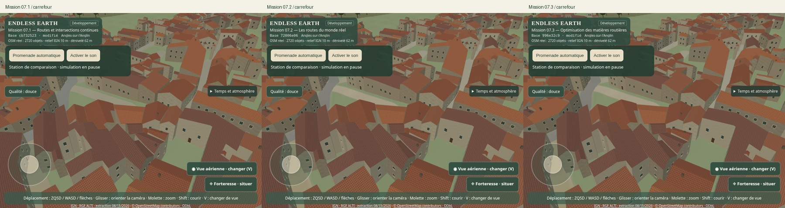
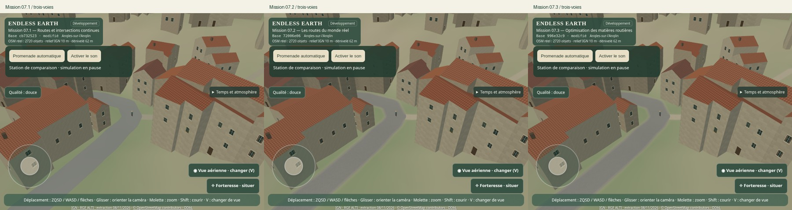
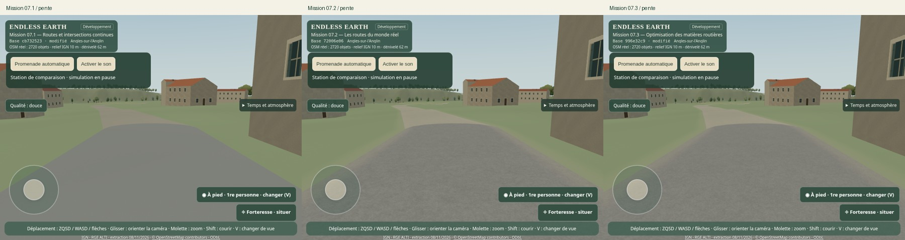
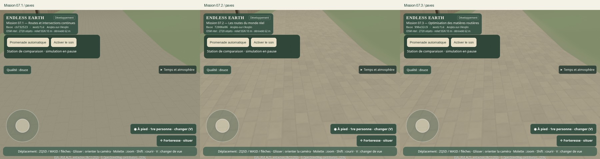
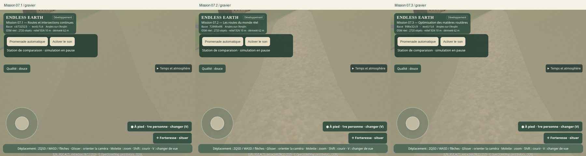
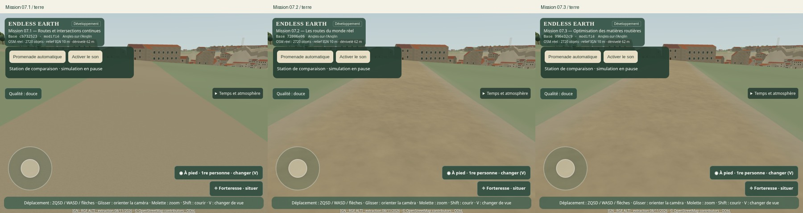
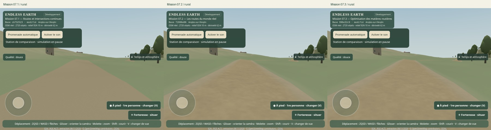
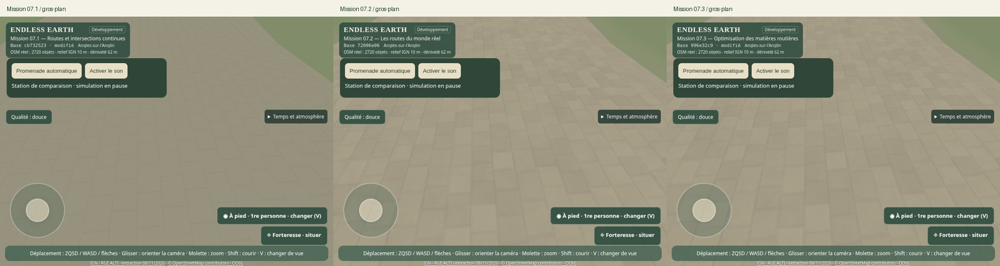
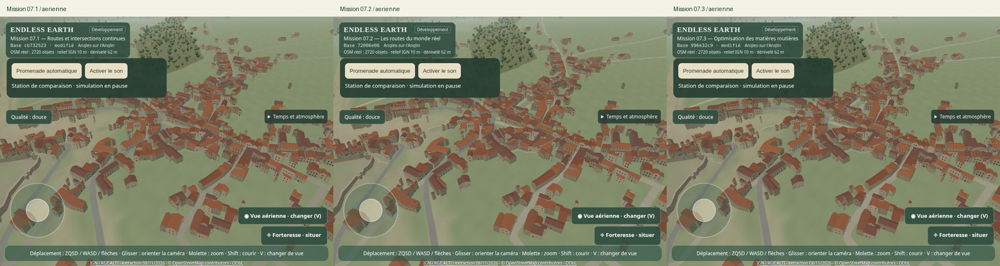
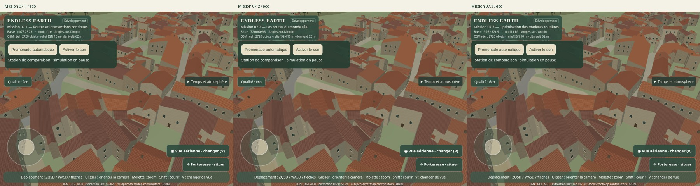
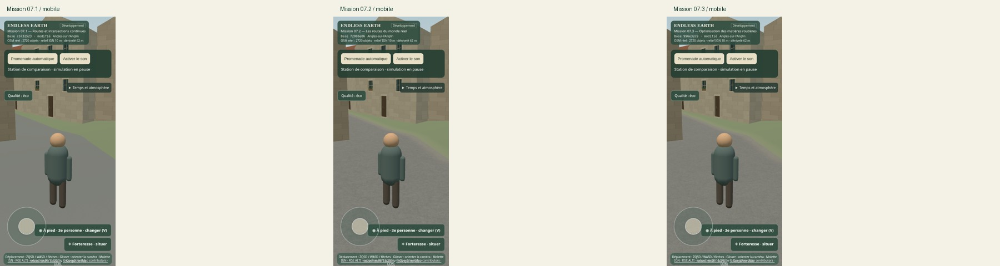

La revue conserve la lisibilité des pierres, leur jointoiement, la granularité du gravier, les couleurs et les raccords doux. La variation secondaire de couleur change légèrement de motif ; elle ne devient pas un quadrillage visible. Les normales proches gardent les mêmes hauteurs. Le filtrage 4 adoucit les plus fines fréquences en vue rasante ; la matière reste lisible. Des crops fixes sans UI fournissent un contrôle supplémentaire dans [visual-crops.json](mission-07-3-captures/visual-crops.json) : écart RGB moyen inférieur à 0,6 niveau sur 255 sur ces quatre crops, énergie des variations voisines presque identique pour pavés/gravier (environ 98,5–100,3 %), environ 86 % dans le crop rasant. Cet indice ne mesure pas une rugosité physique et ne remplace pas l'examen visuel.

Huit trajectoires × six rendus successifs × trois versions : fixe, lent, rapide, rotation à angle rasant, aérienne mobile, zoom, transitions LOD et pavés proches. Les hashes WebGL fixes sont identiques pour six rendus ; chaque trajectoire mobile produit des images réellement différentes. Les séquences ont aussi été examinées : pas de retour du z-fighting, de triangles routiers concurrents, de popping des faces ou de moiré excessif dans ces essais. Les bords restent attachés à leur partition. Une capture fixe seule ne sert pas de preuve de stabilité en mouvement.

| Trajectoire | 07.1 | 07.2 | 07.3 |
|---|---|---|---|
| Lent | [Animation](mission-07-3-captures/motion-071-lent.webp) | [Animation](mission-07-3-captures/motion-072-lent.webp) | [Animation](mission-07-3-captures/motion-073-lent.webp) |
| Rapide | [Animation](mission-07-3-captures/motion-071-rapide.webp) | [Animation](mission-07-3-captures/motion-072-rapide.webp) | [Animation](mission-07-3-captures/motion-073-rapide.webp) |
| Rotation | [Planche](mission-07-3-captures/sequence-071-rotation.jpg) | [Planche](mission-07-3-captures/sequence-072-rotation.jpg) | [Planche](mission-07-3-captures/sequence-073-rotation.jpg) |
| Aérienne | [Planche](mission-07-3-captures/sequence-071-aerienne.jpg) | [Planche](mission-07-3-captures/sequence-072-aerienne.jpg) | [Planche](mission-07-3-captures/sequence-073-aerienne.jpg) |
| Zoom | [Planche](mission-07-3-captures/sequence-071-zoom.jpg) | [Planche](mission-07-3-captures/sequence-072-zoom.jpg) | [Planche](mission-07-3-captures/sequence-073-zoom.jpg) |
| LOD | [Planche](mission-07-3-captures/sequence-071-lod.jpg) | [Planche](mission-07-3-captures/sequence-072-lod.jpg) | [Planche](mission-07-3-captures/sequence-073-lod.jpg) |
| Pavés proches | [Animation](mission-07-3-captures/motion-071-paves.webp) | [Animation](mission-07-3-captures/motion-072-paves.webp) | [Animation](mission-07-3-captures/motion-073-paves.webp) |

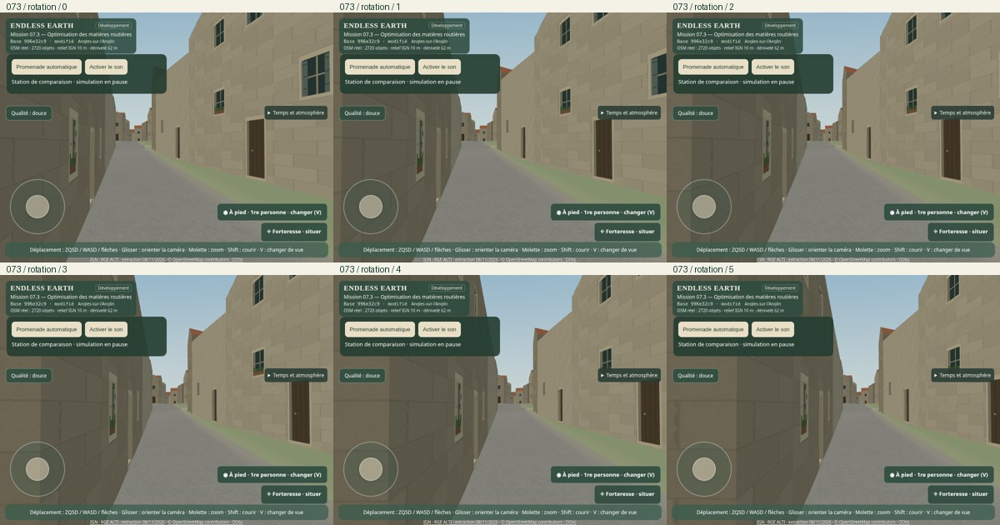
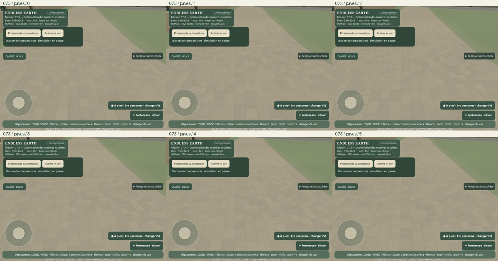

## Non-régression et promenade

**99 tests Node réussis**, compilation TypeScript/Vite réussie. Les nouveaux contrôles couvrent l'identité exacte 07.3, la conservation de chaque octet R/G de l'atlas, le respect des capacités de filtrage, ainsi que la couverture et l'immutabilité de topologie du prototype de support rejeté. Les tests de partition unique, intersections, hauteurs IGN, faces routières identiques aux LOD et intégrité des buffers continuent de passer.

Navigateur : chargement, navigation manuelle, immobilité et garde au sol, trois caméras, zoom/pincement, retour caméra et collision contre un mur, son activé/désactivé avec un seul contexte et deux boucles, reprise manuelle et arrêt du promeneur, Qualité/Éco et viewport mobile. Cinq obstacles injectés pendant la promenade (bâtiment, accès privé, eau, mur, ruine) arrêtent légalement la marche. Les dix scénarios de données dégradées passent, dont accotement absent/corrompu/périmé avec chaussée unifiée conservée.

Les tests d'architecture et de nature sont rejoués sur six et dix vues : [architecture](mission-07-3-captures/architecture-validation.json), [nature](mission-07-3-captures/nature-validation.json). Ils préservent bâtiments, arbres, eau, vent, météo, lumière et profils. Aucune erreur JavaScript dans ces contrôles ; aucune erreur JavaScript/WebGL dans les captures et séquences. [Vérification des 16 triplets, trajectoires et sources](mission-07-3-captures/evidence-validation.json).

Promenade finale : **450,000 m en 425,83 s**, 1904 images de déplacement, arrêt normal « Fin du parcours OSM validé ». Les 921 bâtiments et leurs statistiques restent identiques du départ à l'arrivée, avec `builds: 1`. Le graphe conserve 939 nœuds et 918 arêtes. [Trace complète](mission-07-3-captures/walk.json), [relevé](mission-07-3-captures/walk-survey.json).

La trace marque explicitement les images de marche : 1904 échantillons actifs, aucune troncature. Pendant ces images, CPU avant soumission : médiane **2,7 ms**, p95 **7,2 ms**, maximum **32,3 ms**. Soumission : médiane 0,9 ms, p95 3,7 ms, maximum 810,3 ms. Intervalles entre images actives : médiane 193,0 ms, p95 499,8 ms, maximum 1109,0 ms. D'autres tests navigateur tournaient pendant une partie de la promenade : ces pics réels ne sont pas attribués uniquement aux routes, ni présentés comme fluidité matérielle. Les mesures comparatives du tableau précédent sont, elles, isolées et séquentielles.

Les générations CPU d'atlas ont aussi été comparées après arrêt des navigateurs : cinq passages alternés après deux échauffements, environ 36,1 ms (RGBA) et 33,3 ms (RG) en médiane dans Node. Ce temps chaud n'est pas assimilé au chargement navigateur complet : [données](mission-07-3-captures/resource-generation.json).

## Fidélité et limites restantes

Les tags OSM, la distinction entre surface connue et inconnue, les largeurs estimées et les altitudes IGN restent inchangés. Les palettes et matières sont les interprétations procédurales décrites en 07.2 ; aucun nouveau pavé, trottoir, marquage, relevé photographique ou matériau historique n'est inventé. IGN/RGE ALTI et OpenStreetMap/ODbL gardent leur attribution.

La réduction du coût est **partielle** : elle est mesurée surtout dans le village et le mobile. L'aérien et Éco ne montrent pas de progrès général convaincant, et les temps 07.1 ne sont pas retrouvés partout. La mémoire de l'atlas baisse sans perte de ses données utiles ; la carte d'accotement reste le poste principal de mémoire de finition. Le grain rasant est légèrement plus filtré, tandis que les détails proches et les transitions restent présents dans les vues examinées.

La prochaine décision doit s'appuyer sur un profil GPU réel, notamment Android : coût des dérivées, pression des varyings, filtres anisotropes, taux de remplissage et pics de compilation. Un champ tuilé ou creux peut réduire la mémoire, mais impose des indirections ou des ressources supplémentaires ; les essais de masque et de résolution montrent pourquoi une réduction théorique n'est pas une preuve de gain. Un format GPU compressé demande une mesure de précision des bords et des capacités des appareils. Aucun gain GPU matériel ni 60 FPS n'est revendiqué ici.

## Reproduction et livraison

```sh
npm ci
npm test
npm run build
npm run dev                     # produit final sur 5173
npm run test:road-optimization
npm run test:road-optimization:motion
node scripts/browser-road-optimization-data.mjs
npm run test:road-optimization:walk
npm run test:browser
node scripts/browser-safety.mjs
node scripts/browser-living.mjs
node scripts/browser-camera.mjs
CAPTURE_DIR=work/073-architecture npm run test:architecture
CAPTURE_DIR=work/073-nature node scripts/browser-nature.mjs final
npm run test:build-identity
python scripts/road-optimization-sheets.py
node scripts/validate-road-optimization.mjs
```

Références : servir `cb73252` sur 5175 et `72006e0` sur 5176 dans des worktrees distincts, puis lancer les captures `browser-road-performance.mjs 071` / `072` / `073` et les séquences avec les mêmes trois identifiants. Avec ces serveurs disponibles et les autres navigateurs arrêtés : `npm run bench:roads`, puis `node scripts/report-road-optimization.mjs`. Le profilage initial est rejouable avec `node scripts/profile-road-shader.mjs` sur la référence 07.2 figée. Les expériences du prototype sont identifiées séparément ; elles ne sont pas des profils du jeu.

Le rapport déclaré dans `package.json` fournit l'indicateur **Mission 07.3 — Optimisation des matières routières**, avec le vrai commit et le statut du build. Les commits intermédiaires restent dans l'historique partagé. La livraison poursuit la branche et la PR #13 en brouillon : aucune fusion, aucun déploiement et aucune modification directe de `main`.

Le champ livré et le prototype expérimental ont été régénérés dans `work/` et comparés octet pour octet aux ressources enregistrées : [preuve de déterminisme](mission-07-3-captures/determinism.json). Le CLI du prototype refuse une destination hors `work/`, afin de préserver les ressources du produit lors d'une reproduction. [Synthèse des commandes validées](mission-07-3-captures/test-summary.json).
