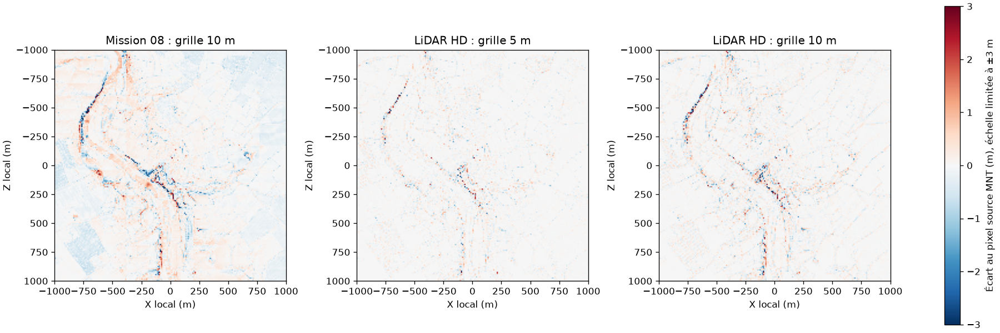
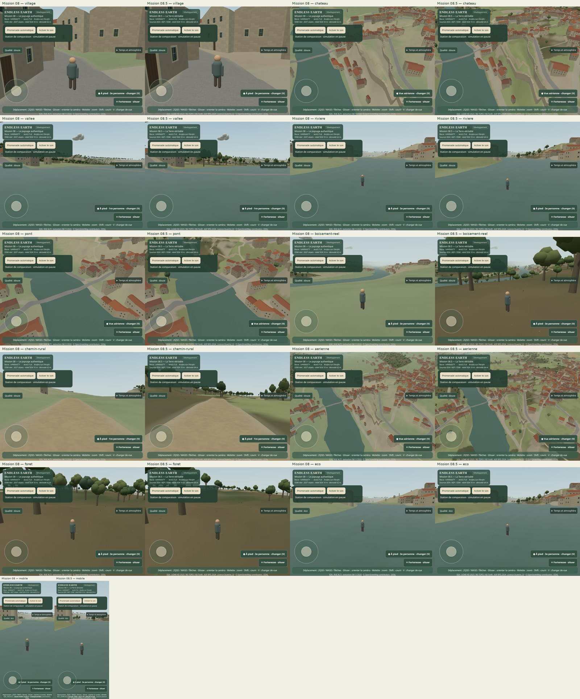
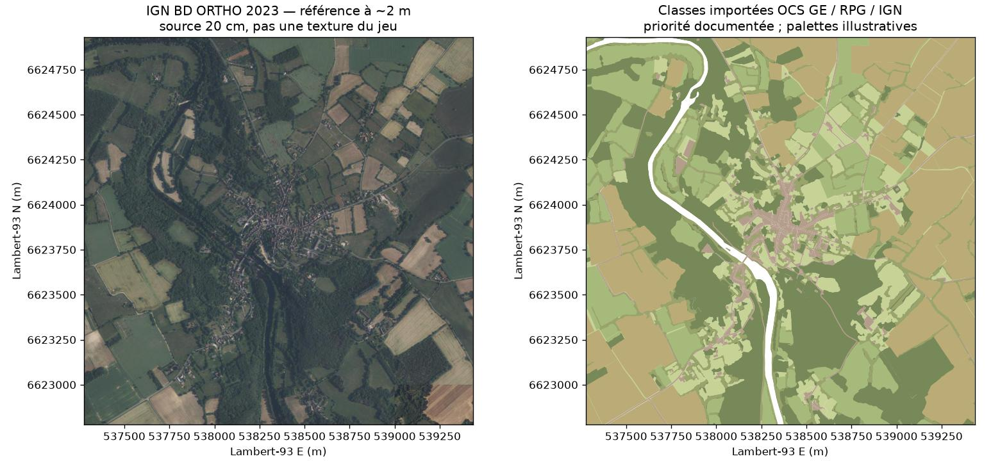

# Mission 08.5 — La Terre véritable

Le nouvel accès a permis d'obtenir et d'intégrer des données réelles : **neuf MNT LiDAR HD IGN**, des polygones **OCS GE 2023**, **RPG 2024**, **BD TOPO végétation** et **BD Forêt V2**. Le jeu utilise le nouveau MNT à **10 m de pas** et **878 polygones normalisés** pour les sols et les habitats. La variante à 5 m est mesurée puis écartée pour son coût. Les matériaux et les plantes restent des interprétations originales ; aucune orthophoto n'est chargée comme texture du jeu.

La PR Mission 08 **#14 est fusionnée**. Branche `mission/08-5-donnees-geographiques` créée depuis le dernier `origin/main` vérifié, **`b440dd7`**. Le worktree de comparaison est détaché sur ce même commit. Aucune modification directe de `main`, fusion ou mise en production.

## 1. Quels accès étaient bloqués ? Audit des missions 01 à 08

Les [huit preuves de Mission 08](mission-08-captures/source-probes.json) établissent des **CONNECT HTTP 403 au proxy** pour `data.geopf.fr` (WFS et téléchargement), `geoservices.ign.fr`, `services.sandre.eaufrance.fr`, `land.copernicus.eu`, `www.data.gouv.fr`, Commons et le miroir cquest. Mission 07 conservait déjà trois refus sur IGN, Sandre et Copernicus. Ils ne prouvaient ni une absence de couverture locale, ni un refus de licence, ni une indisponibilité du fournisseur.

**On ne peut pas attribuer toutes les limites des huit missions à Internet.** Le dépôt contenait un extrait OSM et une grille IGN acquis par les workflows précédents ; GitHub et les gestionnaires de paquets restaient accessibles. Les rapports 01 à 06 n'apportent pas la même preuve réseau détaillée. Les limitations des caméras, du contrôleur et du rendu ont des causes techniques propres et ne sont pas réécrites dans cette mission.

| Missions examinées | État constaté et conséquence pour 08.5 |
|---|---|
| 01–02 | Marche, collisions, contraintes de pente, caméra et restrictions géographiques déjà testées. Conservées ; le relief et les empreintes sources existaient. Pont non calibré : manque de support géographique autant que de rendu. |
| 03–04 | Promenade, reprise manuelle, arrêts et graphe OSM validés. Conservés ; aucun nouveau chemin ni franchissement inventé. |
| 05 | Architecture régionale et empreintes OSM en place, détails et hauteurs ordinaires souvent inférés. BD TOPO nouvellement acquis pour étude, sans substitution aveugle des empreintes ou des hauteurs. |
| 06 | Instancing, LOD, culling et détail proche déjà optimisés. Les deux grands boisements provenaient d'OSM/CORINE 2006 ; absence de sols agricoles récents. Nouvelle provenance d'habitat, budgets et rendu conservés. |
| 07 et correctifs 07.1–07.3 | MNT 10 m, surface routière unifiée, matériaux, accotements, badge et tests établis. L'import LiDAR était seulement testé sur raster synthétique. L'acquisition réelle et sa validation sont maintenant exécutées ; pas de réécriture des routes. |
| 08 | Contours d'eau OSM enfin lisibles, mais tous les nouveaux téléchargements restaient refusés. La couverture LiDAR n'était pas confirmée ; aucune nouvelle occupation du sol. Ces blocages sont réellement levés ici. |

Classement des opportunités, dans l'ordre demandé :

1. **Relief** : MNT réel acquis, CRS normalisé, importé et comparé ; nouvelle source intégrée à budget de grille constant.
2. **Occupation des sols** : OCS GE 2023 et RPG 2024 intégrés ; espaces herbacés distingués des prairies déclarées et des cultures.
3. **Forêts/haies/végétation** : BD TOPO et OCS GE intégrés, BD Forêt en complément ; retrait des anciens massifs CLC dans l'emprise lorsque les nouvelles sources sont valides.
4. **Hydrographie** : huit surfaces BD TOPAGE 2026 acquises et étudiées ; contours OSM du jeu conservés en attendant une partition et une altimétrie hydrologique vérifiées.
5. **Bâtiments/patrimoine** : 911 objets BD TOPO et 18 constructions linéaires acquis ; proportions, définitions des hauteurs et correspondances restent à valider avant application.
6. **Routes/chemins** : mêmes axes, emprises estimées et matériaux OSM ; recalage sur le nouveau MNT et tests de contact, sans recommencer leur conception.
7. **Textures régionales** : BD ORTHO 2023 téléchargée comme référence seulement ; palette et atlas originaux conservés.
8. **Autres détails** : petit extrait OSM de diagnostic et raster Copernicus acquis ; aucun ajout de POI ou d'espèce sans justification.

## 2. Quels services fonctionnent maintenant ?

La configuration observée du même environnement est **actuelle**, `network_policy.mode=unrestricted`, `state=enforced`. Les réponses réelles, chaînes de redirection et erreurs sont dans [network.json](mission-08-5-captures/network.json). Les URL complètes de chaque extraction sont aussi dans le [manifeste des sources](mission-08-5-sources.json). Un HTTP 200 d'une page d'application n'est pas confondu avec la réception de données.

| Source et URL officielle effectivement utilisée | HTTP / redirections et couverture locale | Résolution, date, format, licence et traitement |
|---|---|---|
| [Géoplateforme IGN WFS](https://data.geopf.fr/wfs/ows?service=WFS&request=GetCapabilities) | **200**, sans redirection ; capacités reçues, huit extractions vectorielles locales réussies. | WFS 2.0 / GeoJSON ; précision et dates propres à chaque couche. Prétraitement local possible. |
| [LiDAR HD, métadonnées locales](https://data.geopf.fr/wfs/ows?SERVICE=WFS&VERSION=2.0.0&REQUEST=GetFeature&TYPENAMES=IGNF_LIDAR-HD_METADONNEE:metadata&OUTPUTFORMAT=application/json&SRSNAME=EPSG:2154&BBOX=537276,6622779,539434,6624931,EPSG:2154&COUNT=30) | **200**, neuf dalles ; neuf GeoTIFF **200**, sans redirection. Le lien `geoservices.ign.fr/lidarhd` répond aussi après une redirection, mais les rasters constituent la preuve utile. | MNT **0,5 m**, acquisition **09/04/2023**, édition **24/01/2025**, Float32 GeoTIFF, Lambert-93 / IGN69, Licence Ouverte 2.0. Import hors navigateur. |
| [BD ORTHO WMS](https://data.geopf.fr/wms-r?SERVICE=WMS&VERSION=1.3.0&REQUEST=GetCapabilities) | **200**, image JPEG locale reçue et huit objets du graphe de mosaïquage obtenus en WFS. | Source **20 cm**, vues 2023 : Vienne 30/05 et 07/06 ; Indre 24–25/06 sur l'emprise élargie. Export de référence **1080×1076**, environ 2 m, pas une acquisition à 2 m ni une précision absolue de 20 cm. Licence Ouverte 2.0, IGN. |
| [BD TOPO WFS](https://data.geopf.fr/wfs/ows?service=WFS&request=GetCapabilities) | **200** : 911 bâtiments, 661 haies linéaires, 264 zones de végétation, 9 eaux et 18 constructions linéaires. Aucun résultat tronqué (limite 5 000). | Vecteur 2D/3D, GeoJSON, précision par attribut ; flux consulté le 10/11/2026, dates d'objet conservées, pas de date unique d'observation inventée. Licence Ouverte 2.0. |
| [BD Forêt V2 WFS](https://data.geopf.fr/wfs/ows?service=WFS&request=GetCapabilities) et [lot D086](https://data.geopf.fr/telechargement/resource/BDFORET?zone=D086&limit=50) | **200**, 30 formations locales ; livraison D086 datée **2014-04-01** au catalogue. | Vecteur, formations d'au moins 5 000 m² ; date de prise de vue locale non fournie par l'extrait et laissée inconnue. GeoJSON acquis, SHP départemental disponible. Licence Ouverte 2.0. |
| [OCS GE D086](https://data.geopf.fr/telechargement/resource/OCSGE?zone=D086&limit=50) | **200**, lots **2020 et 2023** et différentiel découverts. Archive 2023 **200**, empreinte fournisseur vérifiée, **451** objets intersectant le pilote. | GeoPackage Lambert-93 dans 7z, millésime **2023**, livraison 2025 ; couverture et usage distincts. Seuils par classe : généralement 500 m² en zone construite / 2 500 m² ailleurs, sylviculture 5 000 m² ; pas une résolution raster. Licence Ouverte 2.0. |
| [RPG 2024, WFS IGN](https://data.geopf.fr/wfs/ows?service=WFS&request=GetCapabilities) | **200**, **128** parcelles locales ; couche explicitement millésimée, sans dépendance à un alias `LATEST`. | Déclarations PAC **2024**, GeoJSON, codes originaux conservés ; ce n'est ni tout le territoire agricole ni la culture constatée en 2026. Licence Ouverte 2.0, ASP/IGN. |
| [BD TOPAGE / Sandre 2026](https://services.sandre.eaufrance.fr/geo/topage2026?service=WFS&request=GetCapabilities) | **200**, huit surfaces élémentaires locales en GeoJSON ; répertoire 2025 également **200**. | Référentiel vectoriel **2026**, attributs de méthode et datum présents, pas de résolution raster ni de niveau d'eau déduit. GeoJSON/SHP/GPKG ; Licence Ouverte 2.0, IGN/OFB/Sandre. Prétraitement possible. |
| [Copernicus CLMS](https://land.copernicus.eu/en/products/high-resolution-layer-forests-and-tree-cover), [EEA ImageServer TCD 2018](https://image.discomap.eea.europa.eu/arcgis/rest/services/GioLandPublic/HRL_TreeCoverDensity_2018/ImageServer?f=json) | Catalogue **200**, métadonnées EEA **200**, export local TCD **200**, **46 656 pixels valides**, valeurs 0–99. Le WMS Geoville lié au catalogue échoue en **503, connexion amont expirée**. | Produit européen **2018, 10 m**, export GeoTIFF mono-bande U8 reprojeté au plus proche (~9,99 m de pas de sortie). Les HRL plus récents 2018–2023 sont documentés, pas acquis. [Politique Copernicus](https://land.copernicus.eu/en/data-policy), attribution UE/EEA et transformations précisées. Référence, pas source du jeu. |
| [OSM](https://www.openstreetmap.org/copyright), [API map](https://www.openstreetmap.org/api/0.6/map?bbox=0.8838,46.6948,0.8850,46.6958), [Geofabrik](https://download.geofabrik.de/europe/france/poitou-charentes.html) | **200** ; petit diagnostic API reçu (536 nœuds, 106 chemins, 10 relations), catalogue régional Geofabrik **200**. `/api/status` Overpass renvoie **406 nginx**, pas un refus CONNECT. L'interpréteur Overpass n'est pas déclaré validé sur cette seule réponse. | OSM XML pour le diagnostic ; PBF régionaux proposés, non téléchargés inutilement. ODbL 1.0. L'extrait de jeu reste celui du **08/11/2026** ; qualité, précision et dates varient par objet. |

Erreurs résolues sans contournement : l'ancien nom WFS `IGNF_MNT-LIDAR-HD:dalle` répond **400 / Unknown namespace** ; la couche actuelle de métadonnées fournit les bonnes URL. Le service Sandre `/geo/eth` est Carthage, pas TOPAGE 2026 ; `application/json` simple y était refusé en 400, le format annoncé `application/json; subtype=geojson` sur le bon service fonctionne. Le mauvais nom TMS OCS essayé une fois est inconnu : l'API officielle de téléchargement révèle le produit `OCSGE`. Aucun de ces cas n'est classé « données absentes ». Aucun quota 429 ni refus fournisseur d'une licence n'a été observé. Le 503 Geoville demeure un échec de connexion amont, sans preuve de blocage de politique ; le catalogue et l'ancien raster EEA fonctionnent.

## 3. Quelles données ont réellement été téléchargées ?

Les **neuf GeoTIFF MNT** pèsent chacun **16 000 513 octets**, soit **144 004 617 octets** au total. Les clés nord-ouest sont **0537/0538/0539 × 6623/6624/6625**. Ce sont les neuf unités kilométriques intersectant le monde de 2×2 km et sa **marge de 50 m** pour les normales et futurs raccords : emprise Lambert-93 **E 537 276–539 434, N 6 622 779–6 624 931**. Aucune archive LAZ, aucun MNS ni MNH n'a été téléchargé.

L'archive **OCS GE 2023 D086** pèse **123 792 783 octets**. Le département est la plus petite unité publiée de ce lot ; extraction spatiale de **451 objets** par index RTree du GeoPackage, hors navigateur. MD5 officiel et calculé : **`6d8f4cdeccc7000cb7645fc963442bae`**. Les fichiers lourds restent dans `work/mission-08-5/raw`, `normalized` et `ocs-extracted`, exclus de Git. Ce stockage local n'est **pas** un service d'archivage durable ; les URL, SHA-256 et scripts permettent de refaire l'acquisition et de vérifier les fichiers. Les URL WMS du MNT peuvent évoluer : il faut comparer leurs empreintes à cette mission avant de considérer une récupération comme identique. Aucun dépôt d'archives brutes volumineuses dans Git.

S'ajoutent les huit extraits WFS IGN listés ci-dessus, les huit surfaces TOPAGE 2026, le JPEG orthographique local, un rendu cartographique OCS, le TCD 2018, le petit XML OSM et les métadonnées officielles. Le [manifeste](mission-08-5-sources.json) conserve URL, tailles, SHA-256 de chaque fichier original, transformations et empreintes après normalisation. Les [métadonnées de livraison](mission-08-5-metadata/) accompagnent la provenance. Les pages de catalogue et les réponses d'erreur sont distinguées des données dans le rapport réseau.

## 4. Quelles données sont réellement intégrées ?

**Relief** : les 40 401 nœuds du jeu sont maintenant échantillonnés dans le MNT LiDAR HD, au même pas de **10 m**, avec datum **IGN69** et acquisition connue. Tous les dérivés ont été régénérés : sol, partition unique routes/eau, LOD, atlas de couverture et accotements. Le moteur et les collisions interrogent la même surface triangulée ; les bâtiments, plantes et ruines s'y ancrent. Les empreintes OSM, le graphe, les matériaux routiers, les restrictions de marche et l'échelle ne sont pas remplacés.

**Sols et végétation** : `angles-environment.json` contient **878 polygones** après découpe, conservation des trous et simplification topologique à **0,5 m**. Ce seuil de simplification n'est pas une précision d'observation. Le raster de palette reste à **2 m**, sans nouvelle texture ni passe. Les sources contrôlent les contours et classes ; la palette, les positions d'arbres non cartographiés, silhouettes, tailles, litière et détails de sol restent procéduraux. Les cultures 2024 ne sont pas présentées comme une observation 2026.

| Attribut | Priorité effective et statut |
|---|---|
| Hauteur du sol | MNT LiDAR HD / IGN69 ; échantillonnage du pixel natif le plus proche, puis interpolation triangulaire partagée. Pas de hauteur aléatoire. |
| Couvert arboré et type foliaire | OCS GE 2023, puis zones BD TOPO et BD Forêt V2 en complément. Un type de couvert ne mesure ni chaque essence ni chaque arbre. |
| Haies | Polygones `nature=Haie` de BD TOPO prioritaires pour un habitat arbustif. Les 661 axes de haies sont acquis pour étude, pas extrudés avec une largeur inventée. Les individus restent une interprétation. |
| Prairies / cultures / vergers | Codes de parcelles RPG 2024. Prairies permanentes/temporaires distinguées, groupe estives/landes non assimilé automatiquement à une prairie. Aucun verger ou jardin créé faute de donnée explicite locale. |
| Herbacées, artificialisé, sol nu | Couverture OCS GE ; herbacée générique reste `open`, pas forcément prairie agricole. Couverture et usage natifs restent séparés dans les attributs. |
| Zones humides | Pas de classe humide locale validée ajoutée. Ni distance à la rivière ni couleur d'orthophoto ne deviennent une preuve de zone humide. |
| Contour de rivière | OSM conservé. OCS eau, BD TOPO et TOPAGE servent de références ; aucune hauteur, largeur de pont ou bathymétrie nouvelle déduite. |
| Bâtiments et patrimoine | Empreintes OSM conservées. Hauteurs et ornements actuels demeurent interprétés lorsqu'ils ne sont pas renseignés. BD TOPO n'est pas encore fusionnée au bâti. |
| Couleur et matière | Création artistique originale par classe, pas texture photographique ni mesure pédologique. |

Ces priorités sont une politique de fusion explicite, pas une mesure de certitude absolue ou une affirmation qu'une date de modification BD TOPO est une prise de vue. Une source plus récente peut montrer une autre définition du couvert. Les champs d'origine sont conservés pour permettre la revue.

Les deux anciens massifs CLC 2006 sont écartés seulement lorsque le nouveau fichier est valide. En cas d'absence, corruption ou provenance incomplète, les habitats OSM historiques reprennent et l'atlas incompatible est rejeté. Le HUD indique l'indisponibilité du nouvel environnement. Le nombre d’ancrages passe de **1 587 à 2 500** ; ce sont surtout des individus procéduraux au sein de classes cartographiées. Le plafond existant de **2 500 arbres** est conservé, mais appliqué par classement spatial déterministe sur l'ensemble du pilote : l'ordre des couches ne vide plus les derniers massifs. Les arbres explicitement cartographiés ont priorité. Les empreintes et exclusions ne sont pas déplacées pour remplir le budget.

## 5. Quelle précision géographique a été gagnée ?

Les rasters reçus sont **2000×2000, mono-bande Float32, pas 0,5 m, nodata −9999**, sans cellule nodata dans les neuf fichiers. Les métadonnées WFS confirment **LAMB93 / IGN69** et la date commune d'acquisition. Elles indiquent `IGN_AUTO_V5` pour le classement et `NR` pour le classement manuel ; cela ne fournit pas un contrôle altimétrique local indépendant. Le CRS du GeoTIFF WMS comporte un défaut de sérialisation : nom EPSG:2154 et paramètres Lambert-93 exacts, mais datum sans nom et ellipsoïde WGS84 de secours. La normalisation exige la déclaration WFS, le bon produit et tous les paramètres de projection ; elle réécrit EPSG:2154 **sans changer un pixel, la grille ou le nodata**, conserve le WKT et les deux empreintes et refuse un autre CRS. Les tests couvrent ce cas et ses refus. Aucun décalage vertical supposé n'est appliqué.

L'ancienne grille et la nouvelle partagent le repère historique du jeu : X est, Z sud, origine 0,8844° E / 46,6953° N. Sa limite métrique d'environ **0,2 %** n'est pas rebaptisée précision géodésique ; aucune couche n'est décalée seule et le monde n'est pas redimensionné. [Contrat et import](GEOGRAPHIC_IMPORT.md).

Sur les **40 401 nœuds communs**, écart absolu moyen **0,174 m**, p95 **0,55 m**, variation extrême **−7,61 à +12,61 m**. La médiane signée est nulle ; une différence importante locale ne représente pas un biais uniforme de tout le relief.

Sur **40 000 positions intermédiaires** indépendantes des nœuds, comparaison au pixel natif du MNT, avec le même repère et projection :

| Grille | Écart absolu moyen | RMSE | p95 absolu | Maximum absolu |
|---|---:|---:|---:|---:|
| Mission 08, IGN API 10 m | 0,201 m | 0,388 m | 0,629 m | 13,736 m |
| **LiDAR HD 10 m, retenu** | **0,128 m** | **0,310 m** | **0,487 m** | **13,924 m** |
| LiDAR HD 5 m, candidat | 0,088 m | 0,212 m | 0,343 m | 8,254 m |

Le gain moyen de la grille retenue est d'environ **36 % sur cet écart au raster source**, pas 36 % de précision absolue réelle. Le maximum n'est pas amélioré et les falaises fines restent mal résolues. Le MNT source est lui-même dérivé/interpolé à partir de points classés ; **0,5 m de pas ne signifie pas 0,5 m d'exactitude**. Aucun contrôle topographique indépendant du terrain n'a été obtenu. La précision locale absolue ne peut donc pas être chiffrée à partir de ce seul comparatif.



[Données et méthode de comparaison](mission-08-5-captures/terrain-comparison.json). Aucun recalage photographique ou niveau de rivière inventé pour améliorer ces chiffres.

## 6. Quelles améliorations sont visibles ?

[**Comparaisons avant/après**](mission-08-5-captures/comparaisons.html) : village, château, vallée, rivière, pont, forêt, chemin rural, aérienne, Éco et mobile. Position, altitude absolue de caméra, orientation et paramètres sont vérifiés dans [camera-equivalence.json](mission-08-5-captures/camera-equivalence.json). La hauteur relative au centre du monde change avec le nouveau MNT : le protocole compense ce changement pour conserver la vraie caméra géographique. Éclairage au 21 juin 2026, midi UTC, simulé et identique ; ce n'est pas une date d'acquisition.



Les parcelles ouvertes réapparaissent là où l'ancien contour CLC plaçait une forêt trop générale ; les boisements cartographiés ailleurs sont peuplés, les haies et limites d'usage différencient le paysage. La station historique `foret` est maintenant un espace agricole selon les sources : elle est conservée comme preuve de cette correction, et la station `boisement-reel` montre un véritable couvert OCS GE 2023. Les routes et fondations suivent les nouvelles altitudes. La silhouette du château et le pont ne sont pas présentés comme nouvellement reconstruits.



Cette image compare des données géographiques, pas un jeu photoréaliste. Les pixels BD ORTHO ne sont pas employés par le rendu du monde. Les caméras rivière/vallée peuvent être dans une zone interdite à la marche : elles ne prouvent pas un accès piéton. Aucun habitant n'a encore validé l'identité du paysage par un parcours et des photos de caméra connue.

## 7. Quelles limites restent présentes ? Patrimoine et architecture mondiale

[Audit des bâtiments et ouvrages](mission-08-5-captures/building-audit.json) : **911 bâtiments**, **894 valeurs non nulles** de `hauteur` (dont certaines nulles au sens métier/égales à zéro), précisions altimétriques annoncées variables et sentinelle **9999** pour l'inconnu. Des coordonnées Z d'ouvrages sont présentes ; d'autres valent **−1000**, donc inconnues. Le pont cartographié comporte des cotes, mais pas un modèle d'arches, un tablier surfacique ou un appariement validé à chaque voie OSM. Une valeur `hauteur` ne doit pas être appliquée sans vérifier sa définition par rapport au toit, au sol et à notre extrusion.

Les empreintes et proportions OSM, les 921 bâtiments reconstruits, les murs et les caméras sont conservés. Aucun château reconstruit arbitrairement, aucune arche ni hauteur patrimoniale inventée. Les 911 objets de l'extrait BD TOPO et les 921 bâtiments du rendu n'ont ni exactement la même emprise de requête ni forcément la même segmentation ; leur différence n'est pas interprétée comme dix bâtiments à supprimer.

Relief à 10 m, falaises/berges encore grossières ; eau drapée, sans niveau mesuré ni bathymétrie ; pont schématique ; dates d'observation inconnues pour certaines formations ; jardins, zones humides et essences individuelles non certifiés. Les variations d'un couvert ou les cultures annuelles ne constituent pas une photographie exacte du monde au 10 novembre 2026. Le coût de génération initiale du bâti et les pics de détails restent à surveiller. Tests Android et GPU physiques non exécutés.

L'architecture d'import [documentée et implémentée](GEOGRAPHIC_IMPORT.md) sépare les adaptateurs nationaux du contrat `endless-earth-environment-v1` : coordonnées EPSG:4326, contours et trous, classe, identifiant d'origine, attributs natifs, source/licence/millésime/emprise/projection/résolution/confiance. Les dates et résolutions inconnues sont explicites. Le runtime ne sait rien du WFS IGN et ne télécharge ni GeoPackage ni LiDAR. Les couches mondiales existantes d'adressage et de streaming restent intactes. Le pilote est encore un jeu de données local, pas une preuve de couverture mondiale ou d'un nouveau streaming planétaire complet.

## 8. Quels sont les coûts de performance ?

**Chromium / ANGLE / SwiftShader logiciel uniquement.** Trois paires alternées, 21 rendus synchronisés par station et par paire : **63 échantillons par version**. Attente de fin de rendu et lecture des pixels incluses ; le temps n'est pas une mesure GPU matériel. Aucune autre automatisation navigateur ne tourne pendant ces séries. [Mesures brutes](mission-08-5-captures/benchmark.json), [synthèse, distributions et chargement](mission-08-5-captures/performance-summary.json).

| Station | Médiane Mission 08 → 08.5 | Variation | Draw calls | Triangles |
|---|---:|---:|---:|---:|
| Village Qualité | 379,6 → 369,9 ms | −2,6 % | 109 → 125 | 245 249 → 246 163 |
| Rivière Qualité | 211,1 → 207,7 ms | −1,6 % | 91 → 106 | 190 528 → 185 548 |
| Boisement réel Qualité | 305,3 → 368,8 ms | **+20,8 %** | 161 → 184 | 233 607 → 301 148 |
| Aérienne Qualité | 368,0 → 365,0 ms | −0,8 % | 140 → 161 | 259 224 → 260 259 |
| Rivière Éco | 197,3 → 195,2 ms | −1,1 % | 89 → 98 | 169 530 → 159 954 |
| Mobile Éco | 105,8 → 112,0 ms | **+5,9 %** | 41 → 54 | 118 837 → 115 701 |

Les petits écarts ne justifient pas une promesse de gain. Le boisement effectivement enrichi coûte plus cher et le mobile régresse légèrement dans cette série variable. **Aucun gain universel, 60 FPS, absence de saccade ou fluidité matérielle n'est revendiqué.** Le contenu géographique apporte un bénéfice visible mais ne supprime pas le travail de performance restant.

Chargement local médian **6,304 → 6,891 s**, trois valeurs par version, sans simulation de réseau mobile. Préparation du mesh terrain : médiane **2,0 → 1,8 ms** sur neuf appels par version ; le CPU complet du démarrage n'est pas isolé du transfert et de la compilation. Les buffers géométriques dédupliqués passent par exemple de **31,15 à 31,43 Mo** au village, et de **33,64 à 36,38 Mo** au boisement. Les textures gardent environ **11,81 Mo estimés avec mipmaps**, sept textures sur ces vues. Ces chiffres ne sont pas la VRAM totale ni tout le tas JavaScript.

La surface prétraitée passe de **119 960 à 120 128 triangles proches**, les 25 tuiles de 400 m et la borne LOD lointaine de **25 cm** restent. Instancing, culling, ressources partagées et cache de quatre cellules de détail cachées sont conservés ; index local d'habitats borné à 128 entrées. La somme des tailles gzip des neuf fichiers concernés passe de **2,323 à 2,812 Mo**, soit environ **+0,489 Mo**. C'est une comparaison de tailles, pas un débit mobile observé. [Détail par fichier et SHA-256](mission-08-5-captures/transfer.json).

Le candidat 5 m est aussi testé avec le code final, les mêmes sources d'habitat, le même budget et les mêmes caméras : une paire exploratoire de neuf échantillons par vue. En mobile **104,2 → 156,9 ms (+50,6 %)**, village +17,7 %, rivière +31,7 %, boisement +36,4 %. Ce protocole est distinct des trois paires du tableau principal ; les exclusions de végétation dépendent naturellement des pentes de chaque grille. La surface 5 m atteint **386 559 triangles proches / 308 047 lointains**, contre **120 128 / 111 104** retenus. [Choix de résolution et limites de l'essai](mission-08-5-captures/resolution-choice.json). Le gain d'interpolation ne justifie pas ce coût pour le pilote mobile ; un raffinement adaptatif des falaises sera préférable à une grille uniformément plus lourde.

Pendant les **428,90 s** de marche, CPU avant soumission **6,6 / 23,4 / 557,2 ms** (médiane/p95/max), soumission **1,7 / 9,34 / 1 249,7 ms**, intervalles d'image **173,8 / 467,0 / 3 909,2 ms**. Le tas JavaScript atteint **213,12 Mo**, puis 145,60 Mo en fin de trace (`performance.memory` avec mesure précise activée, sans VRAM ni processus complet). Une tranche de préparation naturelle a atteint **164,9 ms**, un tampon final 13,7 ms : le budget temporel de 2 ms demeure souple et n'est pas garanti sur cet hôte. Ces pics sont réels dans le protocole et ne permettent pas d'affirmer une promenade sans saccades. Les captures périodiques et observations du test en font partie. La trace complète, non plafonnée, et les cinq plus grands pics avec positions sont dans [walk.json](mission-08-5-captures/walk.json) et [walk-cpu.json.gz](mission-08-5-captures/walk-cpu.json.gz).

Un diagnostic CPU séparé, sans rendu, mesure trois tours alternés : génération écologique médiane **138,810 → 575,527 ms**, p95 des lots de 32 candidats **0,069 → 0,551 ms**, maximum après **1,997 ms** sur quatre cellules déclarées. La nouvelle géométrie augmente donc bien le calcul, surtout au chargement ; ce test Node ne prouve pas la cause des blocages Chromium/SwiftShader et ne les annule pas. [Profil détaillé](mission-08-5-captures/ecology-cpu.json).

## 9. Validation et sources réutilisables dans d'autres pays

**110 tests Node**, **deux tests Python**, compilation TypeScript/Vite, chargement navigateur, trois caméras/zooms, Qualité/Éco, viewport mobile, audio et reprise manuelle : **réussis**. Collisions dynamiques bâtiment, privé, eau, mur et ruines ajoutées après départ : réussies. **14 scénarios** d'absence/corruption/péremption des données passent, dont le nouveau fichier d'environnement et sa provenance. [Validation et commandes](mission-08-5-captures/validation.json), [contrôles géométriques par scénario](mission-08-5-captures/data-validation.json). L'avertissement Vite historique de bundle >500 ko reste présent.

**Promenade complète : 450,000 m planimétriques en 428,90 s, 1845 images de déplacement**, sans accélération de simulation, arrivée normale « Fin du parcours OSM validé ». Le script complet prend 463,75 s, relevé du graphe et caméras compris. Graphe : **920 nœuds / 896 arêtes** contre 939/918 auparavant, certaines pentes du nouveau MNT excluant des candidats avec le même prédicat. Le parcours de 450 m reste proposé, sans raccorder artificiellement un pont. Les **921 bâtiments**, `builds: 1`, sont conservés pendant toute la marche ; les ouvertures illustratives se réadaptent au sol (10 713). [Trace de marche](mission-08-5-captures/walk.json), [graphe](mission-08-5-captures/walk-survey.json), [arrivée mobile](mission-08-5-captures/walk-arrivee-mobile.png).

Les tests d'import vérifient produit MNT/MNS, datum, checksum, CRS, orientation, nodata, absence de remplissage d'un trou et remplacement atomique. Les tests de normalisation refusent la mauvaise déclaration source et un paramètre Lambert modifié, puis vérifient l'identité des pixels. Les tests de provenance et d'environnement couvrent source/licence/millésime, projection, classes, coordonnées, trous, priorités, absence d'invention et répartition du budget indépendante de l'ordre des massifs. Les tests réels de surface contrôlent altitudes, raccords et triangles communs route/eau/sol, sans biais d'altitude. Les **sept dérivés** sol/LOD/couverture/surface/accotements ont été régénérés dans un dossier séparé et comparés octet pour octet : **identiques**. [Empreintes et déterminisme](mission-08-5-captures/determinism.json). Le test de contact navigateur relève moins de **0,000002 m** d'écart numérique route/terrain et moins de **0,000001 m** pour les fondations schématiques ; ce sont des tolérances numériques, pas une précision géographique.

Les sources françaises IGN/ASP/TOPAGE n'ont **pas** une couverture mondiale. **OSM** est réutilisable à l'échelle mondiale, sous ODbL et avec complétude variable. Le **contrat de provenance, les adaptateurs hors navigateur, les grilles et tuiles légères** sont réutilisables ; il faut ajouter des fournisseurs locaux et valider leur datum. Le **TCD européen testé** couvre l'Europe, pas le globe ; d'autres produits Copernicus ont leurs propres couvertures et licences et nécessiteront une acquisition distincte. Aucun accès mondial IGN ou Copernicus n'est supposé.

## 10. Trois prochaines priorités et livraison

1. **Relief adaptatif des falaises, berges et franchissements** : exploiter les rasters 50 cm hors navigateur pour sélectionner les ruptures importantes sans quadrupler toute la grille ; tester le tablier à partir des cotes BD TOPO et une surface hydrologique justifiée.
2. **Appariement du bâti et contrôle patrimonial** : comparer les empreintes OSM/BD TOPO, définition et précision de chaque hauteur, traiter les cotes inconnues, puis calibrer pont et château avec des références mesurables. Garder usages, dates et licences par attribut.
3. **Validation locale et matérielle** : huit photos de caméra connue et retour d'un habitant, puis profil GPU ordinateur / Android réel, chargement mobile et génération du bâti. Confirmer le bénéfice géographique et le coût avant toute publication.

Le badge sélectionne explicitement **ENDLESS EARTH — Mission 08.5 : La Terre véritable** via le rapport actif. Il continue d'embarquer le vrai commit et l'état Git, sans valeur inventée ni requête de version depuis le navigateur. Le bundle compilé depuis le commit propre **`884625dc79e3e635eac06e114d73a73471add22e`** passe sur **1280×800, 390×844, 320×568 et 844×390** : titre complet, commit réel, état propre, statut Production, aucune commande masquée et aucune requête de version. [Preuve du bundle](mission-08-5-captures/build-production-validation.json), [bureau](mission-08-5-captures/build-production-1280x800.png), [mobile étroit](mission-08-5-captures/build-production-320x568.png). Les commits de clôture ajoutent les preuves et la documentation, sans changement des sources jouables. Les comparaisons artistiques portent honnêtement le badge de copie modifiée et ne servent pas de preuve d'un commit de production. Une seule PR en brouillon vers `main`, sans fusion ni déploiement.

Licences : **IGN et ASP / Licence Ouverte 2.0**, **© OpenStreetMap contributors / ODbL 1.0**, provenance historique **Union européenne – SOeS, CORINE Land Cover 2006**, référence **Union européenne / Copernicus Land Monitoring Service / EEA, TCD 2018**, avec export/reprojection signalés. Voir [notice distribuée](../public/data/LICENSE.md), [sources et empreintes](mission-08-5-sources.json), [contrat d'import et reproduction](GEOGRAPHIC_IMPORT.md).

```sh
npm test
npm run build
work/geo-venv/bin/python tests/import-mnt.test.py
work/geo-venv/bin/python tests/normalize-mnt.test.py
node scripts/browser-smoke.mjs
node scripts/browser-camera.mjs
node scripts/browser-safety.mjs
node scripts/browser-living.mjs
node scripts/browser-geography-data.mjs
node scripts/browser-geography-walk.mjs
node scripts/browser-geography.mjs after
node scripts/benchmark-geography.mjs
npm run test:build-identity
```

Les comparaisons attendent les serveurs 5176 (worktree de référence `b440dd7`, cache Vite distinct) et 5173 (branche), sans tests concurrents. Les commandes d'acquisition et de prétraitement, versions Python, champs attendus et réparation de CRS sont dans le contrat d'import. Les données OSM, photos et mesures historiques des Missions 01 à 08 sont conservées ; ce rapport décrit seulement les nouveaux fichiers effectivement obtenus et leur intégration réelle.
