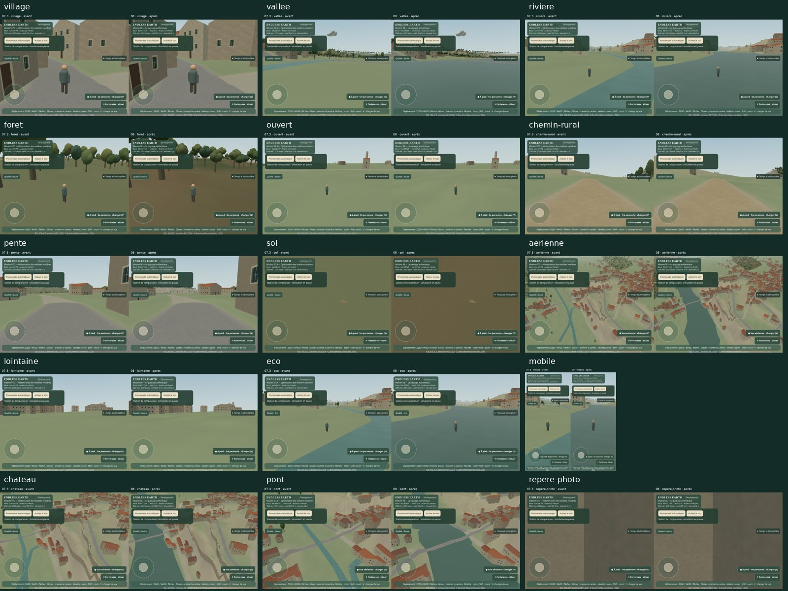

# Mission 08 — Le paysage authentique

Travail sur `mission/08-paysage-authentique`, depuis `origin/main` **aace0c7005d4a2bf42cb2418a5549dcb5d9da695**. La PR #13 est fusionnée le 10 novembre 2026 à 06:31 UTC (vérifié par Git et métadonnées GitHub). Une seule PR en brouillon ; aucune fusion ou publication.

## Audit initial et références

Rapports Missions 05, 06, 07, 07.1, 07.2 et 07.3 examinés. Le terrain est une grille IGN/RGE ALTI de 201 × 201 points espacés de **10 m**, 2 × 2 km, altitudes 63,93–126,37 m. Il s'agit d'échantillons API du 8 novembre 2026 ; la date d'acquisition et la résolution native ne sont pas connues. Repère métrique local historique, X est / Z sud ; pas une nouvelle projection cadastrale. Le datum est libellé « IGN normal elevations » par la source existante, sans contrôle indépendant IGN69. Les collisions et les surfaces partagent la même interpolation triangulaire.

L'extrait OSM du 8 novembre 2026 contient 921 bâtiments rendus, les axes routiers, cinq polygones d'eau, un axe de rivière, deux seuils, un pont et une enceinte de château. **Les deux forêts portent explicitement une provenance CORINE 2006** ; une extraction OSM de 2026 ne rajeunit pas cette information. Un massif est feuillu, l'autre mixte ; aucune essence n'est attestée. Pas de prairies, cultures, jardins, vergers, haies ou zones humides cartographiés dans cet extrait. Les secteurs non renseignés restent inconnus.

Les maisons sont des reconstructions procédurales sur empreintes réelles ; 920 hauteurs sur 921 sont inférées. Les ruines ont un plan OSM et une élévation illustrative. Le pont n'a pas de relevé architectural. Les routes sont la partition commune terrain/chaussée de 07.1, avec atlas RG et matières de 07.3. Leur largeur est généralement estimée. Les systèmes de lumière, météo, vent, oiseaux et audio sont conservés.

Défauts observés sur les captures initiales : rivière principalement cachée sous le DEM parce que chaque grand polygone était aplati au minimum d'une rive ; les seuils `waterway=weir` étaient en revanche dessinés comme des rubans d'eau de 6 m. Les couronnes ont une forme répétitive. Le sol reste très uniforme et les sous-bois peu lisibles. Les coûts existants incluent une génération architecturale synchrone, 25 tuiles terrain, instances végétales et petits lots de détail progressifs avec caches bornés.

[Captures initiales et paramètres](mission-08-captures/before.json) ; le protocole fige le 21 juin 2026 à midi UTC, la caméra, le viewport et les LOD. SwiftShader est un moteur **logiciel**.

## Accès aux données

[Requêtes réseau réelles](mission-08-captures/source-probes.json) : refus CONNECT HTTP 403 pour Géoplateforme WFS et téléchargements, Géoservices IGN, miroir public data.cquest.org, Sandre, Copernicus, data.gouv et Wikimedia. Un seul essai par voie, pas de contournement. La documentation publique peut être étudiée via recherche Web et le dépôt officiel IGNF ; cela ne signifie pas que ses fichiers géographiques ont été téléchargés. Aucun nouveau MNT réel n'est intégré, aucune précision géographique supplémentaire n'est revendiquée.

## 1. Sources étudiées et intégrées

L'[audit des dix familles de sources](mission-08-sources.md) distingue documentation, couverture visée et fichier local effectivement inspecté. Les sources intégrées restent **l'extrait OSM existant et la grille IGN existante**. Le MNT LiDAR HD, BD ORTHO, BD TOPO, BD Forêt, OCS GE, RPG et BD TOPAGE n'ont pas été importés. Les refus CONNECT 403 n'ont pas été répétés indéfiniment. La [demande de données](mission-08-data-request.json) donne l'emprise exacte, les neuf cellules kilométriques de sélection et les pièces nécessaires ; les noms binaires non résolus restent inconnus.

## 2. Résolution et statut des informations

| Attribut | Avant | Après |
|---|---|---|
| Échantillonnage altimétrique | IGN API 10 m | **10 m, identique octet pour octet** |
| Géométrie proche / collisions | Triangles source communs | Mêmes plans, subdivisions des contours d'eau |
| LOD lointain | Erreur maximale 25 cm ; routes protégées | Même budget ; eau également protégée |
| Occupation des sols | Deux forêts OSM héritées CLC 2006 | Mêmes contours et millésime ; provenance par attribut |
| Raster de couleur | Pas 2 m | Pas 2 m ; **pas une précision géographique de 2 m** |
| Rivière | Grand polygone plat caché, rubans sur les seuils | Contours OSM visibles, drapés sur le DEM, altitude non mesurée |

Les empreintes, axes et contours sont des informations cartographiques réelles. Les altitudes sont des échantillons documentés, avec leurs limites de datum et de date. Les hauteurs ordinaires, silhouettes végétales, couleurs, litière et écailles de matériaux sont des interprétations procédurales. Aucune nouvelle essence ou hauteur patrimoniale n'est déclarée mesurée.

## 3. Relief

Aucun sommet source n'est déplacé. La partition terre/route/eau coupe les triangles IGN et conserve leur interpolation, les normales et les hauteurs communes. L'eau ne constitue plus une couche concurrente : contact exact avec la terre, sans fissure, `polygonOffset` ou surface flottante. Les cellules portant une rive interdisent la simplification ; les faces d'eau sont identiques aux deux LOD. L'amélioration concerne la **lecture du relief et du réseau hydrographique**, pas la précision du MNT. Le drapé reste ondulé comme les données de 10 m : il ne devient pas une surface hydrologique nivelée.

## 4. Occupation des sols

Les zones inconnues restent sans classe. Aucun champ, prairie, jardin, verger ou haie n'est ajouté en l'absence de données. Une règle commune au raster et à la végétation permet à un usage local explicite de primer sur un polygone CLC généralisé ; elle n'affirme pas qu'un tag OSM non daté est récent. Les tests couvrent cet emboîtement et les trous. Le manifeste conserve les identifiants, `source`, année CLC et type foliaire de chaque massif. La couleur de sous-bois est une palette illustrative et son alpha un poids de mélange, pas un niveau de certitude.

## 5. Végétation et deux passes artistiques

**Passe 1** : couronnes feuillues à six lobes au lieu d'une silhouette ovoïde répétitive, mêmes 120 triangles proches ; 60 au loin. Palette régionale sobre et motifs de sol dans les seules zones forestières connues. Le calcaire du DEM réapparaît progressivement dans les fortes pentes. [Captures de la passe](mission-08-captures/pass1.json).

**Passe 2** : teintes du sous-bois rééquilibrées, occlusion de canopée calculée une seule fois dans les couleurs de sommets, cohérence des silhouettes lointaines et disparition progressive des rides d'eau entre 25 et 100 m. Les seuils ne servent plus à déduire un habitat riverain. Les arbres supplémentaires des berges inconnues sont retirés : **1 650 → 1 587 ancrages**, sans augmentation de densité. Les premiers mètres gardent branches, feuilles, fougères et herbes déterministes. [Deuxième passe](mission-08-captures/pass2.json).

Instancing, culling, hystérésis, ressources mutualisées et cache de quatre cellules de détail cachées sont conservés. La préparation de recettes examine au plus 256 essais par mise à jour, en blocs de 32, avec une cible de 2 ms. Un bloc indivisible ou le tampon final peut dépasser cette cible ; les maximums observés sont exposés, sans promettre une borne temporelle dure sur tous les appareils.

## 6. Eau, berges et éléments emblématiques

L'union des cinq polygones d'eau est préparée hors navigateur, avec leurs îlots. Elle est soustraite uniquement au sol naturel ; la route garde la priorité aux traversées. Les lignes `waterway=weir` ne sont plus rendues comme des rivières de 6 m de largeur. La surface d'eau occupe environ **112 030 m²** dans le monde préparé, après priorité routière. Ce nombre est calculé dans le repère local et ne constitue pas un relevé de surface hydrologique.

Les matières et sources routières sont conservées octet pour octet. La nouvelle découpe introduit **12 subdivisions de triangles routiers** aux jonctions avec les contours d'eau ; la surface totale reste identique à moins de 0,001 m² dans le contrôle numérique. Les faces routières restent identiques entre LOD, ancrées au DEM et sans décalage. [Contrôle des sources, matières et chaussées](mission-08-captures/road-preservation.json).

Le château conserve son plan OSM et ses hauteurs illustratives. Le pont demeure une traversée drapée, sans tablier élevé ni arches documentées. Aucune tour, arche ou façade historique supplémentaire n'est inventée. Le gain de reconnaissance vient surtout du vrai contour de l'Anglin, des espaces ouverts préservés et de la cohérence des boisements ; la silhouette patrimoniale reste une priorité ultérieure.

## 7. Huit points de vue et contrôle local

Le [manifeste de références](mission-08-references.json) recense auteurs, licences, dates, GPS lorsqu'ils existent, recherches infructueuses et écarts restants pour huit situations : panorama, rivière, château, pont, rue ancienne, chemin rural, forêt et vallée depuis les hauteurs. Les vues du jeu sont reproductibles ; **aucun score de correspondance photographique n'est revendiqué**.

Deux positions GPS et le panorama de vallée donnent des repères documentaires ; la hauteur d'œil, le cadrage, le pitch et parfois la direction ne sont pas calibrés. L'une des caméras GPS tombe même dans une reconstruction de bâtiment : cette capture de diagnostic ne prouve pas une correspondance réelle. La vue du pont initialement obstruée est remplacée par une paire aérienne fraîche, aux mêmes paramètres avant/après. Pour rue, forêt et chemin rural, les recherches n'ont pas établi une photographie libre avec caméra connue. Ces limites ne sont pas masquées par un faux alignement ou par des détails inventés. Aucun habitant n'a encore évalué le « waouh local ».

## 8. Comparaisons visuelles et mouvement



[**Planches comparatives — quinze paires**](mission-08-captures/comparaisons.html), à caméra, éclairage, météo, profil et viewport identiques. Le script vérifie également caméra rendue et altitude du point. Midi UTC du 21 juin 2026 est figé ; les termes « Éco » et « Mobile » désignent le profil et le viewport de test, pas un téléphone matériel.

| Vue | Comparaison |
|---|---|
| Village / rue ancienne | [Avant–après](mission-08-captures/compare-village.jpg) |
| Vallée | [Avant–après](mission-08-captures/compare-vallee.jpg) |
| Château | [Avant–après](mission-08-captures/compare-chateau.jpg) |
| Rivière | [Avant–après](mission-08-captures/compare-riviere.jpg) |
| Pont | [Avant–après](mission-08-captures/compare-pont.jpg) |
| Forêt | [Avant–après](mission-08-captures/compare-foret.jpg) |
| Chemin rural | [Avant–après](mission-08-captures/compare-chemin-rural.jpg) |
| Sol proche | [Avant–après](mission-08-captures/compare-sol.jpg) |
| Aérienne | [Avant–après](mission-08-captures/compare-aerienne.jpg) |
| Panorama lointain | [Avant–après](mission-08-captures/compare-lointaine.jpg) |
| Éco | [Avant–après](mission-08-captures/compare-eco.jpg) |
| Mobile | [Avant–après](mission-08-captures/compare-mobile.jpg) |
| Espaces ouverts | [Avant–après](mission-08-captures/compare-ouvert.jpg) |
| Pente | [Avant–après](mission-08-captures/compare-pente.jpg) |
| Repère GPS photographique, diagnostic obstrué | [Limite visible](mission-08-captures/compare-repere-photo.jpg) |

Les stations rivière et vallée peuvent être dans une emprise exclue de navigation : ce sont des caméras de comparaison, pas la preuve d'un avatar autorisé à marcher dans l'eau. Les séquences de mouvement couvrent neuf trajectoires, six rendus successifs par version : fixe, lent, rapide, rotation, aérienne, zoom, LOD, forêt et rivière. [Avant](mission-08-captures/motion-before.json), [après](mission-08-captures/motion-after.json), [index des animations](mission-08-captures/mouvement.html). Une caméra fixe doit produire six hashes WebGL identiques ; les trajectoires mobiles doivent produire des images distinctes. Ce contrôle accompagne l'inspection des séquences et ne prouve pas une absence universelle de scintillement sur tous les GPU.

## 9. Performances

Chromium/ANGLE, **SwiftShader logiciel**, mêmes stations et éclairage. Trois paires alternées retenues, **21 échantillons synchronisés par vue et par paire**, soit 63 par version et par vue. Le temps comprend soumission, attente de fin de rendu et lecture des pixels : ce n'est pas un chronomètre GPU matériel. La première paire a été exclue car l'assemblage des planches/WebP a chevauché son exécution ; une paire isolée supplémentaire la remplace. Les séries retenues 2, 3 et 4 et le motif d'exclusion sont dans [benchmark.json](mission-08-captures/benchmark.json), avec les résultats initiaux conservés séparément.

| Station | Médiane avant → après (ms) | Écart | Appels avant → après | Triangles avant → après |
|---|---:|---:|---:|---:|
| Village Qualité | 425,4 → 435,5 | +2,4 % | 120 → 109 | 247 134 → 245 249 |
| Rivière Qualité | 270,9 → 232,4 | -14,2 % | 102 → 91 | 194 213 → 190 528 |
| Forêt Qualité | 198,6 → 193,5 | -2,6 % | 39 → 35 | 111 379 → 108 768 |
| Aérienne Qualité | 417,1 → 394,9 | -5,3 % | 151 → 140 | 262 305 → 259 224 |
| Rivière Éco | 266,4 → 213,7 | -19,8 % | 100 → 89 | 172 611 → 169 530 |
| Mobile Éco | 156,8 → 112,1 | -28,5 % | 52 → 41 | 122 266 → 118 837 |

Le gain est net dans les stations rivière, Éco et mobile ; la forêt et l'aérienne sont également moins coûteuses dans cette série. **Le village reste plus lent de 2,4 %** : aucun gain universel n'est établi. Les p95 et maximums de chaque station sont conservés dans la [synthèse](mission-08-captures/summary.json). Le p95 village après atteint 547,6 ms sur ce moteur logiciel. Aucun 60 FPS, débit GPU physique ou résultat Android matériel n'est revendiqué.

La passe de performance évite les lectures d'atlas de couverture sur routes/eau et les lectures de sol sous l'eau. La classe d'eau partage le varying de classe existant ; aucune texture ni passe supplémentaire. L'[équivalence de deux zones](mission-08-captures/shader-equivalence.json) a été vérifiée pour cette seule optimisation au commit `635bce6`, **avant la retouche volontaire du contraste lointain**. Le coût des shaders est évalué indirectement par les rendus synchronisés, pas par un compteur GPU d'instructions ou un chronomètre matériel isolé.

Chargement local jusqu'à disponibilité : médianes **8,044 → 8,741 s**, avec trois valeurs par version (avant 8,021–8,973 s ; après 8,414–8,950 s). Ce n'est pas un essai réseau mobile et aucun gain de chargement n'est annoncé. La création CPU des objets terrain passe d'une médiane de **2,1 à 2,7 ms** sur neuf appels par version. La génération initiale architecturale garde ses 921 bâtiments et son ordre de grandeur de plusieurs centaines de millisecondes ; son algorithme n'a pas été optimisé ici. Le coût CPU complet du chargement n'est pas isolé de la compilation et des transferts.

La surface préparée passe de **117 318 à 119 960 triangles proches** (+2,25 %) et de **103 334 à 106 008 lointains**. La suppression des anciens objets d'eau et de 63 arbres inférés fait néanmoins baisser les triangles effectivement dessinés dans les stations ci-dessus. Les buffers géométriques dédupliqués en village passent de **31,01 à 31,15 Mo** ; environ +0,14 Mo aussi sur les autres stations. Ce compte couvre attributs et indices détenus, y compris LOD, mais pas le tas JS, les matrices d'instances ou toute la mémoire interne du pilote. Les textures du terrain et des finitions gardent environ **11,81 Mo estimés avec mipmaps**, dont **6,48 Mo** pour la finition routière ; sept textures sont comptées sur ces vues. Le grain utilise le même atlas partagé.

Le pack de surface ajoute 75 074 octets compressés ; le raster de sol ajoute 117 545 octets, plus les petits manifestes. Le budget de transfert augmente donc d'environ **0,20 Mo**. La régénération hors navigateur a pris **1,52 s pour atlas/LOD et 46,93 s pour la partition complète**, puis les cinq fichiers régénérés ont été comparés octet pour octet aux livrables : [déterminisme](mission-08-captures/determinism.json).

Pendant les 450 m, CPU avant soumission : **médiane 7,8 ms, p95 22,5 ms, maximum 95,6 ms** ; soumission : **1,4 / 6,7 / 1 041,5 ms**. Intervalles d'images : médiane 230,8 ms, p95 384,3 ms, maximum 1 067,7 ms. La trace est complète, non plafonnée, et la synthèse filtre les images de marche active. Les captures périodiques et observations CDP restent dans ce protocole. Les pics ne sont pas attribués sans preuve à un seul sous-système : [cinq pics par catégorie et positions](mission-08-captures/walk-latency.json). Les recettes naturelles atteignent 2,8 ms par tranche et 6,1 ms pour un tampon final. **Ces mesures ne permettent pas d'affirmer une absence de saccades**, même si plusieurs stations coûtent sensiblement moins cher. La validation GPU matériel reste nécessaire.


## 10. Tests, collisions et promenade

**105 tests Node réussis**, TypeScript/Vite réussis et **un test Python d'import MNT réussi** avec rasterio/pyproj. [Commandes et statuts](mission-08-captures/test-summary.json). Les nouveaux contrôles portent sur l'union des eaux, les îlots, le clipping à l'emprise du DEM, les priorités routières, les classes homogènes, les erreurs de buffers, les faces identiques entre LOD, l'alignement sur les plans source, les sources anciennes et l'absence de forêt automatique sur berges inconnues. Les tolérances numériques des tests ne constituent pas une nouvelle précision géographique.

Navigateur : chargement et déplacement manuel, trois caméras, zooms et pincement, recentrage/rétraction, garde au sol et pentes, collisions bâtiments/murs/eau/privé, reprise manuelle, arrêt automatique, audio (six cycles et douze bascules rapides), profils et viewport mobile. **Onze scénarios de données** passent, dont l'absence du nouvel attribut d'eau ; les dérivés manquants/corrompus/périmés ne sont pas pris pour des données valides. [Validation fonctionnelle](mission-08-captures/validation.json), [données dégradées](mission-08-captures/data-validation.json). Un premier essai audio a échoué avant chargement parce que le serveur local s'était arrêté ; l'essai repris passe. Une reprise des captures a également nécessité des ports/caches Vite distincts pour les deux worktrees ; les captures finales sont celles vérifiées après cette relance.

**Promenade réelle : 450,000 m horizontaux dans le repère local en 391,44 s, 1 686 images de déplacement**, arrivée normale « Fin du parcours OSM validé ». Le script complet, relevé du graphe et contrôles caméra compris, prend 425,82 s. Les **939 nœuds / 918 arêtes**, 921 bâtiments, 10 723 ouvertures et `builds: 1` restent conservés. Pas d'accélération temporelle ni d'autre test navigateur pendant la marche. [Trace complète](mission-08-captures/walk.json), [graphe](mission-08-captures/walk-survey.json), [arrivée mobile](mission-08-captures/walk-arrivee-mobile.png). Les reconstructions de petits détails de proximité restent distinctes de la génération initiale des bâtiments.

Le badge **ENDLESS EARTH · Mission 08 — Le paysage authentique** est sélectionné explicitement par `package.json`. Le vrai bundle de production a été vérifié depuis le commit propre `3049ae3d818b106356fbb7aca8ad228a1137875b` : hash réel, état Git propre, statut **Production**, titre complet à **1280×800, 390×844, 320×568 et 844×390**, aucune commande recouverte et aucune requête réseau de version. [Preuve du bundle](mission-08-captures/build-production-validation.json), [bureau](mission-08-captures/build-production-1280x800.png), [mobile étroit](mission-08-captures/build-production-320x568.png). Les captures artistiques précédentes portent honnêtement une base de travail modifiée ; elles ne servent pas de preuve du hash de production.


## 11. Limites restantes

Le relief reste à 10 m et l'acquisition n'est pas connue ; les berges et falaises fines ne sont pas résolues. L'eau est une représentation drapée du contour OSM, sans bathymétrie, débit ni niveau mesuré. Le pont suit encore le DEM. Les ruines et bâtiments remarquables n'ont pas de modèle patrimonial vérifié. Les deux forêts CLC 2006 sont anciennes et généralisées ; essences, tailles et individus ne sont pas relevés. Prairies, cultures, haies et jardins restent inconnus. La génération initiale des bâtiments conserve son coût synchrone historique. Les recettes naturelles ont un budget souple et un tampon final à coût borné en nombre d'éléments, sans garantie dure en millisecondes. Les replis en cas de dérivé absent restent les systèmes historiques documentés, sans reconstitution de géographie manquante. Les tests n'établissent pas une performance matérielle Android ni un accord photographique.

## 12. Prochaine mission, licences et reproduction

Obtenir les neuf cellules de MNT et leurs métadonnées, vérifier CRS/datum/nodata/acquisition/biais, puis importer à une résolution de travail soutenable et régénérer ensemble les surfaces et ancrages. Obtenir ensuite OCS GE/BD Forêt/RPG documentés et une référence patrimoniale mesurable pour le pont et quelques silhouettes du château. Faire évaluer huit vues par un habitant, avec photos de caméra connue, puis mesurer sur GPU matériel et Android physique avant toute promesse de fluidité.

Attributions conservées : **IGN RGE ALTI / Licence Ouverte 2.0**, **© OpenStreetMap contributors / ODbL 1.0**, et provenance **Union européenne – SOeS, CORINE Land Cover, 2006** des deux forêts héritées. Les bases source et dérivés sont disponibles dans `public/data/` avec [licences](../public/data/LICENSE.md). Les matériaux, couronnes et motifs originaux sont procéduraux. Les photographies restent liées, avec leurs auteurs et licences dans le manifeste ; aucun pixel photographique externe n'est redistribué.

```sh
npm ci --cache work/npm-cache
npm run geo:prepare                 # hors ligne, atlas et LOD du terrain
npm run geo:roads                   # hors ligne, partition terre/route/eau
npm test
npm run build
npm run dev                        # résultat sur 5173
node scripts/browser-landscape.mjs after
node scripts/browser-landscape-motion.mjs after
node scripts/browser-landscape-data.mjs
node scripts/browser-landscape-walk.mjs
node scripts/browser-smoke.mjs
node scripts/browser-camera.mjs
node scripts/browser-safety.mjs
node scripts/browser-living.mjs
npm run test:build-identity
python scripts/landscape-sheets.py
python scripts/landscape-motion-sheets.py
node scripts/report-landscape.mjs
node scripts/verify-landscape-evidence.mjs
```

Pour la référence, servir `aace0c7` dans un worktree séparé sur 5176, puis utiliser `TEST_PORT=5176 node scripts/browser-landscape.mjs before` et `node scripts/browser-landscape-motion.mjs before`. Installer les dépendances dans chaque worktree, ou configurer un `cacheDir` Vite distinct si `node_modules` est partagé. Dans les essais livrés, les dépendances et la configuration locale non suivie rendent le statut de la référence modifié ; ses fichiers produit suivis restent ceux de `aace0c7`. Le benchmark attend les serveurs 5176 et 5173 et doit tourner seul : `node scripts/benchmark-landscape.mjs`. Trois ordres alternés avant/après, sans navigateur de test concurrent. Le badge **Mission 08 — Le paysage authentique** provient du rapport actif et embarque le vrai commit et l'état de compilation ; aucune version n'est devinée du nom de branche.
