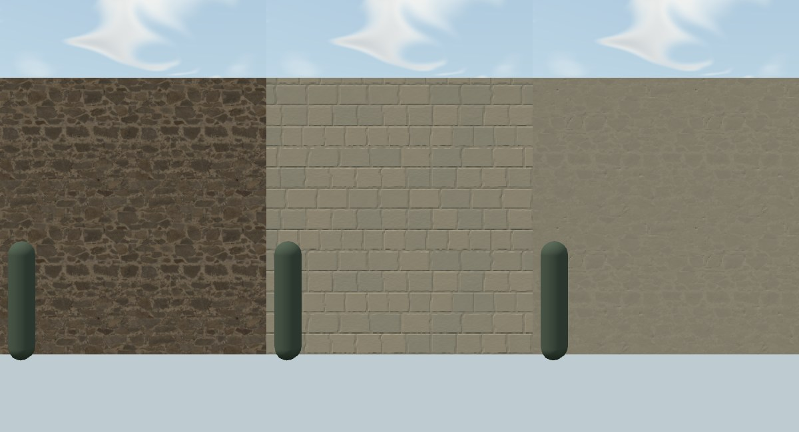
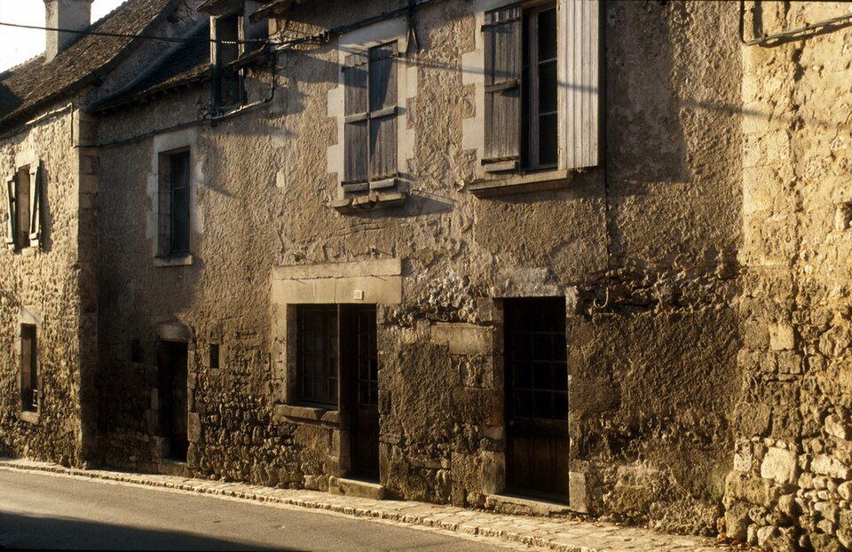
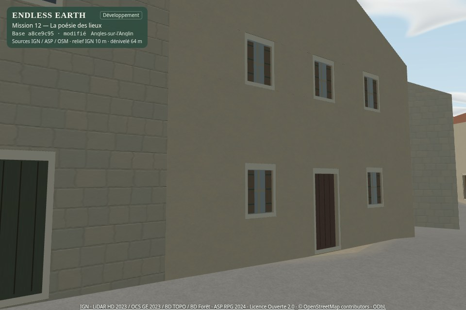
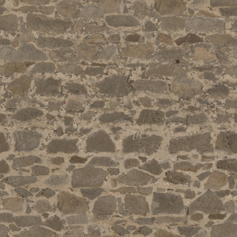
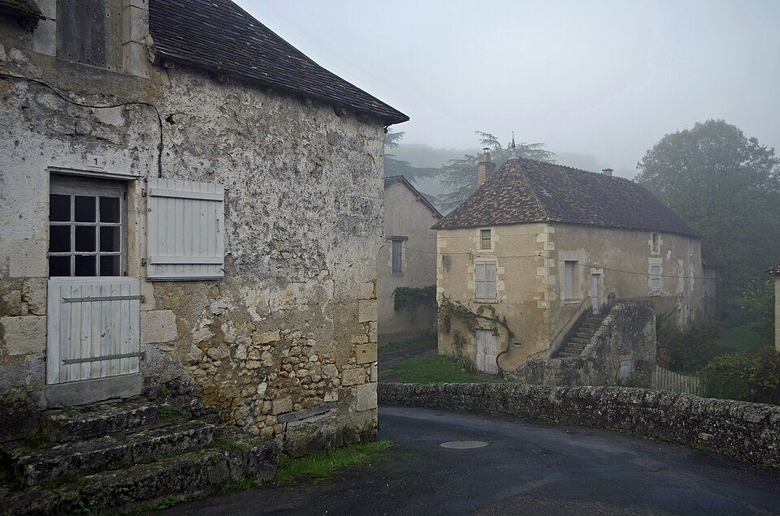
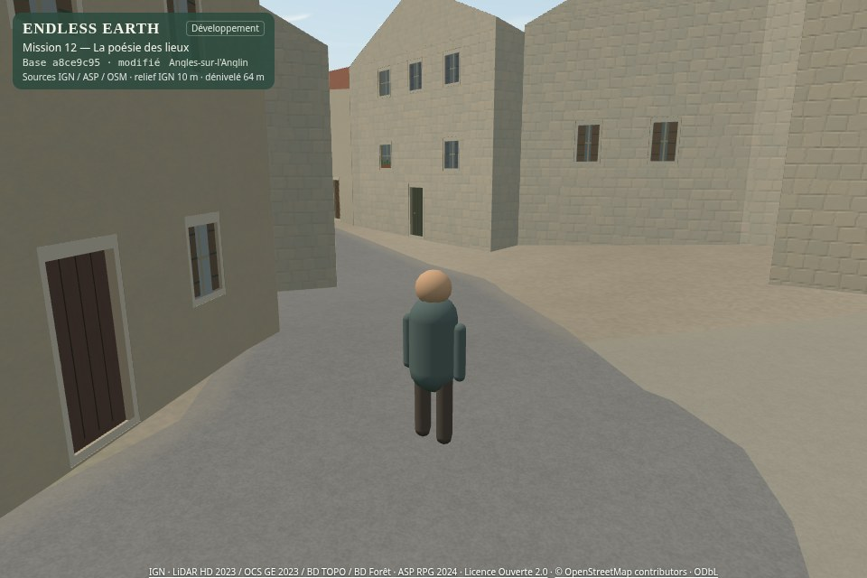
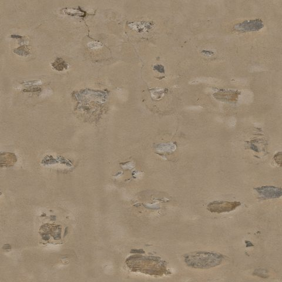
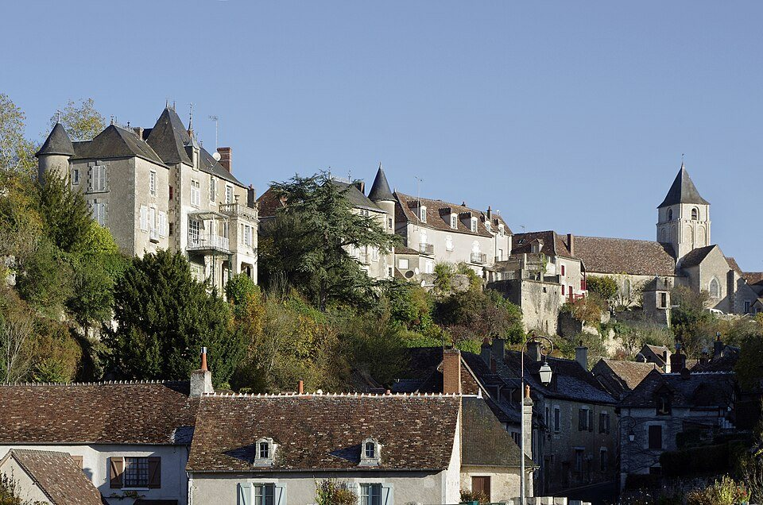
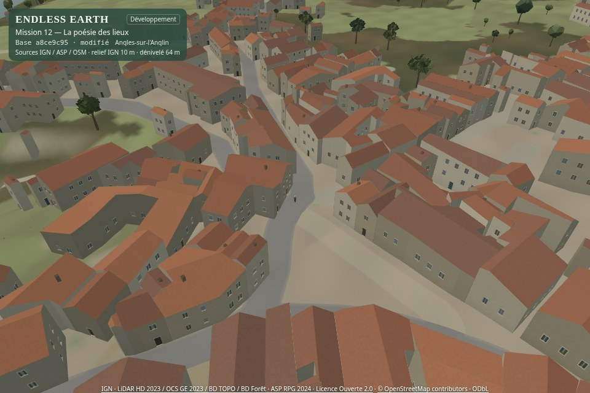
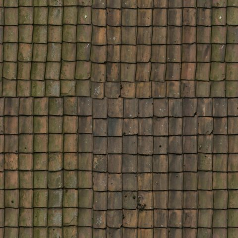

# Mission 13 — Les matières authentiques de France

**13A et 13B livrés. Arrêt avant 13C, pour validation artistique.** Budget : **0 €**. La PR #22 reste en brouillon, sans fusion ni déploiement.

## Jalon 13B — Une bibliothèque partagée à éprouver dans le paysage

L’accord **« Go »** après la livraison 13A ouvre uniquement B depuis `b59348d`. **Dix matériaux CC0** sont préparés hors ligne. Le village, ses matériaux Mission 12, la géographie, les dimensions, les collisions, le streaming, les arbres, le ciel, la météo et l’audio restent inchangés. Le nouveau module est utilisé seulement dans une scène de matériaux de développement ; il n’est pas importé par le jeu de promenade.

Ouvrir la **[galerie 13B : PBR / Mission 12 / hybride](mission-13-evidence/materials/index.html)** et l’atelier interactif local, décrit plus bas. Les comparatifs viennent du vrai navigateur WebGL, avec la même géométrie, la même caméra, les mêmes dimensions et la même lumière. La scène est synthétique : elle ne prétend pas montrer Angles déjà transformé.

### Les choix proposés à votre appréciation

- **Pierre irrégulière : piste prioritaire.** La source apporte des joints moins réguliers ; l’hybride tempère leur contraste et retrouve la palette du jeu.
- **Enduits : conserver la retenue.** Le témoin fin est déjà satisfaisant. L’enduit usé est une réserve ; ses lacunes deviennent très discrètes en hybride. Aucun remplacement systématique n’est proposé.
- **Tuile : dessin plus petit, encore à juger.** Les petits éléments rectangulaires sont moins bombés que le témoin ; la lecture des rangs en hybride est très fine. La scène de rue devra décider si ce détail vaut son coût et reste stable en mouvement.
- **Gravier et sols : choix conditionnels.** Ne pas changer une classe géographique pour utiliser un asset. Le gravier hybride n’est pas moins coûteux que le témoin dans l’essai ; une conservation du procédural reste possible.
- **Roches : distinguer texture et calibrage.** La roche actuelle reste le témoin. Rock023 est une alternative structurée, sans géologie locale déduite.



*Pierre irrégulière, même surface métrique et même caméra. Source Old Stone Wall, Charlotte Baglioni, Poly Haven, CC0. Capsule de 1,65 m. Les autres matériaux, les grandes surfaces et les éclairages moins flatteurs sont conservés dans la galerie.*

### Bibliothèque, échelles et cartes utiles

[Catalogue livrable](../public/materials/authentic/catalog.json) · [sources et empreintes des cartes originales](../public/materials/authentic/sources.json) · [paramètres de préparation](../scripts/mission-13-materials.json) · [décisions par matière](mission-13-evidence/materials/decisions.json).

| Matière | Référence CC0 | Mètres par tuile | Statut |
| --- | --- | --- | --- |
| Pierre irrégulière | Old Stone Wall | 2 × 2 | Piste prioritaire ; largeur fournisseur. |
| Pierre appareillée | Bricks099 | 2 × 2 | Réserve, échelle artistique ; lithologie locale inconnue. |
| Enduit fin | White Plaster 02 | 1 × 1 | Gain discret face au témoin ; largeur fournisseur. |
| Enduit discontinu | Plaster Stone Wall 01 | 2,3 × 2,3 | Réserve ; largeur fournisseur arrondie. |
| Petite tuile | Roof Tiles 14 | 1,5 × 1,5 | À juger en rue ; pas de profil local certifié. |
| Gravier | Gravel Floor | 2,25 × 2,25 | Classe compatible documentée uniquement. |
| Terre sèche | Brown Mud Dry | 1,3 × 1,3 | Générique, largeur fournisseur arrondie. |
| Terre humide | Brown Mud | 1,3 × 1,3 | Réserve de contact ; aucune vase généralisée. |
| Roche structurée | Rock023 | 2,5 × 2,5 | Échelle artistique faute de donnée fournisseur. |
| Roche existante recalibrée | Rock Face 03 | 2,7 × 2,7 | Largeur fournisseur ; témoin M12 conservé à 27 m. |

**Correction étayée :** la [fiche officielle Rock Face 03](https://polyhaven.com/a/rock_face_03) et son API indiquent **2,7 m**, et non 27 m comme l’affirmait le rapport Mission 12. Les 27 m restent son ancien réglage artistique dans le témoin, sans correction du moteur en B. Cette différence est explicitement conservée dans les comparatifs ; son gain ne doit pas être attribué entièrement à un nouveau shader.

Le PBR emploie **couleur, hauteur normalisée du fournisseur et rugosité**. Le relief reste une amplitude de shading artistique, sans déplacement géométrique ni carte de relief prétendument exacte tirée d’une seule photo. Les normales originales sont épinglées dans la provenance mais non livrées : le canal de hauteur suffit au relief retenu. AO non ajouté. L’hybride Lambert utilise un seul atlas ton/hauteur/chaleur relative/rugosité ; sa réponse diffuse n’utilise pas la rugosité pour un reflet spéculaire. Le témoin utilise les vrais shaders et atlas Mission 12.

La préparation réduit les sources 1K à **256² par matériau**, rapproche les bords sur une bande de 8 pixels et ajoute des gutters périodiques de 16 pixels. Elle réduit une partie de l’éclairage large et des dominantes photographiques, sans prétendre restituer un albédo exact. Palette, bornes de ton et distances d’atténuation reprennent l’ADN existant. Décalages par identité géographique stable, faible teinte à grande échelle et filtrage limitent la répétition ; **les motifs d’une source unique restent reconnaissables sur 24 m**. Aucun joint ou rang de tuile n’est tourné aléatoirement.

### Formats et coût

Trois atlas partagés **1152 × 864**, douze cases dont dix utiles. Les tailles sont celles des fichiers effectivement livrés ; tous les matériaux réutilisent ces atlas, sans fichier 2K/4K par maison.

| Fichier | Octets compressés | GPU estimé, mipmaps inclus |
| --- | ---: | ---: |
| Couleur PBR JPEG | 327 866 | 5,06 Mio |
| Hauteur/rugosité PNG, décodé RG8 | 938 777 | 2,53 Mio |
| Hybride PNG RGBA8 | 1 578 189 | 5,06 Mio |

Total des trois fichiers : **2 844 832 octets**. Un choix PBR emploie environ **7,59 Mio**, un choix hybride **5,06 Mio**, estimés par le compte des texels et niveaux de mip ; aucune allocation GPU physique mesurée. Les empreintes, canaux, dimensions et amplitudes sont dans le catalogue. Sources et archives d’environ 28,4 Mo restent dans `work/`, hors Git. Les petits aperçus sont documentaires.

Mipmap, gradients non repliés, anisotropie bornée à 4 (1 en Éco) et relief fin désactivé en Éco. JPEG/PNG restent compatibles avec le WebGL2 existant. KTX2/Basis est différé : aucun gain de transcodage mesuré ne justifie ici une nouvelle chaîne de dépendances. Les ressources sont prêtes avant chargement ; **aucun appel à Poly Haven ou ambientCG pendant les inspections**.

### Comparaison technique réelle

**405 rendus synchronisés avec lecture complète des pixels**, Chromium 156 / SwiftShader, 800 × 600, trois passages alternés et 15 échantillons par combinaison. Extrait Équilibré, médianes :

| Échantillon | PBR | Mission 12 | Hybride |
| --- | ---: | ---: | ---: |
| Pierre irrégulière | 69,8 ms | 62,3 ms | 60,6 ms |
| Tuile | 68,1 ms | 64,7 ms | 49,0 ms |
| Gravier | 83,5 ms | 58,6 ms | 70,4 ms |

Les trois profils, P95, maxima, appels et triangles sont dans la [synthèse](mission-13-evidence/materials/summary.json), avec [trace compressée](mission-13-evidence/materials/measurements.json.gz). Les trois approches ont **4 appels et 686 triangles** dans ces échantillons. Elles n’emploient pas le même modèle de shading : PBR Standard, témoin et hybride Lambert. Ce compromis est mesuré dans un atelier simple ; **aucun pourcentage n’est extrapolé à la promenade, aucun FPS GPU physique ou Android revendiqué**.

Les dix matériaux sont contrôlés dans **sept situations** : matin, après-midi, soir, nuit, couvert, pluie, soir pluvieux. Les grandes surfaces et une vue à 80 m sont conservées. Trois remplacements de bibliothèque retrouvent **7 géométries, 10 textures et 7 programmes** après le premier rechargement chaud. Heap après GC : environ **6,00 → 5,79 → 5,83 → 5,84 Mo** ; test fini, sans garantie d’absence de fuite infinie. Un nouveau fichier corrompu conserve la dernière bibliothèque valide ; les identités restent identiques au rechargement et entre profils.

**183 tests Node**, TypeScript/Vite et contrôles du vrai navigateur passent. Deux préparations donnent les mêmes atlas et catalogue octet pour octet. Le jeu compilé est vérifié séparément : chargement, déplacement, trois vues, hauteur des yeux, son et mobile ; **zéro requête vers la nouvelle bibliothèque**. Le bundle garde sa taille d’environ 734,12 ko (avertissement >500 ko préexistant). Les nouveaux fichiers `public/` augmentent le contenu distribué de `dist/`, mais ne sont pas téléchargés par la promenade. [Préservation](mission-13-evidence/materials/preservation.json) · [validation](mission-13-evidence/materials/validation.txt).

### Reproduire et décider

```sh
npm ci
npm run dev -- --port 5173
```

Atelier : `http://localhost:5173/endless-earth/fixtures/materials.html?perf=1&moment=afternoon&weather=clear&date=2026-06-21T12:00:00Z`. Galerie : `http://localhost:5173/endless-earth/docs/mission-13-evidence/materials/index.html`. [Préparation et protocole complet](mission-13-evidence/materials/README.md). Aucune URL publique autonome ni aucun déploiement revendiqué.

**Validez-vous cette bibliothèque et les réserves proposées pour passer à 13C ?** L’intégration dans les bâtiments, sols et falaises réels, les nouvelles promenades et la comparaison perceptive à l’échelle du village restent **non commencées**. **Arrêt après 13B ; attendre l’accord explicite du propriétaire avant 13C.**

---

## Référence du jalon 13A — recherche validée par l’accord « Go »

La section suivante conserve l’analyse de départ. Les propositions et arrêts 13A y décrivent l’état historique ; le statut courant est celui de 13B ci-dessus.

**Référence livrée en 13A**, avant la préparation de bibliothèque. Recherche et audit uniquement ; moteur et géographie conservés. Budget : **0 €**.

Ouvrir la **[galerie illustrée : photos / jeu actuel / candidates](mission-13-evidence/index.html)**. Elle présente huit familles, les huit vues de référence du moteur et le catalogue avec crédits, droits, dimensions et empreintes. Les candidates sont des diffuses brutes consultées, pas des captures d’un rendu Mission 13.

## Ce que l’étude propose

1. **Pierre et enduits d’abord.** Les vues ordinaires montrent des moellons irréguliers, des encadrements plus réguliers et plusieurs degrés de couverture d’enduit. Les façades actuelles ont une palette cohérente mais des assises trop uniformes. Un mélange photographique adouci et procédural paraît la piste la plus utile en promenade.
2. **Le dessin des toitures avant leur résolution.** C09/C22 montrent de petits éléments rectangulaires, des rangs serrés et des nuances brun-roux/sombres. Roof Tiles 14 est une piste plus proche que les couvertures largement ondulées examinées ; son vieillissement reste trop marqué. L’identification précise de chaque toit demeure inconnue.
3. **Sols et roche ensuite, avec des témoins conservés.** La roche de Mission 12 utilise déjà une source photographique CC0 harmonisée. Son remplacement doit prouver son avantage. Conserver initialement herbe, litière, bois, pavage et eau procéduraux ; ne pas transformer un chemin inconnu en gravier ou en pavés.

| Photo locale effectivement examinée | Jeu actuel, même famille | Candidate CC0 examinée |
| --- | --- | --- |
|  |  |  |
|  |  |  |
|  |  |  |

**Crédits de cette planche :** C18, « Angles - vieilles batisses », Bachelier Jacky, [source](https://commons.wikimedia.org/wiki/File:Angles_-_vieilles_batisses.jpg), [CC BY-SA 4.0](https://creativecommons.org/licenses/by-sa/4.0/). C10 et C09, Daniel Jolivet, [C10](https://commons.wikimedia.org/wiki/File:Angles-sur-l%27Anglin_(Vienne)_(24096695198).jpg), [C09](https://commons.wikimedia.org/wiki/File:Angles-sur-l%27Anglin_(Vienne)._-_Flickr_-_sybarite48.jpg), [CC BY 2.0](https://creativecommons.org/licenses/by/2.0/). Photos réduites proportionnellement et réencodées en JPEG, sous leur licence source. Old Stone Wall et Plaster Stone Wall 01 : Charlotte Baglioni ; Roof Tiles 14 : Rob Tuytel ; Poly Haven, CC0. [Sources et crédits exhaustifs](mission-13-evidence/credits.md). Captures : moteur réel, sources IGN/ASP/OSM et crédits Mission 12 conservés. Ces images ne constituent pas un recalage photographique.

## Audit de Mission 12 et préservation

Dernier `main` vérifié : **`a8ce9c950c4aa3ac1630add0f3d971d9068108c9`**, fusion de la [PR #21](https://github.com/sebastienleidgens-lab/endless-earth/pull/21), le 11 novembre 2026 à 14 h 44, heure de Bruxelles. Lecture de `AGENTS.md`, du rapport final et des quatre jalons : A `bb58c30`, B `96c824a`, C `3cd692e`, D `87035f6`, puis documentation `79dbaf8`.

Checkout initial propre. Branche indépendante **`mission/13-matieres-authentiques-france`** créée depuis ce `main`. Les commentaires historiques de `docs/mission-12.md` mentionnent encore les arrêts successifs ; l’état GitHub établit la fusion effective. Ces preuves historiques n’ont pas été réécrites.

Audit de `src/art/dna.mjs`, `public/art/dna.json`, `docs/art-dna.md`, styles et atlas d’architecture, catalogue des sols, shaders de routes/roche/eau et profils de végétation. L’ADN reste : **paysage calme, tactile, modérément stylisé ; silhouettes avant grain**. Palette minérale sourde, UV métriques, atlas partagés, détails atténués entre 24–110 m sur les façades et 18–100 m sur les sols. Normales discrètes et éclairage Mission 11 conservés.

Les six familles architecturales actuelles sont procédurales dans un atlas **864 × 576**, 1 194 098 octets. Les sols mêlent terre/herbe/litière procédurales et **Rock Face 03**, source 1K préparée en 256² dans l’atlas naturel. Les routes possèdent déjà grain, classes et transitions métriques. L’eau reflète le ciel analytique ; les arbres gardent une expression stylisée. Ajouter partout un PBR complet créerait un risque de discordance et de surcoût.

Dans l’extrait OSM audité en Mission 12, **921 matériaux de façade/toiture sont inconnus et 920 hauteurs sont estimées**. Les photos de cette étude n’ont pas été appariées aux identifiants individuels. Aucune observation n’a été injectée dans les données.

`src/`, `public/`, `fixtures/`, dépendances, configuration et `.github/` sont identiques à la base. Relief, altitudes, empreintes, dimensions et provenance, routes, collisions, navigation, eau, arbres, streaming, climat, audio, profils et budgets restent intégralement conservés. Living Paintings / LP-01 est inchangé. [Preuve par diff et arbres Git](mission-13-evidence/preservation.json).

## Références réelles et analyse locale

**38 entrées utiles : 15 photos Commons, 2 vues Panoramax, 21 textures CC0.** [Catalogue structuré](mission-13-evidence/catalog.json), [observations par famille](mission-13-evidence/findings.json), [rejets et accès](mission-13-evidence/rejected.json). Les fichiers ont été téléchargés puis réellement examinés ; gros plans supplémentaires consultés pour les murs, enduits, tuiles et roches. Les miniatures documentaires sont séparées des ressources du jeu.

| Famille | Observations étayées | Incertitudes à garder |
| --- | --- | --- |
| Pierre | C10/C18 : éléments irréguliers gris-beige, joints variables, enduit partiel ; encadrements plus réguliers. | Pas d’échelle absolue ni de roche exacte déduite. Tous les bâtiments ne partagent pas cette finition ; C24 montre aussi des pans de bois. |
| Enduit | C14/C25 : grains et teintes différents ; C10 : usure laissant voir la pierre. | Lumière chaude ou ombre dans les photos ; ni albédo mesuré ni enduit dégradé à généraliser. |
| Toitures | C09/C19/C22 : petits éléments superposés, variations rousses/brunes et zones sombres. | Forme exacte, matière des couvertures sombres et dimensions non certifiées par bâtiment. |
| Sols | C16 : pavage irrégulier d’une ruelle ; Panoramax : chaussées revêtues ; C15 : cour minérale. | Pas de mesure rapprochée fiable de la terre ou du gravier des chemins du jeu. |
| Roche | C05/C07/C08 : surfaces claires, fissures et grandes ruptures, végétation ponctuelle ; certaines lignes de structure visibles. | Une texture ne peut restituer les ruptures géométriques absentes du MNT à 10 m ; aucune identification géologique exacte. |
| Berges | C20 : rive herbeuse ; C08 : autre contact bâti/rocheux avec végétation et seuil. | Pas de substrat vaseux universel, profondeur ou débit déduit. |

Panoramax fournit une couverture locale effective : deux panoramas SD géolocalisés de rues, crédits conservés par image. Distorsion, véhicule et lumière restent visibles. Une autre image éblouie est rejetée. La [référence IGN BD ORTHO 2023 déjà présente](mission-08-5-captures/geographic-coverage.jpg) a été examinée avec son manifeste Mission 08.5 : utile pour les masses végétales et la répartition des surfaces, sans preuve de matériau de façade. Aucun nouveau téléchargement IGN n’est revendiqué.

## Droits et provenance

Les licences officielles [Poly Haven](https://polyhaven.com/license) et [ambientCG](https://docs.ambientcg.com/license/) autorisent l’usage, la transformation et la redistribution des assets CC0, y compris dans un jeu commercial. **Toutes les candidates de matériau proposées ici sont CC0.** Auteur, titre, URLs, date du contrôle, dimensions, format, portée du SHA-256, échelle disponible, usage et confiance figurent dans chaque entrée.

Pour Poly Haven, les empreintes couvrent les JPEG diffus 1K réellement téléchargés. Pour ambientCG, elles couvrent les ZIP 1K-JPG, avec inventaire et empreintes des cartes extraites. Les archives/originaux restent dans `work/`, hors Git. Les aperçus livrés possèdent leur propre SHA-256.

Les photos Commons sont CC BY 2.0 ou CC BY-SA 2.0/3.0/4.0 ; les panoramas sont CC BY-SA 4.0. Attribution, lien de licence et modifications des aperçus sont conservés. **Leur rôle est documentaire ; aucun pixel local n’est approuvé comme matériau du jeu.** Un futur matériau dérivé d’une photo BY-SA demanderait une analyse de compatibilité et de redistribution distincte. Les originaux photographiques non téléchargés n’ont pas de SHA-256 prétendument calculé : le catalogue indique explicitement les miniatures/SD effectivement consultés. [Contrôles juridiques et réponses HTTP](mission-13-evidence/license-checks.json).

Aucune ressource NC, ND transformée, payante ou à droits incertains retenue. Aucun contournement d’accès. La première requête ambientCG employait un paramètre ancien ignoré ; elle a été corrigée avant toute sélection. Kenney/Quaternius non approfondis : bénéfice probable faible pour cette étude limitée aux matières.

## Bibliothèque proposée pour 13B — pas encore fabriquée

| Famille | Référence à tester | Décision actuelle |
| --- | --- | --- |
| Pierre irrégulière | Poly Haven **Old Stone Wall** | Prioritaire ; joints à adoucir. |
| Pierre plus appareillée | ambientCG **Bricks099** | Réserve ; ne pas l’étiqueter calcaire local, la source mentionne sandstone. |
| Enduit fin | **White Plaster 02** | Prioritaire, grain à calibrer. |
| Enduit discontinu | **Plaster Stone Wall 01** | Prioritaire, lacunes à rendre moins reconnaissables. |
| Petite tuile | **Roof Tiles 14** | Essai conditionnel ; forme et mousse à comparer en promenade. |
| Gravier | **Gravel Floor** | Seulement dans les classes compatibles documentées. |
| Terre | **Brown Mud Dry** | Essai secondaire, faible contraste. |
| Contact humide | **Brown Mud** | Réserve, aucune vase généralisée. |
| Roche structurée | ambientCG **Rock023** | Alternative à tester ; échelle physique source absente. |
| Roche actuelle | **Rock Face 03** | Témoin conservé de Mission 12. |

Rejets artistiques visibles dans la galerie : Rustic Stone Wall trop ocré ; Plastered Stone Wall trop sombre ; plusieurs tuiles largement ondulées ou trop régulières ; RoofingTiles002 à dessin arrondi ; Gravel Road trop rouge ; Rock Face trop brun. Forest Floor à feuilles jaunes reste une réserve saisonnière, pas le sous-bois permanent du pilote. La validité CC0 ne suffit pas à justifier l’intégration.

En 13B, comparer **procédural / photographique / hybride** dans le même moteur. Commencer avec un atlas partagé et le moins de cartes utile ; 512–1K est une piste de test, pas une résolution déjà choisie. La mémoire RGBA8 avec mipmaps vaut environ 1,33 Mio par carte 512², 5,33 Mio par carte 1024² ; ce sont des estimations théoriques, pas une allocation GPU mesurée. Dix textures indépendantes avec plusieurs cartes seraient coûteuses. Préserver l’échelle métrique, la palette, les contrastes, les normales modérées et les replis Éco. Aucun nouveau shader, conversion PBR ou atlas Mission 13 n’a été fabriqué en 13A.

## Preuves, performances et limites

Huit captures fraîches du vrai navigateur : **rue, façade, toitures, chemin, sol, falaise, berge, village**. Pour chacune : coordonnées locales et conversion WGS84 approximative selon le repère existant, position/matrices de caméra, heure/météo effectives, profil, résolution et version. [Baseline complète](mission-13-evidence/baseline.json). La station falaise garde volontairement le bâtiment qui masque une partie de la pente ; ce défaut existant n’est pas retouché.

Chromium 156 / **SwiftShader**, 960 × 640, DPR 1, après-midi clair du 21 juin simulé, heure effective 15 h 57 à Angles. Six rendus synchronisés/readback par station : médianes Équilibré **253,9–580,8 ms**, huit textures. À la rue : Éco **461,9 ms**, Équilibré **517,6 ms**, Qualité **524,2 ms**. Ce sont des coûts logiciels descriptifs, sans cadence de marche, P95 robuste ou GPU physique revendiqués. La simulation est tenue pour les prises fixes.

Le code runtime étant identique, **aucun surcoût de matériau ou téléchargement de ces références pendant la promenade** : elles sont uniquement sous `docs/`, hors du build public du jeu. Aucun gain visuel ou de performance Mission 13 n’est encore mesuré. Mission 12 documente un surcoût logiciel de D/M11 de +10,3 à +50,6 % selon profil/vue : cet héritage devra servir au budget de 13B/C.

Contrôles fraîchement rejoués : **179 tests Node**, TypeScript/Vite ; build compilé avec chargement, déplacement, hauteur des yeux, relâchement sans dérive, trois vues, son et mobile 390 × 844 ; 18 changements de station/profil pour architecture et nature, atlas/chunks corrompus et périmés ; **3 déchargements/rechargements réels du pilote**, **30 changements météo/heure/profil**, **36 cycles de ciel**, **24 créations/libérations de contexte audio**. Aucun message d’erreur JavaScript/WebGL dans ces essais. Les tests Node couvrent navigation, collisions, relief, géographie, dimensions, déterminisme des bâtiments/matières et streaming.

Aux quatre instantanés du test de zone : **2 500 ancrages, 125 géométries, 8 textures, 10 programmes**. Heap après GC : **80,10 → 83,63 → 83,82 → 83,91 Mo**. Plateau des compteurs dans ce test fini ; aucune absence de fuite pour toute durée, fluidité Android ou validation matérielle prétendue. Avertissement Vite préexistant : bundle >500 ko. [Synthèse des vérifications](mission-13-evidence/checks/summary.json) et [protocole reproductible](mission-13-evidence/README.md).

Pas de nouvelle vidéo de marche en 13A, puisqu’aucune matière du jeu n’a changé. Les deux promenades Mission 12 de 450 m restent dans sa [galerie finale](mission-12-evidence/final/index.html). Les comparaisons M12/M13, nouveaux matériaux, intégration, optimisation et démonstrations régionales Mission 13 restent **non commencés** : ils appartiennent à B/C/D après leurs accords successifs.

## Prévisualisation et décision du propriétaire

```sh
git switch mission/13-matieres-authentiques-france
npm ci
npm run dev -- --port 5173
```

Galerie locale : `http://localhost:5173/endless-earth/docs/mission-13-evidence/index.html`. Jeu de référence : `http://localhost:5173/endless-earth/?moment=afternoon&weather=clear`. Le rapport Markdown et ses images sont également consultables directement sur la branche GitHub. Aucun hébergement public autonome revendiqué ; GitHub Pages principal et production inchangés. PR en brouillon uniquement.

**À valider :** les priorités pierre/enduit puis toiture, la piste des petits éléments rectangulaires, les ressources écartées et la conservation initiale des matières procédurales sobres. **Autorisez-vous le jalon 13B sur cette base ?** Les tests techniques ne valent pas validation artistique. **Arrêt obligatoire après 13A ; ne pas commencer 13B sans accord explicite.**
