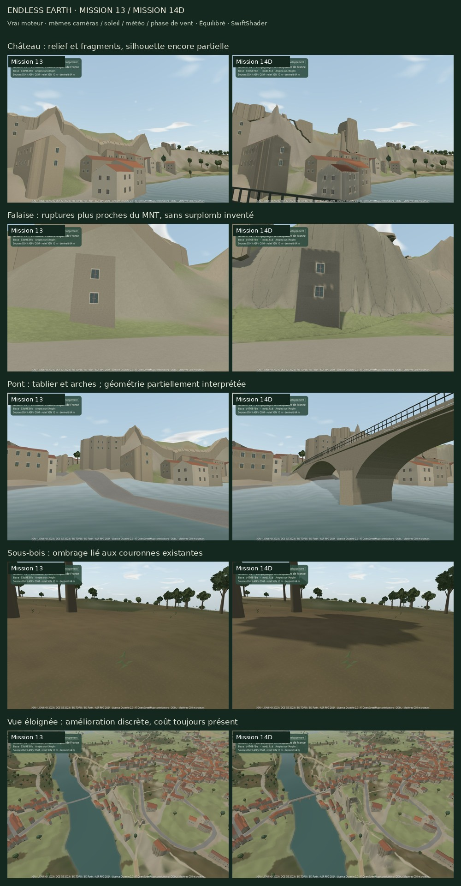
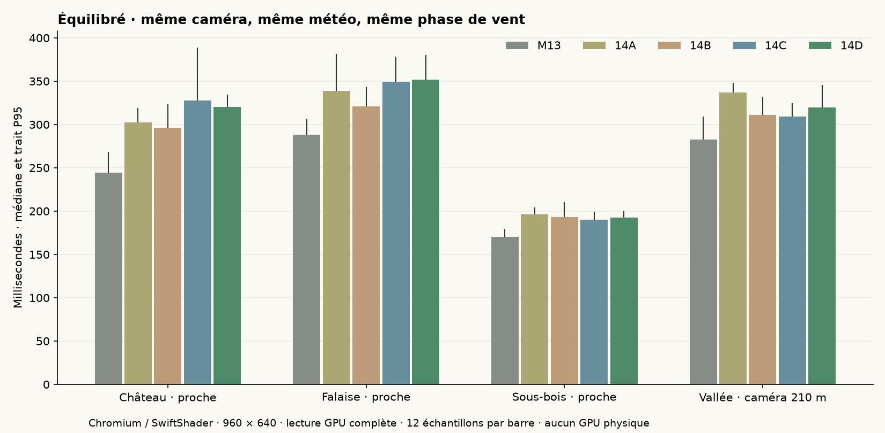
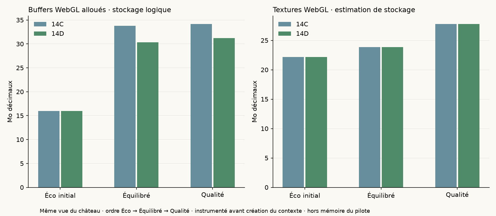
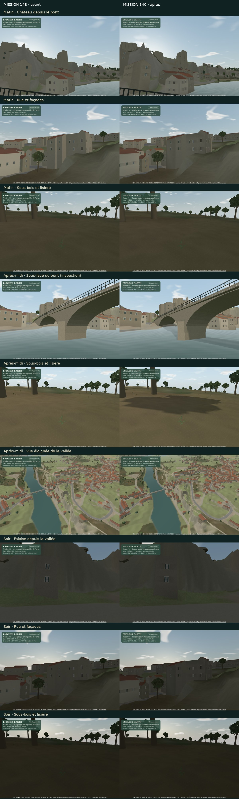
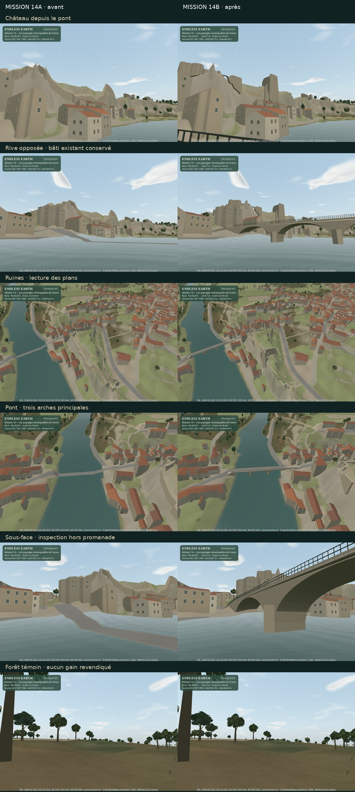
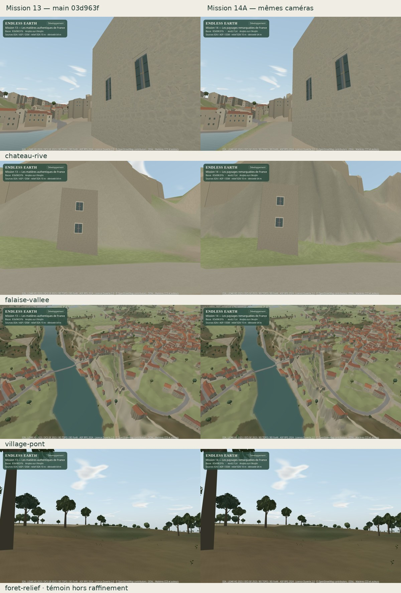

# Mission 14 — Les paysages remarquables de France

## 14D livré — arrêt pour validation artistique finale

Vos **« Go » ont autorisé les jalons A, B, C puis D**. La livraison D harmonise les ombres locales, réduit leurs allocations, vérifie une session native de plus de trente minutes et démontre les modules sur trois scènes synthétiques. **Elle n’ajoute aucune nouvelle observation géographique à Angles.** La validation du plaisir de promenade et du compromis visuel reste la vôtre.

[Comparatif interactif des cinq étapes](mission-14-evidence/final/index.html) · [Planche directement lisible sur GitHub](mission-14-evidence/final/comparison.jpg) · [Preuves finales](mission-14-evidence/final/) · [PR #23 en brouillon](https://github.com/sebastienleidgens-lab/endless-earth/pull/23).



Branche `mission/14-paysages-remarquables-france`. `main` distant revérifié : **`03d963fb1afeea9e2f209800748bfde5d1fab5f8`**, fusion Mission 13 / PR #22. Références : **A `9bc0a25`**, **B `0709d10`**, **C `d4766f8`**. Les quatre serveurs de référence proviennent de checkouts propres ; leur identité servie a été vérifiée. Les captures D précèdent le commit final et portent le badge de sources modifiées : le manifeste de préservation relie les octets testés au code livré. **0 € supplémentaire, aucune fusion, aucun déploiement, aucun changement Living Paintings / LP-01.**

## Ce que D optimise et conserve

Le relief A reste limité à **330 cellules de 10 m, soit 3,30 ha**, guidées par l’écart au MNT IGN natif de 0,5 m. L’erreur moyenne au raster passe de **0,765 à 0,195 m** ; le maximum résiduel reste **9,293 m**. Ce sont des écarts au raster source, pas une précision absolue du terrain. Le pont B conserve son axe de **83,775 m, approches comprises**, sa largeur documentée de **5,5 m** et ses altitudes de tablier autour de **72,25 m IGN69**. Les ruines restent une reconstruction partielle à partir de retours incomplets, sans toit, salle ou accès inventé.

| Éclairage | État C | Livraison D |
| --- | --- | --- |
| Index des cellules | Tous décompressés et conservés : **3 979 752 octets**. | Validation complète à l’installation, puis décodage à la demande des seules cellules sélectionnées. |
| Index de sélection | Tableau de tout le monde : **3 979 752 octets**. | Croissance locale par puissances de deux, plafonnée au nombre d’indices source ; **0 octet en Éco initial, 524 288 en Équilibré et 1 048 576 en Qualité** dans cette campagne. |
| Mises à jour du vent | Reconstruit les bornes, les indices et les listes de couronnes. | Réutilise les bornes et la sélection ; seuls le raster d’ombre et les uniformes de vent sont mis à jour. Déplacement, soleil et profil invalident la sélection. |
| Éco / vue éloignée | Données de casters et copies de couronnes préparées même sans carte active. | Copies de couronnes différées au premier besoin ; aucune carte solaire en Éco. L’index déjà alloué reste un cache borné après retour à Éco. |
| Bord de carte / déchargement | Atténuation radiale. | Atténuation supplémentaire au bord du frustum ; nettoyage des références et du sampler lors de la destruction. |

Les tableaux CPU du dérivé et des index occupaient **13,255 Mo** en C. Ils occupent **5,295 Mo en Éco initial, 5,820 Mo en Équilibré et 6,344 Mo en Qualité** dans les vues D mesurées, hors objets JavaScript et autres données du monde. Avec un index de 524 288 octets, cela donne **5,820 Mo**. Les positions de casters, canaux ambiants et packs d’Angles restent identiques à l’octet près. Le calcul hors ligne a été extrait dans `scripts/lib/bake-local-lighting.mjs` ; le réexécuter sur l’export C reproduit **exactement** le manifeste et le pack existants.

Un prototype de filtrage matériel a été sondé puis écarté : il n’apportait pas de gain suffisamment convaincant face au filtre existant et compliquait le biais des surfaces rasantes. Le filtre à correction du plan récepteur de C reste en place. Les budgets restent **512² / 48 m / jusqu’à 2 Hz en Équilibré**, **1024² / 64 m / jusqu’à 4 Hz en Qualité**, contact précalculé seul en Éco. Les ombres solaires s’atténuent à grande distance et la nuit. Le calendrier, le ciel, le soleil, la météo, le vent, les matières et le son gardent leurs propriétaires M11–M13.

[Préservation du dérivé](mission-14-evidence/final/bake-preservation.json) · [Identités des références](mission-14-evidence/final/stage-identity.json) · [587 fichiers protégés et identité avec la copie d’essai](mission-14-evidence/final/preservation.json).

## Parcours géographiques, accès et physique

La session prolongée suit d’abord le **parcours OSM natif de 450 m**, du village vers un espace naturel, puis le même tracé en sens inverse et à nouveau vers l’extérieur. Aucune vitesse, horloge de simulation ou position n’est rejouée pour fabriquer cette marche. Les retours rejoignent les mêmes coordonnées et chargent à nouveau les détails nécessaires.

Une **branche manuelle vers la rue du Château**, depuis le même départ normal, complète les observations du bâti, des ruines et de la vallée : **247,5 m en 222,5 s, sans téléportation**. Elle suit les sommets OSM de Place Aimé Octobre, rue du Four Banal, rue terrier du château, rue du Château et Tranchée des Anglais. Le script utilise les entrées W et les orientations, avec des arrêts aux angles et des pauses de caméra. Les voies secondaires et les marches de cette branche **restent exclues de l’AutoWalk par sa politique existante** ; leur accès manuel n’ajoute pas d’exception au moteur.

[Vidéo continue de 450 m](mission-14-evidence/final/promenade-continue.webm) · [Branche vers le château](mission-14-evidence/final/castle-promenade.webm) · [Trace de cette branche](mission-14-evidence/final/castle-walk.json) · [Tracé source reproductible](mission-14-evidence/final/reference-route.json).

Le pont est inspecté séparément : **une seule position initiale explicite sur l’axe, puis déplacement W natif jusqu’à l’autre extrémité**. Il n’est pas présenté comme relié à la promenade précédente. Sur le graphe des axes importés, plus permissif que l’AutoWalk mais vérifié dans les deux sens par le moteur de collision, **1 147 nœuds / 1 158 arêtes**, 744 nœuds sont atteignables depuis le départ et aucune connexion praticable au tablier n’est établie. Ce résultat ne prouve pas l’absence de toute solution piétonne dans le monde réel.

- Rue du Pont : à l’échantillon bloquant, le MNT impose environ **0,1485 m de descente pour 0,0998 m horizontal**, au-delà de la pente admise. Aucune rampe ni marche n’est inventée pour réparer cet axe.
- Quai du Premier Président Pérevier : deux gabarits de corps de **30 cm de rayon** rencontrent la maçonnerie reconstruite sous la voûte, avec seulement **0,425 à 0,668 m** de dégagement au bord du gabarit. Leur blocage est cohérent avec le maillage affiché. Ces dégagements sont calculés sur une **sous-face interprétée**, pas relevés sur place.
- Le moteur reste un modèle de hauteur de support et de collisions en plan ; il ne fournit pas une navigation complète à plusieurs étages sous un pont. Les tabliers non documentés restent bloqués.

[Audit d’accès et premières positions bloquantes](mission-14-evidence/final/route-access.json) · [Intersections exactes du gabarit avec le maillage](mission-14-evidence/final/quai-clearance.json) · [Traversée distincte du pont](mission-14-evidence/final/pont-distinct.webm).

Les coordonnées des routes, bâtiments, arbres documentés et ouvrages, les collisions et les surfaces physiques d’Angles ne changent pas en D. Les corrections A/B autorisées et leurs limites restent dans les archives. Le support du pont utilise les mêmes triangles Float32 que son rendu ; le relief et ses raccords utilisent la même triangulation que l’échantillonnage physique. Les tests du relief marqué synthétique incluent un aller-retour praticable et une tentative de franchissement de la pente abrupte, qui reste bloquée.

## Essai natif de trente minutes

**1 802,4 secondes réelles, soit 30 min 2,4 s ; 1 478,0 m cumulés hors coupures, 11 474 images instrumentées**. Sept chapitres : marche continue, retours, couvert, pluie du soir en Qualité, coupure explicite vers le pont, pause forestière, alternance de stations Éco / Qualité et nuit orageuse, puis retour au départ pour une marche matinale. Les changements de station sont exclus des distances et des pas ; ils ne sont pas montés en faux trajet continu.

Le jeu rend et joue son son natif pendant toute la session. Les vidéos sont deux extraits continus du moteur et du flux audio après limiteur, sans reconstruction d’images. Leur copie de publication conserve la durée, les temps natifs et les paquets Opus ; la vidéo passe de VP8 à VP9 lorsque cela réduit son poids, sinon le VP8 natif est conservé. La branche du château possède son propre enregistrement continu. Les traces complètes sont compressées, pas trente minutes de vidéo dans Git.

| Contrôle | Observation |
| --- | --- |
| Contact au support | **0 m d’écart maximal** sur les 11 474 images instrumentées ; pas horizontal maximal **0,3625 m**, variation verticale maximale **0,09345 m** hors coupures. |
| Dérive en pause | Aucune distance parcourue pendant les pauses forestières et les changements de station immobiles. |
| JavaScript / WebGL | **Aucune erreur**, aucune perte/restauration de contexte, aucun avertissement pendant la session finale. |
| Audio | Au plus **6 voix**, cache maximal **25 133 436 octets**, dans le budget **24 Mio**. Après destruction : contexte fermé, zéro nœud et zéro octet de cache. |
| Géométries / textures / programmes | Maximum **527 / 12 / 32**. La hausse initiale correspond à la première exposition de géométries/LOD et aux variantes de profils ; les stations répétées et les derniers retours sont conservés dans la trace. Éco libère la cible solaire. |
| Tas V8 après GC | **93,179 → 94,946 Mo** ; stockage de backing déclaré **61,462 → 64,116 Mo**. Ce sont des compteurs de navigateur, pas la mémoire totale du processus ni de la VRAM. |
| Intervalles d’image | Médiane **115,7 ms**, P95 **376,8 ms**, pic **1 537,5 ms**. Ces valeurs SwiftShader incluent les captures vidéo, GC de diagnostic, compilations et travaux CPU de préparation/tests sur la machine partagée. Elles ne démontrent pas une promenade fluide sur GPU physique. |

Le sol préparé du pilote reste résident ; les chargements/déchargements suivis concernent surtout les détails du décor et leurs caches. **Le compteur du chargeur termine à **155 requêtes  152 chargements achevés et 151 installations**  zéro échec  zéro réponse obsolète  aucune demande active ou prête restante. Son compteur de volume demandé atteint **18 865 019 octets** (y compris les demandes annulées  pas une mesure de trafic réseau effectivement reçu)**. Les compteurs de terrain, décor, son, ombres et ressources sont conservés par chapitre. Aucune surface de terrain n’est absente du contrôle physique, mais ces compteurs ne mesurent pas à eux seuls la gêne visuelle d’une apparition tardive. Les vidéos et la promenade sur votre appareil restent nécessaires pour cette appréciation.

Le premier lancement du banc d’essai avait été interrompu à sept minutes par un sélecteur replié ; l’interaction de test a été corrigée et **la session finale a été entièrement recommencée**. Aucun résultat de ce lancement interrompu ne sert de validation de trente minutes.

[Résumé de session](mission-14-evidence/final/soak-30min.json) · [Trace par image et relevés](mission-14-evidence/final/soak-trace.json.gz) · [Statistiques par chapitre](mission-14-evidence/final/final-summary.json) · [Publication des vidéos](mission-14-evidence/final/video-publication.json).

## Trois niveaux d’architecture, trois scènes synthétiques

| Niveau | Responsabilité et démonstration |
| --- | --- |
| Monde géographique | `Terrain`, TIN local, triangulation des routes, `createNavigation`, `moveGrounded` et support des tabliers ; mêmes modules que le pilote. |
| Style régional | Bibliothèque de matériaux, architecture et végétation existantes. Les données de relief et de repère local restent indépendantes de ces choix. |
| Repère remarquable | Maillage local lié à sa source et son datum, chargé par `prepareLandmarks` / `addLandmarks`. Les matériaux peuvent être fournis par le monde régional ; le moteur ne contient pas de château d’Angles. |

Les trois fixtures portent explicitement **« synthétique »**, leur provenance originale **CC0-1.0** et le datum **`SYNTHETIC-METRES`** ; elles ne prétendent reproduire aucun lieu réel ou relevé IGN69. Les distances ci-dessous sont des trajectoires simulées par le même noyau physique que le jeu ; le visualiseur permet la rotation et le zoom. Elles ne sont pas présentées comme des vidéos de promenade.

- **A — Relief marqué et chemin** : choix local de 16 cellules par erreur de courbure, intérieur à 1 m, bords détaillés partagés entre cellules fines et coins seuls vers la grille grossière. Écart moyen à la fonction synthétique **1,965 → 0,0392 m** sur 576 sondes intérieures des cellules sélectionnées ; rendu / support à **moins de 0,000001 m**, raccords sondés à moins de 0,000001 m. Aller-retour de 200 m possible, pente abrupte bloquée.
- **B — Ouvrage générique** : pont à poutres **48 m × 4 m**, deux piles, tablier incliné partagé par rendu et support. Aller-retour de 96 m ; garde-corps, eau hors tablier et ouvrage privé de support vérifié bloqués. Aucun maillage des arches d’Angles copié.
- **C — Autre contexte régional** : fragments bas d’un point d’observation en granite, maison ordinaire et végétation de style atlantique. Le même décodeur charge les parties locales ; sans détail local, le terrain et le parcours de 80 m restent fonctionnels. Le chargement avec le datum IGN69 implicite est refusé.

Les petits packs d’éclairage sont fabriqués par **le même précalcul générique** que celui d’Angles, sur le terrain et les maillages locaux de ces fixtures ; la maison régionale n’est pas ajoutée à ce précalcul statique. Les couronnes utilisent le mécanisme dynamique commun. Le navigateur recalcule l’empreinte des définitions synthétiques avant de demander l’application du dérivé. **Le contrôle réel du navigateur passe **neuf cycles de chargement/déchargement**, sans croissance des nombres de géométries/textures pour une même scène sur les deux derniers cycles, puis le repli sans détail local et le format mobile. Aucune erreur JavaScript ni avertissement. Les flottants des données synthétiques sont arrondis avant préparation pour éviter des différences de dernier bit entre Node et Chromium ; la géographie réelle ne change pas**.

[Ouvrir les scènes dans le serveur de développement](../fixtures/remarkable.html?perf=1&date=2026-06-21T12:00:00Z&moment=afternoon&weather=clear) · [Audit physique](mission-14-evidence/final/synthetic-physics.json) · [Chargement et déchargement réels](mission-14-evidence/final/synthetic-browser.json) · [Droits](../public/data/remarkable-fixtures/LICENSE.md). Ces tests de contrats locaux ne constituent pas une validation d’un streaming national continu ou d’un autre village réel.

## Coûts comparés : M13 / A / B / C / D

**1 008 rendus synchronisés avec fin GPU et lecture complète**, Chromium / SwiftShader logiciel, **960 × 640 / DPR 1**, trois profils, quatre vues/distances, cinq étapes et deux variantes de rafraîchissement forcé C/D. Trois passages alternés, quatre échantillons par passage et combinaison. Les caméras, FOV, résolution, date, soleil, météo et **état climatique complet, dont la phase de vent**, sont identiques et vérifiés. Une page tenue en pause par variante empêche le décalage du vent rencontré dans un ancien candidat C. Les passages sont alternés ; C et D possèdent aussi des pages séparées pour forcer uniquement le rafraîchissement de la carte. Aucun autre test graphique ne tourne pendant cette campagne.



| Équilibré · médiane ms | M13 | 14A | 14B | 14C | 14D | D / M13 |
| --- | ---: | ---: | ---: | ---: | ---: | ---: |
| Château proche | 244,3 | 302,7 | 296,2 | 327,9 | 320,5 | +31,1 % |
| Falaise proche | 287,9 | 338,6 | 321,0 | 349,1 | 351,7 | +22,2 % |
| Sous-bois | 170,1 | 196,4 | 193,5 | 190,0 | 192,7 | +13,3 % |
| Vallée éloignée | 282,3 | 337,2 | 311,2 | 309,4 | 319,5 | +13,2 % |

Les valeurs portent sur douze échantillons par combinaison. Les P95 et pics détaillés ne sont pas des bornes statistiques de confiance. **Face à M13, les médianes D en Équilibré restent **+13,2 à +31,1 %** selon la vue. Face à C, D varie de **−2,3 à +3,3 %** dans ce profil ; en Qualité, une vue monte jusqu’à **+9,3 %** dans cette campagne. Les temps CPU observés des mises à jour forcées proches (sélection éventuelle et soumission de la passe, sans attendre le GPU) passent de **0,6–0,8 ms à environ 0,2 ms** en Équilibré. Il n’y a aucun rafraîchissement effectif en Éco ou dans la vue éloignée ; leurs temps de mise à jour sont donc notés `null`, et non la dernière valeur d’une autre scène. Les buffers WebGL diminuent exactement de **3 455 464 octets** en Équilibré et de **2 931 176 octets** en Qualité par rapport à C dans les vues appariées**. Les gains D revendiqués concernent surtout les allocations et le travail de sélection ; aucun gain uniforme de temps de rendu n’est déduit d’une petite variation logicielle. Le surcoût total et les scènes à faible gain restent visibles pour votre décision artistique.



Le relevé de mémoire distingue les tableaux retenus en scène, les buffers réellement alloués par les appels WebGL et les estimations de stockage des textures. L’instrumentation observe `bufferData/deleteBuffer` et les appels de création de stockage/mipmaps/destruction des textures **avant la création du contexte**. Les textures de profondeur 24 bits sont comptées prudemment à 4 octets par texel. Les allocations du pilote et du framebuffer par défaut sont exclues : **il ne s’agit pas de VRAM physique mesurée**. Les démarrages du benchmark sont des relevés locaux uniques jusqu’aux données prêtes, avec la boucle tenue avant la première image de mesure. Le contrôle distinct du bundle natif compilé observe **21,23 s jusqu’à sa première capture complète**, préparation, compilation et capture comprises. Ces relevés ne prédisent pas le chargement Internet ou Android.

**Les packs distribués représentent **37 284 003 octets en M13**  puis **44 399 892 / 46 344 896 / 48 385 553 / 48 400 968 octets en A / B / C / D**. D ne modifie aucun pack du pilote ; il ajoute seulement les petits dérivés des fixtures synthétiques**. L’inventaire de distribution comprend les anciens packs de repli et n’est pas présenté comme le volume réellement téléchargé sur un trajet. Le manifeste et le pack lumière du pilote restent **228 051 / 2 040 657 octets** ; binaire **5 295 244 octets**. Aucune donnée LiDAR brute ne rejoint le navigateur. Les profils, les distances de caméra, les triangles, les appels, les caches et les rafraîchissements sont détaillés dans les JSON, y compris les cas où le coût augmente.

[Mesures et démarrages](mission-14-evidence/final/performance-summary.json) · [Échantillons complets](mission-14-evidence/final/performance.json.gz) · [Égalité des conditions](mission-14-evidence/final/paired-conditions.json) · [Inventaire des packs](mission-14-evidence/final/pack-inventory.json).

## Sources, droits et limites qui restent visibles

Aucune nouvelle acquisition réelle en D. MNT IGN LiDAR HD / BD TOPO : **Licence Ouverte 2.0**, acquisition LiDAR 9 avril 2023, édition de dalle 24 janvier 2025, Lambert-93 / IGN69. OSM du pilote : 8 novembre 2026, **© OpenStreetMap contributors / ODbL 1.0**. Les géométries et détails artistiques gardent leurs termes existants. Les archives A/B ci-dessous contiennent les emprises, résolutions, transformations, sources réellement acquises, droits et écarts.

Les photographies Commons restent celles de B : **Floppy36, CC BY-SA 4.0**, et les références M13 **Daniel Jolivet, CC BY 2.0**. Réduction et réencodage déclarés, aucune nouvelle transformation ni texture photographique ajoutée. Les documents patrimoniaux privés étudiés ne sont pas redistribués et ne confèrent aucun droit de modèle 3D. La galerie finale juxtapose photos et vues du moteur en signalant leurs orientations différentes et l’absence de calibration.

[Crédits des références](mission-14-evidence/heritage/reference-credits.json) · [LiDAR réellement acquis pour B](mission-14-evidence/heritage/lidar-source.json) · [BD TOPO](mission-14-evidence/heritage/wfs-sources.json) · [Droits du relief](../public/data/angles-relief.LICENSE.md) · [Droits des ouvrages](../public/data/angles-landmarks.LICENSE.md) · [Droits du dérivé lumineux](../public/data/angles-lighting.LICENSE.md).

Le MNT ne décrit pas les surplombs ; les ruines sont incomplètes et certaines hauteurs/épaisseurs héritées ; les profils des arches et raccords aux rives sont interprétés ; l’eau reste un contour drapé sans nouveau niveau hydrologique ; les petites feuilles, détails linéaires, faune et personnage ne deviennent pas de nouveaux casters. L’AO reste interpolée sur les sommets existants, les couronnes d’ombre grossières et mises à jour à fréquence bornée. Les voies secondaires et ponts ne sont pas rendus automatiquement éligibles à la promenade. Les plans lointains et lieux masqués peuvent montrer peu de gain. **Aucun test sur GPU physique ou téléphone Android et aucun 60 FPS ne sont revendiqués.**

## Vérification et reproduction

**210 tests Node réussis**, TypeScript/Vite, smoke natif (chargement, trois caméras, déplacement et arrêt sans dérive, son et mobile), bundle compilé avec quatre changements de profils et contrôle mobile, sept scénarios d’éclairage dont absence/corruption/dérivé obsolète/géométrie incompatible, parcours de départ identique après chaque chargement, neuf cycles de scènes synthétiques, 55 captures appariées des cinq étapes et 1 008 rendus de comparaison. Les contrôles de galerie, images et lecteurs sont consignés séparément. Les nouvelles scènes sont des entrées de validation sur le serveur Vite ; elles n’ajoutent pas de dépendance ni de code de fixture à l’entrée principale. Le bundle compilé principal et ses commandes natives sont également vérifiés. La CI et l’identité du dernier commit de production sont liées dans la PR après envoi. [Contrôle de galerie, 55 sélections et trois lecteurs réellement décodés](mission-14-evidence/final/gallery-validation.json) · [Bundle natif compilé et démarrage](mission-14-evidence/final/production.json).

```bash
npm ci
npm test
npm run build
npm run dev -- --port 5173
# Jeu : http://localhost:5173/endless-earth/
# Comparatif : http://localhost:5173/endless-earth/docs/mission-14-evidence/final/index.html
# Scènes synthétiques : http://localhost:5173/endless-earth/fixtures/remarkable.html
node scripts/prepare-remarkable-fixtures.mjs
node scripts/audit-remarkable-fixtures.mjs
node scripts/browser-remarkable-fixtures.mjs
node scripts/browser-light-checks.mjs
```

Pour les mesures, servir les checkouts propres **M13 sur 5177**, **A sur 5179**, **B sur 5181**, **C sur 5182**, puis D sur 5173 ; `scripts/lib/mission-14-final.mjs` conserve leurs commits exacts. Préparer une copie de `src`, `public`, `build`, `docs/mission-14.md`, `index.html`, `vite.config.ts`, `tsconfig.json` et `package.json` dans `work/mission-14D/frozen`, avec `node_modules` relié aux dépendances installées, et la servir sur **5184** pour les promenades. Cette copie doit rester figée ; le script contrôle les SHA avant et après l’essai.

```bash
node scripts/audit-mission-14-route.mjs
node scripts/audit-mission-14-clearance.mjs
node scripts/browser-mission-14-soak.mjs             # au moins 30 minutes réelles
node scripts/browser-mission-14-castle-walk.mjs
node scripts/publish-mission-14-final-videos.mjs     # copie VP9, Opus et durée vérifiés
node scripts/benchmark-mission-14-final.mjs          # sans autre test graphique
node scripts/browser-mission-14-captures.mjs
python scripts/report-mission-14-final.py           # Pillow + Matplotlib
node scripts/browser-mission-14-final-gallery.mjs
node scripts/audit-mission-14-preservation.mjs
# Avec le bundle compilé servi sur 5180 :
node scripts/browser-light-production.mjs
npm run test:browser
EARTHLIFE_WAIT_WORLD=1 npm run test:build-identity
```

Le recalcul lumineux d’Angles utilise l’export réel de C dans `work/mission-14C/render-source.json.gz` ; l’archive C donne la commande d’export. Les bruts et enregistrements natifs restent dans `work/`. Les captures, vidéos, traces compressées et graphiques utiles sont seuls ajoutés aux preuves finales.

## Validation artistique finale — aucune fusion avant accord

1. Les falaises paraissent-elles plus fidèles ?
2. Le château est-il davantage reconnaissable ?
3. Le pont semble-t-il réellement construit et praticable ?
4. Les ombres donnent-elles plus de profondeur ?
5. La lumière reste-t-elle naturelle ?
6. Le jeu reste-t-il fluide sur votre matériel ?
7. Les collisions restent-elles fiables ?
8. A-t-on davantage envie de se promener ?

**Arrêt au jalon 14D. PR en brouillon ; validation explicite du propriétaire attendue.**

---

## Archive 14C — état livré au commit d4766f8, puis autorisé pour 14D par « Go »

Le bloc suivant conserve le rapport de livraison C et ses chiffres historiques. Ses mentions « D non commencé » décrivent cette étape passée.

## 14C livré pour validation artistique — arrêt avant 14D

Votre **« go » valide 14B et autorise 14C**. Le paysage reçoit maintenant un ombrage de contact précalculé et des ombres solaires proches, à partir des volumes déjà affichés. Le sous-bois suit les couronnes existantes et leur calendrier. **Le soleil, le ciel, la météo, le vent, les matériaux, les formes et les collisions gardent leurs propriétaires et leurs données.** La profondeur atmosphérique existante est conservée, sans nouveau brouillard permanent ni effet spectaculaire.

[Galerie 14C](mission-14-evidence/light/index.html) · [Planche directement lisible sur GitHub](mission-14-evidence/light/comparison.jpg) · [Traversée du pont](mission-14-evidence/light/after-promenade.webm) · [Observation forestière](mission-14-evidence/light/forest-promenade.webm) · [PR #23 en brouillon](https://github.com/sebastienleidgens-lab/endless-earth/pull/23).



Même branche `mission/14-paysages-remarquables-france`. Référence de ce jalon : **`0709d10f7635fffa0ea7cf4828e72059d737424b`**, livraison 14B propre. 14A est le commit `9bc0a25`, issu de `main` `03d963f` (Mission 13 / PR #22 fusionnée). **Budget : 0 €. Aucune fusion, aucun déploiement, aucun changement Living Paintings / LP-01.** Les rapports A/B restent plus bas comme archives de leurs livraisons. Les essais longs et la généralisation de 14D ne sont pas commencés.

## Audit de lumière et choix du compromis

Le mode géographique courant désactivait les shadow maps Three.js. Le soleil directionnel, l’hémisphère, le ciel Preetham, le brouillard selon la météo et les ombres analytiques des nuages étaient déjà pilotés par Mission 11. Les matériaux recevaient cette lumière, mais ni les masses du village, ni les couronnes ne projetaient des ombres solaires proches dans ce mode. Les reliefs de matière Mission 13 et la transmission discrète des feuilles restent en place.

| Solution examinée | Apport | Décision et limites |
| --- | --- | --- |
| Contact précalculé et atténuation sous les couronnes | Contacts, creux et sous-bois moins uniformes, sans passe supplémentaire. | Retenu dans tous les profils. Interpolé sur les sommets existants ; ne remplace pas une ombre orientée du soleil. |
| Carte locale initiale plus large | Ombres solaires du terrain, des enveloppes bâties et des couronnes. | Candidat mesuré puis resserré : rayon 64 / 80 m, y compris en vue éloignée, jusqu’à +12,6 % de médiane Équilibré dans cette campagne. [Chiffres du candidat](mission-14-evidence/light/candidate-wide-performance.json). |
| Carte locale retenue, filtrée et mise en cache | Ombres proches et ombrage des volumes, y compris autour du pont ; une seule passe additionnelle lors des mises à jour. | **48 m / 512² en Équilibré**, **64 m / 1024² en Qualité**. Atténuation des vues éloignées ; aucune carte en Éco. Coût et pics conservés ci-dessous. |
| Shadow maps globales, occultation d’écran et nouveaux effets atmosphériques | Couverture plus large possible. | Non activés : les premiers gains utiles sont proches, et le ciel/brume M11 assure déjà la continuité des plans. Aucun nouveau post-traitement, bloom, éclairage intérieur ou deuxième soleil. |

Le candidat initial est exploratoire : ses deux variantes solaires partageaient une page et leur phase de vent n’était pas synchronisée. La campagne finale utilise une page par variante et vérifie l’égalité du vent. Leurs différences ne mesurent pas à elles seules l’effet du rayon. Dans la campagne finale, le surcoût médian **des deux vues proches** est **+14.0 à +14.9 % en Équilibré**. En Qualité, ces vues atteignent **+11.4 à +11.9 %**. La vue éloignée conserve surtout le contact et montre peu de bénéfice ; une variation négative dans un essai n’est pas une optimisation revendiquée. **La beauté et l’intérêt de ce compromis attendent votre validation.**

## Sources et précalcul : des effets visuels, aucune nouvelle observation

Aucune acquisition géographique, photographie ou ressource 3D supplémentaire. Les sources, licences, datums et incertitudes de 14A/14B restent applicables : IGN LiDAR HD / BD TOPO sous Licence Ouverte 2.0 ; OSM sous ODbL ; géométries régionales et formes végétales interprétées. Les références photographiques créditées restent dans l’archive 14B ; elles ne servent pas à prétendre mesurer l’éclairage.

Le vrai renderer exporte **287 maillages sélectionnés**, **529,724 sommets** pour les canaux ambiants, et **331,646 triangles opaques** pour les ombres : terrain fin, enveloppes et ouvertures statiques du bâti, ouvrages 14B. L’eau ne devient pas un obstacle opaque. Les détails streamés, petits linéaires, animaux et personnage ne reçoivent pas de nouveaux casters individuels. Leurs géométries restent inchangées.

- Contact : **8 rayons** dans l’hémisphère du sommet, portée **4 m**, départ à **5,5 cm** de la surface pour éviter les auto-intersections numériques. Ce sont des paramètres de rendu, pas une précision du relevé.
- Sous les arbres : atténuation analytique attachée aux **bornes des couronnes et aux 2 500 ancrages existants** ; canaux séparés feuillus / persistants, rétention lue dans le calendrier M11/M12. Une légère composante de contact suit le pied des troncs. Aucun placement de tache sans arbre correspondant.
- Positions de casters : **Float32 conservés sans quantification**, indexation spatiale en **1024 cellules de 64 m**, indices compressés par deltas sans perte. Un BVH sert seulement au calcul hors ligne ; aucun ray tracing de ce type pendant la marche.
- Le navigateur charge **2,040,657 octets** de pack, environ **228,051 octets** de manifeste. Binaire décompressé : **5,295,244 octets**. Les sources rendues brutes restent dans `work/`, hors Git.

[Protocole, tailles et inventaire](mission-14-evidence/light/preparation.json) · [Contrat, empreintes et provenance du dérivé](../public/data/angles-lighting.json) · [Droits et interprétations](../public/data/angles-lighting.LICENSE.md).

Les nouveaux canaux ne sont **ni des mesures photométriques, ni de la géométrie observée supplémentaire**. Les rayons courts et les sommets espacés parfois de 10 m limitent le contact au sol ; les murs et tours incomplets de 14B conservent leurs défauts. L’ombre d’un volume estimé reste celle d’un volume estimé.

## Intégration, stabilité et profils

Les modules `src/lighting/` sont génériques ; l’URL du dérivé local est choisie par le point d’entrée du monde. Le chargeur vérifie les liens de sources déjà validées, l’empreinte binaire, les budgets et la correspondance des positions/matrices avant d’appliquer les attributs. Les deux LOD d’une tuile partagent le même attribut ambiant. Aucun sommet, normale de géométrie, indice de circulation ou collision n’est modifié. L’apparition de l’effet s’atténue sur environ 0,7 s après chargement.

La carte est rendue dans une scène auxiliaire : **un lot statique sélectionné** et au plus deux lots de couronnes. Les couronnes utilisent les silhouettes lointaines existantes, leurs traits stables et le même porteur de vent que l’affichage lointain. Le détail de chaque feuille et ses battements proches ne sont pas reproduits dans cette approximation d’ombre.

| Profil | Carte solaire | Couronnes maximum | Actualisation temporelle | Cible couleur + profondeur estimée |
| --- | --- | ---: | ---: | ---: |
| Éco | Désactivée, contact seul | 0 | 0 | 0 ; la cible est libérée |
| Équilibré | 512², rayon 48 m | 160 | jusqu’à 2 Hz | 1 310 720 o |
| Qualité | 1024², rayon 64 m | 256 | jusqu’à 4 Hz | 5 242 880 o |

Le mouvement du joueur de plus de 2 m, un changement d’angle solaire ou de profil invalide aussi le cache. La projection est alignée aux texels, la comparaison suit le plan récepteur et quatre lectures filtrent le bord. Le champ s’atténue de 78 % du rayon à sa limite. L’effet décroît avec la distance caméra/joueur **de 140 à 180 m** ; au-delà, aucun échantillonnage ni nouvelle passe solaire. La cible peut rester allouée en cache dans une vue éloignée ou la nuit, dans la limite du dernier profil ; Éco la libère.

Les ombres diminuent la lumière directe existante ; le contact atténue la composante indirecte, avec un plancher pour éviter les creux noirs. L’eau reçoit une atténuation limitée sous un obstacle ; **aucun reflet géométrique du pont ni bathymétrie** n’est calculé. Soleil bas, nuit et météo utilisent les valeurs M11. Le ciel, la visibilité, la brume et les transitions jour/nuit gardent leurs paramètres antérieurs.

Le pack ou ses sources absents, corrompus ou incompatibles laissent l’éclairage 14B fonctionnel. Les autres modes géographiques ne disposent pas automatiquement d’un relevé d’occlusion : ils conservent le repli. Les sources brutes LiDAR ne sont jamais demandées par le navigateur. Les caches de décor, les profils et les **25 tuiles** existants restent en place.

## Captures et essais natifs

**18 paires**, six scènes × matin / après-midi / soir : château depuis le pont, falaise depuis la vallée, sous-face du pont, façades, sous-bois/lisière, vue éloignée. **960 × 640, FOV 55°, Équilibré, 21 juin 2026 clair**, caméras et dates identiques au checkout propre 14B `0709d10`. Le badge après indique les sources modifiées ; aucun rendu généré ou retouché ne remplace le moteur. Les deux inspections vallée/sous-face n’ouvrent aucun chemin. La galerie conserve les gains faibles et propose trois comparaisons « contact seul » l’après-midi.

[Poses avant](mission-14-evidence/light/before.json) / [après](mission-14-evidence/light/after.json) · [Caméras, soleil, météo et vent identiques sur les 18 paires](mission-14-evidence/light/climate-and-cameras.json) · [Contact seul](mission-14-evidence/light/ao.json).

Traversée native manuelle du pont : **83.714 m en 63.641 s**, **348 images** instrumentées, profil **Équilibré**, 640 × 360. Une pose initiale, puis marche/orientation seulement, six secondes d’arrêt final. Tous les pas restent admissibles et sur le même support ; pas horizontal maximal **0.339 m**. **116 mises à jour** de carte pendant l’enregistrement, sans erreur JavaScript. Les distances de fin varient légèrement avec le seuil d’arrêt et les pas natifs. La politique AutoWalk reste inchangée.

L’observation forestière séparée dure **22.016 s**, **187 images**, zéro déplacement ; **38 mises à jour** d’ombres. Elle ne prétend pas relier la forêt et le pont par une promenade. Le vent et les calmes n’y sont pas accélérés ou forcés.

[Traversée](mission-14-evidence/light/after-promenade.webm) · [Mesures](mission-14-evidence/light/after-walk.json) · [Détail et images](mission-14-evidence/light/after-walk-frames.json.gz) · [Forêt](mission-14-evidence/light/forest-promenade.webm) · [Mesures forestières](mission-14-evidence/light/forest-walk.json). Son natif post-limiteur. La vidéo du pont est publiée intégralement en VP9 (**1,159,745 o**) avec temps et paquets Opus conservés ; l’original VP8 (**1,404,525 o**) reste dans `work/`. La vidéo forestière conserve son VP8/Opus natif remuxé. [Encodage et SHA audio](mission-14-evidence/light/video-publication.json).

Ces intervalles incluent le rendu **SwiftShader logiciel** et l’enregistrement. La vidéo B utilisait Éco ; celle-ci utilise Équilibré pour inspecter les ombres. Leurs cadences ne sont pas un benchmark apparié. Le pic d’intervalle de la traversée est **234.1 ms** ; aucune fluidité sur GPU physique ou Android n’est revendiquée. Les instantanés après GC et les caches d’une courte séquence ne prouvent pas une stabilité sur 30 minutes.

## Coût final, y compris les pics

**432 rendus synchronisés avec lecture complète des pixels**, Chromium 156 / SwiftShader logiciel, trois profils, trois vues, quatre variantes, trois passages à ordre alterné et quatre échantillons par passage. Une page tenue séparée par variante ; mêmes matrices de caméra, date, état solaire, météo et vent, avec égalité contrôlée. Le rafraîchissement forcé garde l’horloge et le vent inchangés pour isoler son coût ; il ne simule pas une fréquence de jeu. Aucun autre rendu de test ou préparation lourde n’est lancé pendant ces mesures. Les images mesurées suivent un rendu de chauffe ; les compilations initiales de variantes ne sont pas incluses dans ces médianes.

| Profil / scène | 14B médiane (ms) | Contact seul (ms) | 14C cache (ms / évolution) | Mise à jour forcée (ms) | P95 cache (ms) | Pic forcé (ms) |
| --- | ---: | ---: | ---: | ---: | ---: | ---: |
| eco / chateau | 226.9 | 239.3 | 236.8 (+4.4 %) | 244.6 | 260.0 | 295.7 |
| eco / sous-bois | 145.1 | 152.8 | 142.4 (-1.9 %) | 148.8 | 158.2 | 172.4 |
| eco / vallee | 263.1 | 264.9 | 264.9 (+0.7 %) | 277.8 | 294.8 | 299.4 |
| balanced / chateau | 279.8 | 287.0 | 319.0 (+14.0 %) | 323.2 | 349.3 | 369.5 |
| balanced / sous-bois | 170.6 | 178.3 | 196.0 (+14.9 %) | 200.0 | 203.1 | 281.1 |
| balanced / vallee | 299.4 | 308.0 | 309.1 (+3.3 %) | 307.9 | 338.2 | 369.5 |
| quality / chateau | 281.1 | 291.0 | 313.2 (+11.4 %) | 344.6 | 338.5 | 390.0 |
| quality / sous-bois | 173.9 | 184.4 | 194.6 (+11.9 %) | 197.3 | 210.2 | 219.6 |
| quality / vallee | 310.5 | 317.9 | 313.9 (+1.1 %) | 314.8 | 333.8 | 365.9 |

En vue éloignée, la « mise à jour forcée » ne crée pas de passe quand la politique la désactive. Les petits écarts entre variantes Éco/contact identiques et les valeurs négatives reflètent la variabilité de mesure. **Le coût Qualité reste sensible** ; le propriétaire doit apprécier son intérêt visuel.

Les attributs ambiants ajoutent environ **1,59 Mo** aux buffers géométriques de la scène. Le lot de casters et son index de sélection réservent environ **6,42 Mo** de buffers, plus environ **53 ko** d’instances de couronnes ; ils sont hors de l’inventaire des seules géométries de la scène couleur. La cible de carte est comptée séparément dans le tableau des profils. Les buffers CPU du pack et des index représentent environ **13,25 Mo**, hors petits objets JS ; certains servent aussi de source d’envoi GPU. Ces inventaires sont des tailles logiques, **pas une mesure de VRAM**. Pendant la traversée courte, le heap JS après GC passe de **92.16 à 93.42 Mo** ; les buffers externes déclarés passent de **68.72 à 68.41 Mo**. Le cache audio maximal reste à **21,657,600 o**, trois voix, dans le budget existant.

La traversée atteint au plus **12 textures** et **22 programmes** dans ce navigateur ; les cibles et le petit texel de repli sont distingués des textures artistiques, inchangées. Les choix de profils libèrent les anciennes cibles ; les contrôles répétés, la nuit et la pluie sont consignés. Démarrage local observé, une valeur par variante : 14B **12.48 s**, contact **12.54 s**, local **12.07 s**. Ces valeurs incluent compilation/cache logiciel et ne démontrent pas un gain réseau ou matériel.

[Conditions appariées vérifiées](mission-14-evidence/light/paired-conditions.json) · [Résumé complet](mission-14-evidence/light/performance-summary.json) · [Trace intégrale compressée](mission-14-evidence/light/performance.json.gz). Les campagnes A/B restent dans leurs archives ; il ne faut pas additionner leurs pourcentages à ceux-ci, les poses et conditions de mesure diffèrent. La comparaison cumulée et les essais longs appartiennent à 14D.

## Vérifications et reproduction

**204 tests Node**, TypeScript/Vite, smoke du jeu compilé et contrôle du chargement de lumière dans le vrai bundle passent. Les nouveaux tests couvrent les rayons de contact, le contrat et les budgets, les données invalides et la compression d’indices sans perte. L’avertissement Vite historique de chunk >500 ko demeure.

**Sept scénarios navigateur** : normal, désactivation explicite, contact seul, manifeste absent, pack corrompu, sources périmées et aucune géométrie compatible. Cycle de neuf choix de profils, cache/réactualisation, nuit, pluie et viewport 390 × 844 ; les cibles Éco sont libérées et le compte des textures reste borné. [Résultats](mission-14-evidence/light/runtime.json) · [Bundle compilé](mission-14-evidence/light/production.json) · [Galerie : 39 images et deux vidéos contrôlées](mission-14-evidence/light/gallery.json).

**608 fichiers protégés** identiques à 14B, dont relief, positions, maillages du pont, navigation, contrôles, géométrie et matières régionales, saisons, vent, sons et workflows. Les deux manifestes de décor ne changent que l’empreinte du module de raccordement ; les données de scène et les 2 500 arbres sont identiques. [Preuve par SHA](mission-14-evidence/light/preservation.json). Deux préparations depuis les mêmes géométries sources donnent les deux dérivés identiques octet pour octet : [déterminisme](mission-14-evidence/light/determinism.json).

```sh
npm ci
npm test
npm run build
npm run dev -- --port 5173
# Jeu : http://localhost:5173/endless-earth/
# Revue : http://localhost:5173/endless-earth/docs/mission-14-evidence/light/index.html
```

Les dérivés sont déjà versionnés. Pour les préparer à nouveau avec Node 24, Playwright et Chromium installés, depuis le jeu local servi sur 5173 :

```sh
node scripts/export-light-source.mjs
node scripts/prepare-light.mjs
npm run test:lighting
```

Pour les comparaisons, servir le checkout propre 14B sur 5181 et la branche courante sur 5173, sans autres rendus simultanés :

```sh
git worktree add --detach work/mission-14C/baseline 0709d10
# Autre terminal : cd work/mission-14C/baseline && npm run dev -- --port 5181
node scripts/browser-light.mjs before
node scripts/browser-light.mjs after
node scripts/browser-light-variants.mjs
node scripts/benchmark-light.mjs
node scripts/browser-light-checks.mjs
node scripts/browser-light-walk.mjs
node scripts/browser-light-walk.mjs forest
node scripts/audit-light.mjs
# Avec Pillow dans le venv documentaire existant :
work/geo-venv/bin/python scripts/report-light.py
node scripts/browser-light-gallery.mjs
# Avec le build servi sur 5180 :
node scripts/browser-light-production.mjs
```

**Arrêt après le commit 14C et la mise à jour de la PR en brouillon. Votre validation explicite est requise avant 14D.** La lecture artistique des ombres, leur naturel et le plaisir de promenade restent à juger ; les tests techniques ne les approuvent pas à votre place.

---

> **Archives A/B** : les paragraphes suivants décrivent les livraisons précédentes. Les mentions « avant 14C », leurs coûts et états sont historiques. L’état courant est celui de 14C décrit ci-dessus.

## Archive 14B — livré au commit 0709d10, puis validé par « go »

Votre **« Go » valide le jalon 14A** et autorise 14B. Le pont possède maintenant un tablier distinct du terrain, trois arches principales et des garde-corps métalliques sur un soubassement de pierre. Le château reçoit des crêtes et fragments élevés issus du LiDAR, en conservant l’implantation OSM et l’état de ruine. **La reconstruction du château reste partielle ; sa reconnaissance et sa qualité artistique attendent votre validation.** Les travaux d’ombres 14C et la campagne longue/généralisation 14D ne sont pas commencés.

[Galerie de revue 14B](mission-14-evidence/heritage/index.html) · [Comparaison lisible sur GitHub](mission-14-evidence/heritage/comparison.jpg) · [Traversée complète du pont](mission-14-evidence/heritage/after-promenade.webm) · [PR en brouillon #23](https://github.com/sebastienleidgens-lab/endless-earth/pull/23).



Même branche `mission/14-paysages-remarquables-france`. Référence 14B : **`9bc0a253935518fcbe8e1768f65e9c1dd71e80e5`**, commit 14A propre, issu de `main` **`03d963f`** (Mission 13 fusionnée, PR #22). **Budget supplémentaire : 0 €. Aucune fusion, aucun déploiement, aucun changement Living Paintings / LP-01.** Le rapport 14A est conservé plus bas comme archive datée de sa livraison ; ses chiffres ne sont pas réattribués à 14B.

### Sources effectivement acquises pour 14B

| Source | Acquisition et emploi | Droits / limites |
| --- | --- | --- |
| IGN LiDAR HD classé, dalle `0538_6624` | Requête spatiale COPC HTTP par plages, **736 189 points** dans Lambert-93 `[538090, 6623620, 40, 538335, 6623815, 140]`. Dalle native : 28 401 603 points ; elle n’a pas été téléchargée entièrement. **5 930 retours de classe 17** pour le pont. Classes 1/2/6 étudiées pour les maçonneries. | Licence Ouverte 2.0 ; acquisition **9 avril 2023**, édition **24 janvier 2025**, **EPSG:2154 / IGN69**. Classification et occlusions imparfaites, aucun contrôle terrestre indépendant. |
| IGN BD TOPO, WFS Géoplateforme | Petits extraits : 239 bâtiments, 16 constructions linéaires, 48 tronçons de route, aucune construction surfacique dans l’emprise. Ouvrage `CONSLINE0000000054297658`, route `TRONROUT0000000054544470` retenus pour recoupement. | Licence Ouverte 2.0 ; métadonnées de précision conservées. Aucune substitution des empreintes ordinaires. |
| MNT IGN LiDAR HD natif 0,5 m | Cache contrôlé de 14A réutilisé pour le contact des murs et le contexte du sol. | Même Lambert-93 / IGN69 ; le MNT ne décrit ni les baies, ni la sous-face du pont. |
| OSM du pilote, 8 novembre 2026 | Château **way 961675973** ; axe du pont **way 647696691** et plans d’eau inchangés. | © OpenStreetMap contributors / ODbL 1.0. L’axe cartographié inclut les approches, pas seulement la maçonnerie. |
| ArmmA, commune, documentation historique du pont | Plan de Michaud (1994), photographies du donjon et des tours, état des vestiges ; pont à trois arches principales et une petite arche de décharge. | Références documentaires non calibrées. Images privées étudiées seulement dans `work/`, sans redistribution ni extraction d’un modèle 3D. |
| Wikimedia Commons | Deux vues du pont par **Floppy36, CC BY-SA 4.0**, et références **C05/C07/C08** de Mission 13 par Daniel Jolivet, CC BY 2.0. | Copies réduites et crédits dans la galerie. Les photos ne sont pas des textures et ne fournissent pas de dimensions exactes. |

[URL COPC, emprise, classes et SHA du sous-ensemble trié](mission-14-evidence/heritage/lidar-source.json) · [URL WFS, tailles et SHA](mission-14-evidence/heritage/wfs-sources.json) · [Deux objets BD TOPO, attributs et Z conservés](mission-14-evidence/heritage/bridge-bdtopo.geojson) · [Photos et droits](mission-14-evidence/heritage/reference-credits.json) · [Licences du dérivé](../public/data/angles-landmarks.LICENSE.md).

Références consultées : [ArmmA](https://armma.saprat.fr/monument/angles-sur-langlin-chateau/), [commune](https://anglessuranglin.com/angles-en-images/chateau/), [histoire du pont](https://www.photo-patrimoine-vgc.fr/angles-l-anglin/pont-angles/). La notice POP **PA00105324** était indisponible (HTTP 503) pendant la recherche ; aucun relevé POP n’est revendiqué. Aucun modèle 3D réutilisable n’a été acquis. Pas de nouvelle acquisition Panoramax ou BD ORTHO. Les références déjà disponibles ont suffi au travail partiel présenté.

Le sous-ensemble LiDAR brut et le MNT restent dans le cache de préparation. **Aucun nuage de points n’est chargé dans le navigateur.** L’inverse du repère métrique local existant est conservé, sans déplacement ni changement d’échelle ; sa limite métrique héritée d’environ 0,2 % reste applicable. Décimales, résolution de grille et précision absolue sont distinctes.

### Inventaire, dimensions et niveaux de confiance

| Élément | Observé ou documenté | Reconstruction / interprétation / inconnu |
| --- | --- | --- |
| Implantation du château | Périmètre OSM conservé, même position sur l’éperon. | Épaisseur **1,25 m héritée**, sans nouvelle mesure. Pas de château complet, de toiture, de salle ou de cour praticable ajoutée. |
| Crêtes des murs extérieurs | Profils locaux de retours classés 1/2/6, échantillonnés autour du périmètre ; retours 1/6 élevés retenus comme indices de maçonnerie. | Propagation locale des crêtes fortes jusqu’à **4 m**, interpolation et raccord au sol : **reconstruction**, pas relevé continu. La classe 1 est non classée : elle ne certifie pas à elle seule une pierre. |
| Fragments élevés du donjon | Deux plans dominants ajustés sur **566 et 324 retours** classés 1/6 ; intervalles observés **98,90–110,38 m** et **97,13–112,11 m IGN69**. | Occupation projetée à **0,5 m**, fermeture locale de petits manques et suppression de bruit. Deux panneaux principaux, environ **162,5 et 44 m²** de surface projetée reconstruite. Les vides ne sont pas tous des fenêtres certifiées. Les tours et faces non observées restent incomplètes. |
| Pied des murs | Contexte du MNT, altitudes du terrain 14A conservées. | Remplissages de contact sous certains fragments : explicitement **interprétés**. Pas de prétendue maçonnerie mesurée sous les retours les plus bas. |
| Axe et largeur du pont | Axe OSM **83,775 m**, approches comprises. BD TOPO donne **5,5 m de chaussée**, identique à la largeur source déjà utilisée. | Pas de changement de tracé. Cette longueur ne constitue pas une mesure de la seule structure ancienne. |
| Altitude du tablier | Classe 17, cœur de chaussée : **P05 / médiane / P95 = 72,15 / 72,25 / 72,31 m IGN69**. Support routier issu de ces retours dans la plage centrale de chaînage des retours (**P01/P99 : 18,59 à 80,23 m**). BD TOPO Z **71,4–71,9 m**, précision attributaire **1,5 m**, compatible comme recoupement grossier. | Profil par bins de 2 m ; raccords aux deux extrémités vers le terrain existant hors cœur observé. Ce sont des **transitions estimées sur l’axe**, pas des rampes relevées. Aucune précision centimétrique indépendante revendiquée. |
| Arches et piles | **Trois grandes arches** et appuis maçonnés documentés par plusieurs photographies et la documentation historique. | Portées d’environ **17,8 m**, profils elliptiques, naissance à **66,8 m**, épaisseur du tablier **0,45 m**, sections de piles et avant-becs : **interprétés**. La petite arche de décharge est omise faute de géométrie suffisamment étayée. |
| Garde-corps | Photographies : métal sur soubassement bas de pierre. | Largeur **0,35 m**, hauteur totale **1,05 m**, socle **0,25 m**, pas des barres **0,5 m** : simplification artistique, non mesures. |
| Relation eau / ouvrage | Eau issue des polygones cartographiés existants ; le tablier est séparé du sol. | Fondations prolongées à **64,5 m** pour éviter un jour dans l’eau : interprétation enterrée, **aucune bathymétrie**. Niveau d’eau hérité, pas une mesure hydrométrique nouvelle. |

[Observations et recoupements](mission-14-evidence/heritage/observations.json) · [Paramètres, profils et inventaire des maillages](mission-14-evidence/heritage/preparation.json). Les limites restent visibles : murs schématiques, crêtes parfois trop uniformes, vides interprétés, surfaces voisines masquantes. Les photographies ne sont pas recalées sur les caméras du jeu ; la comparaison est documentaire.

Aucun autre escalier, ouvrage hydraulique ou muret de rue n’est ajouté. Les maisons ordinaires et les arbres gardent leurs données et positions, même lorsqu’ils masquent les ruines.

### Rendu, support physique et navigation

Le contrat **générique** `landmark-model.mjs` charge des géométries locales liées par SHA au terrain, à OSM et au raffinement. Aucun identifiant ou emplacement d’Angles n’est codé dans le moteur générique. Les positions patrimoniales et paramètres sont dans les dérivés préparés hors ligne. Le renderer utilise les matériaux régionaux existants de pierre, chaussée et métal ; **aucune nouvelle texture ni passe de rendu**.

La marche interroge **les mêmes triangles Float32 du tablier que le rendu**, avec une recherche spatiale bornée. Le contact des pieds, les pentes et la caméra prennent ce support, et non le lit de rivière sous le pont. Les limites latérales et les bandes de murs à hauteur de corps ont des collisions. Les fragments suspendus ne deviennent pas une barrière jusqu’au sol, sauf là où un remplissage de contact visible est explicitement reconstruit. Le périmètre historique extérieur reste protégé ; aucune entrée patrimoniale n’est inventée.

Sous le pont, **117 anciennes faces de chaussée** sont localement redécoupées, **460,72 m²** d’asphalte drapé déclassés et **290,80 m²** d’eau cartographiée rétablis. Les sommets originaux et les hauteurs de surface 14A sont conservés ; les nouveaux sommets interpolent les mêmes faces. Pas de déplacement d’axe ni de polygone d’eau. Le découpage est identique aux deux LOD concernés. [Audit de sous-face](mission-14-evidence/heritage/underlay.json).

Activation atomique : modèle **et** surface sous le pont doivent passer les validations de source, datum, emprise, budget, normales et SHA. Si l’un échoue, **14A complet est conservé et le pont sans altitude vérifiée reste bloqué**. Le pack 14A n’est pas téléchargé en plus du pack 14B dans le cas normal. Les deux ouvrages sont un petit lot local, chargé une fois et libéré avec le monde ; les **25 tuiles**, caches et streaming du décor sont conservés.

L’audit des axes autorisés signale **13 échantillons modifiés**, dont un doublon : **8 deviennent admissibles** près des raccords du pont ; **5 deviennent bloqués**, dont un point de quai près du garde-corps et quatre échantillons près des maçonneries reconstruites (trois positions uniques). Les blocages correspondent aux collisions de la géométrie affichée ; l’intersection locale du quai et les raccords restent à contrôler sur place avec des données plus précises. **Ce n’est pas une preuve d’accessibilité exhaustive.** Les lignes OSM ne sont pas supprimées ou déplacées. Graphe **920 → 919 nœuds, 896 → 896 arêtes** ; le parcours AutoWalk de référence reste **exactement le même, 450 m**. La politique existante d’exclusion des ponts/routes secondaires de cet AutoWalk reste inchangée : la nouvelle traversée est **manuelle**.

**553 fichiers protégés** comparés à 14A, dont données originales, matières, sons, systèmes régionaux et workflows ; **2 500 ancrages d’arbres identiques**. Les deux manifestes de décor ne changent que l’empreinte du module de chargement : aucun pack ni placement modifié. [SHA, points modifiés et parcours](mission-14-evidence/heritage/preservation-and-navigation.json).

### Comparaisons et traversée dans le vrai moteur

**11 paires originales** : château depuis le pont, rive opposée, vallée, rue, zone haute, aérien ; pont en ensemble, sous-face et tablier ; village éloigné ; forêt témoin. Avant : vrai checkout détaché **propre `9bc0a25`**, servi sur 5179. Après : sources 14B modifiées sur cette base, badge explicite. Même matrice de caméra absolue, quaternion et FOV **55°**, résolution **960 × 640**, profil **Équilibré**, **21 juin 2026 après-midi clair**. [Métadonnées avant](mission-14-evidence/heritage/before.json) / [après](mission-14-evidence/heritage/after.json).

Les vues rive/valée et sous-face sont des **inspections hors promenade**. Le point haut accessible et le témoin forestier sont conservés. Aucun arbre ou bâtiment n’est déplacé pour dégager la vue. La galerie et la planche conservent les scènes à gain faible, le château masqué et le témoin hors ouvrages ; les tests ne décident pas de leur beauté.

**83,804 m enregistrés en 63,889 s**, **502 images de simulation**, sur l’axe du pont cartographié : une pose initiale de test, puis touches de marche native et changements d’orientation seulement. Aucun déplacement rejoué, aucune relocalisation ou accélération pendant la capture. Tous les pas enregistrés restent admissibles et à moins de **1 mm numérique** du support calculé ; pas horizontal maximal <0,4 m. Six secondes d’arrêt final. La précision numérique n’est pas celle du relevé.

[Vidéo](mission-14-evidence/heritage/after-promenade.webm) · [Mesures](mission-14-evidence/heritage/after-walk.json) · [Détail](mission-14-evidence/heritage/after-walk-detail.json.gz) · [Toutes les images instrumentées](mission-14-evidence/heritage/after-walk-frames.json.gz). Vidéo native VP8/Opus **1 789 814 o** dans `work/` ; publication intégrale VP9 **1 159 234 o**, mêmes temps et paquets Opus identiques par SHA, sans montage ou normalisation. [Preuve d’encodage](mission-14-evidence/heritage/video-publication.json). SwiftShader : intervalles d’images affectés par le rendu logiciel et l’enregistrement ; aucun objectif de FPS physique revendiqué.

### Coûts mesurés et régressions

**216 rendus synchronisés avec lecture complète des pixels**, Chromium 156 / **SwiftShader logiciel**, 960 × 640, trois profils, trois poses, trois passages à ordre alterné, quatre images par passage. Même caméra, date et météo, aucun autre rendu de test en parallèle. Ces données ne mesurent ni un GPU physique ni Android.

| Profil / vue | Médiane 14A → 14B (ms) | Évolution | P95 14A → 14B (ms) | Pic 14B (ms) |
| --- | ---: | ---: | ---: | ---: |
| eco / chateau-pont | 212.5 → 213.6 | +0.5 % | 233.3 → 230.9 | 237.0 |
| eco / pont-ensemble | 182.2 → 183.7 | +0.8 % | 200.4 → 196.5 | 196.6 |
| eco / village | 256.8 → 251.9 | -1.9 % | 268.7 → 271.2 | 280.6 |
| balanced / chateau-pont | 264.1 → 280.6 | +6.2 % | 285.1 → 312.9 | 315.7 |
| balanced / pont-ensemble | 207.0 → 229.2 | +10.8 % | 217.4 → 239.0 | 239.3 |
| balanced / village | 294.5 → 313.1 | +6.3 % | 315.8 → 345.1 | 353.1 |
| quality / chateau-pont | 275.8 → 294.8 | +6.9 % | 281.5 → 307.5 | 307.8 |
| quality / pont-ensemble | 211.1 → 245.8 | +16.5 % | 223.5 → 262.0 | 273.1 |
| quality / village | 303.8 → 326.2 | +7.4 % | 312.5 → 345.8 | 355.3 |

**Équilibré : +6,2 à +10,8 %** dans ces vues ; Qualité monte à **+16,5 %** sur le pont. Le bénéfice visuel et ce coût restent à arbitrer lors de la validation. Le bruit de mesure explique aussi de petits gains Éco ; ils ne constituent pas une optimisation revendiquée. Aucun nouvel effet d’éclairage n’est introduit.

| Ressource | 14A | 14B |
| --- | ---: | ---: |
| Triangles de surface proches / lointains | 130 196 / 121 172 | 130 397 / 121 373 |
| Maillages d’ouvrages | anciennes approximations | château **3 514**, pont **11 620**, total **15 134** |
| Variation scène mesurée | — | **+13 607 triangles**, **+3 appels**, environ **+1,543 Mo** de buffers géométriques ; textures inchangées (8 Éco / 9 autres) |
| Modèle patrimonial | — | JSON d’inspection **3 026 876 o** ; pack runtime gzip **306 751 o** |
| Surface compressée active | **1 817 612 o** | **1 638 253 o** + manifeste **22 521 o** |
| Modèle + surface, packs seuls | **1 817 612 o** | **1 945 004 o**, soit **+127 392 o** |
| Buffers de surface décompressés | **3 603 480 o** | **3 627 828 o** |
| Démarrage local observé | **3,95 s** | **12,06 s** |

Le démarrage inclut préparation, compilation et premier chargement dans ce navigateur logiciel. **Un seul relevé par version**, non un benchmark Internet ou matériel : la régression est visible, ses causes ne sont pas isolées ici. Les buffers inventoriés ne sont ni tout le heap JS ni une mesure de VRAM. [Médianes, P95, pics, ressources, mémoire et démarrage](mission-14-evidence/heritage/performance-summary.json) · [Trace intégrale](mission-14-evidence/heritage/performance.json.gz).

### Vérifications et reproduction de 14B

**199 tests Node passent**, TypeScript/Vite et jeu compilé passent. Les cinq tests patrimoniaux couvrent le même triangle routier rendu/support, sa face supérieure, la traversée physique dans les deux sens, garde-corps et pont inconnu, sous-face sans variation d’altitude, et refus des données invalides. Le smoke test compilé vérifie chargement, vues, marche, yeux, audio, profil et mobile. L’avertissement Vite historique de chunk >500 ko subsiste.

**Sept scénarios navigateur** : normal, modèle absent, corrompu, mauvaise liaison de sources, normales invalides, sous-face absente et mauvaise empreinte de sous-face. Le repli 14A conserve ses 330 cellules et bloque le pont non vérifié. Trois profils, **18 changements de station/profil** et viewport **390 × 844** contrôlés. [Résultats runtime](mission-14-evidence/heritage/runtime.json) · [Mobile](mission-14-evidence/heritage/mobile.jpg). La galerie vérifie ses 22 captures, références, vidéo et mise en page 1280 / 390 px : [preuve](mission-14-evidence/heritage/gallery.json).

Deux préparations depuis les **mêmes entrées en cache** donnent les quatre dérivés runtime identiques octet pour octet. [SHA de déterminisme](mission-14-evidence/heritage/determinism.json). Une nouvelle requête WFS vivante peut légitimement changer les données ; elle n’est pas présentée comme déterministe.

```sh
npm ci
npm test
npm run build
npm run dev -- --port 5173
# Jeu : http://localhost:5173/endless-earth/
# Revue 14B : http://localhost:5173/endless-earth/docs/mission-14-evidence/heritage/index.html
```

Les dérivés sont déjà versionnés. Préparation facultative sous Python 3.12 / Node 24, après acquisition/normalisation du MNT indiquée dans l’archive 14A :

```sh
. work/geo-venv/bin/activate
pip install -r scripts/heritage-requirements.txt
python scripts/fetch-landmark-sources.py
npm run geo:landmarks
npm run test:landmarks
npm run report:landmarks
```

Mesures et comparaisons (sans autre rendu simultané) :

```sh
git worktree add --detach work/mission-14B/baseline 9bc0a25
# Autre terminal : cd work/mission-14B/baseline && npm run dev -- --port 5179
node scripts/browser-landmarks.mjs before
node scripts/browser-landmarks.mjs after
npm run bench:landmarks
npm run test:landmarks:browser
node scripts/browser-landmark-walk.mjs
# Publication intégrale facultative :
EVIDENCE_DIR=docs/mission-14-evidence/heritage NATIVE_VIDEO=work/mission-14B/after-native.webm node scripts/publish-mission-14-evidence.mjs
node scripts/audit-landmarks.mjs
npm run report:landmarks
node scripts/browser-landmarks-gallery.mjs
```

**Arrêt après le commit 14B et l’actualisation de la PR en brouillon. Votre accord explicite est nécessaire avant 14C.** La campagne longue de 30 minutes et les fixtures régionales restent du périmètre 14D.

---

> **Archive 14A** : les paragraphes ci-dessous décrivent le livrable au commit `9bc0a25`, avant votre « Go ». Les mentions « avant 14B », les mesures et les états d’accès sont historiques ; l’état courant est celui de 14B décrit ci-dessus.

## Archive 14A — état livré au commit 9bc0a25

Le relief de l’éperon utilise maintenant des maillages locaux préparés depuis le MNT LiDAR HD. **330 cellules de 10 m, soit 3,30 ha**, sont affinées dans le pilote de 400 ha. Sur ces cellules, l’écart absolu moyen au raster passe de **0,765 à 0,195 m** (−74,6 %). Le coût total du terrain est de **120 128 → 130 196 triangles proches** (+8,4 %). Le gain est visible sur les ruptures et le pied de falaise ; il reste discret ou masqué depuis certains angles. **La qualité artistique attend votre validation.**

[Galerie locale de revue](mission-14-evidence/index.html) · [Planche directement lisible sur GitHub](mission-14-evidence/comparison.jpg) · [Carte des zones](mission-14-evidence/relief-map.png).



Branche `mission/14-paysages-remarquables-france`, issue du dernier `main` vérifié **`03d963fb1afeea9e2f209800748bfde5d1fab5f8`**. Mission 13 confirmée fusionnée par la **PR #22**, le 12 novembre 2026 à 08 h 26 (Europe/Brussels). Le checkout initial était encore sur Mission 12 ; `main` a été récupéré avant le travail. Instructions `AGENTS.md` et rapports 08.5, 11, 12, 13 examinés. **Budget : 0 €. Aucune fusion, aucun déploiement, aucun changement Living Paintings / LP-01.**

### Sources réellement exploitées et précision

Une seule dalle de Mission 08.5 a été récupérée à nouveau : `LHD_FXX_0538_6624_MNT_O_0M50_LAMB93_IGN69.tif`, **16 000 513 octets**, depuis l’URL officielle IGN déjà épinglée. SHA-256 brut identique : `e6caa7bea6438f02b300cd5361cb9195e64540b2cf20dd2cf8ed3ddc7a96b572`. Les huit autres dalles, les nuages LAZ et les MNS/MNH n’ont pas été téléchargés. Le raster suffit à cette amélioration de surface de hauteur ; aucun surplomb ou vide rocheux n’est inventé.

| Attribut | Source et statut |
| --- | --- |
| Sol | IGN LiDAR HD **MNT**, natif **0,5 m**, acquisition **9 avril 2023**, édition **24 janvier 2025**, Licence Ouverte 2.0. |
| Référentiels | Lambert-93 / **IGN69**. Même inverse du repère local X est / Z sud de `geo.ts`, sans décalage ni changement d’échelle. Limite métrique héritée d’environ 0,2 %. |
| Normalisation | Outil 08.5 conservé : contrôle des paramètres Lambert, produit, datum, nodata, orientation et SHA ; correction connue de la sérialisation WMS du CRS **sans changer de pixel ni rééchantillonner**. |
| Échantillonnage | Pixel natif le plus proche ; hauteurs arrondies à deux décimales comme la grille existante. Les décimales ne sont pas une précision d’observation. |
| Routes / bâti / eau | Extrait OSM existant, **8 novembre 2026**, © OpenStreetMap contributors / ODbL 1.0. Axes, emprises, permissions et largeurs inchangés. |
| Habitats / matières | IGN/ASP normalisés et données de Mission 13 conservés. Aucune nouvelle mesure géologique ni texture photographique. |

[Acquisition / contrôle du cache](mission-14-evidence/source-acquisition.json) · [Métadonnées, URL complète et transformations distribuées](../public/data/angles-relief.json) · [Licences du dérivé](../public/data/angles-relief.LICENSE.md). Les fichiers bruts restent dans `work/`, pas dans Git ; les scripts permettent une nouvelle acquisition avec refus si l’empreinte fournisseur change. La vérification actuelle du cache n’est pas présentée comme un nouvel échange HTTP journalisé.

**Résolution et précision absolue sont distinctes.** Le MNT est lui-même un produit classé et interpolé ; aucun contrôle terrestre indépendant n’a été réalisé. Les écarts ci-dessous mesurent la proximité au raster épinglé, pas la vérité centimétrique du site. Les photographies patrimoniales de Mission 13 restent leurs références documentaires ; aucune photo non calibrée n’a servi à fabriquer une nouvelle altitude.

### Comparaison et choix du maillage

Zone d’étude locale : **X −220 à +120 m, Z +40 à +420 m**. Une cellule devient candidate lorsque son dénivelé dans le MNT atteint 6 m et que le résidu maximal de la grille 10 m atteint 1 m, puis une couronne de transition est ajoutée. Ces seuils sélectionnent un budget de travail, pas une définition géologique de falaise.

Le premier candidat couvrait 479 cellules : 77 points d’axes OSM perdaient leur admissibilité et 43 en gagnaient. Il est **écarté**. Sans relevé de chaussée permettant d’interpréter sûrement ces variations, on conserve l’approximation antérieure des couloirs déjà praticables. Le script utilise le vrai prédicat de collision et `validPoint` de Mission 13, tous les 25 cm au plus, avec une marge de 1,25 m. **149 cellules candidates restent donc à 10 m**. Aucun seuil de pente n’est relâché et aucun chemin n’est créé. [Candidat initial et motif de rejet](mission-14-evidence/candidate-unprotected-summary.json).

Comparaison finale sur les **mêmes 330 cellules**, avec raccords à leur périmètre. **132 000 points de validation**, aux décalages 0,25 / 0,75 / … / 9,75 m, distincts des nœuds candidats de 1 m. Ce sont des pas locaux cousus à la grille ; aucune grille de 1 m n’est imposée au monde entier.

| Solution | Triangles locaux avant découpe routes/eau | Moyenne absolue (m) | RMSE (m) | P95 absolu (m) | Maximum absolu (m) |
| --- | ---: | ---: | ---: | ---: | ---: |
| 10 m local | 660 | 0.765 | 1.316 | 2.769 | 14.107 |
| 5 m local | 2300 | 0.485 | 0.918 | 1.829 | 13.796 |
| 2 m local | 15140 | 0.232 | 0.478 | 0.896 | 11.195 |
| 1 m local | 62940 | 0.168 | 0.352 | 0.677 | 9.750 |
| Adaptatif retenu | 9684 | 0.195 | 0.361 | 0.675 | 9.293 |

Le candidat à 5 m reste trop simplifié. Celui à 2 m coûte plus que l’adaptatif pour un résidu moyen supérieur. Le candidat à 1 m apporte un gain moyen supplémentaire de 2,6 cm, pour **6,5 fois plus de triangles locaux**. L’adaptatif est retenu. Le **maximum de 9,293 m reste important** : les transitions conservées et les abrupts sous le pas candidat limitent la fidélité. Aucune borne générale de 40 cm face au MNT n’est revendiquée. [Audit et chiffres complets](mission-14-evidence/terrain-comparison.json).

Les bords partagés sont simplifiés avec un seuil de 25 cm sur leur profil ; des points intérieurs sont insérés par erreur supérieure à 40 cm aux nœuds candidats, jusqu’à la limite de 1 m. Ces critères guident la préparation. Les cellules ont des triangulations de Delaunay déterministes, avec les mêmes points de bord des deux côtés. Le périmètre extérieur conserve les arêtes de la grille 10 m. Les hauteurs des nœuds historiques restent fixes.

### Intégration dans le vrai moteur

`terrain-refinement.mjs` porte un contrat générique de petits TIN locaux et une recherche bornée par cellule. Il ne contient aucune coordonnée d’Angles ni géométrie patrimoniale. Le relief local reste une donnée ; les palettes et shaders Mission 13 restent le style régional. `sampleGrid`, la préparation des surfaces, l’ancrage et la marche interrogent les mêmes triangles.

La partition unique sol / routes / eau est redécoupée sur le nouveau relief. Il n’y a ni surcouche rocheuse flottante, ni collision parallèle, ni nouvelle passe. Les **25 tuiles** et leurs mécanismes existants sont conservés. Les triangles affinés restent identiques aux LOD proche et lointain : la falaise ne s’écrase pas lors d’un changement de LOD. Les autres cellules gardent leur simplification antérieure, à 25 cm vis-à-vis de leur surface source de jeu (ce n’est pas une borne face au raster IGN).

Le chargeur vérifie datum, emprise, dimensions, budget, topologie, sources et empreintes avant d’activer ensemble surface affichée et sol physique. Il charge le pack raffiné **à la place** de l’ancien ; le pack 10 m n’est demandé qu’en repli. Si les données locales manquent, sont corrompues ou périmées, la surface Mission 13 complète reprend. Si le décor préparé manque, les générateurs déterministes utilisent le terrain actif.

Les **2 500 arbres gardent exactement X/Z, identité, essence générique, échelle et statut cartographié** ; **22** reçoivent une correction de Y. **55 bâtiments** ont des ancrages ou panneaux dépendant du sol réévalués, sans déplacement d’empreinte. Les anciennes règles d’exclusion d’ouvertures schématiques changent le nombre de panneaux sur cinq façades ; ce ne sont pas des fenêtres nouvellement observées. Les deltas et identifiants sont dans l’audit. Les hauteurs, ornements et ruines restent les interprétations antérieures ; le château et le pont ne sont pas reconstruits en 14A.

Le décor utilise un manifeste de remplacement, les mêmes limites de streaming/cache, **300 packs partagés sur 317** et seulement 17 packs de détail modifiés, plus le lot statique. Aucun gros nuage de points n’arrive dans le navigateur. Deux préparations complètes produisent les mêmes dérivés octet pour octet : [déterminisme et SHA](mission-14-evidence/determinism.json). Un garde-fou refuse la préparation raffinée dans le dossier des packs d’origine.

### Captures et audit physique

Les dix vues demandées sont conservées **avant et après** : château depuis le pont ; rive opposée ; falaise depuis la vallée ; village/pont ; rue du château ; pose sur le pont ; zone haute accessible ; vue aérienne ; berge/eau ; forêt avec relief. Les poses, position absolue de caméra, quaternion, matrice, FOV, résolution, profil, date simulée, météo, sources et commit de référence figurent dans [before.json](mission-14-evidence/before.json) et [after.json](mission-14-evidence/after.json).

Référence : vrai checkout détaché, propre, de `03d963f`, jamais la branche courante renommée « avant ». Après : sources 14A modifiées à partir de cette base ; le badge le dit. Caméras fixes **960 × 640, FOV 55°, Équilibré**, 21 juin 2026, après-midi clair. Les commandes, matières et lumières habituelles restent la référence. La végétation n’est pas déplacée pour dégager le château.

Certaines vues restent masquées par l’architecture schématique existante. Les stations du pont et la pose rapprochée de falaise sont **des inspections non praticables**, déjà non praticables avant. La zone haute retenue, X 80 / Z 90, passe le prédicat de navigation. Le témoin forestier est hors zone affinée ; on ne lui attribue aucun gain de relief. La galerie conserve les vues faibles et la vue aérienne où la différence est plus discrète.

- Maillage source : aucune arête ouverte intérieure ni T-junction ; seuls les **800 segments du bord du monde** restent ouverts.
- **23 240 centres de triangles** sol / route / eau, LOD proche et lointain : résidu maximal rendu / support physique **0,000023 m** environ. Tolérance numérique, pas précision géographique.
- Déplacements testés sur les cellules raffinées : refus des pentes excessives et maintien des pas acceptés sur la même surface ; aucune descente à travers la falaise.
- Audit final : **2 117 échantillons** des axes autorisés, **zéro changement d’admissibilité**, **920 → 920 nœuds**, **896 → 896 arêtes**, même parcours de **450 m**.
- Six scénarios navigateur : normal, raffinement absent/invalide, mauvais datum, surface périmée, pack corrompu et décor absent. Replis navigables ; trois profils, 18 changements de station/profil, LOD et viewport 390 × 844 contrôlés.

[Audit chemins, ancrages et graphe](mission-14-evidence/collision-audit.json) · [Tests de chargement et LOD](mission-14-evidence/runtime.json) · [Mobile](mission-14-evidence/mobile.jpg). Le pont existant n’a pas de tablier altimétrique vérifié : il reste exclu de la navigation, sans liaison piétonne inventée.

### Coûts mesurés, y compris les régressions

**216 rendus synchronisés avec lecture complète des pixels**, Chromium 156 / **SwiftShader logiciel**, 960 × 640, trois profils, trois vues, trois passages à ordre alterné et quatre images mesurées par passage. Même caméra absolue, date et météo ; simulation tenue pendant ces comparaisons. Aucun autre rendu de test n’était lancé en parallèle. Ces chiffres ne sont pas des FPS sur GPU physique ou Android.

| Profil / vue | Médiane M13 → 14A (ms) | Évolution | P95 M13 → 14A (ms) | Pic 14A (ms) |
| --- | ---: | ---: | ---: | ---: |
| eco / rue-chateau | 239.4 → 238.9 | -0.2 % | 256.3 → 262.8 | 272.6 |
| eco / falaise-vallee | 243.1 → 264.9 | +9.0 % | 259.4 → 306.6 | 315.4 |
| eco / village-pont | 241.9 → 255.1 | +5.4 % | 264.2 → 266.2 | 266.5 |
| balanced / rue-chateau | 287.7 → 300.6 | +4.5 % | 333.9 → 330.6 | 338.9 |
| balanced / falaise-vallee | 287.2 → 300.8 | +4.7 % | 294.8 → 315.3 | 323.2 |
| balanced / village-pont | 285.6 → 303.3 | +6.2 % | 290.4 → 326.6 | 328.2 |
| quality / rue-chateau | 284.2 → 292.8 | +3.0 % | 290.6 → 310.4 | 323.1 |
| quality / falaise-vallee | 295.0 → 309.7 | +5.0 % | 314.1 → 319.4 | 319.6 |
| quality / village-pont | 293.0 → 295.0 | +0.7 % | 338.7 → 324.1 | 334.9 |

Les appels de rendu restent **116 / 164 / 167** pour les trois vues en Équilibré. Les buffers géométriques inventoriés de la scène gagnent environ **0,19 à 0,24 Mo** ; ils n’incluent ni tout le heap JS ni une mesure de VRAM. Le compte des textures et les shaders de matières sont conservés. [Synthèse avec triangles, mémoire et démarrage](mission-14-evidence/performance-summary.json) · [Trace complète compressée](mission-14-evidence/performance.json.gz).

| Ressource terrain préparée | Mission 13 | 14A |
| --- | ---: | ---: |
| Triangles proches, toute la surface | 120 128 | 130 196 |
| Triangles lointains, toute la surface | 111 104 | 121 172 |
| Buffers terrain décompressés | 3 354 192 o | 3 603 480 o |
| Pack terrain gzip | 1 643 444 o | 1 817 612 o |
| TIN local JSON / support physique | absent | 217 953 o |

Préparation hors navigateur : environ **17,1 s** pour la surface intégrée et **9,5 s** pour l’overlay de décor sur cet hôte. Les temps ne font pas partie des fichiers déterministes. [Inventaire](mission-14-evidence/preparation.json) · [Décors](mission-14-evidence/decorations/preparation.json).

Les démarrages locaux observés dans la paire du benchmark sont **4,862 / 4,260 s**. Une ouverture par version ne permet pas d’affirmer un chargement accéléré. Les entrées HTTP de développement observées représentent environ **10,37 / 11,33 Mo** de corps reçus à l’instant du relevé ; ce n’est pas un test de réseau mobile ni la taille du build. L’ancien pack terrain n’est pas téléchargé dans le cas nominal raffiné ; les anciens dérivés demeurent distribués pour le repli.

Le profil Équilibré coûte **+4,5 à +6,2 % de médiane** dans ces vues. Aucune accélération uniforme n’est annoncée. La surface locale persistante est bornée par les mêmes 25 tuiles, les cellules ont un budget validé, et la file de décor conserve ses limites. La validation matérielle et le plaisir de promenade restent à faire par le propriétaire.

### Promenade native de non-régression

**450,000 m** parcourus avec la commande AutoWalk ordinaire, vue subjective Éco **640 × 360**, 21 juin, après-midi clair, puis douze secondes d’arrêt. **351.591 s** entre première et dernière image, **3455 images**, aucun déplacement initial forcé, rejeu, changement de vitesse ou accélération de simulation. Toutes les positions enregistrées passent le prédicat de collision ; plus grand pas observé **0.317 m**. Aucun message d’erreur JavaScript.

Intervalles réels incluant l’enregistrement : médiane **93.0 ms**, P95 **153.0 ms**, pic **337.7 ms**. Ce sont des observations SwiftShader, pas une validation de fluidité matérielle. Heap V8 après GC : **88.08 → 88.97 Mo** ; backing storage **46.10 → 46.41 Mo**. Pics : **205 géométries / 9 textures / 16 programmes**, **3 voix audio**, cache maximal **23,582,716 octets** (sous 24 MiB). Ce test fini ne prouve pas une absence de fuite pour toute durée.

[Vidéo complète](mission-14-evidence/after-promenade.webm) · [Synthèse et relevés](mission-14-evidence/after-walk.json) · [Détail intégral compressé](mission-14-evidence/after-walk-detail.json.gz) · [Toutes les images instrumentées](mission-14-evidence/after-walk-frames.json.gz). Le fichier natif VP8/Opus de **12,080,898 octets** est conservé dans `work/mission-14/after-native.webm`. Pour limiter Git, la copie publique complète est encodée en VP9 : **5,302,368 octets**, mêmes temps et **paquets audio Opus identiques par SHA-256**, sans montage ni normalisation. Les captures fixes restent les originaux du moteur. [Encodage et empreintes](mission-14-evidence/video-publication.json).

Ce parcours ordinaire se situe principalement au nord du raffinement. Il valide la continuité et le streaming ; **il ne prouve pas une traversée de la falaise ni du pont**. Les inspections de la falaise et les tests de pentes sont distincts. Le témoin vidéo Mission 13D reste accessible dans sa galerie historique ; il n’est pas présenté comme un nouvel enregistrement synchronisé. Aucun essai de 30 minutes n’est revendiqué en 14A ; la campagne longue est prévue dans 14D, non autorisé à ce stade.

### Validation et reproduction

**194 tests Node réussis**, TypeScript/Vite et jeu compilé contrôlés : chargement, marche, hauteur des yeux, trois vues, arrêt sans dérive, audio, profil graphique et viewport mobile. Les contrôles du navigateur et de la galerie passent : 20 images appariées décodées, vidéo complète, liens locaux et largeurs 1280 / 390 px ; l’avertissement Vite historique de chunk >500 ko subsiste. Les tests ajoutés couvrent la topologie, la concordance rendu/support aux deux LOD, les datums/topologies invalides, les pentes et la préservation des arbres/packs.

**512 fichiers protégés** comparés octet pour octet à `main` : géographie, sources originales, matières, audio, systèmes Living/atmosphère et workflows inchangés. Le manifeste de décor 10 m ne change que trois empreintes de modules, sans modification de ses arbres ni de ses packs. Les silhouettes/positions de végétation restent les mêmes, avec recalage vertical documenté. [SHA de préservation](mission-14-evidence/preservation.json).

Jeu et galerie en local, sans publication :

```sh
npm ci
npm test
npm run build
npm run dev -- --port 5173
# Jeu : http://localhost:5173/endless-earth/
# Revue : http://localhost:5173/endless-earth/docs/mission-14-evidence/index.html
```

Les dérivés sont déjà versionnés. Pour reproduire leur préparation, avec Python 3.12 et Node 24 utilisés ici :

```sh
python -m venv work/geo-venv
. work/geo-venv/bin/activate
pip install -r scripts/relief-requirements.txt
python scripts/fetch-relief-source.py
python scripts/normalize-ign-wms-mnt.py work/mission-14/raw/mnt-manifest.json work/mission-14/normalized
npm run geo:relief
TERRAIN_REFINEMENT=public/data/angles-relief.json DECORATION_EVIDENCE_DIR=docs/mission-14-evidence/decorations node scripts/prepare-decorations.mjs public/data/angles-relief-decorations
node scripts/audit-mission-14.mjs
```

Pour les captures et mesures, servir le checkout détaché `03d963f` sur **5177** et la branche 14A sur **5173**, sans autre rendu de test simultané :

```sh
git worktree add --detach work/mission-14/baseline 03d963f
# Autre terminal : cd work/mission-14/baseline && npm run dev -- --port 5177
node scripts/browser-mission-14.mjs before
node scripts/browser-mission-14.mjs after
node scripts/benchmark-mission-14.mjs
node scripts/browser-mission-14-checks.mjs
node scripts/browser-mission-14-walk.mjs after
python scripts/report-mission-14.py
```

Aucun rendu d’illustration, API payante ou asset acheté. Aucun chantier d’ombres 14C ou d’ouvrage 14B ajouté indirectement. **Arrêt après le commit 14A et la PR en brouillon pour votre validation explicite.**
