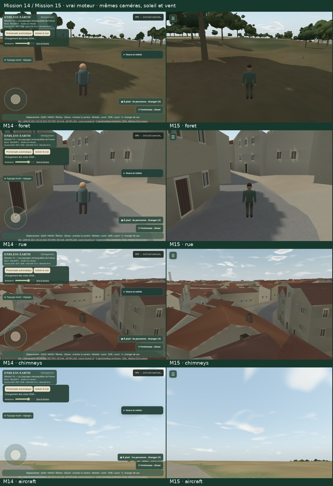

# Mission 15 — Un monde vivant, généreux et immersif

## Mission 15 complète — proposée à la validation artistique finale

**Un village plus généreux, un ciel vivant, une promenade dégagée et quelques signes de vie discrets.** Les « Go » du propriétaire ont accepté 15A, 15B puis 15C et autorisé 15D. Les quatre jalons sont livrés dans la [PR brouillon #24](https://github.com/sebastienleidgens-lab/endless-earth/pull/24), branche `mission/15-monde-vivant-immersif`. **Arrêt pour revue finale ; aucune fusion, aucun déploiement, aucune modification de GitHub Pages ou Living Paintings / LP-01. Budget supplémentaire : 0 €.**

[Galerie et six films natifs](mission-15-evidence/signs-life/index.html) · [Planche M14 / M15](mission-15-evidence/signs-life/comparison.jpg) · [Historique 15A](mission-15a.md) · [15B](mission-15b.md) · [15C](mission-15c.md).

## Ce qui reste des quatre jalons

**15A — Nature généreuse.** Les 2 500 ancrages sont conservés ; les couronnes sont plus amples, ajourées de près et simplifiées à distance. Les écotypes, saisons et exclusions autour des maçonneries restent explicites. Les **180 compositions fleuries** sont des interprétations guidées par les références documentaires du village, sans devenir des observations géolocalisées. Les essais de techniques et les ombres re-préparées sont conservés dans le [rapport 15A](mission-15a.md), avec ses images et ses limites de densité.

**15B — Neige et ciel.** Le choix Neigeux, le dépôt/fonte progressifs, l’abri et les contacts utilisent les dérivés liés aux mêmes sources. Fleurs et feuillages respectent calendrier et dépôt ; rivière et surfaces verticales ne deviennent pas de la glace. La pluie laisse sa place à la neige sans particules contradictoires. Les nuages se déforment lentement et gardent le porteur du vent commun. Les films de plusieurs minutes et le compromis sous neige restent dans le [rapport 15B](mission-15b.md), accepté par le propriétaire.

**15C — Promeneur et immersion.** Un personnage original de **1 936 triangles / 16 os / un appel**, appuis liés à la distance réellement parcourue, marche/course/repos et contacts sonores partagés. Un seul bouton de menu, fermé par défaut ; gestes tactiles relatifs, clavier, son, profils et sources restent accessibles. Forteresse et sa téléportation, joystick visible et panneaux permanents sont supprimés. Chaque chargement ordinaire tire un nouveau départ parmi **1 556 points / 80 secteurs** vérifiés ; `spawnSeed` reproduit les mêmes données. Les 112 ouvertures et les films de marche/course/pentes restent [archivés en 15C](mission-15c.md). La navigation précalculée évite son ancien calcul bloquant au premier bouton et ne téléporte pas le promeneur.

**15D — Petits signes de vie.** Un avion générique original, quelques finitions de cheminées et une fumée occasionnelle s’ajoutent à ce monde. Leur rareté, leurs budgets et leur provenance restent séparés de la géographie vérifiée.

## Avions : un passage, pas un fond permanent

Le petit appareil à aile haute est une création de **228 triangles**, un matériau à couleurs de sommets et une envergure de **10,1 m**. Il suit une trajectoire rectiligne continue, à altitude décorative constante au-dessus de l’enveloppe chargée, sans virage artificiel ou ré-ancrage à la caméra. Il devient minuscule au loin et s’efface dans la distance. **Un seul appareil peut exister à la fois. Aucun trafic aérien réel ou service de suivi n’est utilisé.**

Le planificateur utilise une graine de session, des attentes exponentielles et un intervalle minimal de calme. Il attend au moins trois minutes avant un premier passage éventuel ; les grosses pluies et brumes peuvent supprimer une tentative. Une promenade n’a aucune garantie d’en voir un. Dans **120 simulations unitaires de trente minutes**, 37 sessions ne contiennent aucun avion. Ces simulations accélérées ne remplacent pas la vraie session prolongée ci-dessous. [Distribution](mission-15-evidence/signs-life/rarity.json).

Le son vient de [Small plane flyover 1, SoundsLikeYukon](https://freesound.org/people/SoundsLikeYukon/sounds/820324/), annoncé **CC0** par l’auteur et vérifié sur sa page. La captation est canadienne ; elle ne documente pas Angles. L’aperçu HQ MP3 est déclaré comme tel, découpé sur 24 s puis filtré, réglé par gain linéaire borné, fondu et préparé en mono 32 kHz / FLAC PCM16. Il reste une source initialement avec pertes. **531,885 octets compressés**, 3 072 000 octets décodés au taux demandé.

Le passage utilise **le Soundscape et l’AcousticRenderer existants** : une voix ponctuelle de faible priorité, déplacement du Panner en trois dimensions, atténuation avec la distance et extinction naturelle. Aucun oscillateur, second contexte ou lit de vrombissement. Si la voix, le cache ou l’enregistrement sont indisponibles, le passage peut rester silencieux. Les limites de **24 Mio**, 8/12/12 voix et 1/2/3 HRTF restent en place. [Sources, licences et empreintes](../public/audio/sources.json) · [Transformations](../public/audio/manifest.json) · [Crédits](../public/audio/credits.html).

## Cheminées et fumée : hypothèses artistiques discrètes

Le moteur possédait déjà des cheminées dans ses toitures procédurales. **238 caps existants** sont retrouvés dans les vraies géométries indexées chargées, avec leurs dimensions et leur teinte caractéristiques ; aucun point aléatoire n’est posé sur une emprise. Les murs et toitures d’origine ne sont pas déplacés. Des couronnements de pierre et pots de terre cuite, **52 triangles par instance**, ajoutent une petite variation de hauteur et de ton. Ils restent sur environ un quart des bâtiments, jamais sur chaque toit. Un seul appel instancié, avec disparition progressive à distance et plafonds **24 / 48 / 72** détails pour Éco / Équilibré / Qualité. Ils reçoivent lumière et neige communes. [Inventaire](mission-15-evidence/signs-life/chimneys.json).

La température vient de la neige/calendrier déjà simulés. Le planificateur choisit parmi **toutes** les cheminées et ne consulte ni caméra ni visibilité pour décider d’un chauffage. Un maximum de deux sources peut être planifié ; le budget global peut en refuser. Cela ne constitue pas une observation d’occupation, de cheminée réelle, de chauffage ou d’émission réelle d’une maison.

Les bouffées naissent irrégulièrement, montent peu, s’élargissent, dérivent avec **le même vecteur de vent** puis se dissipent. Le bassin de particules est fixe ; le rendu est diffus, transparent et sans texture d’image. Avions, fumée, oiseaux et micro-événements partagent **un seul WorldLifeBudget**. Éco reçoit un petit plafond global de quatre particules, contre huit et seize dans les autres profils ; un refus de particules ne permet plus aux feuilles d’en dessiner sans allocation. Les sons gardent leur budget distinct existant. Une cheminée n’émet pas seulement parce qu’elle devient visible.

La séquence de fumée est une **inspection explicite avec graine et caméra de toiture**, à temps natif ; elle n’est pas présentée comme un événement rencontré au hasard. Elle est volontairement silencieuse, sans crépitement d’occupation inventé. La session prolongée n’utilise aucun forçage d’avion ou de foyer.

## Une vraie promenade continue de trente minutes

**1800.97 secondes réelles continues**, **1530.5 m cumulés**, **6,464 intervalles instrumentés**, sur une copie figée du build de production, 720 × 460. Le départ est celui de `spawnSeed=79` et le planificateur ordinaire reçoit `lifeSeed=normal-30m-0`. Aucun déplacement de position, trajet imposé pendant la session, accélération ou inspection d’événement rare. Les reprises d’AutoWalk utilisent le graphe depuis la position courante ; la distance est cumulée et peut inclure des retours sur des voies déjà parcourues.

La session couvre été, passage au calendrier hivernal et neige, pluie printanière, orage, retour estival, soir, trois profils, plusieurs pauses contemplatives et reprises. Les réglages météo/heure/profil utilisent le menu ; les dates utilisent le diagnostic de calendrier existant, déclaré dans le protocole. Le monde continue ses événements pendant les arrêts. Les quatre premières minutes restent calmes ; deux vols ont été planifiés pendant cette session, avec **66 échantillons où l’appareil est rendu**, et **1 événement audio admis**. Une voix n’est pas garantie pour chaque vol. Un foyer a été admis hors champ pendant cette marche ; aucune bouffée n’y a été visible. La scène active visible est donc vérifiée séparément par l’inspection déclarée.

**Médiane 266.6 ms, P95 516.6 ms, pic 1083.2 ms** : ce sont les intervalles du rendu logiciel, avec interface, streaming et enregistrement, sans retirer les pauses longues. Aucun autre travail navigateur/GPU pendant la session. Les contrôles n’ont relevé ni coordonnées invalides, mélange pluie/flocons contradictoire, dépassement des voix/cache/allocations de vie, ni recours à l’inspection rare. Les seules pistes sonores des extraits viennent du véritable bus après limiteur, observé par une branche diagnostique. [Résultat et chronologie](mission-15-evidence/signs-life/soak.json) · [Trace complète comprimée](mission-15-evidence/signs-life/soak-trace.json.gz).

Deux films supplémentaires comparent la marche native M14/M15 à une même station initiale : vrai bouton AutoWalk, arrêt, première personne puis vue élevée. Ces films ne prétendent pas apparier chaque position à la même seconde : le pas physique reste plafonné pendant une image lente.

| Séquence native | Durée conteneur | Distance | Médiane / P95 / pic ms |
| --- | ---: | ---: | ---: |
| M14-native-walk | 60.03 s | 19.6 m | 412.5 / 512.1 / 1088.2 |
| M15-native-walk | 60.16 s | 18.9 m | 418.0 / 481.0 / 642.3 |

Les médias gardent leurs paquets et PTS/DTS natifs par remuxage, sans accélération ou bande-son ajoutée. Les six films sont intégralement décodés ; le poster de vol au milieu vient d’une vraie image du flux. [Vérification audiovisuelle](mission-15-evidence/signs-life/media.json).

## Coûts finaux : mêmes caméras et météo commune

**324 rendus synchronisés**, 960 × 640 DPR 1 : trois profils × trois scènes × M14 fusionnée / 15C / 15D × trois passages alternés × quatre échantillons. Caméra, soleil, date, phase du vent et champs météo communs sont vérifiés identiques. Le mode Neigeux n’existant pas en M14, la matrice principale utilise un été clair commun ; son coût est isolé ensuite. **SwiftShader logiciel uniquement**, aucun GPU physique ou Android disponible mesuré. Douze valeurs par ligne ne constituent pas une garantie statistique de fluidité matérielle.

| Profil · scène | M14 médiane ms | M15 médiane ms | Écart M14 | Écart 15C | M15 P95 / pic ms |
| --- | ---: | ---: | ---: | ---: | ---: |
| eco · rue | 364.4 | 399.8 | +9.7 % | +1.8 % | 488.0 / 518.0 |
| eco · foret | 173.0 | 177.9 | +2.9 % | +0.6 % | 198.8 / 198.9 |
| eco · vallee | 356.1 | 346.5 | -2.7 % | -7.1 % | 393.4 / 420.6 |
| balanced · rue | 576.1 | 531.9 | -7.7 % | -2.1 % | 634.6 / 697.1 |
| balanced · foret | 252.9 | 262.9 | +3.9 % | +2.6 % | 347.3 / 349.9 |
| balanced · vallee | 365.6 | 378.5 | +3.5 % | +1.3 % | 465.4 / 499.1 |
| quality · rue | 525.3 | 543.5 | +3.5 % | -0.9 % | 614.2 / 632.0 |
| quality · foret | 233.2 | 260.1 | +11.5 % | +1.3 % | 273.1 / 283.9 |
| quality · vallee | 377.6 | 386.5 | +2.4 % | +0.4 % | 459.8 / 467.4 |

**Le seuil de 10 % est dépassé en forêt Qualité (+11,5 % face à M14), avec +1,3 % pour 15D / 15C.** Les profils alternatifs mesurés restent à +2,9 % en forêt Éco et +3,9 % en Équilibré face à M14. Les grandes couronnes et les ombres locales sont conservées pour leur apport artistique déjà accepté ; ce compromis Qualité reste proposé à votre revue finale, sans garantie de fluidité matérielle.

Les appels, triangles, textures, tas après GC, allocations WebGL logiques, temps de préparation et streaming figurent dans la [matrice complète](mission-15-evidence/signs-life/performance-summary.json). Ces estimations ne sont pas de la VRAM physique. Les compromis historiques 15A et 15B restent archivés, notamment **+16,0 à +26,4 % sous neige en 15B / 15A** et la scène de forêt 15C ; une nouvelle campagne ne les efface pas.

**486 rendus supplémentaires** séparent les coûts, avec activation/désactivation du propriétaire réel, boucles tenues et échauffement :

| Élément isolé | Éco on / off ms | Équilibré on / off ms | Qualité on / off ms |
| --- | ---: | ---: | ---: |
| Maillages d’arbres visibles | 173.3 / 153.0 | 254.6 / 186.7 | 253.4 / 184.2 |
| Fleurs | 452.5 / 464.6 | 690.4 / 644.4 | 699.6 / 682.6 |
| Nuages + ombres nuageuses | 214.8 / 197.9 | 271.5 / 244.2 | 273.5 / 253.0 |
| Personnage | 371.2 / 355.5 | 501.8 / 509.9 | 534.5 / 543.9 |
| Neige : dépôt + flocons | 438.5 / 372.1 | 695.9 / 524.6 | 643.4 / 539.4 |
| Finitions de cheminées | 447.3 / 455.0 | 636.3 / 661.8 | 657.2 / 642.6 |
| Fumée | 419.5 / 408.5 | 581.5 / 628.3 | 612.4 / 612.3 |
| Avion | 108.3 / 111.8 | 88.3 / 91.1 | 153.4 / 156.2 |
| 15D combiné sous neige | 388.5 / 385.7 | 531.9 / 560.8 | 557.7 / 560.8 |

Les scènes diffèrent selon l’effet : forêt, rue et fleurs proches, ciel, rue enneigée, toitures. « Combiné » enlève les ajouts 15D d’une scène enneigée ; les événements simultanés restent ceux admis par le profil, un seul en Éco. Les ombres statiques d’arbres restent dans le cache lors de l’ablation de leurs maillages. Les petites inversions de temps illustrent le bruit du rendu logiciel ; elles ne constituent pas un gain garanti. Ces écarts marginaux **ne s’additionnent pas** et la visibilité ne libère pas les allocations. Les événements de ces inspections sont explicitement placés pour les mesurer ; ils ne prouvent pas la rareté ordinaire. [Composants, P95, pics, appels et triangles](mission-15-evidence/signs-life/components.json).

## Préservation, ressources et validation

**235 tests Node**, TypeScript/Vite et contrôles du navigateur compilé. Les nouveaux tests couvrent rareté, trajectoire, hauteur, chauffage saisonnier, reconnaissance des caps, budgets partagés, changements de profils et destruction. Les contrôles navigateur couvrent collisions, chargements retardés/manquants, navigation, clavier/focus et tactile, trois profils, six cycles réels de création/rendu/destruction des nouveaux objets et douze stations distinctes de streaming. Ces stations sont des inspections, pas un itinéraire de marche fabriqué. Le repli sans captation d’avion garde les autres sons et ne fabrique pas de bruit.

Les **112 démarrages de 15C** restent conservés ; **12 ouvertures complètes supplémentaires** vérifient les sources finales, six graines, deux répétitions et quatre ouvertures ordinaires. Les mêmes graines reproduisent exactement les positions et orientations de 15C. Menu, météo et vue ne relancent pas la sélection.

**518 fichiers protégés identiques à 15C**, dont données géographiques, relief, routes, emprises, pont/ruines, surfaces, colliders, navigation, personnage, végétation, matières et éclairage. **270 preuves historiques** conservées. Les 40 captations et 93 actifs audio antérieurs restent identiques ; une seule captation CC0 est ajoutée. Les crédits IGN/ASP Licence Ouverte 2.0, OSM ODbL et matières/sons préexistants sont conservés. Les trois nouveaux petits modèles/effets sont originaux et n’ajoutent aucune texture d’image. [Audit et inventaire](mission-15-evidence/signs-life/audit.json) · [Contrôles finaux](mission-15-evidence/signs-life/validation.json).

Les preuves sont produites sur les sources figées. Les captures portent la base `8455726` modifiée avant le commit 15D ; les builds suivants embarquent leur propre commit, sans requête de métadonnées distante.

## Limites et choix artistiques à valider

Le MNT, les hauteurs estimées, les accès M14 au pont et aux ruines, le style des couronnes, vêtements et visages restent ceux des jalons documentés. Les pots/couronnements nouveaux ne sont pas ré-intégrés à la silhouette du cache d’ombres statiques M14 ; ils reçoivent la lumière commune mais n’ajoutent pas une passe solaire. La fumée est une approximation légère, sans aérodynamique ou combustion ; l’avion générique n’est pas du trafic réel. Les pas restent silencieux sur un sol de matière inconnue et il n’y a pas de nouvelle captation de pas neigeux. La fluidité et l’accessibilité sur un appareil Android physique restent à examiner par le propriétaire.

La décision finale porte sur : **1.** beauté et volume des arbres ; **2.** densité naturelle des forêts ; **3.** présence et fidélité des fleurs ; **4.** neige convaincante ; **5.** ciel vivant ; **6.** promeneur agréable en marche/course ; **7.** paysage dégagé ; **8.** départs sans incident ; **9.** subtilité des avions et fumées ; **10.** fluidité et plaisir de promenade. Les tests techniques ne répondent pas à votre place.

**Arrêt après 15D pour validation artistique finale. Ne pas fusionner ou déployer sans nouvel accord explicite.**
