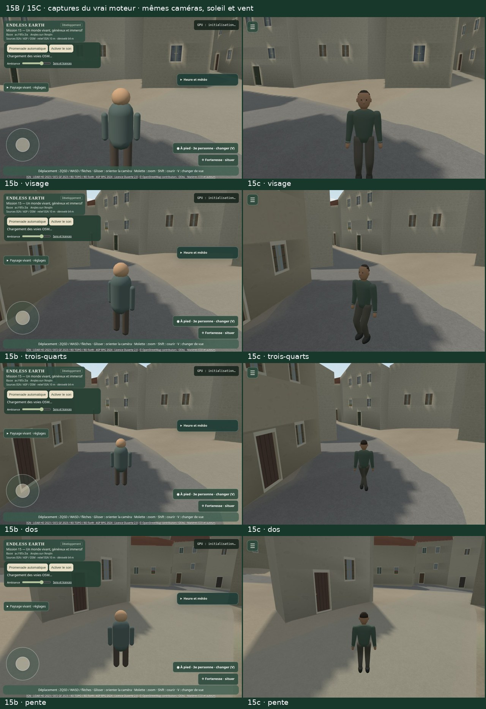

# Mission 15 — Un monde vivant, généreux et immersif

## 15C livré pour validation — arrêt avant 15D

**Un promeneur articulé, un écran dégagé et un départ aléatoire pour chaque visiteur.** Le « go » du propriétaire valide 15B et autorise 15C. **15D n’est pas commencé**. Branche `mission/15-monde-vivant-immersif`, [PR brouillon #24](https://github.com/sebastienleidgens-lab/endless-earth/pull/24), référence **`acf05c3ae66e7cfab391998bc93a774ed462d412`**. Budget supplémentaire **0 €** ; aucune fusion, mise en ligne, modification de GitHub Pages ou Living Paintings / LP-01.

[Galerie locale avec films](mission-15-evidence/walker-menu/index.html) · [Planche avant/après](mission-15-evidence/walker-menu/comparison.jpg) · [Rapport historique 15B](mission-15b.md) · [15A](mission-15a.md).

## Une silhouette humaine et des articulations

Les six maillages du personnage en capsules sont remplacés par **un maillage skinné original, 16 os, 1 936 triangles, un matériau à couleurs de sommets** : veste verte sourde, pantalon, poignets, mains, chaussures, visage sobre et cheveux. La silhouette reste légèrement stylisée, sans modèle photoréaliste extérieur. Taille d’environ 1,78 m ; le gabarit physique existant reste inchangé. **Aucune texture d’image** nouvelle ; la texture interne de matrices du squelette utilise **1 024 octets**.

Les références [Universal Base Characters](https://quaternius.com/packs/universalbasecharacters.html) et [Universal Animation Library](https://quaternius.com/packs/universalanimationlibrary.html) de Quaternius ont été étudiées : CC0 annoncée par l’auteur, corps humanoïdes autour de 13 000 triangles et plus de 120 animations selon leurs pages. Ce sont des chiffres publiés, **pas des candidats importés ou mesurés ici**. La proposition originale permet de régler tenue, masse et contacts sans achat ou retargeting. Aucun modèle ou texture d’image supplémentaire à télécharger ; le code compilé passe de 798,06 à environ 818,5 ko (avertissement Vite >500 ko déjà présent). [Droits, sources et inventaire](mission-15-evidence/walker-menu/audit.json).

La marche et la course utilisent la **distance effectivement parcourue**, après résolution des collisions, et le même pas métrique que l’audio. Accélération, décélération, bras opposés aux jambes, flexion des coudes en course et orientation progressive suivent ce mouvement. Au repos : respiration légère, tête calme, jambes immobiles. Les pieds sont maintenus dans le monde pendant l’appui ; deux articulations et l’inclinaison de la chaussure suivent le sol. Les contacts sont reconstruits même lorsqu’une image saute un passage d’appui. Après un arrêt, le prochain départ reprend une amorce de pas adaptée au pied arrière. Le ralentissement ne réapplique pas d’amortissement au déplacement du pied : la distance physique suffit. Un test de régression couvre aussi la course suivie d’un virage latéral et du repos.

Les tests couvrent marche/course, pente, virage, arrêt et reprise à **4, 8, 30 et 60 images/s**, dont des pas de temps de 250 ms. Le matériau du sol, les sons vérifiés et leurs budgets restent ceux du moteur audio ; seule la commande de contact vient maintenant de cette cadence commune, avec préchargement du premier pas. Aucune distance fictive n’est ajoutée lorsque la collision bloque le joueur. Les films exposent aussi les pauses du rendu logiciel.

## Une seule entrée dans l’interface

**Un bouton de 44 × 44 px en haut à gauche**, menu fermé par défaut. Un dialogue natif regroupe heure/météo, vue, promenade automatique, son/volume, course tactile, profil, réglages avancés, aide, sources/licences/version et diagnostics lorsqu’ils sont activés. Les contrôles existants gardent leurs propriétaires et leurs écouteurs ; il n’y a pas de second système météo ou audio.

Le bouton **Forteresse et son gestionnaire de téléportation sont supprimés**. Le joystick visible et les panneaux permanents disparaissent. Sources et version restent accessibles dans le menu. Les captures ordinaires montrent l’interface réelle, sans masque de test. Les films du canevas montrent le rendu 3D ; l’interface est inspectée séparément.

Clavier : ZQSD/WASD/flèches, Maj pour courir, V pour changer de vue. Au toucher : geste relatif dans la moitié gauche pour marcher, moitié droite pour regarder, deux doigts simultanés possibles ; relâcher arrête la commande. L’aide est accessible dans le menu. L’ouverture du dialogue met la promenade en pause et efface les commandes actives. Espace ouvre le bouton, Tab reste dans le dialogue, Échap ferme et rend le focus. Le panneau défile en gardant son bouton Fermer accessible.

Les essais réels couvrent **960 × 640, 390 × 844, 320 × 568 et 844 × 390**, puis le multitouch natif émulé par Chromium. Météo, profils et changements de vue laissent exactement la même position et la même graine au repos. **Ce n’est pas un essai Android physique**, ni une certification complète d’accessibilité. [Contrôles, focus et gestes](mission-15-evidence/walker-menu/ui-runtime.json).

## Un départ nouveau à chaque chargement

La sélection s’applique à **tous les visiteurs**, sans dépendre du mode `perf`. Sans graine, deux entiers issus de `crypto.getRandomValues` sont tirés à chaque chargement. `?spawnSeed=12345` reproduit position et orientation avec les mêmes données ; aucune position n’est relue comme un départ permanent depuis le stockage.

Les voies OSM autorisées sont échantillonnées à distance régulière, puis les points sont contrôlés avec le terrain réellement chargé, le gabarit de 30 cm, l’eau, les obstacles et les supports d’ouvrage. Le voisinage de 35 cm et d’un mètre doit être stable ; les fortes pentes et les supports de pont sont exclus des départs. Un secteur de **200 m** est choisi, puis un point de ce secteur : le nombre de sommets OSM d’une ruelle ne lui donne pas plus de poids qu’à tous les autres secteurs. L’orientation finale dispose d’une direction dégagée vérifiée.

Le jeu actuel trouve **1 556 points stables dans 80 secteurs**. Le calcul détaillé du regard est réservé au point choisi, ce qui réduit la préparation d’environ 8,5 à 1,4 seconde dans le premier essai local. Le personnage reste masqué et les mouvements bloqués jusqu’à la disponibilité du terrain et des collisions. Si aucun point n’est trouvé, un ancien point connu est **revalidé** ; sans données permettant de garantir la sécurité, le jeu reste en attente avec un message explicite. Aucun départ inventé sur un sol plat de secours.

**112 ouvertures complètes du vrai jeu** : 100 graines 0–99, six répétitions et six ouvertures ordinaires sans graine, toutes sans `perf`. Chaque position est revérifiée par le vrai inspecteur de terrain et de collision, puis une première image normale est rendue. Les 100 graines donnent **95 positions dans 60 secteurs** ; les répétitions reproduisent les coordonnées et le regard à l’identique. Les six ouvertures ordinaires donnent six graines nouvelles et **6 positions distinctes**. La liste finie autorise naturellement des collisions entre graines différentes. [Série complète](mission-15-evidence/walker-menu/starts.json).

Le départ initial est conservé dans les diagnostics. **Aucun bouton météo, menu ou vue ne rappelle la sélection.** AutoWalk réutilise le graphe et les accès de Mission 14 ; il démarre depuis la position courante si un chemin est admissible, sinon il explique son indisponibilité. Il ne replace plus le personnage pour lui fabriquer une longue promenade.

## Preuves natives et physique conservée

Les poses rapprochées, forêt, pente, première personne et vue élevée sont des inspections séparées, avec caméra/soleil/vent appariés. Les films partent de stations diagnostiques annoncées, puis utilisent les boutons, le clavier et la boucle ordinaires, sans itinéraire forcé ni déplacement de position pendant la séquence. La route utilise AutoWalk ; marche/course/arrêt et déplacement latéral utilisent le clavier. Une pente réelle admissible est choisie parmi les voies chargées. La marche/course sonore se déroule sur l’asphalte OSM du Quai du Premier Président Pérevier : les compteurs de pas doivent augmenter en marche et en course, puis rester fixes au repos. Sur la pente, la matière acoustique est inconnue et les pas restent volontairement silencieux selon la règle audio héritée.

| Film natif | Durée conteneur | Distance | Médiane / P95 / pic moteur ms |
| --- | ---: | ---: | ---: |
| before-route | 80.50 s | 20.9 m | 436.8 / 524.4 / 916.9 |
| after-route | 80.53 s | 20.6 m | 437.0 / 568.9 / 985.0 |
| before-run | 46.12 s | 39.1 m | 336.6 / 395.4 / 739.2 |
| after-run | 46.33 s | 36.5 m | 350.6 / 462.0 / 1044.9 |
| after-slope | 46.08 s | 11.3 m | 306.2 / 399.9 / 711.9 |

Les films sont **à vitesse normale**, VP9/Opus natifs, canevas au plus 8 images/s et véritable bus après limiteur. Les traces incluent une courte chauffe et les intervalles instrumentés ; durée du conteneur et fenêtre d’observation sont distinctes. Les temps incluent le rendu logiciel, la capture, les transitions et compilations. Ce ne sont pas des FPS matériels. Tous les paquets et PTS/DTS sont conservés par remuxage, et le décodage audiovisuel complet est vérifié. [Films et contrôle](mission-15-evidence/walker-menu/video-validation.json).

**642 fichiers de sources et données protégées identiques à 15B** : données géographiques, dérivés, végétation, neige, ciel, lumière, catalogue audio et noyaux de déplacement/caméra/navigation. Le fichier de collisions reçoit uniquement une interrogation de support en lecture seule ; sans cette ligne, il est identique. **2 898 réponses de collision et 20 déplacements identiques** au navigateur, six cycles de création/rendu/destruction du rig, entrée en collision sans pas sur place, données retardées ou manquantes. Les limites d’accès M14 autour du pont et des ruines restent conservées. Les ombres 15A/B ne demandent pas de régénération géographique ; le nouveau personnage reçoit l’éclairage commun. [Audit](mission-15-evidence/walker-menu/audit.json) · [Runtime](mission-15-evidence/walker-menu/runtime.json).

## Coût graphique et animation

**216 rendus synchronisés**, 960 × 640 DPR 1, trois profils × trois scènes × deux versions × trois passages alternés × quatre échantillons. Fin GPU et lecture d’un pixel ; mêmes caméra, date, soleil, vent, météo et état nuageux vérifiés. Aucun autre travail navigateur/graphique pendant cette campagne. Douze valeurs par ligne ne garantissent pas une borne statistique haute. **SwiftShader logiciel uniquement**, aucun GPU physique ou Android accessible mesuré.

| Profil · vue | 15B médiane ms | 15C médiane ms | Écart | 15C P95 / pic ms |
| --- | ---: | ---: | ---: | ---: |
| eco · rue | 418.1 | 379.2 | -9.3 % | 426.8 / 428.7 |
| eco · foret | 197.8 | 183.6 | -7.2 % | 259.5 / 281.0 |
| eco · vallee | 319.5 | 318.5 | -0.3 % | 366.4 / 375.2 |
| balanced · rue | 554.1 | 532.5 | -3.9 % | 595.0 / 615.0 |
| balanced · foret | 250.7 | 277.0 | +10.5 % | 315.2 / 340.9 |
| balanced · vallee | 396.7 | 381.1 | -3.9 % | 425.7 / 435.7 |
| quality · rue | 564.8 | 553.3 | -2.0 % | 621.7 / 632.5 |
| quality · foret | 267.0 | 284.1 | +6.4 % | 329.0 / 339.1 |
| quality · vallee | 396.2 | 403.3 | +1.8 % | 545.7 / 557.4 |

En Équilibré, les écarts finaux vont de **-3.9 à +10.5 %**. Les appels et triangles, tas après GC, textures, allocations logiques et métriques de streaming figurent dans les données. Le personnage passe de six appels à un ; sa texture de squelette est comptée séparément des textures d’image. En Équilibré, cinq appels et cinq géométries de moins, 59 900 octets de buffers en plus, avec le pool de diagnostic et le graphe conservés dans le tas ; 1 024 octets de texture de squelette en plus. Le personnage passe de 620 à 1 936 triangles. Les allocations WebGL estimées ne sont pas de la VRAM physique.

| Équilibré · vue | Appels 15B / 15C | Triangles 15B / 15C | Tas après GC 15B / 15C (Mo) |
| --- | ---: | ---: | ---: |
| rue | 133 / 128 | 246 329 / 247 645 | 160.17 / 160.96 |
| foret | 41 / 36 | 112 840 / 114 156 | 153.59 / 154.38 |
| vallee | 163 / 158 | 289 627 / 290 943 | 154.28 / 155.11 |

Données prêtes en 18.16 s / 5.25 s dans cette observation locale isolée, pas un résultat réseau Internet. Un dérivé de 38 657 octets charge les 919 nœuds et 896 segments exacts du graphe validé par le moteur. Son calcul direct bloquait le premier lancement environ 14 secondes : il est maintenant préparé hors promenade, lié aux données et aux générateurs physiques, borné, vérifié par SHA-256 et régénéré à l’identique. Un cache absent, périmé ou corrompu désactive AutoWalk en conservant la marche libre ; aucun calcul lourd ne se cache derrière le bouton. Le premier trajet final de 450 m est obtenu en **1.6 ms**, sans changement de position. [Latence du premier trajet](mission-15-evidence/walker-menu/graph-latency.json) · [Licence du graphe dérivé](../public/data/angles-walk-graph.LICENSE.md) · [Matrice, mémoire, chargement et streaming](mission-15-evidence/walker-menu/performance-summary.json) · [Trace](mission-15-evidence/walker-menu/performance.json.gz).

**Le seuil de 10 % est dépassé en forêt Équilibré (+10,5 %).** Une alternative retire uniquement les ombres locales reçues par le personnage : 24 rendus supplémentaires appariés donnent 275.6 / 268.9 ms, soit -2.4 %. Ce gain limité ne compense pas la perte de cohérence d’éclairage entre le corps et le sous-bois. La proposition conserve donc l’éclairage commun, la silhouette articulée et les contacts au sol ; ce compromis reste **soumis à la validation artistique du propriétaire**, sans promesse de fluidité matérielle. [Variante mesurée et protocole](mission-15-evidence/walker-menu/alternative.json) · [Éclairage conservé](mission-15-evidence/walker-menu/alternative-full.jpg) · [Prototype sans ombres locales du corps](mission-15-evidence/walker-menu/alternative-without-character-local-shadows.jpg).

Le CPU d’animation est isolé séparément : propriétaire réel 15C, boucle exacte des quatre membres 15B, distances synthétiques et racine tenue. Ces lots ne sont **pas une preuve de marche** ; les films ci-dessus remplissent ce rôle. Deux cents appels de chauffe, douze lots de 200 par cas :

| Vitesse diagnostique | 15B ms/update | 15C ms/update |
| --- | ---: | ---: |
| 0 m/s | 0.0005 | 0.2195 |
| 1.45 m/s | 0.0005 | 0.1890 |
| 3.2 m/s | 0.0005 | 0.1845 |

[Échantillons CPU et pics des moyennes de lot](mission-15-evidence/walker-menu/animation-cpu.json).

## Validation et limites

**229 tests Node**, TypeScript/Vite, shaders réels, navigateur compilé, identité de production et formats mobiles vérifiés. Les tests fonctionnels incluent la météo neigeuse héritée, les contrôles au clavier et au toucher, le masquage initial, les replis, les contacts sur pentes et les grandes images. Les sources finales sont figées pendant les campagnes. Le build de travail vérifié porte `acf05c3a · modifié`, avant le commit 15C ; les builds suivants embarquent automatiquement leur propre identité. Le zoom respecte une vue choisie avant la fin du chargement ; les grands pas de temps, le cache de navigation et ses replis sont vérifiés séparément. [Validation finale et empreintes](mission-15-evidence/walker-menu/validation.json).

Limites : visage et vêtements encore stylisés, phénologie et contacts selon les données existantes, pas de doigts articulés ni de capture de mouvement, pieds posés selon le support physique et une approximation de chaussure, pas de nouvel enregistrement neigeux. La fluidité d’un téléphone réel et l’appréciation artistique restent à valider par le propriétaire. Aucun ajout d’avion, cheminée ou fumée de 15D, aucune promenade de trente minutes revendiquée ici.

**Arrêt après 15C. Attendre la validation du propriétaire avant 15D.**
