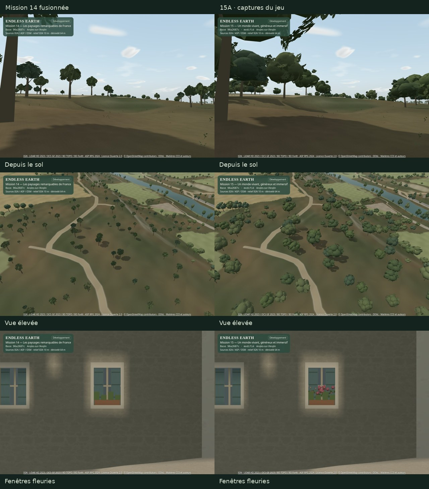

> Archive du rapport 15A livré au commit 62be569 et accepté par le « go » du propriétaire. Les mentions d’arrêt avant 15B ci-dessous décrivent cet état historique. Le rapport courant est [mission-15.md](mission-15.md).

# Mission 15 — Un monde vivant, généreux et immersif

## 15A livré pour validation — arrêt avant 15B

**Couronnes plus généreuses et fenêtres fleuries, sans déplacer les 2 500 ancrages.** Le jalon 15A est proposé pour votre revue artistique. **15B, 15C et 15D ne sont pas commencés.** Budget supplémentaire **0 €**. Aucune fusion, aucun déploiement, aucune modification GitHub Pages ou Living Paintings / LP-01.

[Galerie locale des comparaisons](mission-15-evidence/index.html) · [Planches lisibles sur GitHub](mission-15-evidence/comparison.jpg) · [Preuves et protocole](mission-15-evidence/README.md).

La [PR #23 / Mission 14](https://github.com/sebastienleidgens-lab/endless-earth/pull/23) est fusionnée dans `main` au commit **`96a2687caf41fd8de9b778c681e7d693994093a6`**, vérifié sur GitHub avant toute modification. La branche indépendante **`mission/15-monde-vivant-immersif`** part de ce commit. Lecture de `AGENTS.md`, des rapports 11–14 et de l’[ADN artistique commun](art-dna.md). Le témoin provient d’un checkout de ce commit avec sources propres. Les captures de proposition portent honnêtement la base `96a2687` et l’état modifié avant le commit 15A ; les empreintes des sources testées accompagnent la validation.

## Arbres : volume et silhouette avant le nombre

L’audit de Mission 14 retrouve **84 triangles de cartes ajourées de près**, **60 triangles dans trois petits volumes au loin** et **40 triangles de tronc/branches**, pour 2 500 individus inférés dans les habitats existants. La faible masse résulte surtout de couronnes petites face à l’espacement. Le budget et la sélection géographique bornée accentuent les espaces ouverts. Aucun inventaire botanique n’est inventé et aucun nouvel arbre n’est ajouté pour masquer ce défaut.

La proposition utilise **sept lobes irréguliers partagés**, des normales adoucies et **36 bouquets périphériques ajourés**. Les faces dont le centre se trouve profondément dans un autre lobe sont retirées une fois à la création. Le feuillage n’est pas un solide étanche : quelques ouvertures entre volumes sont intentionnelles. **331 triangles de près / 58 au loin**, contre 632 / 140 dans le premier candidat. Les aiguilles génériques gardent des étages coniques, à 27 / 18 triangles ; le tronc conserve ses 40 triangles et ses racines à la même altitude.

L’enveloppe proche générique passe d’environ **5,30 × 5,84 m à 10,20 × 9,86 m**, avant les échelles, rotations et variations propres aux individus. Le centre de couronne monte de 5,6 à 6,05 unités d’échelle ; les troncs s’affinent horizontalement à 0,86 de leur échelle antérieure. Les formes de milieu humide restent plus élancées, les jeunes plus petits ; orientation, variante, teinte et calendrier restent déterministes. Ces mètres décrivent une **interprétation de forme**, pas des couronnes relevées sur place.

Les 2 500 positions, habitats, espèces génériques, échelles sources et règles d’exclusion sont conservés. Un index spatial de maçonnerie limite la largeur de **12 couronnes** près du bâti et du patrimoine. Aucun changement des routes, bâtiments, surfaces physiques, eau, relief ou accès. Pas de nouvelle requête IGN/BD Forêt : le gain recherché vient ici des proportions et de la représentation, sans prétendre améliorer les données de couverture.

Les lots d’arbres gardent **deux objets instanciés par cellule**, tronc et couronne. Aucun objet CPU par branche ou feuille. Les matrices sont préparées au chargement ; le vent continue dans les shaders M11. Branches principales plus inertes, bouquets périphériques plus mobiles, phases indépendantes, racines fixes ; peu de mouvement sous faible vent. Les distances de détail et leur hystérésis M12 restent celles de l’ADN commun.

## Comparaison des solutions et compromis conservé

| Approche | Triangles proches / lointains | Lecture et décision |
| --- | ---: | --- |
| Mission 14 : cartes ajourées | 84 / 60 | Témoin réel ; cimes trop petites et légères. |
| Volumes pleins détaillés | 560 / 140 | Candidat réellement rendu ; masse généreuse mais surfaces trop lisses de près. |
| Premier hybride entièrement ajouré | 632 / 140 | Feuillage plus ouvert ; coût logiciel initial important. Sources, images et mesures conservées. |
| Enveloppe allégée + bouquets ajourés | 331 / 58 | Proposition 15A : masse conservée, intérieur simplifié, moins de surdessin. |

Le premier hybride donne **+47,0 % / +48,1 %** en Équilibré dans le bois au sol / en hauteur lors de sa campagne initiale. Cela a déclenché la recherche d’alternative demandée. La suppression des faces intérieures, le cœur opaque texturé et la désactivation de la réception solaire fine sur les couronnes lointaines réduisent ce coût. Ces couronnes lointaines **continuent à projeter leurs ombres** ; le ciel et les ombres nuageuses restent actifs. Les ombres proches conservent leur filtrage.

**Le compromis artistique reste à votre choix :** l’option entièrement ajourée n’est pas supprimée. Elle se consulte avec `?perf=1&canopy=perforated`. Les volumes seuls se consultent avec `?perf=1&canopy=volume`. Aucun réglage de développement n’encombre le menu ordinaire. Les images [du premier hybride au sol](mission-15-evidence/candidate-hybrid-bois.jpg) et [en hauteur](mission-15-evidence/candidate-hybrid-aerienne.jpg), ses [coûts](mission-15-evidence/candidate-performance.json) et ses [sources exactes compressées](mission-15-evidence/candidate-sources.json.gz) restent disponibles. Aucun modèle tiers CC0 n’a été importé : trois solutions procédurales ont été comparées dans le même moteur.

Campagne distincte, **90 rendus synchronisés**, Équilibré, trois approches × deux vues × trois passages alternés × cinq échantillons :

| Vue | Variante | Médiane ms | P95 ms | Triangles couleur |
| --- | --- | ---: | ---: | ---: |
| Bois depuis le sol | m14 | 200.1 | 232.8 | 85,062 |
| Bois depuis le sol | volume | 278.3 | 286.1 | 175,018 |
| Bois depuis le sol | hybrid | 242.2 | 262.3 | 116,729 |
| Bois en vue élevée | m14 | 276.4 | 298.6 | 122,267 |
| Bois en vue élevée | volume | 353.9 | 403.8 | 242,671 |
| Bois en vue élevée | hybrid | 303.0 | 372.9 | 160,422 |

Ces chiffres décrivent cette campagne séparée, avec ses propres conditions chaudes ; ils ne remplacent pas la matrice finale ci-dessous. [Données complètes](mission-15-evidence/techniques.json).

## Fleurs : références locales, placements interprétés

Les photos locales déjà collectées ont été examinées : **C16**, jardinières et végétal retombant dans une ruelle ; **C24**, pots fleuris sur les fenêtres et plantes conduites en façade. C18 montre aussi une façade sobre : la floraison ne doit pas être universelle. Ces images guident des **types**, sans appariement photographique à chaque bâtiment.

**180 compositions déterministes au maximum**, sélectionnées dans les fenêtres procédurales déjà munies d’une jardinière : petites fleurs à cinq pétales en coupe, feuilles, tiges et grimpantes. Nuances rose sourd, crème et mauve ; aucune identification locale d’essence revendiquée. Les compositions restent dans les embrasures existantes. Elles ne masquent aucune porte, ne débordent pas dans la chaussée, ne créent aucune collision et ne prétendent pas être des observations actuelles. Pas de massif ajouté aux prairies, pas de plantation inventée sur le pont.

Le calendrier existant pilote feuillage et floraison, avec disparition hivernale et retour progressif au printemps. Les tiges ont un mouvement très limité sous le vent commun. Un petit maillage fusionné par cellule visible est créé progressivement, avec au plus quatre cellules cachées conservées ; aucune animation CPU par fleur.

[Inventaire des placements](mission-15-evidence/flowers.json) · [Fleurs en rue](mission-15-evidence/15a/fleurs-ruelle.jpg) · [Hiver](mission-15-evidence/15a/fleurs-hiver.jpg) · [Profils et cache](mission-15-evidence/runtime.json).

## Ombres, géographie et collisions

Le dérivé d’éclairage est **réexporté du vrai moteur et régénéré**, lié au contrat `generous-canopy-v2`. Un ancien contrat de couronnes est refusé avant d’appliquer son pack. Les replis sans lumière locale restent navigables ; ils ne réutilisent pas silencieusement les anciennes ombres.

L’audit établit : **607 fichiers protégés identiques à Mission 14**, tous les ancrages inchangés, positions et indices solaires statiques identiques, **zéro changement du canal de contact**, **30,287 valeurs de couronne feuillue actualisées**. Le binaire conserve **5 295 244 octets** ; le pack passe de **2 040 657 à 2 067 850 octets** (+27 193). Les petits manifestes synthétiques sont réémis avec le contrat de couronne courant ; leurs packs restent identiques.

Le proxy solaire suit la déformation commune et le calendrier, sans représenter chaque feuille. Budgets conservés : **Éco sans carte**, **Équilibré 512² / 48 m / 2 Hz**, **Qualité 1024² / 64 m / 4 Hz**. Le rafraîchissement forcé proche coûte environ **0,2 ms de soumission CPU médiane** avant et après dans cette campagne, sans prétendre inclure tout le travail graphique.

Le véritable navigateur compare **2 898 positions de collision et 20 déplacements avec le noyau physique** : mêmes réponses et mêmes positions finales avant/après. Les contrôles du relief, du pont, des pentes et du gabarit de 30 cm passent aussi dans les tests Node. Les limites d’accès M14 autour du pont et du quai restent conservées. Les arbres décoratifs n’acquièrent pas de nouveaux colliders ; les fleurs n’en ont aucun. [Audit détaillé](mission-15-evidence/audit.json) · [Contrôles navigateur et replis](mission-15-evidence/runtime.json).

## Performances finales — Mission 14 fusionnée / 15A

**360 rendus synchronisés avec fin WebGL et lecture complète**, SwiftShader logiciel, **960 × 640 / DPR 1**, trois profils × quatre vues × trois passages alternés × cinq valeurs × deux versions. Chaque paire vérifie la même caméra absolue et le même climat complet, **phase du vent comprise**. Pas d’autre charge graphique pendant cette campagne. **24 rendus supplémentaires** forcent les rafraîchissements solaires. P95 et pics sont conservés ; 15 échantillons ne constituent pas une garantie statistique de borne haute.

| Profil · vue | M14 médiane ms | 15A médiane ms | Écart | 15A P95 ms | 15A pic ms |
| --- | ---: | ---: | ---: | ---: | ---: |
| eco · Bois depuis le sol | 168.0 | 162.6 | -3.2 % | 183.8 | 197.8 |
| eco · Bois en vue élevée | 234.4 | 199.3 | -15.0 % | 229.3 | 241.6 |
| eco · Vallée éloignée | 328.0 | 347.6 | +6.0 % | 416.3 | 424.0 |
| eco · Rue du village | 305.3 | 324.3 | +6.2 % | 382.6 | 391.1 |
| balanced · Bois depuis le sol | 204.1 | 223.1 | +9.3 % | 245.6 | 252.6 |
| balanced · Bois en vue élevée | 257.3 | 299.0 | +16.2 % | 336.6 | 355.8 |
| balanced · Vallée éloignée | 417.8 | 396.8 | -5.0 % | 456.9 | 476.6 |
| balanced · Rue du village | 414.3 | 436.9 | +5.5 % | 466.6 | 478.0 |
| quality · Bois depuis le sol | 191.9 | 216.9 | +13.0 % | 278.0 | 323.5 |
| quality · Bois en vue élevée | 269.0 | 319.6 | +18.8 % | 363.4 | 377.9 |
| quality · Vallée éloignée | 381.0 | 401.4 | +5.4 % | 441.9 | 473.3 |
| quality · Rue du village | 436.9 | 406.7 | -6.9 % | 436.0 | 449.7 |

En Équilibré, les vues au sol testées restent **−5,0 à +9,3 %** ; la vue boisée élevée reste à **+16,2 %**. **Cette exception dépasse le seuil de 10 %.** L’alternative a été recherchée et mesurée ; la masse des nouvelles couronnes est conservée comme proposition artistique majeure, plutôt que réduite pour ce seul benchmark logiciel. Votre validation du compromis et une mesure sur votre appareil restent nécessaires. Aucun gain uniforme de fluidité, GPU physique ou Android n’est revendiqué.

Les appels couleur sont identiques dans les trois vues naturelles ; la rue passe de **116 à 118 appels**, avec les fleurs. Le nombre de textures reste **11 / 11** en Équilibré dans les quatre scènes. Les buffers WebGL logiques augmentent d’environ **71 736 octets** dans les vues naturelles, **233 304 octets** dans la rue ; ce sont les allocations observées par `bufferData/deleteBuffer`, pas de la VRAM physique. Le tas JS après GC augmente d’environ 0,95–1,34 Mo selon la scène ; l’instrumentation et les objets de diagnostic y contribuent. Les octets et pics de textures sont estimés séparément, sans inclure tout le pilote graphique.

Chargement local jusqu’aux données prêtes : **17,87 s / 17,19 s**, une seule observation par version, boucle tenue avant les prises. Aucun gain réseau Internet n’en est déduit. Les détails nature/architecture conservent leur streamer et leurs packs ; les compteurs de requêtes, octets, installation et caches restent dans les traces. Les fleurs sont des géométries locales originales sans téléchargement nouveau. La compilation réussit, avec l’avertissement Vite >500 ko déjà existant ; bundle courant d’environ **785,47 ko**.

[Mesures, mémoire, chargement, streaming et ombres](mission-15-evidence/performance-summary.json) · [Trace compressée](mission-15-evidence/performance.json.gz).

## Animation et observations à vitesse normale

Deux films continus observent le même bois : clair, couvert, orageux, **15 secondes chacun**. Boucle native, aucune accélération de simulation, aucun montage ou faux déplacement continu. Capture du canevas à 8 images/s, 800 × 540, VP9 ; films silencieux, aucun changement audio dans 15A. Les intervalles du moteur ci-dessous incluent l’enregistrement, les transitions météo et le rendu logiciel.

| Version | Durée observée | Images instrumentées | Intervalle médian / P95 / pic |
| --- | ---: | ---: | ---: |
| m14 | 45.08 s | 262 | 165.2 / 222.8 / 1090.2 ms |
| 15a | 45.27 s | 241 | 182.2 / 232.5 / 799.6 ms |

Les fichiers vidéo indexés durent **44,633 s / 44,573 s** ; leur fenêtre instrumentée est distincte. Le remuxage WebM ajoute la durée et les index de navigation **sans réencodage** : tous les paquets VP9 et horodatages PTS/DTS sont identiques. [Vérification](mission-15-evidence/video-index.json).

[Vent M14](mission-15-evidence/m14-vent.webm) · [Vent 15A](mission-15-evidence/15a-vent.webm) · [Méthode et statistiques](mission-15-evidence/motion.json) · [Trace compressée](mission-15-evidence/motion-trace.json.gz).

Un essai séparé coupe/rétablit l’animation végétale sous le profil personnalisé dérivé d’Équilibré : **32 rendus**, deux chauffes par état et 20 mesures CPU de LOD par état. Il inclut la végétation basse, pas seulement les couronnes. Le mode coupé n’est pas plus rapide dans ces courtes séries : le changement de recouvrement des feuilles et la variabilité logicielle empêchent d’en déduire un coût graphique absolu. Les valeurs sont exposées sans promesse de gain matériel.

| Version | Animation végétale | Rendu médian ms | LOD CPU médian ms |
| --- | --- | ---: | ---: |
| m14 | actif | 193.3 | 0.200 |
| m14 | coupé | 198.1 | 0.300 |
| hybrid | actif | 203.3 | 0.200 |
| hybrid | coupé | 215.7 | 0.300 |

## Validation, droits et limites restantes

**214 tests Node**, TypeScript/Vite et shaders réels passent. Le navigateur vérifie 18 changements de scène/profil/saison, trois retours à une même pose avec ressources stabilisées, le mobile Éco, le candidat entièrement ajouré, les ombres périmées/corrompues et les décorations facultatives absentes. Le smoke du build compilé contrôle chargement, déplacement, caméras, arrêt sans dérive, son et format mobile. [Capture mobile avec les commandes existantes](mission-15-evidence/mobile-controls.png) ; leur refonte reste en 15C. Les preuves ne revendiquent pas la session de trente minutes réservée à 15D.

**30 captures réelles**, deux films natifs, comparaisons sol/hauteur/saisons/vent, deux candidats visuels et tests techniques sont accessibles dans la galerie. Les fenêtres sont inspectées séparément, sans prétendre relier toutes les stations par une marche. Les fichiers de sources restent identiques pendant les campagnes finales. Les médias et liens de la galerie sont contrôlés dans le navigateur. [Validation et empreintes](mission-15-evidence/validation.json).

Arbres, fleurs, tiges et texture de feuilles sont **originaux au projet**, sans modèle externe, achat ou licence tierce nouvelle. C16 : **Bachelier Jacky, CC BY-SA 4.0** ; C24 : **Jochen Jahnke, CC BY-SA 3.0** ; références documentaires uniquement, pixels non utilisés dans le jeu. [Catalogue et crédits photographiques existants](mission-13-evidence/catalog.json) · [Inventaire des modèles et droits](mission-15-evidence/resources.json). IGN/ASP sous Licence Ouverte 2.0, © contributeurs OSM sous ODbL ; licences des matières existantes conservées.

Limites : silhouettes encore stylisées, formes et phénologie génériques, quelques espacements forestiers visibles en hauteur, fleurs limitées aux fenêtres procédurales, LOD et ombres de couronnes approximés, aucun inventaire botanique ni relevé de fleurs par maison. Les modèles de collision, interfaces, son, neige et ciel sont ceux de Mission 14. Aucun matériel Android/GPU physique n’est mesuré ici. L’appréciation du naturel et du plaisir de promenade reste humaine.

**Validez-vous les couronnes proposées, leur densité, les fleurs et le compromis de coût, ou préférez-vous le candidat plus ajouré ? Arrêt après 15A : attendre votre accord explicite avant 15B.**
