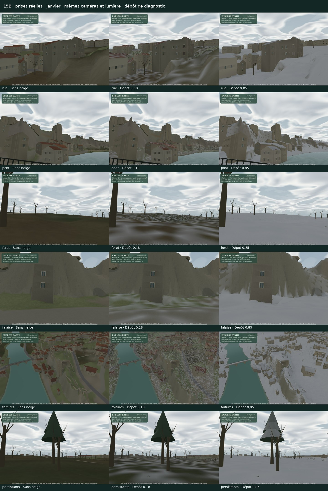

> Archive du rapport 15B au commit acf05c3, accepté par le « go » du propriétaire. Les mentions d’arrêt avant 15C décrivent cet état historique. [Rapport courant](mission-15.md).

# Mission 15 — Un monde vivant, généreux et immersif

## 15B livré pour validation — arrêt avant 15C

**Neige progressive, paysage blanchi et formes nuageuses en évolution lente.** Le « go » du propriétaire valide 15A et autorise 15B. Le jalon 15B est proposé pour revue artistique ; **15C et 15D ne sont pas commencés**. Branche `mission/15-monde-vivant-immersif`, [PR brouillon #24](https://github.com/sebastienleidgens-lab/endless-earth/pull/24). Budget supplémentaire **0 €**. Aucune fusion, aucun déploiement, aucune modification de GitHub Pages ou Living Paintings / LP-01.

[Galerie 15B avec films](mission-15-evidence/snow-sky/index.html) · [Planche comparée](mission-15-evidence/snow-sky/comparison.jpg) · [Rapport historique 15A](mission-15a.md) · [Preuves 15A conservées](mission-15-evidence/index.html).

Le témoin est le commit **`62be56993d7f7ec69a45406f57d298a1885daea9`**, livré en 15A, dans un checkout détaché propre. Mission 14 reste fusionnée dans `main` par la [PR #23](https://github.com/sebastienleidgens-lab/endless-earth/pull/23), base `96a2687`. Les captures 15B indiquent honnêtement base 62be569 + sources modifiées avant le commit 15B ; leurs empreintes sont conservées dans l’audit. Les 58 fichiers de preuve historiques de 15A restent identiques.

## Neigeux : chute et dépôt progressifs

Le choix **Neigeux** réutilise le propriétaire existant du calendrier, de la météo, du vent et des transitions audio. C’est une simulation artistique, sans prévision ni relevé météorologique. Il ajoute une intensité de neige au vecteur des six météos existantes. Une transition pluie → neige termine la phase sortante avant de commencer l’autre : les deux émetteurs ne produisent pas de précipitations contradictoires. Aucun changement de date n’est imposé pour fabriquer l’hiver.

**Un seul objet GPU Points**, sans objet CPU par flocon : 1 100 graines statiques au maximum, 26 400 octets de positions/graines, un appel supplémentaire seulement pendant la chute. Les plafonds Éco / Équilibré / Qualité sont **240 / 680 / 1 100**, modulés par l’intensité. La descente varie de 0,55 à 1,40 m/s, les diamètres de 2,5 à 7,5 cm, avec fluctuations indépendantes, taille apparente et couleur selon profondeur/lumière. Le volume est ancré dans le monde autour de la caméra ; il ne glisse pas avec elle. Le vent commun entraîne les flocons, les arbres et les nuages.

La profondeur du moteur masque les flocons derrière les bâtiments. Une enveloppe supérieure les efface sous les toits, le tablier du pont ou le sol ; une capsule de proximité protège le personnage, et le voisinage immédiat de la caméra est estompé. Le modulo du volume reste une approximation bornée ; ce n’est pas une simulation collisionnelle de chaque cristal ou feuille.

Le dépôt part de **zéro**. À intensité normale 0,72 et masse d’air simulée à −3 °C, il gagne environ **0,10 en 30 s**, **0,62 en 3 min**, puis sature en environ cinq minutes. L’état utilise le temps réel écoulé, plafonné à une seconde par mise à jour afin de ne pas blanchir brutalement le lieu au retour d’un onglet inactif. Après arrêt des précipitations, la température saisonnière simulée, la lumière du jour et la pluie favorisent une fonte continue. Aucun échange brutal d’atlas, aucun déplacement de sommet ou de collision.

Le shader compose une **fine couche de couleur** avec les matières et l’éclairage existants : orientation montante, pente, exposition au-dessus des volumes opaques, grain large et fin, intensité et durée. Les toitures, rebords, roches, sol, branches et couronnes compatibles blanchissent avec des irrégularités ; les façades verticales et le verre sont préservés, l’eau courante est exclue. **Aucun modèle de glace** n’est ajouté. Le calendrier garde les feuillus hivernaux dégarnis et les persistants feuillés ; le dépôt estompe aussi les fleurs estivales si l’on choisit artificiellement la neige en été. Un léger rebond blanc du sol accompagne le dépôt.

Le diagnostic `?perf=1&weather=snow&snowCover=0.65` reproduit un niveau **verrouillé**, sans le présenter comme une accumulation instantanée normale. `snowfall=0.15` ou `snowfall=1`, également derrière `perf`, inspecte une faible ou forte chute. Le banc de test peut amorcer un dépôt puis le déverrouiller par événement diagnostique ; la vidéo de début naturel n’utilise aucun amorçage. Ces outils n’ajoutent pas de commandes au parcours ordinaire.

## Abri, droits et cycle de vie

L’enveloppe **1024² RG8**, 1,953125 m par texel, vient des positions et indices opaques exacts du dérivé d’éclairage 15A : relief, bâtiments, patrimoine, pont. L’eau est exclue. Hauteurs quantifiées au 1/64 m ; **2 097 152 octets bruts, 1 175 798 compressés**, 188 186 triangles non verticaux rasterisés. Ce masque représente un abri artistique approché, pas de nouvelles altitudes mesurées ou une épaisseur de neige.

Chargement différé au premier besoin ; **aucune requête d’exposition en météo sèche sans dépôt**. Les révisions terrain/refinement/surface/patrimoine/statique et les SHA-256 compressé/décompressé doivent correspondre. Allocations et décompression sont bornées. Les réponses tardives d’un ancien propriétaire sont ignorées ; remplacement et destruction libèrent texture, géométrie, matériau et écouteurs. En cas de données absentes, périmées, corrompues ou trop grandes, le jeu conserve ses autres météos et sa navigation ; le dépôt et les flocons sont retenus, avec indication d’indisponibilité.

Forme des flocons, graines, grain et shaders **originaux au projet**. Aucun modèle, son, texture tiers ou achat nouveau. Le dérivé conserve les crédits **IGN Licence Ouverte 2.0 / © contributeurs OSM ODbL**. [Préparation](mission-15-evidence/snow-sky/exposure-preparation.json) · [Licence du dérivé](../public/data/angles-snow-exposure.LICENSE.md) · [Audit des sources et ressources](mission-15-evidence/snow-sky/audit.json).

## Ciel : diagnostic avant modification

L’advection existait déjà en 15A. Les formes restaient essentiellement fixes dans leur repère advecté, et le plancher d’opacité élevé du ciel couvert rendait leurs contours difficiles à suivre. La couche basse visible se projetait à **280 m**, alors que le champ macro d’ombres utilisait **230 m**. Sur une courte promenade, la lenteur apparente, les grands motifs et ce faible contraste pouvaient donner une impression d’immobilité.

La vitesse d’advection et le vent sont conservés. Trois phases lentes, calculées une fois par image, déforment progressivement le champ macro et la distorsion des détails. Le même état pilote le ciel et la réception des ombres nuageuses. La couche basse visible utilise maintenant **230 m** ; la couche haute reste à **540 m**, avec 0,65 de l’advection basse et une évolution différente. Le plancher du couvert descend de 0,80 à 0,46 pour laisser lire les contours. Même nombre d’échantillons de bruit et de passes ; aucune rotation rapide artificielle.

Deux observations natives de **quatre minutes chacune**, caméra fixe, météo Nuageux, captures espacées d’une minute : before : 239.9 s observées, 239.4 s de simulation native, 682.8 m d’advection ; after : 240.0 s observées, 239.9 s de simulation native, 684.0 m d’advection. Les vidéos conservent les **120 premières secondes**, par copie de paquets, à vitesse normale. Les formes évoluent en plus du déplacement ; les ombres restent une approximation macro, sans prétendre reproduire chaque détail de nuage. [Avant](mission-15-evidence/snow-sky/before-clouds.webm) · [Après](mission-15-evidence/snow-sky/after-clouds.webm) · [Observation et coordonnées avant](mission-15-evidence/snow-sky/before-cloud-observation.json) · [Après](mission-15-evidence/snow-sky/after-cloud-observation.json).

## Captures, marche, fonte et audio réels

**41 captures de comparaison** : rue, pont, dessous du pont, forêt, falaise, toitures, vallée et persistants ; dépôt 0 / 0,18 / 0,85 ; profils Éco/Équilibré/Qualité et format mobile 390 × 844. Les poses, date, soleil et vent sont contrôlés. Les vues de pont et sous le pont sont des stations d’inspection distinctes, avec altitude absolue explicitée, sans prétendre les relier par un itinéraire accessible. [États des captures](mission-15-evidence/snow-sky/captures.json).

La promenade sous la neige utilise la boucle normale : 30 s d’arrêt, AutoWalk activé par son bouton ordinaire pendant 80 s, puis arrêt. **55.1 m réellement parcourus**, **87 pas audio** ; aucun chemin forcé, changement de position ou déplacement de caméra diagnostique pendant le film. Le premier déclenchement charge et compile réellement la neige pendant cette séquence. La fonte observe séparément **cinq minutes réelles** en juillet ensoleillé, depuis un dépôt diagnostique 0,24 déverrouillé avant l’observation.

| Observation native | Durée observée | Images moteur | Intervalle médian / P95 / pic ms | Dépôt début → fin |
| --- | ---: | ---: | ---: | ---: |
| snow-walk | 120.03 s | 267 | 478.9 / 637.4 / 1593.1 | 0.000 → 0.409 |
| melt | 300.04 s | 757 | 401.0 / 489.9 / 1434.4 | 0.236 → 0.000 |
| light | 30.01 s | 84 | 428.1 / 674.8 / 1195.4 | 0.300 → 0.300 |
| heavy | 30.05 s | 83 | 429.2 / 534.4 / 856.2 | 0.300 → 0.300 |

Le nombre d’images moteur inclut aussi la courte chauffe native préalable ; la fenêtre des observations et la durée conteneur sont distinctes. Ces intervalles incluent l’enregistrement VP9/Opus, les transitions, les compilations éventuelles et le rendu **SwiftShader logiciel**. Ils exposent les pauses ; ils ne constituent pas un benchmark sur matériel physique. Les vidéos capturent le canevas à un maximum de 8 images/s et le **véritable bus audio après limiteur**. Remuxage uniquement par copie, sans accélération, reconstruction ou ajout de piste. [Début et marche](mission-15-evidence/snow-sky/snow-walk.webm) · [Fonte](mission-15-evidence/snow-sky/melt.webm) · [Chute faible](mission-15-evidence/snow-sky/light.webm) · [Forte](mission-15-evidence/snow-sky/heavy.webm) · [Contrôle des paquets et décodage](mission-15-evidence/snow-sky/video-validation.json).

La neige atténue discrètement les couches existantes d’eau, de détail et de feuillage, et adoucit leur filtrage ; le vent reste celui du système audio. Une garde retire rapidement les anciennes voix de pluie à l’entrée en neige pure. Le test fait jouer réellement la pluie puis la neige et vérifie l’absence de couche/voix de pluie, ainsi que les budgets. **Aucun bruit blanc de remplissage, aucun nouvel enregistrement**. Le catalogue vérifié ne comporte pas de pas sur neige adaptés ; les pas gardent le matériau physique existant, limite audible assumée. [Audio et transitions réels](mission-15-evidence/snow-sky/runtime.json).

## Coût : ciel seul, dépôt et flocons séparés

**432 rendus synchronisés** avec fin WebGL et lecture complète, **960 × 640 / DPR 1**, trois profils × trois scènes × quatre variantes × trois passages alternés × quatre échantillons. Caméra absolue, date, soleil, phase du vent et vecteur lumineux commun vérifiés par assertions. Le banc reproduit explicitement cloud 0,96 / mist 0,30 / wind 0,38 / rain 0 dans 15A et 15B ; seule la variante flocons émet snow 0,72. Les libellés météo du banc restent Couvert : ce vecteur est un diagnostic, pas un mode ordinaire ajouté. Aucun autre travail navigateur/graphique pendant les mesures. P95 et pics sont conservés ; douze échantillons par ligne ne garantissent pas une borne statistique haute.

| Profil · vue | 15A ms | 15B sans dépôt ms (écart) | Dépôt ms (écart) | Flocons ms (écart) | Flocons P95 / pic ms |
| --- | ---: | ---: | ---: | ---: | ---: |
| eco · rue | 348.1 | 344.8 (-1.0 %) | 417.4 (+19.9 %) | 396.2 (+13.8 %) | 510.3 / 518.1 |
| eco · foret | 159.9 | 175.2 (+9.5 %) | 181.0 (+13.2 %) | 185.0 (+15.7 %) | 205.5 / 209.8 |
| eco · vallee | 344.0 | 344.3 (+0.1 %) | 429.1 (+24.7 %) | 397.5 (+15.5 %) | 465.6 / 492.8 |
| balanced · rue | 439.8 | 477.6 (+8.6 %) | 513.1 (+16.6 %) | 556.2 (+26.4 %) | 657.6 / 669.1 |
| balanced · foret | 218.1 | 233.6 (+7.1 %) | 253.1 (+16.0 %) | 253.0 (+16.0 %) | 292.4 / 295.9 |
| balanced · vallee | 388.1 | 387.6 (-0.2 %) | 462.4 (+19.1 %) | 487.0 (+25.5 %) | 552.1 / 599.5 |
| quality · rue | 436.8 | 438.9 (+0.5 %) | 526.7 (+20.6 %) | 511.9 (+17.2 %) | 581.8 / 593.0 |
| quality · foret | 241.1 | 248.6 (+3.1 %) | 290.1 (+20.3 %) | 273.4 (+13.4 %) | 305.3 / 308.1 |
| quality · vallee | 396.3 | 390.2 (-1.5 %) | 478.6 (+20.8 %) | 509.6 (+28.6 %) | 699.8 / 776.3 |

En Équilibré sans dépôt, l’écart complet est **-0.2 à +8.6 %**. Avec neige en chute, il atteint **+16.0 à +26.4 %**, au-delà du seuil de 10 %. **Le coût n’est donc pas validé implicitement.** Une campagne séparée de 108 rendus compare réellement le shader conservé, la suppression du grain fin et la suppression supplémentaire de l’abri :

| Vue | Conservé ms | Un grain ms (écart / conservé) | Sans abri ms (écart / conservé) |
| --- | ---: | ---: | ---: |
| rue | 507.0 | 487.3 (-3.9 %) | 486.7 (-4.0 %) |
| foret | 259.9 | 257.1 (-1.1 %) | 247.2 (-4.9 %) |
| vallee | 464.4 | 449.0 (-3.3 %) | 454.8 (-2.1 %) |

Le grain fin est déjà retiré en Éco. La variante sans abri perd la protection sous les volumes ; elle est rejetée pour cette perte de protection. La version conservée garde les irrégularités du dépôt et sa cohérence avec les toits. **Le gain artistique majeur proposé est le paysage réellement blanchi**, avec ce surcoût actif explicitement soumis au propriétaire. Le chemin sec compile sans échantillonnage ni varyings de neige. Les sources et captures des alternatives sont conservées ; ces variantes d’essai ne modifient pas le réglage livré. [Alternatives et protocole](mission-15-evidence/snow-sky/alternatives.json).

La mise à jour CPU du propriétaire d’atmosphère complet est mesurée séparément, rendu tenu : 200 appels de chauffe puis dix lots de 100 appels par cas, trois profils. Le temps du vent et des formes avance par pas diagnostiques de 1/60 s, le dépôt et l’horloge climatique sont tenus. Ces valeurs comprennent les systèmes existants et ne prétendent pas isoler le seul coût des flocons. Médianes des lots, en ms par mise à jour :

| Profil | 15A ms/update | 15B sec | 15B neige |
| --- | ---: | ---: | ---: |
| eco | 0.0090 | 0.0070 | 0.0090 |
| balanced | 0.0050 | 0.0100 | 0.0060 |
| quality | 0.0060 | 0.0080 | 0.0060 |

[Échantillons CPU et pics des moyennes de lot](mission-15-evidence/snow-sky/animation-cpu.json).

En Équilibré, mêmes triangles couleur (**rue 216 808, forêt 109 900, vallée 282 207**). Le dépôt seul n’ajoute aucun appel ; les flocons ajoutent **un appel** : 118 → 119 en rue, 34 → 35 en forêt, 170 → 171 dans la vallée. Textures moteur **11 → 13** ; les allocations logiques supplémentaires mesurées sont **2 102 613 octets de texture estimée** et **26 400 octets de buffers** pour la chute. Le chemin sec n’alloue pas de buffers/textures WebGL supplémentaires dans ces scènes. Tas JS après GC : environ +0,3 Mo à sec, +2,5 Mo avec dépôt/chute, instrumentation comprise. Ce ne sont pas des mesures de VRAM physique.

Chargement local jusqu’aux données prêtes : **18.44 s en 15A / 19.66 s à sec en 15B**, une observation par version ; aucune conclusion réseau Internet. Le pack d’exposition différé ajoute 1,18 Mo seulement à son activation. Streaming, packs et caches existants sont conservés, avec leurs métriques brutes. Compilation **798,06 ko**, avertissement Vite >500 ko déjà présent. [Matrice, mémoire, chargement, streaming et ombres](mission-15-evidence/snow-sky/performance-summary.json) · [Trace brute compressée](mission-15-evidence/snow-sky/performance.json.gz).

## Géographie, ombres et validation

**599 fichiers protégés identiques à 15A**, incluant données publiques, collisions, commandes de déplacement, navigation et éclairage. Les deux manifestes décoratifs changent uniquement leurs empreintes de générateurs, pas les packs, ancrages, matrices ou autres champs. Le calendrier conserve ses règles et son propriétaire existants. Les 2 500 arbres et le relief réel restent en place. Le vrai navigateur retrouve **2 898 réponses de collision et 20 mouvements identiques** à 15A. Le dépôt reste purement visuel, sans pente physique, épaisseur ou collider ajouté.

Le pack et le manifeste d’éclairage 15A restent **identiques**, liés à `generous-canopy-v2`. Aucune silhouette ne change en 15B ; leur régénération serait sans bénéfice géométrique. Les nouvelles couleurs continuent à recevoir le contact, le soleil et les ombres existants. Budgets solaires inchangés : Éco sans carte, Équilibré 512² / 48 m / 2 Hz, Qualité 1024² / 64 m / 4 Hz. **Zéro passe d’ombre supplémentaire pour la neige.** L’enveloppe d’abri séparée est liée aux révisions courantes et régénérable de manière déterministe.

**221 tests Node**, TypeScript/Vite et shaders dans le vrai navigateur passent. Le [contrôle de l’identité compilée](mission-15-evidence/snow-sky/build-identity.json) couvre 1280, 390, 320 et 844 pixels : le long titre de mission rogné à 320 px a reçu un retour à la ligne uniquement à 360 px et moins. Toutes les prises et mesures 3D (390 px et plus) gardent leur rendu ; cette correction CSS postérieure est consignée avec ses empreintes dans l’audit. Le runtime contrôle quinze changements de scène/profil, trois retours avec ressources stabilisées, la progression du dépôt, l’exclusivité pluie/neige, l’audio réellement décodé et quatre erreurs de données. Les régions de pixels échantillonnées confirment le blanchiment du toit/sol, le maintien de la rivière et l’éclairage modéré d’une façade. Le smoke du build compilé vérifie chargement, déplacement, caméras, arrêt sans dérive, activation sonore et mobile. [Runtime](mission-15-evidence/snow-sky/runtime.json) · [Échantillons de surfaces réelles](mission-15-evidence/snow-sky/surface-samples.json) · [Audit](mission-15-evidence/snow-sky/audit.json) · [Validation finale, médias et sources](mission-15-evidence/snow-sky/validation.json).

Limites : neige stylisée sans congères ni traces de pas, masque d’abri d’environ deux mètres sans occlusion feuille par feuille, couverture parfois simplifiée près des arêtes et rebords étroits, ombres nuageuses macro, fonte selon un modèle artistique générique, pas de son de pas neigeux dédié. Aucun GPU physique ou Android disponible ; ni fluidité matérielle ni session de trente minutes de 15D revendiquée. Le personnage, le menu et les départs aléatoires restent réservés à 15C.

**Arrêt après 15B. La validation du naturel de la neige, du ciel et du compromis de coût reste humaine avant tout démarrage de 15C.**
