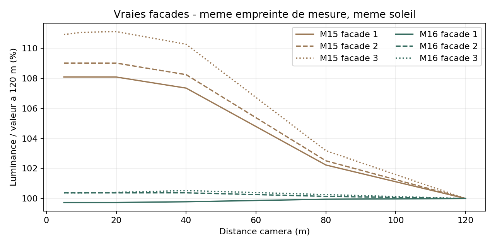
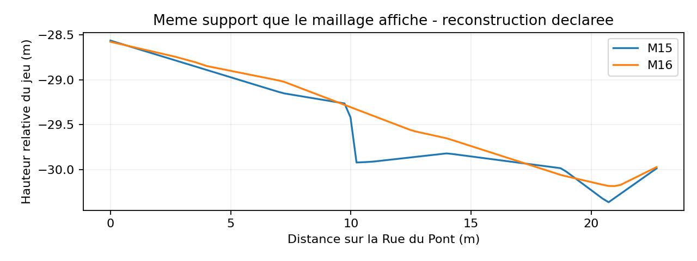
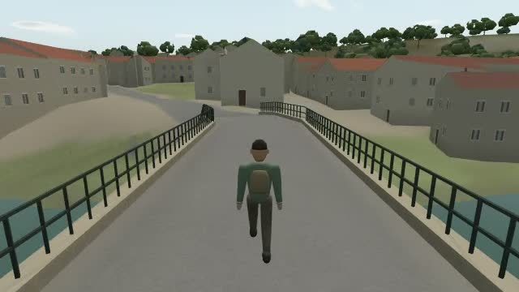

# Mission 16 — Réalisme, continuité et plaisir de promenade

**Les façades retrouvent des murs continus, le pont se rejoint depuis sa rue, quelques fenêtres s’allument le soir et la rivière suit son tracé.** Les corrections sont proposées dans la [PR brouillon #25](https://github.com/sebastienleidgens-lab/endless-earth/pull/25). Un seul jalon autonome ; **0 €**, aucune fusion, aucun déploiement, aucune modification de Living Paintings / LP-01.

Trois façades × six distances × trois profils × deux versions : **108 captures**, variation de luminance **8,08–11,71 % → 0,25–0,96 %**, à éclairage fixe et sur une même petite zone de mur. Une autre série suit le déplacement du centre des ombres pour vérifier séparément le défaut de normales. Le pont reçoit un **aller-retour natif de 229,8 m**, puis une traversée après rechargement près du garde-corps. Une dernière traversée sonore mesure **163 pas effectivement joués sur 114,7 m**.

Les routes ne sont pas toutes certifiées pour une future voiture : les irrégularités hors correction restent signalées, et le raccord interprété du tablier conserve une pente locale importante. Le personnage reste stylisé ; la qualité artistique et le confort sur GPU/Android physiques restent à apprécier.

[Galerie locale et films](mission-16-evidence/index.html) · [Planche avant/après](mission-16-evidence/summary/comparison.jpg) · [Mesures des façades](mission-16-evidence/facade-summary.json) · [Contrôles du moteur](mission-16-evidence/runtime.json) · [Mesures de performance](mission-16-evidence/performance-summary.json).

## Base, sources et périmètre

GitHub vérifié : Mission 14 / PR #23 fusionnée dans `96a2687`, Mission 15 / PR #24 fusionnée dans **`b815cce740c9cfcebb598e6f3bdfb979f19a2908`**. Les quatre commits de Mission 15 sont dans l’ascendance. Branche `mission/16-realisme-jouabilite`. La seule autre PR ouverte au départ était Living Paintings #19, laissée intacte.

`AGENTS.md`, les rapports et les modules des Missions 11–15 ont été examinés. Les références locales M13 **C10, C14 et C25**, ainsi que la photographie du pont M14 `153575084`, ont été consultées : murs continus, cadres de pierre, volets identifiables et diversité réelle des matières. Pas de nouvelle bibliothèque photo. [Catalogue et droits M13](mission-13-evidence/catalog.json) · [Crédits du pont](mission-14-evidence/heritage/reference-credits.json).

Les contours OSM, emprises, MNT/LiDAR source, rivière, ancien tablier documenté et fichiers audio sont conservés. Les surfaces nouvelles sont des dérivés liés par empreintes aux mêmes sources. La correction de chaussée est une **reconstruction explicitement interprétée**, pas un nouveau relevé topographique. Les fenêtres éclairées ne constituent pas une observation d’occupation.

Les prises de vues et parcours principaux utilisent le checkout figé `a33e05a`. Le raccord de pied de mur et la correction audio sont vérifiés sur **`ce66dcb`** ; le benchmark final utilise ce dernier. Aucun changement du serveur figé pendant ses mesures. [Identités et états des checkouts](mission-16-evidence/freeze.json).

## Diagnostic des huit problèmes

| Problème | Cause confirmée / état initial | Correction et vérification |
| --- | --- | --- |
| Façades qui changent à l’approche | Le ton hybride proche était centré vers `.96`, contre `.88` au loin. Les normales intérieures dirigeaient aussi le biais solaire vers le mauvais côté du mur, créant de l’auto-ombrage. | Contraste centré sur `.88`, macrovariation indépendante du fondu ; orientation réelle corrigée. Série de distances, lecture des pixels du moteur et film d’approche. |
| Bandes aux fenêtres | Les quads des murs étaient orientés vers l’intérieur. Le rendu double face cachait ce défaut ; les rayons d’occlusion entraient dans la maison et leur interpolation dessinait les bandes horizontales. | Inversion du winding et des normales des faces concernées, puis recalcul de l’occlusion et des ombres depuis le vrai maillage. Les trous, embrasures, cadres et volets restent présents. |
| Fenêtres du soir / nuit | Aucun intérieur emissif dans M15. L’extinction nocturne des oiseaux diurnes existait déjà. | Sélection par identifiant de bâtiment et d’ouverture, horaire civil et soleil existants ; émission chaude partagée. Audio nocturne conservé, pas de nouveau fond artificiel. |
| Sols et routes | La partition terre/route/eau existait déjà. La Rue du Pont héritait d’une forte irrégularité DEM/raffinement ; le DEM ne mesure pas une chaussée. | Correction locale dans le maillage unique, raccord d’accotement et support pris sur ses mêmes triangles Float32. Un pied de mur voisin est prolongé de 20,9 cm. Classification et contrôle de gabarit ajoutés. |
| Blocages invisibles | Le noyau traitait chaque différence verticale comme une pente sur un pas de quelques centimètres ; une petite marche pouvait être refusée. Les largeurs avec unité pouvaient aussi diverger entre rendu et navigation. | Petite marche admise seulement avec palier dégagé et presque plat ; pente soutenue inchangée. Parseur de largeur partagé. Diagnostic de la règle, hauteurs, pente, obstacle et position demandée. |
| Accès au pont | Le noyau direct refusait l’irrégularité de la Rue du Pont. Le quai conserve un vrai conflit avec la maçonnerie, déjà documenté en M14. | Rue réelle corrigée, aucun passage inventé dans le quai. Aller-retour, rive opposée, arrêts, course, garde-corps et rechargement réellement testés. |
| Courant de rivière | Les vagues utilisaient des directions artistiques globales sans lien au réseau hydrographique. | Petit champ préparé selon l’ordre aval de la ligne OSM de l’Anglin, coordonnée longitudinale continue et activité localisée aux seuils cartographiés. Vagues et mousse discrète, sans simulation hydraulique. |
| Randonneur | M15 possédait déjà 16 os et une marche liée à la distance. Les pas des voies secondaires/pont devenaient silencieux parce que leur matière venait des seules voies AutoWalk. | Rig conservé, petit sac, col, bretelles, couleurs et posture affinés. Matières de pas prises sur toutes les routes cartographiées, sans supposer une matière inconnue. Altitude acoustique prise sur le support réel. |

### Hypothèses et alternatives vérifiées

Les ablations dans le véritable moteur séparent **sans bump**, **sans occlusion ambiante**, **sans ombre solaire** et changement de matière. Enlever le bump ne supprime pas les bandes ; enlever l’occlusion les supprime. Enlever les ombres supprime les taches d’auto-ombrage, mais ne constitue pas la solution retenue. Une augmentation du biais a aussi été essayée : elle ne corrige pas les normales ni les bandes d’occlusion. Le correctif final conserve le biais existant et les vraies ombres.

Aucune superposition de mur opaque derrière les vitres n’a été retenue comme cause : les trous et panneaux existaient déjà. Le passage de détail remplace les panneaux d’une cellule, sans ajouter une seconde façade. Atlas, mipmaps, anisotropie, couleurs de données et UV métriques ont été examinés ; ils ne sont pas établis comme la cause des bandes. La mesure à empreinte de pixels constante isole le fondu de distance de la minification des textures. Pas de suppression globale d’ombre, de garde-corps, d’eau ou de collision.

## Façades, fenêtres et toitures

Les géométries anciennes restent des caches vérifiés par checksum. À leur hydratation, un correctif explicite oriente les faces vers l’extérieur et ajoute un attribut d’identité aux seuls panneaux de vitrage. Les empreintes de génération historique restent lisibles ; les transformations de runtime ont leurs propres empreintes. Aucun déplacement horizontal d’emprise, nouvelle ouverture prétendument observée ou nouvelle texture par maison.

La tuile photographique, ses échelles métriques et la palette de Mission 13 restent la référence. Les normales des pans de toiture dirigés vers le bas sont corrigées. Les reliefs de matière restent des détails d’éclairage : ils ne remplacent pas une réparation de géométrie. La finesse de la bibliothèque 128 px et les toitures procédurales demeurent des limites.

**Mesure principale :** même heure, soleil, météo et orientation ; distances 5, 10, 20, 40, 80, 120 m. Le FOV varie pour conserver la même zone de **24 cm** et la même empreinte en pixels : cela mesure la stabilité de la matière, pas la précision d’un gros plan à 120 m. Les captures avec FOV fixe sont dans les films. Le centre des ombres est fixe dans cette première série ; la série complémentaire le déplace avec chaque station, en gardant aussi la phase des nuages et du vent fixe. Cette seconde série fait apparaître un assombrissement proche d’environ 39–42 % avant réparation, contre une variation totale de 0,53 % après. Un premier harnais faisait avancer les nuages entre les stations ; sa variation résiduelle n’était pas un défaut du biais solaire. Le biais supplémentaire essayé n’est pas retenu.

| Profil | Façade 1 avant / après | Façade 2 avant / après | Façade 3 avant / après |
| --- | ---: | ---: | ---: |
| eco | 8.08 % / 0.25 % | 9.04 % / 0.40 % | 11.67 % / 0.96 % |
| balanced | 8.08 % / 0.26 % | 9.01 % / 0.38 % | 11.10 % / 0.53 % |
| quality | 8.08 % / 0.26 % | 9.01 % / 0.38 % | 11.71 % / 0.53 % |

[108 images et données complètes](mission-16-evidence/facades/measurements.json) · [Centre d’ombre suivant les stations](mission-16-evidence/shadow-distance/measurements.json) · [Approche avant](mission-16-evidence/before-facade-approach.webm) / [après](mission-16-evidence/after-facade-approach.webm).

Les films d’approche sont explicitement des **inspections de caméra**, 120 → 5 m en 25 secondes réelles, FOV 55°, joueur immobile. Ils ne sont pas présentés comme des marches clavier. La marche clavier continue est celle du pont ci-dessous.

## Une nuit calme et quelques lumières

L’identité associe le bâtiment OSM à la position métrique de l’ouverture ; elle reste identique entre panneaux proches et lointains, chargements et déplacements de caméra. Environ 58 % des ouvertures sont candidates ; l’horaire et l’intensité varient par ouverture. Allumage progressif à la tombée du jour, davantage d’extinctions entre 22 h et 3 h, quelques réveils matinaux, extinction avec le soleil. Pas de silhouettes derrière les vitres.

La même rue est capturée matin, après-midi, crépuscule, soir, nuit, nuit pluvieuse et nuit neigeuse. L’heure vient du propriétaire solaire/calendaire existant ; la neige, la pluie et le ciel gardent leurs systèmes. **Zéro lampe individuelle, zéro passe ajoutée, zéro texture d’intérieur** : l’émission utilise les matériaux partagés.

Les oiseaux diurnes restent interdits lorsque le soleil est couché. L’eau et le vent subsistent selon leurs sources et leur météo. Aucune nouvelle faune nocturne, voix humaine, musique ou bruit de remplissage n’est inventé. Le silence sur une matière inconnue reste volontaire.

[Captures et états temporels](mission-16-evidence/scenes/captures.json) · [Séquence native eau / soir / nuit / pluie, son réel](mission-16-evidence/final-river-night-native.webm).

## Chaussée, support, accès et gabarit

La correction porte sur les **22,964 m de l’OSM way 900319308**, Rue du Pont, entre ses altitudes source **72,637 et 71,261 m**. Elle conserve la descente d’ensemble, utilise un raccord transversal aux extrémités et un fondu d’accotement de 4 m. Correction maximale d’un sommet : **1,339 m**. Les sommets de rivière et le maillage du tablier ne sont pas modifiés.

Le dérivé remplace la surface unique ; il ne pose pas une route flottante au-dessus du terrain. Son support est l’interpolation barycentrique des **mêmes triangles Float32** que le rendu. Les LOD du secteur corrigé conservent ces triangles. Le chargement vérifie les sources et le checksum, et garde une surface complète de repli si le dérivé manque. Il évite de télécharger l’ancienne surface en plus du remplacement dans le cas normal.

Le contrôle des fondations a trouvé quatre bâtiments voisins influencés par l’accotement, dont un pied de mur exposé de **20,9 cm**. Seuls les sommets inférieurs de ce mur sont prolongés vers le terrain corrigé. Ni les ouvertures, ni les étages, ni l’emprise ne sont déplacés ; ombres et abri neige sont recalculés.

Au pas de mesure de 25 cm, la pente locale maximale de la Rue du Pont passe de **201,4 % à 13,23 %**. Ce résultat est une mesure du maillage du jeu, pas une nouvelle mesure de la route réelle. Le contrôle simplifié utilise un empattement de **2,6 m** et **14 cm** de garde nominale sous caisse. Il conserve les inconnues de largeur et les restrictions d’accès.

Les catégories **chaussée, voie piétonne, escalier, pont et inconnu** sont explicites, indépendamment de la matière et de l’autorisation automobile. Un chemin large n’est pas promu en route automobile. Les tags d’accès conditionnel, privé et motorisé restent séparés.

Le tablier conserve une pente locale **25,75 %** et la route de l’autre rive `647696688` atteint **29,62 %** dans la source retenue. Ces cas restent signalés pour une future voiture ; aucune altitude de pont, rampe réelle ou précision topographique n’est inventée pour les faire passer.

[Préparation](mission-16-evidence/road-preparation.json) · [Carte/inventaire des problèmes et gabarit](mission-16-evidence/roads.json) · [Profils complets](mission-16-evidence/road-profiles.json.gz) · [Audit des fondations](mission-16-evidence/foundations.json) · [Raccord final vérifié](mission-16-evidence/final-foundation.json).

## Déplacement et pont : preuves natives

Une petite différence de hauteur n’est admise que si elle est ≤ **18 cm** et que trois échantillons sur **30 cm** trouvent un palier libre à ±2,5 cm. Une rampe durablement trop raide ne devient donc pas une succession de petites marches. Les limites de pente `.7`, les escaliers cartographiés, le rayon de 30 cm, les murs, l’eau et les garde-corps gardent leurs règles.

Le diagnostic contient position actuelle/demandée, hauteur actuelle/suivante, distance horizontale, dénivelé, pente, seuil, règle de refus et contexte d’obstacle. Les barrières et restrictions cartographiques indiquent leurs identifiants. Les vrais obstacles ne sont pas globalement désactivés.

Le graphe d’audit manuel, construit uniquement sur les sommets OSM coïncidents et vérifié dans les deux sens par le noyau réel, relie maintenant le départ de référence au pont : **itinéraire de 871,8 m**. Cet itinéraire complet est un résultat de graphe, **pas une vidéo de 871,8 m**. La promenade AutoWalk ordinaire conserve sa politique d’exclusion des routes secondaires/ponts ; son cache est régénéré et lié au nouveau support.

| Film / inspection indépendante | Résultat | Limite de la preuve |
| --- | --- | --- |
| M15, approche depuis la Rue du Pont | 23,9 m ; accès atteint avec glissement latéral, écart maximal à l’axe ≈ 1,30 m. | Ne démontre pas un pont systématiquement inaccessible avant. Le noyau direct et le profil révèlent l’irrégularité, mais le glissement peut la contourner. |
| M16, aller-retour natif | **229,8 m / 153,9 s**, rue du village, tablier, 8 m sur l’autre rive, demi-tour, pauses, reprise et course au retour. | Une seule pose initiale explicite sur la rue voisine, sans liaison inventée avec un autre parcours. |
| Après vrai rechargement | **128,8 m / 100,6 s**, approche du garde-corps à 1,8 m de l’axe, marche parallèle, arrêt/reprise, autre rive. | Film distinct et déclaré, pas montage dans l’aller-retour. |
| Traversée sonore finale | **114,7 m / 88,4 s**, **163 sons de pas admis**, altitude acoustique du tablier **72,27 m**. | Version finale avec correction audio ; les films antérieurs conservés ne contiennent pas encore ces nouveaux pas de pont. |

Les durées ci-dessus sont celles des conteneurs natifs indexés ; les temps de contrôle et de transfert sont conservés séparément dans les JSON. La publication est un remux sans encodage : chaque paquet audio/vidéo et chaque PTS/DTS restent identiques dans leur piste.

Toutes les positions enregistrées dans ces parcours M16 sont admissibles. Aucun rejeu de coordonnées, changement de vitesse physique, accélération de simulation ou téléportation pendant les films. Les temps natifs et les pistes WebAudio après limiteur sont conservés.

[Avant](mission-16-evidence/before-bridge-native.webm) · [Aller-retour](mission-16-evidence/after-bridge-native.webm) · [Après rechargement](mission-16-evidence/reload-bridge-native.webm) · [Traversée sonore finale](mission-16-evidence/audio-bridge-native.webm) · [Audit d’accès](mission-16-evidence/route-access.json).

Les diagnostics exécutent aussi marche/course, deux sens, **30/60/120 pas de simulation par seconde**, sur la géographie réellement chargée. Ce ne sont pas des cadences matérielles atteintes. Un garde-corps arrête le gabarit ; les tests unitaires conservent mur, falaise et terrain inconnu. **80 graines** de départ sont vérifiées dans le pool réellement préparé, avec rechargement et changements de profils. [Résultats du moteur](mission-16-evidence/runtime.json).

## Anglin et paysage sonore

La ligne OSM de l’Anglin est orientée vers l’aval ; son ordre et ses segments servent à préparer un champ **256² RGBA8** avec direction approximative et coordonnée longitudinale. Les neuf segments des deux seuils importés produisent une influence locale. Le champ est spatialement interpolé ; les contours et niveaux d’eau ne changent pas aux raccords des polygones.

Le courant ordinaire reste modéré ; les ondulations et une petite quantité d’écume varient près des seuils. Pas de rocher ou barrage ajouté, de mousse en particules périodiques, de débit converti en vitesse ou de simulation de fluides. Le coût est une lecture de petit champ et des termes analytiques dans le matériau existant. **262 144 octets de texels sans mipmaps**, environ 76 ko compressés.

L’audio garde ses enregistrements libres existants et ses mêmes seuils cartographiques. L’altitude du promeneur vient maintenant de son support réel, tandis que la hauteur de l’eau reste le DEM disponible : sur le pont, la distance acoustique à l’eau cesse d’être artificiellement voisine de zéro. Les pas utilisent les tags de toutes les voies, même celles exclues de l’AutoWalk. Une matière non renseignée reste silencieuse.

Vues du pont, sous la direction du regard vers l’eau, près du moulin/seuil, zone calme et vallée sont conservées. Les films sont des observations natives indépendantes ; aucune écoute humaine de l’agent ni calibration hydraulique n’est revendiquée.

[Champ et provenance](mission-16-evidence/river-preparation.json) · [Eau M15](mission-16-evidence/before-river-night-native.webm) · [Eau et nuit M16](mission-16-evidence/final-river-night-native.webm).

## Randonneur

Le modèle M15 est conservé et affiné : col, petit sac en toile, bretelles, teintes naturelles et légère inclinaison du corps. **2 248 triangles au lieu de 1 936**, toujours **16 os, un seul draw call, zéro texture d’image**. Taille et vitesses physiques inchangées.

Le cycle et les sons prennent la distance réellement parcourue, avec le même pas métrique ; une collision ne produit pas de marche sur place. Les appuis IK et la respiration M15 restent actifs. La trace native d’aller-retour ne montre pas de dérive des appuis mesurés, et **aucun contact de pas pendant les arrêts réellement immobiles**. Cela contrôle les cibles du rig ; ce n’est pas une capture de mouvement humaine ou une garantie de perfection artistique.

Les vues de face/profil/dos au repos sont de vraies inspections séparées. Les images de marche/course sont extraites des films natifs sans réanimation ni remplacement d’image. Les pentes et changements de direction sont présents sur le parcours du pont. La silhouette demeure stylisée et ne reçoit pas une nouvelle ombre dynamique individuelle.

## Coût et performances

**288 rendus synchronisés**, 960 × 640 / DPR 1, quatre vues, trois profils, deux versions figées, trois tours alternés et quatre échantillons mesurés par tour. Caméra, soleil, date, phase de vent et météo commune vérifiés identiques. Pas d’autre charge navigateur/GPU pendant la matrice. Synchronisation de fin et lecture de pixels incluses. **SwiftShader logiciel uniquement** ; aucun FPS de GPU physique ni téléphone Android revendiqué.

| Profil · vue | M15 médiane ms | M16 médiane ms | Écart | M16 P95 / pic ms |
| --- | ---: | ---: | ---: | ---: |
| eco · rue | 297.7 | 320.6 | +7.7 % | 332.5 / 335.8 |
| eco · foret | 142.6 | 145.5 | +2.1 % | 157.6 / 158.4 |
| eco · riviere | 167.2 | 171.9 | +2.8 % | 181.6 / 183.5 |
| eco · vallee | 249.1 | 272.7 | +9.5 % | 288.5 / 292.6 |
| balanced · rue | 431.3 | 460.0 | +6.7 % | 490.5 / 505.1 |
| balanced · foret | 203.4 | 210.1 | +3.3 % | 229.9 / 232.6 |
| balanced · riviere | 215.8 | 234.6 | +8.8 % | 265.9 / 270.0 |
| balanced · vallee | 304.4 | 314.8 | +3.4 % | 346.4 / 350.9 |
| quality · rue | 447.8 | 454.1 | +1.4 % | 474.0 / 479.5 |
| quality · foret | 211.6 | 204.6 | -3.3 % | 210.1 / 211.4 |
| quality · riviere | 235.0 | 231.1 | -1.7 % | 256.7 / 257.4 |
| quality · vallee | 337.7 | 350.3 | +3.7 % | 373.0 / 379.0 |

Les draw calls sont identiques dans chaque paire. Le personnage ajoute **312 triangles** quand il est visible ; la vue subjective de rivière conserve le même nombre de triangles. La rivière ajoute une seule petite texture. Les fenêtres ne créent pas de lumières ou de passes supplémentaires. Les buffers, textures, programmes, tas JS après GC et allocations WebGL estimées sont dans la matrice ; ce ne sont pas des mesures de VRAM physique.

Le chargement observé une fois par version est **3,566 → 4,346 s** ; ce n’est pas une médiane de campagne. Ce coût supplémentaire, les régressions et les pics ne sont pas effacés par les petites améliorations d’autres vues. Le temps de la promenade enregistrée inclut le coût de l’enregistrement ; il ne remplace pas la matrice appariée. La conservation de vraies ombres et de façades sans bandes motive le compromis artistique.

72 rendus supplémentaires isolent l’émission des vitres, l’ancien/nouveau shader d’eau dans une scène finale identique, et le personnage visible/masqué. Les quatre échantillons par état restent petits : les écarts négatifs ne démontrent pas un coût nul. Les attributs et le champ restent alloués pendant les ablations.

| Élément, on / off | Éco | Équilibré | Qualité |
| --- | ---: | ---: | ---: |
| windows | 327.9 / 316.0 ms | 427.7 / 415.2 ms | 426.9 / 424.4 ms |
| river | 174.9 / 164.4 ms | 214.9 / 227.8 ms | 256.1 / 242.4 ms |
| character | 332.3 / 338.0 ms | 458.9 / 465.9 ms | 459.3 / 462.6 ms |

[Mesures détaillées](mission-16-evidence/performance-summary.json) · [Échantillons bruts](mission-16-evidence/performance.json.gz) · [Ablations par composant](mission-16-evidence/components.json).

## Validation, fichiers et limites

**245 tests Node**, TypeScript/Vite et contrôles du jeu compilé. Les tests ajoutés vérifient l’orientation, l’idempotence après hydratation, l’identité des fenêtres, l’horaire, les petites marches, la conservation des obstacles, les catégories, le support exact, le champ de rivière, le raccord de fondation et les matières de pas du pont. Les tests historiques de fingerprints distinguent explicitement les caches d’origine et leurs réparations au chargement.

Le navigateur vérifie 12 parcours de simulation dans le vrai monde, graines, profils, ressources, rechargement et données manquantes/corrompues. Le build de production, les caméras, clavier, son et formats mobiles sont contrôlés séparément. Les films sont entièrement décodés par ffmpeg. [Contrôles et identités](mission-16-evidence/validation.json) · [Médias](mission-16-evidence/media.json) · [Préservation](mission-16-evidence/preservation.json).

Les principales modifications sont dans `src/architecture/`, `src/materials/world.ts`, `src/controls/walking.mjs`, `src/world/{terrain,collisions,navigation,surface-support,road-category}`, `src/living/{geography,sound}`, `src/audio/geography.mjs`, `src/earthlife/{water,river-field,river-flow,state}`, `src/nature/{sky,surfaces}`, `src/character/walker.mjs` et leur intégration dans `src/main.ts`. Les nouveaux dérivés `angles-walk-*` et `angles-river-flow.*` ont leurs scripts reproductibles. Aucun package ajouté ; bibliothèque de matières et sons réutilisée.

| Problème demandé | État final | Limite restante |
| --- | --- | --- |
| Stabilité des façades | **Corrigé sur les cas reproduits et mesurés** | Trois façades quantitatives, pas inventaire visuel exhaustif de chaque maison. Le mode photographique expérimental n’est pas la matière normale du pilote. |
| Bandes, fenêtres, murs et toitures | **Corrigé pour les bandes reproduites ; finition partielle** | La géométrie et les ouvertures restent des reconstructions procédurales, non relevés de chaque façade. |
| Vie lumineuse et audio nocturne | **Corrigé / comportement existant vérifié** | Pas de nouvelle captation nocturne ou activité domestique inventée ; appréciation sonore humaine à faire. |
| Routes et continuité future automobile | **Partiellement corrigé** | Rue du Pont réparée, classification et alertes ajoutées. Autres profils et largeurs non certifiés, gabarit simplifié. |
| Blocages invisibles | **Corrigé sur les causes reproduites ; couverture partielle du village** | Diagnostic disponible ; pas de garantie universelle de navigation sur toutes les données françaises. |
| Pont depuis ses accès | **Corrigé pour l’accès testé et les deux sens** | Le quai sous maçonnerie demeure bloqué ; pas de navigation complète à plusieurs étages. Raccords automobiles encore signalés. |
| Courant et cohérence sonore | **Amélioré et testé dans le jeu** | Champ approximatif OSM ; niveau d’eau, bathymétrie et vitesse réelle inconnus. |
| Randonneur | **Amélioré et testé en marche/course** | Style et sympathie restent à juger ; pas de validation artistique humaine ou GPU physique inventée. |

Les contrôles techniques ne déclarent pas à la place du propriétaire qu’une promenade de plusieurs heures est parfaite. Aucun essai de plusieurs heures, GPU matériel ou Android physique n’est revendiqué. La silhouette des bâtiments et certaines pentes restent tributaires de données et d’estimations antérieures.

## Reproduire sans publier

`npm ci`, `npm test`, `npm run build`, puis `npm run dev -- --port 5305`. Le jeu est servi localement sous `/endless-earth/` ; la galerie documentaire sous `/endless-earth/docs/mission-16-evidence/index.html`. Les scripts `browser-mission-16-*` utilisent `MISSION16_PORT=5305`. La référence M15 est un checkout détaché de `b815cce`, servi sur 5310.

Les préparations de route et de champ de rivière sont hors ligne. La préparation de lumière exporte les buffers du serveur de développement sur 5303, puis reconstruit le cache ; celle de neige dérive de ce nouveau cache. Le graphe est exporté par le moteur réellement chargé. Les anciens caches restent disponibles pour le repli et la comparaison. Les gros exports intermédiaires sont dans `work/`, ignoré par Git ; seuls films, captures et traces utiles sont conservés dans ce dossier.

**PR maintenue en brouillon, sans fusion ni déploiement.**
