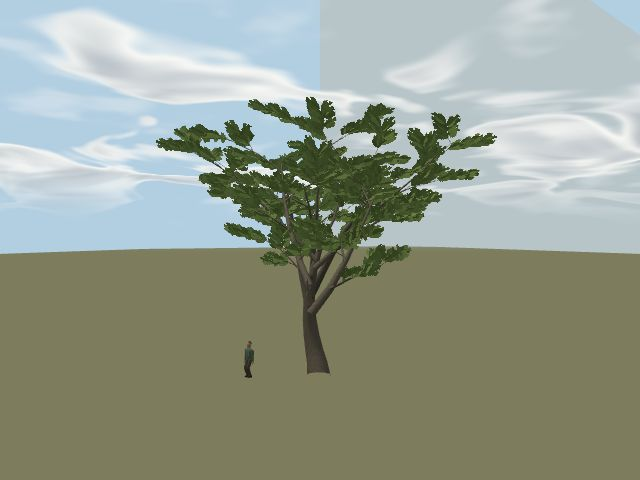
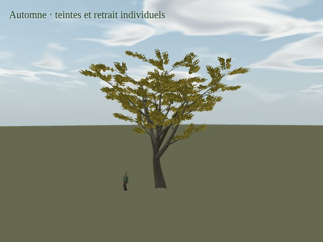
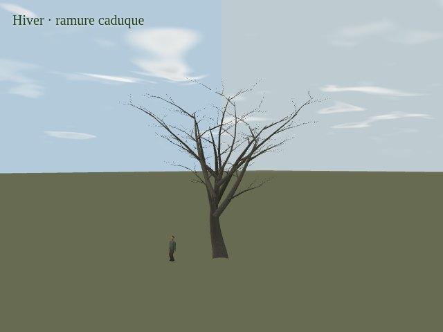

# Mission 17 — La renaissance des arbres (17C)

**Le vent hiérarchique, les saisons par feuille et le dépôt de neige sont proposés pour validation artistique.** Le « Go » après la livraison 17B est interprété comme son approbation artistique et l’autorisation de ce jalon. **Arrêt après 17C : 17D reste à faire.** Aucune fusion ni publication.

[PR brouillon #26](https://github.com/sebastienleidgens-lab/endless-earth/pull/26) · [Galerie interactive des douze films](mission-17-evidence/life/index.html) · [Atelier 3D](../fixtures/forest-life.html?perf=1) · [Rapport 17B conservé](mission-17b.md) · [Rapport 17A conservé](mission-17a.md).

| Été | Automne | Hiver |
| --- | --- | --- |
|  |  |  |

Les nouvelles réponses restent des interprétations artistiques. Les petites feuilles sont dessinées dans des pousses planes attachées aux rameaux ; le frémissement anime ces pousses, tandis que la croissance et le retrait distinguent les feuilles de leur atlas. Une simulation mécanique de chaque limbe ou de chaque espèce n’est pas revendiquée. **Les tests ne valident pas la beauté du mouvement.**

## Vent, appuis et temps

Le champ et l’horloge sont ceux de Mission 11. Une banque spatiale de **16 × 16 échantillons**, pilotée par ce champ, ajoute trois réponses amorties : **1,7 / 3,4 / 7,5 rad/s**. Elle ne génère ni météo ni temps indépendants. L’interpolation partage la direction des rafales entre voisins ; flexibilité, taille, âge et phases des embranchements différencient les réponses. L’énergie décroît jusqu’au repos quand l’entrée devient nulle.

Les déformations s’appliquent depuis les attaches : frémissement de la pousse, rameau fin, branche secondaire, branche principale, puis très faible flexion du tronc. Les normales suivent les mêmes rotations. Le tronc est particulièrement amorti sur les grands individus ; jeunes et berges sont plus souples, les conifères plus retenus. Les grandes masses ne se déplacent plus comme un seul bloc. Les pivots quantifiés restent attachés à moins de **1,5 mm** sur les joints testés sous entrée forte ; les racines des pousses restent à moins de **2 mm** avec croissance et frémissement.

Le propriétaire M11 utilise désormais le temps mural déjà fourni par la boucle pour son horloge environnementale, avec sa limite de reprise à une seconde. Il reste distinct du pas borné des collisions. Cela évite de ralentir artificiellement le vent quand le GPU logiciel rend peu d’images ; aucun deuxième chronomètre n’est ajouté. Les douze traces montrent un écart entre temps enregistré et temps du vent inférieur à **0,02 s**.

L’enveloppe conservatrice de mouvement ajoute **3,2 m** aux bounds de visibilité. À proximité des maçonneries, l’amplitude utilise la marge existante ; **131 individus** ont une réponse atténuée dans le pilote. Les positions et les trois composantes de forme statique restent celles de 17B.

## Références consultées

Deux vidéos publiques sous **CC BY-SA 4.0** ont été téléchargées et des séquences de frames horodatées ont été décodées puis inspectées :

- [Wind in tree AppletonFarms Massachusetts 2024-10](https://commons.wikimedia.org/wiki/File:Wind_in_tree_AppletonFarms_Massachusetts_2024-10.webm), **Oakley413** : tronc peu mobile, extrémités plus actives, déplacement commun avec des réponses locales différentes. L’espèce n’est pas identifiée ici.
- [Chaya leaves (Cnidoscolus aconitifolius) swaying in the wind](https://commons.wikimedia.org/wiki/File:Chaya_leaves_(Cnidoscolus_aconitifolius)_swaying_in_the_wind.webm), **Undeka11** : changements d’orientation des limbes autour de leurs attaches et différences entre voisins. Cette plante tropicale sert uniquement à observer le mouvement, sans fournir de modèle botanique français.

Cela a guidé l’écart entre les trois inerties et l’amplitude discrète du roulement des pousses. Ce sont des observations qualitatives ; aucune vitesse de vent mesurée ni validation de toutes les familles n’en est déduite. Aucun pixel externe n’entre dans les matériaux du jeu. Les originaux restent dans `work/`, hors Git. [Journal des URL, licences, empreintes, segments observés et limites](mission-17-evidence/life/naturalist-references.json).

## Croissance et retrait saisonnier

Chaque famille possède une plage de débourrement et de chute ; l’identité stable de chaque arbre décale ces dates d’environ dix jours. La phénologie est générique et interprétée, sans prétention de relevé local.

Le calendrier M11 pilote les bourgeons discrets, l’allongement des pousses et la croissance des feuilles au printemps. L’été garde les couronnes de référence. À l’automne, les pigments varient entre individus et feuilles, puis le retrait ouvre la ramure progressivement. L’hiver caduque expose la vraie charpente, ses branches secondaires et ses ramifications. Les persistants contournent la perte saisonnière.

L’ancien seuil de suppression par `natureCluster` est retiré du chemin forestier. Le canal G de l’atlas contient un rang stable par feuille et le canal B une distance à son contour. Chaque feuille croît puis s’efface sur sa pousse ; le rang de pousse décale son calendrier. Les tiges fines s’atténuent vers l’hiver, sans retirer de paquets de triangles de branches. La luminance R et la silhouette alpha d’origine sont conservées. La végétation basse conserve son propriétaire existant.

Les lointains utilisent le même calendrier et la même règle d’alpha, avec leur représentation simplifiée de 17B. Ils ne simulent pas chaque feuille tridimensionnelle. [Inventaire des familles, plages de dates et modes par profil](mission-17-evidence/life/inventory.json).

## Neige et ombres

La neige reste celle de **Mission 15** : température, accumulation, fonte, exposition statique et particules viennent de son système existant. La couche suit les surfaces compatibles et les normales déformées ; son grain reste attaché aux branches en mouvement. Les persistants reçoivent un coefficient de dépôt plus élevé que les pousses caduques. L’exposition de la couronne est approchée par hauteur et rétention, en complément de l’exposition M15 du terrain et des bâtiments. Ce n’est pas une simulation de charge de neige ni d’auto-occlusion complète.

Aucun volume blanc de couronne n’est créé. Les ouvertures de l’atlas et les espaces entre branches restent ouverts. Le dépôt sur les aiguilles fines est encore discret. La prise de fonte conserve la vitesse M15 : la couverture passe de l’état saturé à une valeur légèrement inférieure sur seize secondes, sans rendre le processus artificiellement rapide. Voir les valeurs exactes dans les métadonnées et la trace `thaw`.

Les casters **Mission 14** partagent les fonctions de pose et d’alpha saisonnier avec la couleur. Le proxy distant conserve une déformation de grosses branches, sans le frémissement fin du premier plan. Les plafonds restent **Éco : aucun target local ; Équilibré : 160 arbres, 512 px, 2 Hz ; Qualité : 256 arbres, 1 024 px, 4 Hz**. La carte solaire n’est pas recalculée à chaque petit mouvement de feuille.

Le contrat devient `branch-attached-forest-v2`. Le pack actif `angles-walk-lighting` est **réellement rebaké** à partir des 287 maillages et des 3 889 ancrages exportés. La géométrie statique et les bounds de couronnes au repos sont identiques à 17B : le binaire calculé reste identique, avec un nouveau contrat explicite dans son manifeste. Les anciens caches incompatibles restent refusés. [Préparation effective, 52,7 s](mission-17-evidence/life/light-preparation.json).

## Films natifs et lecture

[La galerie](mission-17-evidence/life/index.html) propose : vent faible, vent modéré, rafales, forêt, printemps, été sous la couronne, automne, hiver caduque, hiver persistant, neige, début de fonte et transition saisonnière.

Les neuf films d’atelier utilisent les modèles, matériaux et propriétaires du jeu dans une scène synthétique, en **640 × 480, profil Qualité**. Chaque nouvelle image GPU est copiée une fois sur un canvas de capture pour y ajouter son libellé ; la capture demande alors une frame native. Les trois films du pilote restent dans le vrai terrain, en **480 × 320** : Éco pour la forêt, Équilibré pour la neige et la fonte, avec une caméra de revue fixe pour ces deux derniers. Aucun arbre n’est caché pour la prise.

**Tous les mouvements sont enregistrés à vitesse réelle.** Seul le film « Diagnostic calendrier accéléré » parcourt mars à décembre en dix-huit secondes ; l’accélération est inscrite dans ses pixels. Les shaders et les premiers états météorologiques sont stabilisés avant la capture ; la fonte commence après une commande de météo douce, puis évolue naturellement. Aucune avance de simulation n’est ajoutée pendant les films naturels. Les vidéos ne sont ni rejouées ni interpolées ; l’indexation WebM utilise une copie de codec avec vérification d’identité de chaque paquet, de ses timestamps et de son empreinte.

Le GPU est **SwiftShader logiciel**. Les films du pilote peuvent descendre autour de deux à quatre images rendues par seconde ; cette cadence est conservée. Aucun FPS Android physique n’est inventé. [Métadonnées et preuves des douze films](mission-17-evidence/life/movies.json) · [Décodage, seek et quatre formats de galerie](mission-17-evidence/life/media-validation.json) ; les traces par frame sont conservées sous `*-trace.json.gz`.

## Préservation et vérifications

Base `origin/main` vérifiée : **`9cde6af3c48a3973928d669f2228285ded674f1d`**, Mission 16 fusionnée par PR #25. Comparaison 17C avec le jalon 17B figé : **`f7c18199af6ed2f68adb18678f6301f466d2fd52`**. Même branche, même PR brouillon. Aucun travail Living Paintings / LP-01. Budget supplémentaire : **0 €**.

- **3 889 ancrages identiques** : les 2 500 d’origine et les 1 389 compléments 17B, avec leurs attributs individuels.
- **462 buffers identiques octet par octet** : positions, indices, normales, couleurs, UV et attributs de base des onze modèles et trois LOD. Seules les données de mouvement et les métadonnées des feuilles s’ajoutent.
- Archives d’images, vidéos et preuves **17A/17B intactes** ; rapport 17B archivé séparément sans réécriture. Terrain, eaux, relief, routes, bâtiments, repères et packs de décor inchangés.
- Graphe recalculé : **919 nœuds, 896 arêtes, même SHA-256**, pack inchangé.
- **267 tests Node passent**, dont sept nouveaux contrôles de réponse, stabilité à 30/60/120 Hz, phénologie, attaches, enveloppe et atlas de pivots.
- Build TypeScript/Vite réussi. Le navigateur rend les trois profils avec couleur, ombres estivales/hivernales et neige, sans erreur ni avertissement WebGL. Six cycles de création/destruction reviennent au même nombre de textures, géométries et octets logiques. Rechargement stable ; caches d’ancrages absent, corrompu ou périmé reconstruits à l’identique.

Le bundle de production est testé depuis le commit propre **`c7f61d021c25883c5b50b3bc0f4b6e3df43b7312`**. Il charge le monde et passe déplacement, modes de caméra, hauteur d’œil, arrêt sans dérive, son et changement de profil. Son identité embarquée « Mission 17 — La renaissance des arbres (17C) » passe quatre formats sans recouvrement des contrôles ni requête de métadonnées externe. Le test d’enveloppe est ensuite renforcé jusqu’à une échelle de **2,2**, couvrant le maximum réel de **2,194626**, et ses sept contrôles ciblés repassent. Le commit de preuve suivant ne modifie pas le runtime de l’application. [Validation compilée](mission-17-evidence/life/compiled-validation.json).

[Audit de préservation](mission-17-evidence/life/preservation.json) · [Navigation](mission-17-evidence/life/navigation-equivalence.json) · [Validation navigateur](mission-17-evidence/life/validation.json).

## Coût et réserve de fluidité

**La réserve de fluidité reste majeure.** 17B coûtait déjà **+32 à +150 %** face à Mission 16 dans sa campagne logicielle. Cette dette n’est pas résolue. La campagne 17C ajoute du coût dans huit des neuf paires ; une baisse isolée ne démontre pas une amélioration générale. **Cette branche n’est pas prête à être fusionnée pour ses performances.**

Comparaison directe avec 17B, **216 rendus synchronisés**, Chromium / **SwiftShader logiciel**, **960 × 640, DPR 1**, douze échantillons chauds alternés par paire. Caméra et climat complets sont vérifiés identiques. Le temps est figé pendant les échantillons ; les ombres locales utilisent leurs dérivés respectifs et une carte solaire stable. Ce ne sont pas des mesures de rafraîchissement forcé ni des résultats de téléphone.

| Campagne | Profil | Vue | 17B médiane ms | 17C médiane ms | Δ | 17C P95 ms |
| --- | --- | --- | ---: | ---: | ---: | ---: |
| Couleur | eco | bois | 413.1 | 495.6 | +20.0 % | 580.8 |
| Couleur | eco | aerienne | 334.6 | 346.2 | +3.5 % | 450.7 |
| Couleur | balanced | bois | 563.2 | 667.0 | +18.4 % | 709.5 |
| Couleur | balanced | aerienne | 585.6 | 612.4 | +4.6 % | 718.8 |
| Couleur | quality | bois | 841.1 | 747.6 | -11.1 % | 842.8 |
| Couleur | quality | aerienne | 608.2 | 655.2 | +7.7 % | 843.9 |
| Ombre locale | eco | bois | 403.7 | 501.9 | +24.3 % | 554.6 |
| Ombre locale | balanced | bois | 693.1 | 840.9 | +21.3 % | 997.1 |
| Ombre locale | quality | bois | 936.5 | 1046.3 | +11.7 % | 1225.9 |

La géométrie soumise varie légèrement avec les bounds agrandis. La variation de cadence et le fill rate du logiciel limitent l’interprétation d’une paire isolée. Les mesures brutes et le protocole sont conservés : [résumé](mission-17-evidence/life/performance-summary.json), [216 échantillons](mission-17-evidence/life/performance.json.gz).

La banque de vent occupe **32 Kio CPU et 4 Kio GPU**. L’atlas commun de pivots ajoute **7,07 Mio de texture GPU**, la même quantité pour son tableau CPU, plus **6,36 Mio** d’attributs source CPU ; il évite de dépasser les seize emplacements d’attributs WebGL. Dans cette campagne, la hausse de textures logiques est de **7,07 Mio** et celle des buffers d’environ **0,74–0,79 Mio**. Ce comptage ne mesure pas la VRAM physique ni les caches du pilote.

Une ablation sur **un arbre isolé**, même pose et temps figé, mesure **89,0 ms** sans vent, **87,6 ms** avec grosses branches seules et **91,2 ms** avec hiérarchie complète, après synchronisation et lecture GPU. L’écart fin est faible devant le coût de rendu et sa variabilité ; ce résultat ne doit pas être extrapolé à la forêt. La banque seule à 60 Hz, dans le navigateur hôte, reste sous la résolution de 0,1 ms à la médiane, avec **P95 0,1 ms et pointe 0,2 ms**, hors conversion half-float et transfert GPU. [Protocole et données du coût du vent](mission-17-evidence/life/wind-cost.json).

La validation conserve **2 898 points de collision et 20 mouvements identiques à 17B**. Six cycles de destruction reviennent exactement aux mêmes allocations logiques, sans établir un bilan mémoire sur trente minutes. [Collisions directes](mission-17-evidence/life/collisions.json).


## Reproduction

Depuis la branche et avec les dépendances installées :

```sh
npm test
npm run build
npm run dev -- --port 5317
```

Dans un second terminal :

```sh
node scripts/audit-forest-life-preservation.mjs
node scripts/verify-forest-life-integration.mjs
node scripts/browser-forest-life-validation.mjs
node scripts/record-forest-life.mjs stage
node scripts/record-forest-life.mjs world
node scripts/catalog-forest-life.mjs
```

Ces générateurs écrivent seulement les preuves `life/` ; ne pas lancer les anciens générateurs 17A/17B pour cette livraison. Pour préparer le comparateur :

```sh
node scripts/prepare-forest-life-baseline.mjs
cd work/mission-17c/baseline
npm run dev -- --port 5320
```

Depuis la racine du dépôt, lancer ensuite `node scripts/benchmark-forest-life.mjs` et `node scripts/browser-forest-life-cost.mjs`. Le routage `baselineRoute` fournit tous les manifestes actifs modifiés et la lumière depuis l’objet Git 17B ; le badge de build local hérité ne sert pas à identifier cette copie. Les campagnes graphiques doivent être exécutées séparément, sans autre charge de rendu.

Les positions et la bibliothèque originales ne sont pas de nouvelles observations géographiques. La validation de trente minutes, la performance sur téléphone physique, la campagne complète de streaming et les optimisations générales sont réservées à **17D**, après validation artistique de **17C**.
