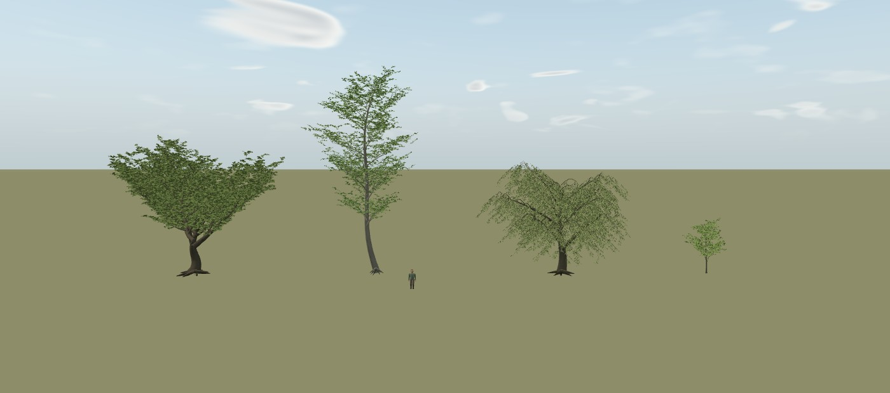
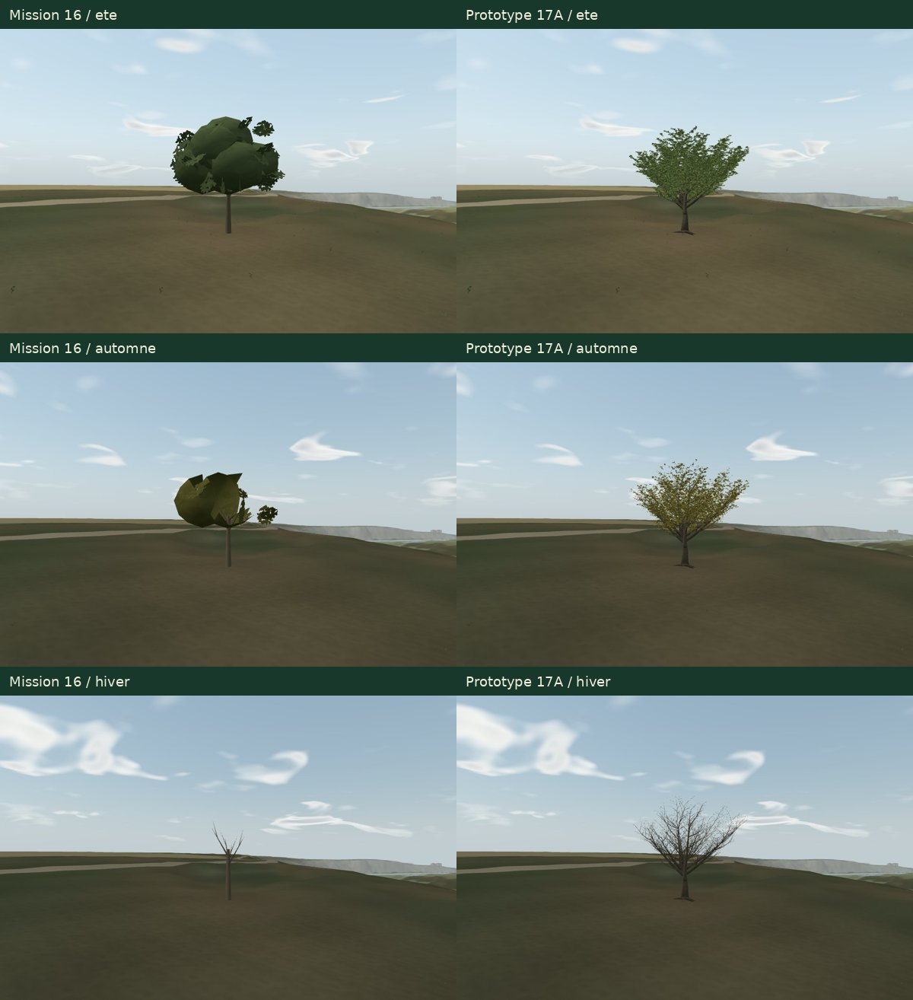
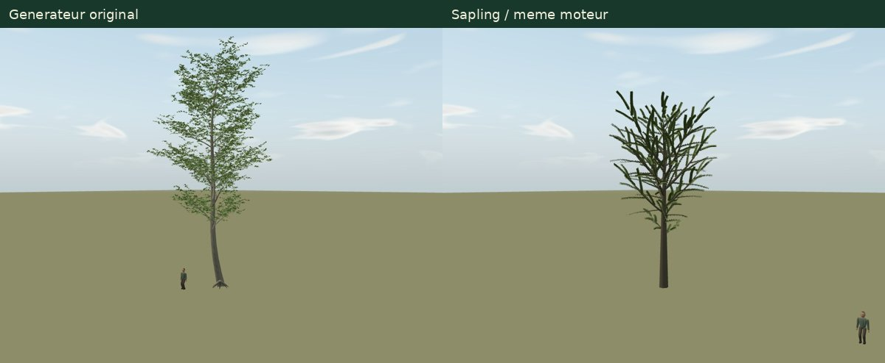
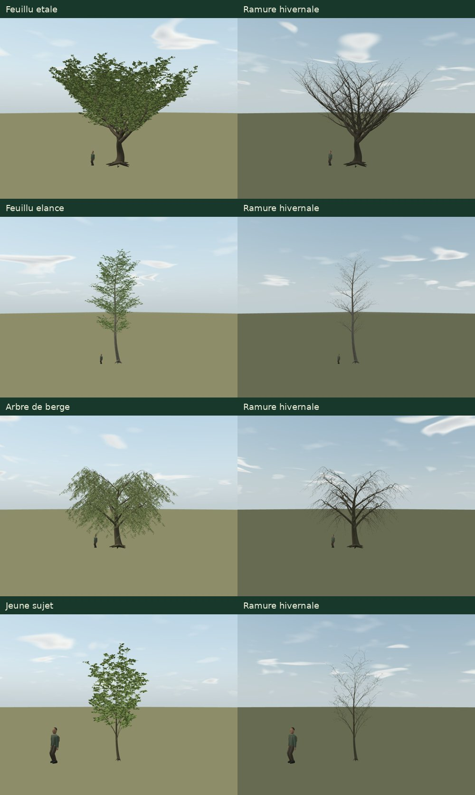

# Mission 17A — La renaissance des arbres

**Quatre prototypes à vraie ramure sont proposés pour validation artistique : feuillu étalé, feuillu élancé, arbre de berge et jeune sujet.** Les feuilles individuelles poussent sur les rameaux du modèle. La forêt ordinaire reste celle de Mission 16. **17B–17D ne sont pas commencés.**

[PR brouillon #26](https://github.com/sebastienleidgens-lab/endless-earth/pull/26) · [Galerie de revue](mission-17-evidence/index.html) · [Atelier 3D de développement](../fixtures/trees.html?perf=1&moment=afternoon&weather=clear&date=2026-06-21T12:00:00Z) · [Protocole et commandes](mission-17-evidence/README.md).

La proposition change nettement la construction des arbres, mais **ne démontre pas encore une forêt belle et fluide**. Le grand modèle de référence coûte 377 500 triangles ; il dépasse le double du temps de rendu du témoin dans certaines mesures logicielles. Ces géométries ne doivent pas être généralisées telles quelles. La décision demandée ici porte sur leurs formes et leur feuillage, avant une bibliothèque et des LOD de production.

## Base vérifiée et périmètre

Le dernier `origin/main` a été récupéré avant le travail : **`9cde6af3c48a3973928d669f2228285ded674f1d`**, fusion de Mission 16 par la **PR #25**. Branche `mission/17-renaissance-des-arbres`. Premier commit d’implémentation : **`49caf98`** ; les preuves et le rapport sont ajoutés sur cette même branche. Aucune fusion, aucun déploiement, aucun changement Living Paintings / LP-01. Budget supplémentaire : **0 €**.

`AGENTS.md`, les rapports 08.5, 11, 12, 14, 15, 15A et 16 et les modules arbre/couronne/matière/rendu/bibliothèque/écologie, vent, lumière, neige et streaming ont été examinés. Les contrats existants restent explicites : 2 500 ancrages, lots instanciés par cellule, calendrier M11, enveloppes M15, casters locaux M14 et dérivés liés aux sources. Les données IGN/ASP/OSM et les exclusions géographiques ne sont pas réinterprétées.

**Tous les 4 306 fichiers déjà suivis dans `main` sont conservés à l’identique.** Cette livraison ajoute un atelier, des générateurs de référence, des tests et des preuves. Elle ne remplace aucun arbre du parcours normal. [Audit de préservation et empreintes](mission-17-evidence/preservation.json).

Les cinq captures du propriétaire sont mentionnées dans la mission, mais n’étaient pas jointes au texte reçu. Les défauts sont donc reproduits sur une station du moteur actuel ; aucune correspondance exacte avec ces cinq images n’est revendiquée.

## Diagnostic reproduit avant de développer

Le sujet inspecté est un ancrage existant du boisement, **X −438,5213 / Z 340,4795 m**, sol local ≈ 8,0024 m. Ces coordonnées appartiennent au repère du jeu ; il ne s’agit pas de la position relevée d’un chêne identifié. Pour inspecter sa structure, les autres cellules d’arbres sont explicitement masquées. Le terrain, le ciel et les bâtiments restent ceux du jeu.

Douze vues initiales : été, automne, hiver × face, profil, trois quarts et dessous. Trois ablations supplémentaires gardent la même vue d’automne : calendrier normal, rétention forcée à 1, vent végétal nul. [Captures initiales et climat](mission-17-evidence/audit/captures.json) · [Géométrie et LOD](mission-17-evidence/audit/structure.json).

| Défaut | Cause établie / portée de la reproduction |
| --- | --- |
| Tronc et hiver pauvres | **40 triangles** pour le tronc, quatre branches principales et quatre petites fourches ; pas de réseau de rameaux portant la couronne. La vue hivernale révèle cette structure réellement limitée. |
| Masses polygonales | Sept lobes issus d’icosaèdres, faces intérieures partiellement retirées et 36 cartes périphériques. La normale adoucie et la texture ne changent pas leur silhouette géométrique. |
| Bouquets apparemment flottants | Les cartes et lobes sont disposés dans une couronne autonome, déplacée/étirée séparément du tronc ; ils n’ont aucun parent de branche. Le calendrier retire une partie de la masse intermédiaire tout en conservant des cartes périphériques. |
| Effet de `natureCluster` / `discard` | **43 groupes** : 41 conservés en été, 10 en automne, 0 en hiver sur le sujet mesuré. Un même seuil supprime des lobes ou cartes entiers. Le rendu sans masquage retrouve la masse ; il conserve l’aspect polygonal. Cette hypothèse est donc confirmée sur le cas reproduit. |
| Vent | Les bouquets isolés subsistent avec vent nul : il n’est pas leur cause principale dans ce cas. Le code applique toutefois des amplitudes/fréquences différentes au bois et à la couronne, qui n’ont pas de point d’attache partagé ; cette incohérence peut accentuer leur séparation. Son impact perceptif n’est pas chiffré ici. |
| LOD / variantes | Couronne **331 triangles proche / 58 lointaine**, même tronc de 40 triangles. Éco utilise réellement le modèle lointain ; Équilibré utilise le proche à cette station. Les deux variantes sont capturées à caméra fixe. Cela vérifie les représentations, sans certifier une transition en mouvement sans saut. |

Les captures [calendrier normal](mission-17-evidence/audit/autumn-calendar.jpg), [sans masquage](mission-17-evidence/audit/autumn-no-season-mask.jpg) et [sans vent](mission-17-evidence/audit/autumn-no-wind.jpg) séparent ces causes. L’analyse ne généralise pas ce résultat à tous les bouquets, tous les terrains ou toutes les captures absentes.

## Méthodes gratuites effectivement étudiées

| Méthode | Travail réalisé | Décision pour 17A |
| --- | --- | --- |
| [Sapling Tree Gen](https://extensions.blender.org/add-ons/sapling-tree-gen/) | Archive officielle **0.3.6** téléchargée, SHA-256 vérifié, génération réelle dans **Blender 4.3.2**, conversion du bois et des feuilles puis rendu dans le même atelier Three.js. Paramètres originaux, aucune image de rendu Blender substituée à une capture du jeu. Échantillon : **30 480 triangles de bois + 68 128 de feuilles**, ≈ 1 s de génération observée. | Alternative viable pour préparer des assets hors ligne. L’essai ne donne pas automatiquement un bon feuillu régional : densité, proportions et organisation doivent être travaillées. Il ne constitue pas un plafond de qualité de Sapling. |
| [Modular Tree](https://extensions.blender.org/add-ons/modular-tree/) / [sources](https://github.com/GoodPie/modular_tree) | Documentation, licence et source examinées : nœuds de tronc/branches, enveloppes botaniques, gravité, feuilles sur branches fines et export de pivots. Version officielle observée **5.6.0**, Blender minimal **4.5** ; installé : 4.3.2. | **Pas de génération exécutée ni de benchmark revendiqué.** Potentiel intéressant pour l’édition de charpentes et les pivots, avec une étape d’adaptation Three.js à vérifier. |
| [Modèles Poly Haven](https://polyhaven.com/models/nature/trees) | Catalogue API réellement lu : 13 modèles dans la catégorie au moment de la consultation. Les sapins/pins existent, mais ne répondent pas aux quatre feuillus demandés. `Tree Small 02` est annoncé **Burkea africana**, **4 652 585 polygones source**, `.blend` 1k ≈ **63,8 Mo avant textures** ; présence de LOD relevée. | Pas d’import massif. Ce petit arbre africain ne sert pas de référence botanique régionale ; aucun asset n’est intégré sous prétexte qu’il est libre. |
| Générateur original | Graphe métrique déterministe, embranchements à plusieurs ordres, tubes effilés et limbes individuels enracinés sur les pousses. Quatre architectures réellement rendues puis revues en plusieurs itérations. | Retenu **provisoirement pour les références 17A** : contrôle explicite des attaches et possibilité de travailler les saisons sur les vraies feuilles. Le coût actuel interdit un remplacement global. |

Les deux échantillons ci-dessus utilisent le même moteur, la même palette, le même éclairage et la même caméra relative, sans normaliser leur taille. Ils ont des silhouettes et densités différentes : **ce n’est pas une comparaison à qualité ou budget égal**, ni une démonstration que Sapling serait inférieur à un générateur original mieux calibré.

### Droits des outils et des sorties

Le manifeste de l’archive Sapling **0.3.6** indique **GPL-2.0-or-later** ; la version actuelle **1.0.0** indique GPL-3.0-or-later et nécessite Blender 5.2. Modular Tree annonce GPLv3 pour l’extension et MIT pour son cœur. Ces droits concernent le logiciel et ne doivent pas être attribués indistinctement aux images ou maillages exportés. [Règles Blender](https://www.blender.org/about/license/) · [GPL v2, section 0 sur les sorties](https://www.gnu.org/licenses/old-licenses/gpl-2.0.en.html).

L’essai Sapling n’utilise ni preset importé ni objet de feuille externe ; son export reste dans `work/`, avec le générateur téléchargé. **Les quatre modèles livrés sont des créations procédurales originales** : aucun code d’extension, preset, modèle ou texture tiers n’entre dans le runtime. Les assets Poly Haven sont annoncés [CC0 et redistribuables](https://polyhaven.com/license) ; cette licence ne couvre pas automatiquement les exemples de rendu et autres éléments du site. Aucun asset Poly Haven n’est intégré à cette livraison.

[Journal des sources, licences, versions, photos consultées et empreintes](mission-17-evidence/sources.json).

## Les quatre références

| Prototype | Architecture et proportions | Coût de référence |
| --- | --- | --- |
| Étalé | Tronc épais, départ bas de charpentes obliques, leaders intérieurs remplissant le centre, ramifications et feuilles dans toute l’épaisseur. Hauteur **14,21 m**, largeur X/Z ≈ **13,92 / 16,96 m**. | **3 888 branches / 50 400 feuilles**, **377 500 triangles**, **20 975 496 octets** de buffers. |
| Élancé | Flèche continue, départ de branches plus haut, rameaux latéraux plus courts, couronne plus verticale et aérée. Hauteur **21,05 m**, largeur X/Z ≈ **11,42 / 11,05 m**. | **1 810 / 16 320**, **136 226 triangles**, **7 248 000 octets**. |
| Berge | Charpentes basses ouvertes, rameaux souples descendants, feuilles plus étroites, masse étalée et lumineuse. Hauteur **11,67 m**, largeur ≈ **15,93 / 15,87 m**. | **2 188 / 29 750**, **222 360 triangles**, **12 358 236 octets**. |
| Jeune | Tronc fin continu, branches latérales et vrais rameaux, silhouette resserrée. Hauteur **5,89 m**, largeur ≈ **3,68 / 3,78 m**. | **626 / 5 184**, **45 320 triangles**, **2 179 560 octets**. |

Chaque modèle utilise **deux maillages / deux appels propres**, bois et feuilles, **zéro texture d’image ajoutée**. Les octets sont les tableaux de sommets/indices, pas de la VRAM physique ni tout le graphe JavaScript. Les couleurs sont compactées en octets et les normales en entiers normalisés ; cela réduit les buffers sans changer les silhouettes. Le modèle étalé reste particulièrement lourd.

Les photographies consultées montrent une couronne adulte dense à tronc court, une forme élancée plus aérée, un saule à couronne profonde et un jeune arbre de pépinière à flèche fine, avec une personne pour repère. Elles ont servi à comparer proportions, départs de branches et remplissage. **Leurs pixels ne sont ni distribués ni utilisés dans le jeu.** La référence de pépinière est cultivée, taillée et tuteurée ; elle ne documente pas un jeune arbre sauvage d’Angles. Les modèles sont des archétypes, sans identification d’espèce ou d’individu local.

Chaque branche possède un parent, un point d’insertion et une courbe. Chaque feuille possède une branche porteuse, une abscisse et une attache. La base du limbe est au rameau ; il n’y a ni sphère, ni coque opaque de couronne, ni grande carte alpha. Le bois reste présent lorsque toutes les feuilles disparaissent. À la station réelle, les sommets bas s’ajustent continûment au terrain sans déplacer l’ancrage X/Z ; corrections maximales observées : **14 / 7 / 12 / 1,5 cm** selon le modèle.

### Saisons et vent : raccord initial, pas livraison 17C

Le calendrier vient de `foliageSeason` et de la date du moteur existant. La rétention concerne désormais **des feuilles entières**, avec variation locale, et laisse leurs supports en place. Printemps, été, automne et hiver sont capturés. Une déformation continue commune agit sur les positions du bois et des feuilles ; le frémissement pivote autour de l’attache et vaut zéro à sa base. La direction du vent est ramenée dans le repère de l’arbre tourné. Les bounds reçoivent une marge de 1,2 m.

Deux observations natives courtes, sans accélération, inspectent le dessous du jeune sujet : [vent léger](mission-17-evidence/light-wind.webm) et [vent modéré](mission-17-evidence/moderate-wind.webm). L’état météo est stabilisé **avant** l’enregistrement. Ces films d’atelier sont silencieux et ne sont pas des promenades. Leur cadence logicielle limite l’appréciation du mouvement ; ils ne certifient pas le naturel de l’animation finale.

La déformation reste un raccord de prototype. **L’inertie hiérarchique par branche, les calendriers propres aux familles, les transitions longues, la neige et les ombres fines adaptées restent à développer/valider en 17C.** La rétention hivernale de l’étalé est ici nulle ; aucune marcescence botanique particulière n’est revendiquée.

## Coût mesuré : ne pas généraliser ces maillages

**288 rendus WebGL synchronisés**, Chromium / **SwiftShader logiciel**, **960 × 640, DPR 1** : quatre prototypes × trois profils × deux versions × trois passages alternés × quatre valeurs. Douze valeurs par cellule du tableau ; médiane, P95 et pic conservés. Même caméra absolue et même climat vérifiés dans chaque paire, après chauffe. Aucun autre test graphique ne tourne pendant cette campagne.

La scène du vrai jeu garde un seul arbre inspecté ; le témoin utilise les géométries ordinaires de Mission 16. Éco utilise sa couronne lointaine. Les références détaillées 17A restent volontairement identiques dans les trois profils : **aucune optimisation LOD de production n’est prétendue**. Les cartes fines M14 sont désactivées pour les deux versions. Le coût des autres objets visibles demeure inclus ; ces chiffres ne sont ni des FPS matériels, ni un benchmark d’une forêt complète.

<!-- PERFORMANCE_TABLE_START -->
| Profil | Reference | Mission 16 (ms) | Prototype (ms) | Ecart | P95 prototype (ms) |
| --- | --- | ---: | ---: | ---: | ---: |
| eco | Etale | 177.5 | 374.7 | +111.1 % | 446.6 |
| eco | Elance | 179.2 | 262.6 | +46.5 % | 321.2 |
| eco | Berge | 193.3 | 354.6 | +83.4 % | 384.9 |
| eco | Jeune | 161.8 | 183.6 | +13.5 % | 215.5 |
| balanced | Etale | 218.3 | 473.4 | +116.9 % | 492.4 |
| balanced | Elance | 244.1 | 330.4 | +35.4 % | 385.5 |
| balanced | Berge | 266.9 | 382.3 | +43.2 % | 455.7 |
| balanced | Jeune | 229.3 | 239.0 | +4.2 % | 277.6 |
| quality | Etale | 226.7 | 503.9 | +122.3 % | 564.6 |
| quality | Elance | 236.5 | 310.7 | +31.4 % | 413.6 |
| quality | Berge | 230.3 | 378.4 | +64.3 % | 430.9 |
| quality | Jeune | 229.3 | 256.2 | +11.7 % | 291.0 |
<!-- PERFORMANCE_TABLE_END -->

Les deux maillages propres gardent le même nombre d’appels que le témoin ; le nombre de triangles soumis augmente fortement. Les textures de scène restent identiques à l’intérieur de chaque paire. Le prototype et le témoin sont tous deux alloués pendant les bascules de visibilité : **les compteurs résidents ne mesurent pas un delta d’allocation entre les versions**. Les octets de modèle du tableau précédent sont un inventaire distinct.

Cette régression est substantielle, surtout pour l’étalé. Un modèle proche peut garder cette direction artistique, mais le partage des variantes, des versions réellement simplifiées, un atlas de petites feuilles attachées ou une autre représentation fidèle devront être comparés avant toute forêt. Aucune multiplication du plafond de 2 500 arbres ou promesse de FPS Android n’est faite en 17A.

[Synthèse détaillée par profil](mission-17-evidence/performance-summary.json) · [Échantillons complets comprimés](mission-17-evidence/performance.json.gz).

## Préparer l’intégration sans réutiliser des dérivés faux

Le contrat de production `CANOPY_VERSION` et les packs d’ombre/neige restent inchangés, puisque la forêt de production n’est pas remplacée. Les références possèdent leur propre version `branch-attached-prototypes-v1`. **Le cache M14 des anciennes couronnes n’est pas appliqué aux nouvelles références dans les comparaisons.**

Après accord sur les formes : grouper les prototypes/variantes par géométrie partagée et identité stable ; choisir des dimensions compatibles avec la place réelle plutôt que rétrécir une couronne en boule ; conserver les ancrages cartographiés ; proposer des LOD cohérents à partir du même graphe ; intégrer les nouveaux casters et **régénérer les dérivés liés à leur nouveau contrat** ; tester ensuite couverture neige, réception/cast d’ombre, streaming, profils, collisions visuelles près des murs et performances. Il ne suffit pas de changer une constante de version sur les anciens packs.

L’essai d’ancrage unique n’est pas un contrôle de placement de tous les futurs modèles. Les silhouettes ne sont pas encore confrontées à chaque maison, berge ou chemin ; aucune nouvelle collision n’est ajoutée.

## Validation, inspection artistique et limites

**255 tests Node et build TypeScript/Vite réussis.** Les dix tests nouveaux vérifient parents, insertions de branches, attaches des feuilles, coordonnées finies, indices, dimensions, tailles de limbes, rétention homogène par feuille, déterminisme, architectures distinctes et raccord des racines à une pente. Ils ne constituent pas un jugement esthétique. Le build garde l’avertissement préexistant de bundle > 500 ko.

**114 captures de proposition** : 40 vues individuelles d’atelier, deux ensembles à la même échelle et **36 paires dans le jeu** (quatre formes × trois saisons × trois distances). Les 15 images initiales d’audit, deux LOD et deux vues d’alternatives sont distinctes. Les vues à 5 m et certaines à 15 m coupent volontairement une partie des grands sujets ; 40 m permet leur inspection d’ensemble. Les cadrages, dates et états accompagnent les images dans [captures.json](mission-17-evidence/captures.json).

La galerie vérifie ses 36 paires et les 32 vues été/hiver, puis son affichage à **390 × 844**. Les trois profils compilent les nouveaux matériaux dans le navigateur ; les films sont décodés et la destruction de l’atelier est contrôlée. Le jeu compilé conserve les essais de chargement, déplacement, caméra, son et viewport mobile. [Contrôles de revue](mission-17-evidence/review-validation.json) · [Validation finale](mission-17-evidence/validation.json) · [Médias](mission-17-evidence/media.json).

L’inspection des prototypes retrouve un gain clair de ramification, de diversité et de liaison des feuilles. Les premières versions trop ajourées et un vide central dans l’étalé ont été retravaillés avant les captures retenues. Il reste une répétition perceptible de certaines pousses, des jonctions de tubes visibles de très près, une finesse d’écorce limitée et une lumière interne moins riche qu’une vraie canopée. L’élancé est volontairement plus aéré ; la forme de berge accentue la retombée sans revendiquer une espèce précise.

**Pas de certification artistique humaine, GPU physique, Android physique, forêt densifiée, transitions LOD en marche, neige/ombres adaptées ou promenade de 30 minutes revendiquée.** Ces points ne sont pas remplacés par des tests unitaires. Les jalons 17B–17D restent fermés.

## Recommandation et arrêt

Retenir le **graphe de ramure et l’attache explicite des feuilles** comme direction de travail ; conserver Sapling comme alternative de fabrication hors ligne à calibrer si les formes restent insuffisantes. **Ne pas généraliser les maillages détaillés actuels.**

La revue demandée porte sur les quatre silhouettes, le volume estival, les vues de dessous et la qualité des ramures hivernales, en gardant le coût mesuré visible. **Arrêt après 17A pour validation artistique du propriétaire, PR maintenue en brouillon, sans fusion ni déploiement.**
