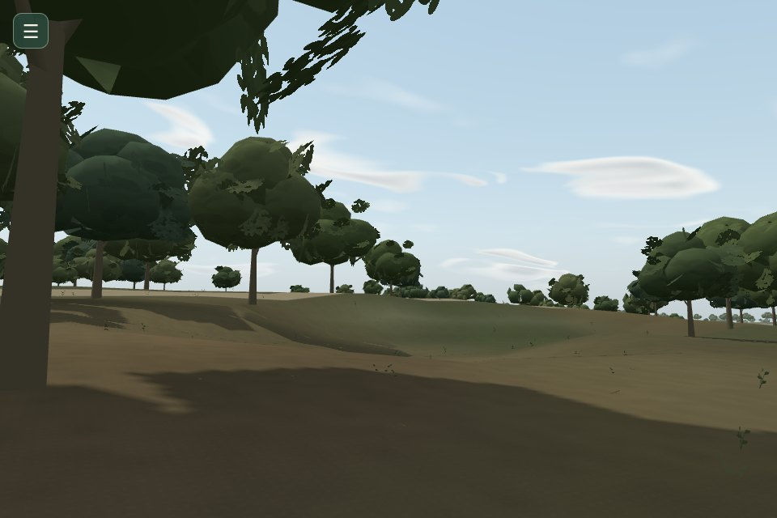
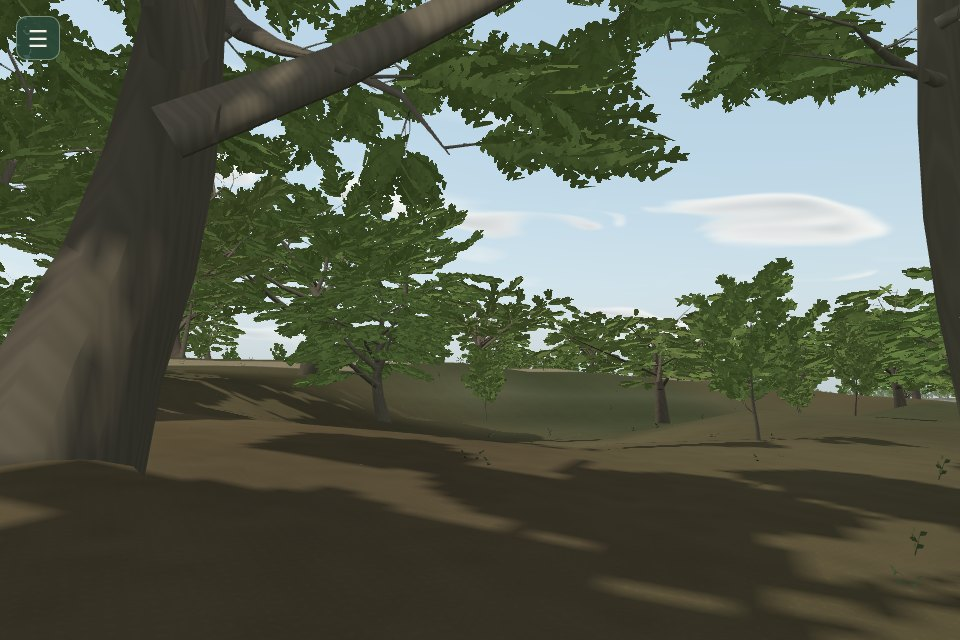
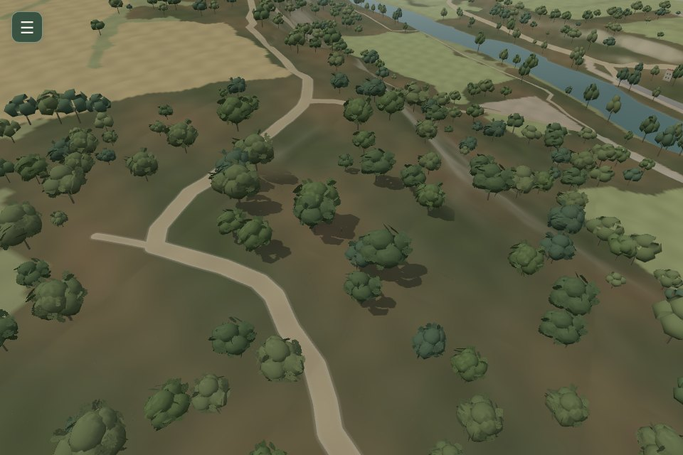
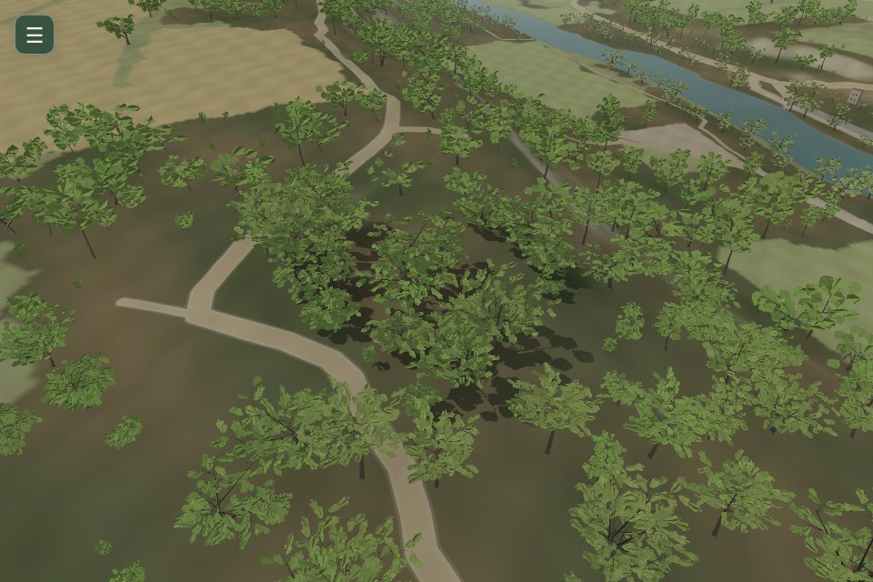
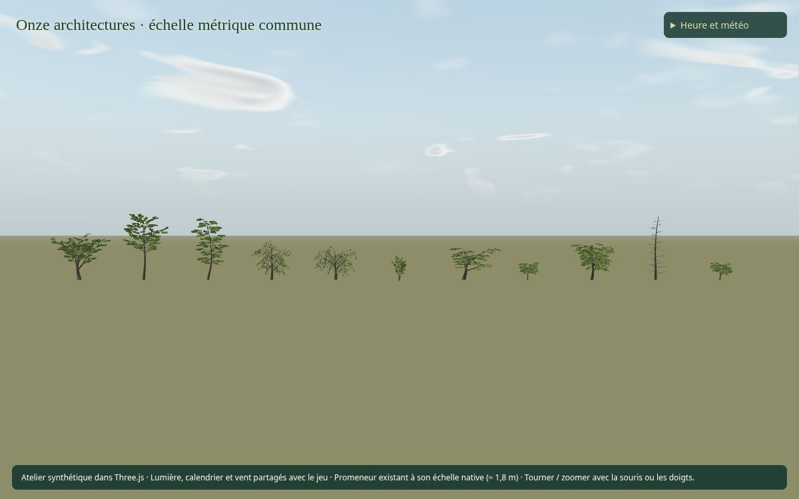
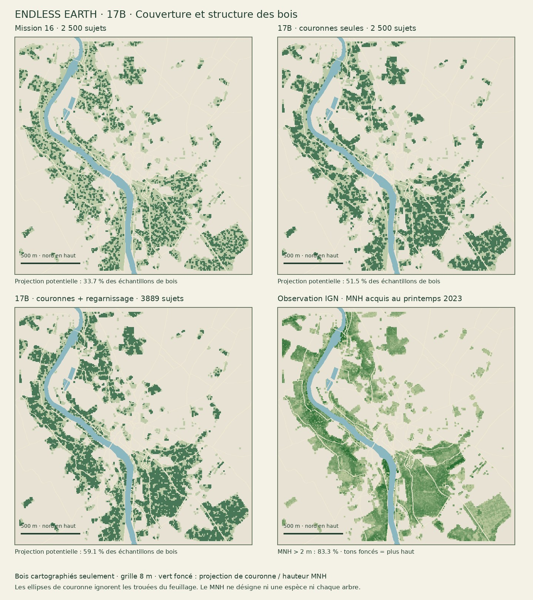

# Mission 17 — La renaissance des arbres (17B)

**Onze architectures originales, un pilote de 3 889 arbres et une comparaison directe avec Mission 16 sont proposés pour revue artistique.** Le « Go » du propriétaire après 17A autorise ce jalon. **Arrêt après 17B : 17C et 17D ne sont pas livrés.**

[PR brouillon #26](https://github.com/sebastienleidgens-lab/endless-earth/pull/26) · [Galerie interactive de revue](mission-17-evidence/forest/index.html) · [Atelier 3D de développement](../fixtures/forest.html?perf=1&moment=afternoon&weather=clear) · [Rapport 17A conservé](mission-17a.md).

| Avant · Mission 16 | Après · 17B |
| --- | --- |
|  |  |
|  |  |

La régression logicielle reste importante : **+32 à +150 %** sur les médianes de la campagne couleur. **Ce pilote n’est pas prêt à être fusionné pour ses performances.** La validation de fluidité et les optimisations de 17D restent nécessaires.

La proposition remplace les couronnes en lobes par des charpentes et des pousses feuillées enracinées sur leurs branches. Les masses arborées s’étendent, les hauteurs et les formes varient et les ombres suivent la nouvelle bibliothèque. **Cela reste une proposition artistique, avec des répétitions et des simplifications visibles ; les tests ne certifient pas sa beauté.**

## Périmètre et préservation

Base `origin/main` vérifiée : **`9cde6af3c48a3973928d669f2228285ded674f1d`**, Mission 16 fusionnée par PR #25. Même branche `mission/17-renaissance-des-arbres`, même PR brouillon. Les preuves 17A restent conservées sans modification. Aucun déploiement, aucune fusion, aucun travail Living Paintings / LP-01. Budget supplémentaire : **0 €**.

Les fichiers de terrain, IGN/ASP/OSM, relief, eaux, chemins, bâtiments, repères et packs de décor restent inchangés. Les 2 500 ancrages existants gardent exactement leurs coordonnées et attributs ; un fichier complémentaire distinct contient les nouvelles positions inférées. Le pilote n’a **aucun arbre individuel explicitement cartographié** parmi ces ancrages. La conservation des ancrages cartographiés est aussi testée sur une fixture qui en possède.

Le recalcul réel du graphe de marche produit les **mêmes 919 nœuds, 896 arêtes et SHA-256** ; le pack reste inchangé. Les empreintes des modules de raccord sont actualisées explicitement dans les métadonnées. Les collisions sont comparées sur 2 898 points et 20 mouvements entre les deux versions. Le seul raccord à la faune place les perchoirs à la nouvelle hauteur des arbres.

[Équivalence de navigation](mission-17-evidence/forest/navigation-equivalence.json) · [Collisions](mission-17-evidence/forest/collisions.json) · [Audit de préservation](mission-17-evidence/forest/preservation.json).

## Onze architectures, des individus reproductibles

Les structures distinguent : étalé, cime haute, élancé, berge, retombant, jeune, mature asymétrique, petit isolé, dense, conifère et verger. Elles changent la flèche, le départ des charpentes, leur portée et leur élévation, la gravité des rameaux, la densité et les leaders intérieurs. Ce ne sont pas onze couleurs d’une même sphère.

| Famille | Plage de hauteur | Branches de référence | Triangles proche / intermédiaire / loin |
| --- | ---: | ---: | ---: |
| Grand feuillu étalé | 11–19 m | 478 | 14 148 / 2 682 / 276 |
| Feuillu à cime haute | 16–24 m | 401 | 11 940 / 2 256 / 304 |
| Feuillu élancé | 12–22 m | 521 | 15 468 / 2 922 / 388 |
| Feuillu de berge | 8–17 m | 321 | 9 588 / 1 812 / 248 |
| Ramure retombante | 8–15 m | 281 | 8 412 / 1 590 / 220 |
| Jeune feuillu | 2.7–6.5 m | 321 | 9 588 / 1 812 / 248 |
| Feuillu mature asymétrique | 10–20 m | 372 | 11 044 / 2 094 / 220 |
| Petit arbre isolé | 4–9 m | 372 | 11 044 / 2 094 / 220 |
| Couronne dense et arrondie | 8–16 m | 716 | 22 004 / 3 974 / 332 |
| Conifère à étages irréguliers | 8–23 m | 801 | 23 700 / 4 476 / 584 |
| Petit arbre de verger | 3.5–7.5 m | 319 | 9 492 / 1 800 / 192 |

Les plages de hauteur vont de **2,7–6,5 m pour les jeunes sujets** à **16–24 m pour les cimes hautes**. Les dimensions des autres familles restent intermédiaires ; les troncs et les couronnes évoluent ensemble. Il n’y a pas d’arbre géant ajouté pour l’effet spectaculaire.

L’identité est calculée à partir des coordonnées géographiques locales stables, sans hasard non contrôlé. Elle règle hauteur, largeur, profondeur, âge, teinte, densité, orientation, inclinaison, hauteur de ramification, diamètre apparent du tronc, torsion/asymétrie et gain de réponse au vent. Une déformation continue commune au bois et aux pousses garde leurs attaches cohérentes. La géométrie est partagée par famille ; aucune armature CPU complète n’est instanciée par arbre.

Le proche ajoute de vraies branches fines et de petites pousses croisées. L’intermédiaire garde les charpentes et les rameaux principaux ; le lointain représente des pousses et leur tige au point d’insertion sur une branche conservée. **Ce sont des représentations provisoires nécessaires à cette intégration, pas la livraison des transitions LOD de 17D.**

Les cartes alpha contiennent quatre familles de dessins originaux, déclinées en deux bandes proche/lointain, **512 × 256**, 524 288 octets RGBA hors mipmaps. Elles représentent de petites pousses reliées, avec des feuilles et une tige, dans l’épaisseur de la ramure. Il n’y a pas de coque opaque ou de sphère proche. Les feuilles individuelles très détaillées de 17A restent consultables ; elles ne sont pas dupliquées 3 889 fois.

[Inventaire, coûts et empreintes](mission-17-evidence/forest/library.json) · [Atlas original](mission-17-evidence/forest/spray-atlas.png). Aucun preset, modèle, code d’extension, photo ou texture externe n’entre dans la forêt de production.

## Densité : comparer les couronnes et le nombre

| Variante | Arbres dans le pilote | Projection potentielle sur les bois |
| --- | ---: | ---: |
| Mission 16 | 2 500 | 33,7 % |
| 17B, nouvelles couronnes seules | 2 500 | 51,5 % |
| 17B, couronnes et regarnissage retenus | 3 889 | 59,1 % |

Le nombre augmente de **1 389 sujets (+55,6 %)**, uniquement dans les bois documentés. Le plafond initial de 2 500 n’est donc pas intangible. La limite de sécurité du complément est 2 000, **non atteinte** : la sélection finale résulte des habitats, des exclusions, des espacements et de la place disponible, plutôt que d’un remplissage du plafond.

L’essai de couronnes seules montre un gain substantiel sans ajouter d’individu. Les couronnes adultes étalées/hautes/denses/asymétriques sont ensuite plus larges, sans gonfler leur hauteur. Le complément ajoute des jeunes sujets et des tailles intermédiaires, avec une distribution par taches à deux échelles, une priorité stable et des distances minimales. Les clairières, cultures, prés et trous des polygones restent ouverts. La strate basse existante est conservée.

L’indicateur utilise **16 242 échantillons de bois espacés de 8 m**, dans l’emprise intérieure [−960, +960 m] et la classe de couverture prioritaire, et la projection elliptique des bounds des couronnes réellement rendues. Il ignore les trous du feuillage, les différences verticales et les variations saisonnières. **Ce n’est pas une mesure réelle de fermeture de canopée.** Les proportions ne doivent pas être comparées au MNH comme si leurs méthodes étaient identiques.

[Comptages et méthode](mission-17-evidence/forest/density.json) · [Synthèse d’implantation](mission-17-evidence/forest/placement.json) · [Détail des positions et dimensions, comprimé](mission-17-evidence/forest/placement.json.gz).

## MNH IGN : acquisition et limites établies

Le service officiel IGN a répondu **HTTP 200** et fourni un véritable GeoTIFF du **MNH LiDAR HD** sur l’emprise du pilote, en Lambert-93. Source native à 0,5 m, requête à **2 m**, 1 079 × 1 076 pixels, environ 4,65 Mo conservés dans `work/`, sans envoyer le raster brut dans le navigateur ni le dépôt. Les métadonnées locales déjà conservées en Mission 08.5 situent l’acquisition au **9 avril 2023**. Licence Ouverte 2.0 / IGN.

Sur les échantillons de bois valides, le MNH donne environ **9,1 m à la médiane, 19,0 m au P95 et 24,7 m au P99** ; **83,3 %** sont au-dessus de 2 m. Ce sont des statistiques de pixels de hauteur, pas des hauteurs d’arbres individuels. Elles étayent une hiérarchie verticale et montrent qu’une forêt encore plus fermée pourrait être justifiée dans certains massifs.

La date printanière, l’échantillonnage WMS, les erreurs de normalisation et les différences de date empêchent d’interpréter chaque pixel bas comme une clairière permanente. Le jalon retient le MNH comme référence de plausibilité à l’échelle du peuplement ; il n’invente pas d’individus relevés, d’espèces ni de hauteurs mesurées pour les sujets procéduraux. **La proposition reste plus ouverte que l’observation sur certains bois.**

[URL officielle, acquisition, empreinte et statistiques](mission-17-evidence/forest/mnh-study.json).

## Rives, murs et place disponible

Les formes humides sont privilégiées pour les ancrages de berge et le complément situé près de l’eau. Le conifère est limité au couvert qui le justifie ; **12 sujets** sont présents. Le verger existe dans la bibliothèque mais **aucun sujet n’est ajouté sans contexte documenté de verger**.

Les nouvelles positions sont refusées dans l’eau, les bâtiments, les cours contraintes, les couloirs routiers, les trous du couvert et les pentes trop fortes. Les bounds métriques des couronnes sont confrontés aux murs, y compris les contours intérieurs des cours. **96 sujets choisissent une autre forme plus étroite ou un individu entier plus petit** ; aucune couronne n’est écrasée en minuscule boule. L’audit ne trouve pas de forme sans place suffisante selon ces enveloppes conservatrices.

Le contrôle distingue les contraintes de tronc et la projection de couronne : du feuillage peut surplomber un chemin comme dans la réalité ; aucune collision physique supplémentaire n’obstrue le parcours. Les limites restent celles des emprises cartographiées et des hauteurs architecturales interprétées.

## Lumière et raccords conservés

Le calendrier et le champ de vent viennent des propriétaires M11 ; aucun second climat ou chronomètre ne tourne. La version de couronne devient `branch-attached-forest-v1`. Le **pack actif `angles-walk-lighting` est réellement recalculé**, avec les nouvelles couronnes et les 3 889 ancrages, à partir des mêmes buffers statiques. Les casters locaux utilisent le même shader de forme/vent, le même atlas et le même calendrier que la couleur. Les plafonds M14 restent **160/256 arbres, 512/1 024 px et 2/4 Hz** selon le profil ; Éco désactive ce target.

L’ancien pack historique `angles-lighting` conserve son ancien contrat. Il n’est pas rebaptisé pour lui faire accepter les nouveaux arbres : si cette voie de repli est utilisée, le cache incompatible est refusé. La géométrie statique et l’enveloppe de neige précalculée de Mission 15 restent inchangées. **L’adaptation artistique de la neige et du vent hiérarchique appartient à 17C.**

[Préparation effective de lumière](mission-17-evidence/forest/light-preparation.json).

## Coût mesuré et limites de performance

La régression logicielle reste importante : **+32 à +150 %** sur les médianes de la campagne couleur. **Ce pilote n’est pas prêt à être fusionné pour ses performances.** La validation de fluidité et les optimisations de 17D restent nécessaires.

| Profil | Scène | Mission 16 médiane (ms) | 17B médiane (ms) | Δ | 17B P95 (ms) |
| --- | --- | ---: | ---: | ---: | ---: |
| eco | bois | 182.2 | 419.1 | +130.0 % | 554.2 |
| eco | aerienne | 240.6 | 364.7 | +51.6 % | 415.7 |
| eco | berge | 160.2 | 232.4 | +45.1 % | 279.1 |
| balanced | bois | 224.4 | 550.1 | +145.1 % | 655.0 |
| balanced | aerienne | 295.6 | 440.5 | +49.0 % | 496.0 |
| balanced | berge | 214.3 | 282.8 | +32.0 % | 321.1 |
| quality | bois | 239.9 | 600.9 | +150.5 % | 696.0 |
| quality | aerienne | 301.3 | 568.3 | +88.6 % | 614.1 |
| quality | berge | 201.6 | 341.0 | +69.1 % | 402.4 |

La première version mesurée était encore plus lourde au loin. La représentation distante a été ramenée à 192–584 triangles avant cette campagne ; [l’étude exploratoire](mission-17-evidence/forest/optimization-study.json) conserve les étapes et leurs limites.

Les champs historiques `treeCells`/`farCells` du diagnostic ne sont pas comparables aux anciennes cellules géographiques ; les comptages utilisés ici sont les champs canoniques `forest.total`, `forest.visible` et `forest.levels`.

Les mesures identifient explicitement **Chromium / SwiftShader logiciel**, 960 × 640, DPR 1. Le protocole compare trois variantes à climat et caméra identiques : Mission 16, couronnes seules, forêt retenue. Les trois profils et trois scènes sont observés, puis une campagne distincte compare les lumières locales compatibles. Les rendus sont synchronisés par `gl.finish` et lecture GPU, après chauffe, en passages alternés. Les fenêtres restent figées pendant les échantillons.

La campagne couleur désactive les ombres locales des trois variantes pour isoler la végétation. La campagne lumière mesure une carte solaire stabilisée ; elle **ne mesure pas chaque rafraîchissement forcé**. Le nombre de casters et le target restent bornés, mais la multiplication des familles augmente les appels de leur passe. Les octets de buffers et textures sont des allocations logiques instrumentées, pas de la VRAM physique. Les temps de chargement sont des observations locales isolées.

**Aucun FPS sur GPU ou Android physique n’est revendiqué.** Les niveaux de détail et les atlas rendent ce pilote très inférieur au coût d’une duplication des prototypes 17A, mais ils ne remplacent pas la validation de fluidité et les optimisations de 17D.

[Synthèse et mémoire par profil/scène](mission-17-evidence/forest/performance-summary.json) · [Échantillons comprimés](mission-17-evidence/forest/performance.json.gz).

## Contrôles et revue perceptive

**260 tests Node et build TypeScript/Vite réussis.** Ils couvrent les attaches, dimensions, indices, déterminisme, enveloppes des couronnes, exclusions, ancrages, LOD, resize et destruction. Le contrôle WebGL de six zones a révélé puis corrigé l’oubli de libérer les buffers propres aux `InstancedMesh` ; géométries, textures et octets instrumentés reviennent maintenant exactement au même état après chaque cycle.

Les trois profils et les dates été/automne/hiver chargent les matériaux sans erreur JavaScript/WebGL. Un rechargement conserve les mêmes individus et layouts. Le fichier complémentaire absent (404 attendu), corrompu ou périmé reconstruit **exactement les mêmes individus**, avec le cache de lumière actif toujours compatible. Le placement entier supprime les écarts de décimales observés entre Node et Chrome.

Une marche native courte avec changement de profil parcourt **15.4 m**, sur **52 images observées**, toutes sur un support autorisé. Les commandes durent 20 s puis 2 s d’arrêt ; la trace entre première et dernière image couvre 18.2 s. La vidéo décodée dure 16.9 s. Son conteneur WebM a été indexé par copie codec ; les paquets encodés et leurs PTS sont identiques à l’original. La durée du film ne doit donc pas être confondue avec les attentes de commande ; sa faible cadence logicielle limite le jugement du mouvement. Aucune promenade de 30 minutes n’est revendiquée.

[Contrôles du runtime](mission-17-evidence/forest/validation.json) · [Revue desktop/mobile et décodage](mission-17-evidence/forest/review-validation.json) · [Marche native](mission-17-evidence/forest/forest-native.webm) · [Vérification compilée](mission-17-evidence/forest/compiled-validation.json).

La galerie montre neuf paires du vrai moteur : bois au sol, sous-bois, lisière, vue aérienne, vallée, berge, village, pente et sujet isolé. Le sujet isolé garde les autres arbres visibles ; son voisin le plus proche est à environ 94 m. Les onze familles sont aussi rendues à échelle métrique, avec le promeneur natif ; des vues de détail montrent le profil, le dessous et la ramure hivernale. Les ombres compatibles sont actives dans les captures du parcours. Les images de l’atelier synthétique sont explicitement distinguées du paysage réel.

La variation statique emploie une déformation polynomiale commune au bois et aux feuilles. Le placement utilise un mélange entier et une normalisation numérique, pour que les octets reconstruits dans Node et Chrome soient identiques ; cela ne revendique aucune précision de relevé.

La revue interne a écarté des versions trop ajourées au loin et des pousses trop plates. La version retenue apporte une ramification plus riche, un feuillage dans l’épaisseur et une meilleure continuité entre couronnes. **Des paquets de pousses restent reconnaissables, des jonctions de tubes se voient de très près, certaines formes sont encore trop organisées en étages, et certains massifs restent ouverts.** Les paliers LOD peuvent être perceptibles ; leur transition n’est pas certifiée.

Le vent raccordé reste une flexion continue, sans l’inertie hiérarchique définitive. Les saisons ont un contrôle de non-régression, sans constituer les films de validation de 17C. La promenade courte ne remplace pas l’essai de 30 minutes de 17D. Les cinq captures du propriétaire n’étant pas jointes au texte initial, aucune reproduction exacte de leurs positions n’est revendiquée.

## Livraison et arrêt

**17B proposé à la validation artistique du propriétaire.** Examiner d’abord la profondeur des couronnes, les différences entre familles, la générosité des bois et les vues de berge, en gardant le coût affiché à côté des images. Les limites de forme et de fluidité restent explicites.

La PR reste en brouillon, sans fusion ni déploiement. **Attendre cette revue avant 17C ; ne pas traiter les tests comme une approbation artistique.**
