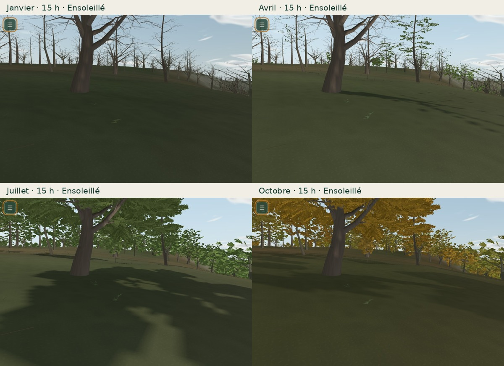

# Mission 18 — La terre et la lumière

Le menu de promenade propose les douze mois, avec le calendrier, le soleil, les arbres, les sols et le paysage sonore existants. Les sols reçoivent un grain révisé, des transitions minérales moins régulières, des états saisonniers et l’humidité de la pluie. Le randonneur projette une ombre issue de son vrai squelette. Branche `mission/18-terre-et-lumiere`, fondée sur Mission 17 fusionnée (`bad03f5`). Aucune fusion ni publication automatique. Coût : 0 €.

[Galerie des douze mois, saisons, matières et ombres](mission-18-evidence/index.html).



[Janvier](mission-18-evidence/months/01.jpg) · [Février](mission-18-evidence/months/02.jpg) · [Mars](mission-18-evidence/months/03.jpg) · [Avril](mission-18-evidence/months/04.jpg) · [Mai](mission-18-evidence/months/05.jpg) · [Juin](mission-18-evidence/months/06.jpg) · [Juillet](mission-18-evidence/months/07.jpg) · [Août](mission-18-evidence/months/08.jpg) · [Septembre](mission-18-evidence/months/09.jpg) · [Octobre](mission-18-evidence/months/10.jpg) · [Novembre](mission-18-evidence/months/11.jpg) · [Décembre](mission-18-evidence/months/12.jpg)

## Contrôle manuel du calendrier

Le sélecteur **Mois de l’année** se trouve dans le menu unifié de Mission 15. Il propose Janvier à Décembre, sans panneau permanent. Une commande choisit le **15 du mois dans l’année simulée**, en conservant heures, minutes et secondes **à Angles-sur-l’Anglin, Europe/Paris**. Le changement d’heure légal est pris en compte : 15 h en janvier devient 14 h UTC ; 15 h en juillet devient 13 h UTC. Le joueur, la caméra, les coordonnées et les collisions restent inchangés.

Le propriétaire reste `naturalSky`, le calendrier de Mission 11. `representativeMonth` est une conversion civile pure ; aucun second calendrier n’est créé. La date cible est appliquée directement, sans faire défiler des semaines. Le bois et le feuillage de Mission 17 utilisent le même jour ; les états visuels source et cible se fondent en 0,8 s. Les ombres utilisent exactement le même gate de feuilles et le même fondu. Le draw range hivernal conserve le bois et ne supprime les feuilles qu’à la fin du fondu. Les persistants gardent leurs aiguilles. Les couleurs des sols convergent vers leur état cible en moins d’une seconde environ, sans nouvel atlas par mois.

Les trois commandes restent indépendantes. Après un changement de mois, l’heure civile reste identique : un « Soir » d’hiver peut donc encore être lumineux en juillet si son heure a été conservée. Choisir à nouveau **Soir** recalcule la fin du jour pour le mois sélectionné. **Temps réel** fait avancer l’heure du mois choisi ; le mois reste une simulation. Les choix sont conservés localement et restaurés au rechargement.

Les systèmes synchronisés sont la ramure, les feuilles caduques et persistantes, les pousses et détails au sol, les fleurs de fenêtres, la litière, les prairies documentées, le soleil et ses ombres, les fenêtres et chauffages saisonniers existants, les règles d’activité des oiseaux, insectes et feuillages sonores et les règles de neige/fonte. Le calendrier ne force aucune météo. **Neigeux en été** affiche « simulation volontaire, hors climat habituel ». Les enregistrements, espèces et droits audio sont conservés.

## Audit et refonte des sols

| Famille / défaut initial | Intervention de Mission 18 | Limite conservée |
| --- | --- | --- |
| Bitume | Grain à une échelle plus fine, accotements irréguliers et humidité partagée. | Pas de fissures ou marquages inventés. |
| Pavages | Échelle métrique plus serrée, relief discret, minéral humide sous pluie. | Affectations uniquement selon les classes existantes ; pas de pavage ajouté à une route inconnue. |
| Terre / graviers | Grain et transition d’accotement révisés ; assombrissement poreux sous pluie. | Relief visuel sans déplacement des triangles. |
| Herbe / prairie | Fibres orientées et racines décalées dans l’atlas périodique ; rotation fixe en coordonnées du monde ; réponse au repos hivernal, pousse et dessèchement. | Les terrains inconnus ou cultivés ne sont pas convertis en prairie. |
| Sous-bois | Litière, nervures et variations forestières ; détails de feuilles/fleurs soumis au calendrier. | Répartition et espèces interprétées de Mission 17 conservées. |
| Pierres / roche | Plans dominants, grain et normales existants conservés et vérifiés sous quatre saisons. | Les pixels de roche sous licence CC0 restent strictement identiques ; pas de nouvelle géologie affirmée. |
| Transitions | Le champ de distance existant varie la largeur des deux côtés de la partition ; aucun ruban superposé. | Résolution du champ et des contours géographiques inchangée. |
| Pluie / humidité | Assombrissement par porosité, faible reflet solaire sur bitume/pavés, humidification rapide et séchage sur une constante de 24 s. | Réponse artistique ; pas de simulation hydrologique ou de flaques géométriques. |

Un atlas partagé **576 × 576**, avec mipmaps et gouttières périodiques, remplace le précédent. Aucune texture supplémentaire pour les sols. Le champ des habitats, l’IGN, l’OSM, les matériaux régionaux et leurs crédits restent en place. Les contrastes diminuent avec la distance pour éviter de transformer les détails en bruit lointain.

## Ombres et lumière

La carte locale des bâtiments utilise le soleil de la date sélectionnée et retient désormais toutes les cellules qui coupent son frustum : le filtre horizontal pouvait exclure des occultants lorsque le soleil était bas. Les projections sont ancrées sur la grille des texels ; le filtrage de profondeur conserve sa correction du plan récepteur.

Les arbres utilisent les formes de Mission 17 et sa fonction commune d’alpha des feuilles. Le fondu saisonnier invalide aussi la carte de profondeur, même si le joueur et le soleil restent immobiles. L’hiver caduc projette une ramure ; les persistants conservent leur couronne. Le proxy reste un LOD simplifié : ce n’est pas une ombre de chaque feuille proche au pixel près. La limite antérieure à très faible soleil est conservée : la carte locale s’estompe sous environ 14,5° et s’éteint vers 5,7° ; le ciel et la lumière continuent de suivre le soleil au crépuscule.

L’ombre du personnage utilise un proxy de son **vrai SkinnedMesh et du même squelette**, sans dupliquer sa géométrie ou ses os. Une carte séparée de 128² en Équilibré, 256² en Qualité, évite de recalculer toute la forêt à chaque pas. Elle suit le soleil et la pose à une cadence bornée ; elle reste visible en première personne. Elle ajoute au maximum 80 Kio / 320 Kio de cibles et un petit passage de profondeur. Le profil Éco conserve son choix antérieur : occlusion ambiante, sans carte solaire locale. Il n’est donc pas présenté comme équivalent au profil Qualité pour les ombres.

Les nuages et leurs ombres utilisent toujours le champ météorologique partagé et le même vecteur solaire. Les captures Matin / Après-midi / Soir / Nuit vérifient l’atmosphère existante. La position solaire provient du modèle astronomique approximatif existant, et non d’un filtre de couleurs.

## Validation et mesures

Les résultats chiffrés, captures et traces reproductibles sont joints dans `mission-18-evidence/`. Les scripts de la mission utilisent le vrai moteur Three.js et ses données chargées ; les positions de revue ne sont pas des points de vue topographiques relevés.

La campagne couvre les douze mois × trois profils, les quatre saisons, quarante commandes rapides, décembre/janvier, les arbres caduques et persistants, les fleurs, la neige d’été, le contexte sonore, les sols et ombres, la date solaire, les collisions et le menu tactile 390 × 844. La galerie mensuelle utilise **une seule caméra, 15 h locales et Ensoleillé**. Les comparaisons janvier / avril / juillet / octobre sont aussi fournies sur six stations du vrai jeu.

Les 279 tests Node passent. La compilation TypeScript/Vite passe. Les tests du graphe recalculé dans le moteur retrouvent exactement ses **919 nœuds, 896 arêtes et ses octets**. Les empreintes larges du manifeste, qui incluent des fichiers de shaders, sont renouvelées après cette vérification. Les manifestes de décor conservent les packs et leurs checksums, avec les transformations visuelles de calendrier documentées explicitement.

Les mesures de performance sont prises avec **Chromium et SwiftShader logiciel**, 640 × 420, dix rendus chauds synchronisés par cellule, ordre avant/après alterné. Elles mesurent les cartes locales stabilisées, pas leur reconstruction forcée. Elles ne démontrent pas une fréquence d’images sur Android ou GPU physique. Les valeurs détaillées sont dans [performance.json](mission-18-evidence/performance.json).

La promenade native prolongée et le build compilé sont détaillés dans les résultats chiffrés ci-dessous.

## Limites et reproduction

Le pilote reste une interprétation géographique stylisée. Les prairies et sols, la densité végétale, les fleurs et la météo ne constituent pas une observation actuelle du site. Les ombres du feuillage lointain et des nuages restent des approximations bornées. Aucun nouveau relevé de terrain, aucune nouvelle espèce ni aucun nouvel enregistrement sonore n’est ajouté. Le confort sur smartphone physique et l’appréciation artistique restent à évaluer par le propriétaire.

```sh
npm ci --cache work/npm-cache
npm test
npm run build
npm run dev -- --port 5318
node scripts/browser-mission-18.mjs
node scripts/browser-mission-18-controls.mjs
node scripts/browser-mission-18-shadows.mjs
node scripts/soak-mission-18.mjs
```

Pour la comparaison avant/après, démarrer la base `bad03f5` dans un checkout détaché au port 5319, avec les mêmes dépendances, puis lancer `node scripts/benchmark-mission-18.mjs`. `prepare-mission-18.mjs` reconstruit l’atlas en préservant les pixels de roche de cette base ; `prepare-mission-18-graph.mjs` exige l’égalité du graphe avant toute mise à jour de ses empreintes.

<!-- mission18 measurements -->

## Résultats chiffrés

| Vue | Profil | M17 médiane ms | M18 médiane ms | Variation |
| --- | --- | ---: | ---: | ---: |
| sous-bois | eco | 182.5 | 191.1 | +4.7 % |
| sous-bois | balanced | 239.2 | 240.8 | +0.7 % |
| sous-bois | quality | 293.5 | 296.2 | +0.9 % |
| rue | eco | 307.5 | 305.1 | -0.8 % |
| rue | balanced | 402.3 | 387.4 | -3.7 % |
| rue | quality | 404.1 | 420.1 | +4.0 % |

Ces échantillons ne démontrent pas une accélération générale : certaines cellules gagnent et d’autres régressent. Les cartes et les compteurs de ressources sont bornés ; la promenade native expose aussi leur coût de mise à jour.

Quarante commandes rapides : **43.6 ms** de traitement des commandes observé dans ce navigateur, hors attente du fondu et hors rendu GPU. Les comptes de géométries, textures et programmes restent identiques avant/après cette série dans le même profil.

À 15 h, la hauteur solaire passe de **17,3° le 15 janvier à 62,3° le 15 juillet** ; la durée du jour passe de **8,95 h à 15,50 h**. La date UTC passe de 14 h à 13 h pour conserver 15 h civiles. Les captures et le contexte audio portent ces mêmes dates.

Rendu après quarante changements, même caméra / juillet / heure / météo et profil Équilibré : médiane **271.5 → 259.2 ms**, P95 **320.4 → 275.8 ms**, douze rendus synchronisés de chaque côté. Géométries, textures et programmes identiques après stabilisation. [Échantillons](mission-18-evidence/switch-performance.json).

Promenade : **606.1 s réelles**, **605.3 s entre première et dernière image**, **674.4 m** et **6891 images natives**, cinq chapitres, 3 retournements aux seuls points d’arrivée. Écart vertical maximal au support : **0.000000 m**. Aucun contexte WebGL perdu ni erreur JS. La fermeture audio laisse zéro nœud. Le film est un extrait natif, pas une reconstitution accélérée. [Trace et mesures](mission-18-evidence/walk.json).

Le build de production compilé a également été essayé sans interception du code : douze mois via le menu, conservation du joueur, restauration du mois / moment / météo après rechargement et identité Mission 18 vérifiées. [Preuve compilée](mission-18-evidence/compiled.json).

La galerie interactive est contrôlée à 1280 × 900 et 390 × 844 : douze vues mensuelles, six stations, comparaisons, vidéo de 74,235 s et absence de débordement horizontal. [Contrôles de galerie](mission-18-evidence/gallery.json).
