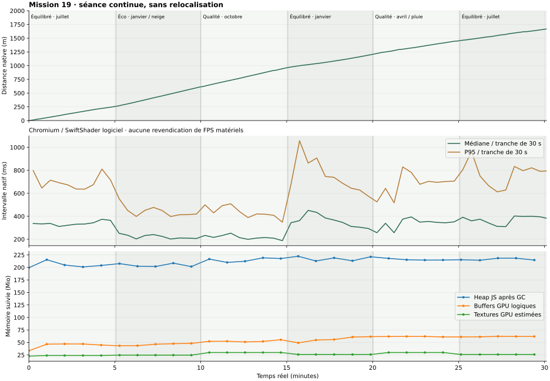

# Mission 19 — L’immersion sans rupture

Les huit systèmes sont intégrés : résidence et LOD des arbres, détail du décor, ombre du randonneur, animation, contacts sonores, neige, Lune et destinations de promenade. **PR brouillon [#28](https://github.com/sebastienleidgens-lab/endless-earth/pull/28)**, sans fusion ni déploiement. Budget supplémentaire : **0 €**. Les réserves visuelles et de performance restent explicites ci-dessous.

[Galerie locale, comparaisons et films natifs](mission-19-evidence/index.html). Code de validation figé : `a7b99bba986587aae78f18a0863171ce77163518`. Base M18 fusionnée : `2866c860b77456dcc9cec2cd257241d95c26bc51` ; M17 / PR #26 et M18 / PR #27 sont dans l’ascendance. `AGENTS.md` et les rapports 11–18 ont été lus. La seule autre PR ouverte au départ était LP-01 #19, laissée intacte. Aucun service, API, asset ou hébergement payant n’est ajouté.

## 1. Diagnostic du popping

La forêt du pilote conserve tous ses ancrages et toutes ses géométries en mémoire. Le problème principal observé dans le code est la **sélection**, plutôt qu’un téléchargement tardif de chaque arbre : le frustum, la liste d’instances et les budgets proches étaient recalculés au quart de seconde, avec un seuil de rotation. Les plafonds de détail s’appliquaient aux seuls arbres du champ. Tourner pouvait donc redistribuer les formes et remplir une file de transitions. Le niveau caché pouvait aussi conserver un ancien détail.

L’audit distingue ce mécanisme des ressources du sous-bois et de l’architecture, réellement chargées par cellules. Terrain, patrimoine principal et façades de repli sont résidents. L’alpha-test et les mipmaps de M17 restent en place ; ils ne sont pas établis comme l’unique cause des apparitions signalées. [Audit initial complet](mission-19-evidence/initial-audit.json.gz).

## 2. Causes identifiées et dispositif d’inspection

Le rendu sépare désormais les causes : résidence, frustum conservateur, distance après couverture, niveau courant/demandé et transition. En mode `?perf=1`, `endlessDiagnostics.nature.forest.inspect()` décrit les douze arbres visibles les plus proches ; `inspect("tree:x:z")` retrouve une identité métrique stable dans le repère d’Angles. Le diagnostic retourne distance, hauteur projetée, LOD, transition, frustum, chargement, visibilité et motif. Il ne présente pas ces formes procédurales comme des arbres relevés individuellement.

Les compteurs exposent apparitions/disparitions, changements de niveau, transitions en attente et reconstructions de batches. Le flux de décor conserve requêtes, chargements, installations, évictions et temps CPU ; il ajoute les installations de l’image courante. Les bornes tiennent compte de la déformation et de l’enveloppe des nouvelles cartes lointaines. Les frustums sont testés dans chaque image où la caméra change ; les états immobiles réutilisent leur résultat.

## 3. Continuité des quatre LOD

Les budgets proches et moyens sont alloués selon la position, la taille projetée, le FOV et des identités stables, **indépendamment de la direction regardée**. Les représentations hors champ sont préparées avant une rotation. Les priorités favorisent l’importance projetée et l’attente ; la limite de **48 transitions simultanées** et la durée de **0,48 s** sont conservées.

Chaque carte lointaine est ajustée aux feuilles fines rattachées à la même branche secondaire. Les deux derniers niveaux partagent exactement leur feuillage ; le dernier simplifie le bois. Cela évite le changement supplémentaire de couronne dû à la suppression d’un plan. Le modèle canonique proche, les racines, les tailles de placement, la couleur individuelle et les dates de phénologie sont préservés.

Le fondu de couverture reste opaque. Les deux représentations échantillonnent un plan commun ancré dans le monde, afin de partager la même couverture pour un rayon de caméra, même à des profondeurs différentes. Aucun bruit aléatoire par image ni alpha blend massif. Une couverture progressive termine la portée existante 950–1 050 m ; la distance maximale n’est pas arbitrairement augmentée.

**Limite :** les cartes de branches restent des approximations des pousses fines. Les deux niveaux lointains ont le même feuillage, mais les niveaux proche/moyen/lointain ne sont pas des silhouettes identiques au pixel. Les conifères, la chute des feuilles, le vent et le fondu saisonnier gardent le propriétaire M11/M17/M18. La continuité artistique parfaite n’est pas déduite d’un test de seuil.

## 4. Cellules, installations et autres décors

Les distances des cellules naturelles sont calculées depuis leur emprise plutôt que leur seul centre : une frontière de cellule ne retire plus une bande entière proche de la caméra. Les herbes, fougères, petites pierres, feuilles et fleurs utilisent une couverture spatiale et une admission progressive à l’installation. Des groupes de triangles réutilisent leurs buffers et ne soumettent que les secteurs pouvant contribuer à la distance utile, avec une marge de mouvement.

Les panneaux architecturaux ordinaires restent le repli résident. Les détails et le repli utilisent des couvertures complémentaires ; les caches ne remplacent plus tous les panneaux d’un seul coup. Les distances prennent aussi la hauteur de la caméra, afin d’éviter des détails coûteux et subpixel en aérien. Les fleurs utilisent la même logique de distance physique. Les corps de bâtiments, cheminées principales et monuments ne sont pas supprimés par ce mécanisme. Les petits pots et couronnements de M15 conservent leur retrait par échelle et leur budget antérieurs.

Les plafonds réseau **2 chargements / 2 prêts / 1 installation par image**, les réserves de **4 cellules naturelles / 12 architecturales** et les replis sont conservés. Une installation géométrique individuelle reste non préemptible ; son coût réel est mesuré plutôt que présenté comme un plafond CPU strict. Le pilote possède un jeu borné de 25 tuiles de terrain ; aucun futur streaming de toute la France n’est revendiqué.

## 5. Forêt en mouvement et caméras

Les contrôles couvrent trois profils × janvier/juillet/octobre × rotations 0°, 45°, 90°, 180°, 360°. Le niveau demandé reste identique entre orientations à position/FOV communs, et aucune apparition supplémentaire retardée n’est observée après le changement de frustum dans ces cas. Un arbre est suivi à 150, 100, 75, 50, 30, 15 et 5 m, avec son identité et son niveau.

Les films montrent rotation, approche et promenade avec les mêmes postes initiaux. **L’approche est une inspection de caméra, joueur immobile**, pas une marche de 145 m. Les films de marche utilisent le même itinéraire OSM dans les deux versions ; les temps logiciels influencent leur distance, sans prétendre à une trajectoire identique à chaque seconde. Les vues première, troisième personne et aérienne, les saisons et les profils sont aussi exercés par les contrôles natifs. [Contrôles](mission-19-evidence/runtime.json) · [Trace](mission-19-evidence/runtime-trace.json.gz) · [Films](mission-19-evidence/movies.json).

Trois individus distincts, dont un persistant, sont inspectés de 150 à 5 m en janvier, juillet et octobre : neuf pistes, un profil déclaré par individu. Ces inspections de caméra stabilisent les transitions par pas virtuels M11 et ne sont pas présentées comme des marches natives. [Identités, niveaux et captures](mission-19-evidence/tree-tracks.json).

## 6. Diagnostic du scintillement des ombres

La carte du personnage M18 pouvait attendre **100 à 160 ms**, ne suivait pas explicitement la rotation du groupe et ne suivait pas toutes les composantes de la pose. Le personnage échantillonnait aussi cette carte dont il était lui-même le seul occultant. Le biais de réception employait une normale antérieure à la déformation du squelette.

Une rafale de trente changements réels de pose/rotation donne **1 mise à jour avant, 30 après**. L’ablation pixel isole la réception de la carte du personnage de celle du paysage. Dans les cas capturés, son effet moyen avant est faible (jusqu’à environ **0,0043/255**, maximum 3 niveaux) et nul après sur le masque du personnage. **Cette expérience ne reproduit pas à elle seule le fort clignotement décrit par le propriétaire.** La cadence obsolète est démontrée ; l’auto-réception est un mécanisme retiré, sans être déclarée cause unique certaine du défaut perceptif. [Protocole et mesures](mission-19-evidence/shadow-ablation.json).

## 7. Correction de l’ombre du personnage

Le personnage reçoit la carte du paysage et projette sa propre carte sur le décor. Il n’échantillonne plus sa propre carte locale. Le proxy partage toujours le vrai squelette et les vrais sommets. Position, rotation, translations/rotations/échelles des os et direction solaire invalident la carte dès la pose rendue ; il n’y a plus de délai volontaire entre animation et ombre.

Le biais utilise la normale effectivement transformée. Le filtrage reste celui du propriétaire d’éclairage, sans camouflage par flou supplémentaire. Les tailles **128² / 256²** et les budgets de cibles sont conservés. Éco garde la politique M18 d’occlusion ambiante sans carte solaire locale ; il n’est pas présenté comme équivalent à Qualité pour les ombres. Les faibles hauteurs solaires et l’extinction nocturne de M18 restent en place.

## 8. Marche

Le rig original reçoit une rotation retenue du bassin, un contre-mouvement du torse et des épaules, des bras moins symétriques, une tête compensée et une faible variation de foulée. La pente et l’inertie de direction influencent la posture. La respiration reste discrète. Aucun asset de capture de mouvement commercial, aucune bibliothèque d’animation lourde, aucun changement du modèle géographique.

Le mouvement demeure procédural et le personnage stylisé. Le résultat proposé est visible dans les films ; les tests d’appui ne constituent pas une validation de naturel humain.

## 9. Course et transitions

La course utilise une foulée plus longue, une phase d’appui plus courte, une levée de pied et une impulsion de bassin plus fortes, une inclinaison du torse et des bras distincts. Les amplitudes sont lissées. Elle ne consiste donc pas seulement à accélérer le même cycle. L’entrée en marche/course, le ralentissement, l’arrêt et le demi-tour sont montrés par des entrées clavier natives. [Film et protocole](mission-19-evidence/run.json).

Un second film montre une course puis une marche et un retour sur un segment public OSM près de la forêt : 7.3 m natifs, sans sortie du segment déclaré. La matière locale n’est pas documentée : aucun son de feuilles n’est inventé. [Film, contrôles et trace](mission-19-evidence/trail-run.json).

## 10. Pieds, contacts et support

La distance réellement parcourue pilote la phase. Les appuis restent ancrés dans le monde et l’IK prend le support physique commun, y compris les ponts. La pose met à jour les matrices parentes avant de mesurer les pieds. Les événements sonores proviennent des entrées effectives en phase d’appui et contiennent le pied, sa position et son énergie.

Les tests à 30/60/120 pas de simulation par seconde, les pentes, virages, arrêts et collisions passent. Un test direct de marche et de course sur pente garde une erreur d’appui et de semelle inférieure à **2,5 cm**. Cette mesure porte sur les repères du rig ; elle ne certifie pas chaque sommet de chaussure dans toutes les poses. Déplacement nul, caméra seule et blocage physique ne produisent pas de nouveau pas sonore.

## 11. Bibliothèque sonore

Les **41 captations antérieures**, leurs extraits, droits et empreintes sont conservés. Deux prises CC0 de neige ajoutent **12 extraits distincts** : edschaefer / Freesound 380041 et studiogreenhill / 841736. Les préécoutes HQ MP3 publiées par les auteurs sont la source acquise, pas les WAV originaux. Mono 32 kHz, filtrage léger, gain borné, fondus de 5 ms ; les transformations et la preuve de licence sont enregistrées.

La sélection évite les trois derniers extraits lorsque le stock le permet et favorise une autre prise. Les pieds varient légèrement en énergie ; hauteur et volume varient modérément. La course modifie énergie et durée. L’attente de programmation des impacts est réduite à 2 ms, avec un contexte interactif ; la latence finale du matériel audio n’est pas prétendue nulle. Voix, concurrence et cache restent dans les budgets existants, dont **24 Mio** de buffers décodés. [Sources](mission-19-evidence/audio-sources.json) · [Crédits](../public/audio/credits.html).

## 12. Matière réellement foulée, neige et humidité

Chaque contact interroge la route, la couverture de sol et la neige à la position du pied. La neige partage le dépôt, l’exposition chargée et le grain de la surface rendue. Une chaussée nue ne reçoit pas un son de neige seulement parce que « Neigeux » est choisi. La température et la fonte distinguent un état humide ; la distinction fraîche/tassée reste une **interprétation acoustique**, notamment selon le support pavé. Ce ne sont pas trois relevés de compaction locaux.

L’humidité des contacts de terre suit aussi le séchage M18 après la pluie. Les enregistrements génériques de contact dur ne sont pas rebaptisés en relevés locaux de bitume. Les matières inconnues restent discrètes/silencieuses. Les feuilles ont des enregistrements licenciés, mais aucun poste local de litière vérifiée n’est inventé pour la preuve.

Huit séquences natives montrent bitume, pierre, terre, herbe, gravier et trois états simulés de neige. Leur seule piste sonore vient de l’AudioContext du jeu, après limiteur ; aucun habillage sonore ajouté. Les postes sont séparés et déclarés. [Mesures et films](mission-19-evidence/audio-native.json).

## 13. Lune et calendrier

Le petit modèle orbital topocentrique de Schlyter, avec perturbations lunaires, utilise **la même date M11/M18 et le site géographique** que le Soleil. Il calcule azimut, hauteur, phase, fraction éclairée, orientation du limbe et rayon angulaire, avec parallaxe. La galerie vise la direction calculée depuis la voie publique vérifiée de la rue de Tournon, à hauteur d’œil, sans inventer un nouveau point d’intérêt. Le disque a une taille angulaire physique ; sa phase est éclairée par le vecteur solaire commun. Il fait partie du shader de ciel et est occulté par les profondeurs du paysage. Aucun sprite géant, halo excessif, texture externe ou passe lunaire n’est ajouté.

L’horizon, l’illumination, la brume, les nuages et la pluie déterminent la visibilité, y compris de jour. Le ciel couvert/orageux peut masquer le disque ; aucune Lune n’est garantie chaque nuit. Les huit dates de référence sont calculées, non attribuées aux mois pour embellir la galerie.

Comparaison indépendante avec **Astronomy Engine 2.1.19, MIT**, installé uniquement dans `work/` pour contrôle, sans dépendance de production : erreur maximale de hauteur **0.0833°**, d’azimut **0.0345°**, erreur de fraction éclairée **0.00142** sur les huit dates. Les altitudes comparées sont géométriques, sans réfraction. Le modèle est approximatif et n’est pas destiné aux éclipses ou à la navigation. [Référence](mission-19-evidence/moon-reference.json) · [Galerie calculée](mission-19-evidence/moon-gallery.json).

## 14. Promenade vers des lieux documentés

Un graphe piéton dirigé de **1 104 nœuds / 1 109 arêtes** est préparé hors ligne, depuis les voies OSM et le support déjà vérifié. Le graphe historique de départ reste **919 / 896**, identique octet pour octet. Les accès conditionnels/privés, directions piétonnes, murs, eau et supports non vérifiés restent des exclusions. Les voies secondaires et le pont ne sont admis qu’avec les accès et la validation physique du simulateur.

Dijkstra remplace la recherche de longueur maximale pour la découverte. Les poids artistiques explicites sont patrimoine 5, pont 4, nature 3, chemin 2, rue 1,5, pondérés par distance réelle, proximité de l’approche et visites récentes. Aucun score de popularité fictif. Les abords d’un bâtiment ne sont pas une entrée inventée. Une destination atteinte entraîne une courte pause puis une autre sélection, sans répétition immédiate ; le contrôle manuel interrompt la promenade.

Un raccord court exige une validation physique et un corridor public cartographié. Une prairie simplement libre dans le moteur n’est pas déclarée chemin public. Des points de vue absents des données ne sont pas inventés. Le menu existant affiche la destination sans panneau permanent. [Préparation et sources](mission-19-evidence/graph-preparation.json).

## 15. Itinéraires natifs testés

| Départ | Destination OSM / approche | Distance native | Arrivée |
| --- | --- | ---: | --- |
| village | les abords de Château d'Angles-sur-l'Anglin | 20.7 m | Point d’arrivée atteint |
| rue | les abords de Église Saint-Martin | 62.9 m | Point d’arrivée atteint |
| sentier-forestier | un sentier cartographié | 55.0 m | Point d’arrivée atteint |
| berge-pont | les abords du pont | 117.2 m | Point d’arrivée atteint |
| nature | un sentier cartographié | 28.2 m | Point d’arrivée atteint |

Chaque film commence sur un sommet public documenté, puis utilise le véritable contrôleur et les collisions jusqu’au point d’arrivée, sans relocalisation intermédiaire. Les postes près de la nature sont des sentiers cartographiés ; les stations de revue hors réseau sont refusées lorsque leur accès n’est pas vérifiable. [Films, traces et distances](mission-19-evidence/tours.json).

## 16. Coût et optimisation

La première matrice a montré des régressions et a motivé les chemins rapides hors fondu, la sélection spatiale des triangles de détail et le culling en trois dimensions. Le vent grossier était encore échantillonné identiquement pour chaque sommet : il est maintenant lu **une fois par individu dans le même champ demi-précision M11**, sans changer ses coordonnées, sa direction ou son horloge. Un regroupement sans perte de deux attributs libère l’emplacement de l’attribut de vent, sans augmenter le besoin maximal en attributs du shader. Les attributs canoniques sont conservés pour les ombres et la référence.

Le contrôle isolé donne **271,4 → 227,3 ms** en Équilibré sur un cas SwiftShader ; les **24 comparaisons** trois profils × quatre saisons × calme/orage ont un écart de pixel nul dans ce navigateur. Cela démontre l’équivalence de ces cas, pas celle de tout matériel. Le cache ajoute un petit bank CPU, des données par instance et un attribut de sommets partagé ; aucun nouvel atlas de pivots ou texture d’animation.

| Scène | Profil | M18 médiane | M19 médiane | Écart | M19 P95 / pic | Appels M18 → M19 | Triangles M18 → M19 |
| --- | --- | ---: | ---: | ---: | ---: | ---: | ---: |
| sous-bois | eco | 202.9 ms | 205.8 ms | +1.4 % | 214.6 / 214.6 ms | 40 → 40 | 222186 → 212813 |
| sous-bois | balanced | 262.7 ms | 253.4 ms | -3.5 % | 348.0 / 348.0 ms | 44 → 46 | 257168 → 249544 |
| sous-bois | quality | 259.8 ms | 298.9 ms | +15.1 % | 320.6 / 320.6 ms | 45 → 47 | 336766 → 337668 |
| rue | eco | 255.4 ms | 285.7 ms | +11.9 % | 296.4 / 296.4 ms | 92 → 96 | 290797 → 345765 |
| rue | balanced | 396.5 ms | 430.1 ms | +8.5 % | 571.5 / 571.5 ms | 96 → 104 | 328183 → 354573 |
| rue | quality | 382.4 ms | 425.6 ms | +11.3 % | 449.3 / 449.3 ms | 99 → 107 | 334015 → 360189 |
| vallee | eco | 220.2 ms | 236.9 ms | +7.6 % | 268.6 / 268.6 ms | 109 → 108 | 260041 → 251800 |
| vallee | balanced | 274.9 ms | 272.0 ms | -1.1 % | 316.3 / 316.3 ms | 114 → 114 | 276608 → 263179 |
| vallee | quality | 256.6 ms | 259.3 ms | +1.1 % | 285.7 / 285.7 ms | 117 → 117 | 277202 → 263695 |

Les valeurs sont des rendus chauds synchronisés **Chromium / SwiftShader logiciel, 640 × 420 DPR 1**, douze échantillons alternés par cellule. Caméra, date et météo sont vérifiées identiques ; champs M11 et transitions sont stabilisés de manière contrôlée. **Aucun FPS Android/GPU physique n’est revendiqué.** Le nombre de textures est identique dans chaque cellule appariée. Les géométries résidentes vont par exemple de 134 à 139 dans la rue en Équilibré ; les variantes de shader et les couronnes supplémentaires ont donc un coût explicite. Le pic d’installation observé sur cette matrice passe de 150,6 à 166,8 ms ; les installations individuelles ne sont pas déclarées résolues. Les valeurs de heap brutes sont dans le JSON et ne remplacent pas les snapshots après GC de la séance prolongée. Les écarts varient selon la scène et les campagnes ; les régressions restantes sont conservées, pas effacées par la moyenne. Le coût visuel des couronnes et des replis complémentaires reste une réserve de performance. [Matrice complète](mission-19-evidence/performance.json) · [Premier candidat](mission-19-evidence/performance-initial-candidate.json) · [Cache de vent](mission-19-evidence/wind-cache-cost.json) · [Équivalence](mission-19-evidence/wind-cache-equivalence.json).

Un micro-banc CPU Node/V8 mesure les véritables propriétaires du rig, sans rendu, après échauffement et en alternant les versions :

| Régime | Rig M18 | Rig M19 |
| --- | ---: | ---: |
| 0.00 m/s | 0.00295 ms | 0.00348 ms |
| 1.35 m/s | 0.00392 ms | 0.00485 ms |
| 3.20 m/s | 0.00418 ms | 0.00459 ms |

Le calcul lunaire prend environ **0.00167 ms par appel** sur ce micro-banc, avec une seule évaluation par seconde du calendrier commun en production. Ces mesures indicatives sont prises pendant la séance native et ne sont pas des coûts Android ou GPU. Les données d’animation, de corps et de Lune restent sans nouvelle passe géométrique. [Échantillons CPU](mission-19-evidence/cpu.json).

## 17. Profils et build

Éco, Équilibré et Qualité conservent les mêmes individus et identités, avec leurs budgets de détail et d’ombres. Les rotations et les saisons sont vérifiées dans les trois profils. **290 tests Node** et TypeScript/Vite passent. L’avertissement historique du bundle supérieur à 500 kB demeure. Le contrôle du build de production, du menu mobile, des douze mois et de leur restauration est publié dans [compiled.json](mission-19-evidence/compiled.json). Une émulation tactile ne remplace pas un téléphone physique.

## 18. Promenade prolongée

**1807.3 s réelles, 1806.5 s entre première et dernière image**, 1668.2 m et 6127 images natives. Une séquence clavier réelle passe de la course à la marche puis reprend AutoWalk, et une rotation complète de caméra est enregistrée. Six chapitres passent par les trois profils, quatre saisons, la neige, la pluie, le jour et la nuit, et les trois vues. Aucune relocalisation après le départ ordinaire ; aucun temps accéléré, aucune reconstruction d’images.

Intervalles **logiciels**, avec streaming, enregistrement et GC : médiane **279.0 ms**, P95 **642.9 ms**, pic **2096.2 ms**. Ces valeurs décrivent les ralentissements de l’environnement et ne valident pas une fluidité matérielle. Écart maximal au support : **0.000000 m** ; déplacement maximal entre deux images : **0.798 m**. Erreurs maximales des repères articulés : appui horizontal **0.0000 m**, repère de semelle **0.0000 m**. Ces repères ne mesurent pas chaque sommet de chaussure. Arrêts terminaux/reprises depuis la même position consignés par le banc : **0**. Leur nature est conservée dans la trace, sans téléportation de réparation.

Aucune erreur JS ou perte de contexte relevée dans ce test ; toutes les empreintes `src/` et `public/` suivies sont vérifiées avant/après. Le contexte audio est fermé à la fin et laisse zéro nœud. Les snapshots de mémoire après GC sont publiés ; ils ne mesurent pas toute la mémoire native du pilote. [Résultat](mission-19-evidence/soak.json) · [Trace complète compressée](mission-19-evidence/soak-trace.json.gz).

| Chapitre | Profil / météo | Distance native |
| --- | --- | ---: |
| 0.0–5.1 min | balanced / mois 7 / clear | 258.6 m |
| 5.1–10.0 min | eco / mois 1 / snow | 356.4 m |
| 10.0–15.1 min | quality / mois 10 / cloudy | 350.4 m |
| 15.1–20.0 min | balanced / mois 1 / clear | 241.8 m |
| 20.0–25.1 min | quality / mois 4 / rain | 248.5 m |
| 25.1–30.1 min | balanced / mois 7 / clear | 212.4 m |

Arrivées effectives pendant la séance : **7** ; plus longue période stationnaire : **5.1 s**. Pic d’installation dans une image : **1**. Voix audio simultanées observées : **6** ; buffers audio décodés observés : **23.99 Mio**. Pics de durée murale côté JavaScript (y compris appels GL et leurs attentes éventuelles) : sélection forêt **26.1 ms**, cache de vent **19.9 ms**, carte du personnage **442.2 ms**, installation **256.1 ms**, mise à jour audio **25.1 ms**. Ces pics restent des ralentissements constatés ; ils ne sont pas annulés par le faible coût du micro-banc CPU. Les différents lieux, profils et saisons empêchent d’assimiler une simple différence de heap à une fuite certaine. [Analyse détaillée](mission-19-evidence/soak-analysis.json).




## 19. Non-régressions et reproductibilité

**4213 fichiers publics ou preuves historiques** sont identiques à M18, avec six métadonnées/crédits explicitement autorisés à évoluer et les nouveaux fichiers de cette mission. Terrain, noyau physique, collisions, repère géographique, forêt canonique, ancrages et empreintes originales sont préservés. Les **2 898 points de collision et vingt mouvements** donnent les mêmes réponses que M18. Les 41 anciennes prises et tous leurs extraits sont identiques. Les sorties complètes de tests et de compilation sont conservées dans [validation.json](mission-19-evidence/validation.json). Aucun fichier LP-01, workflow de déploiement ou expérimentation Living Paintings n’est modifié. [Contrôle complet](mission-19-evidence/preservation.json).

```sh
npm ci --cache work/npm-cache
npm test
npm run build
npm run dev -- --port 5332
# Base M18 dans un checkout détaché, port 5319.
node scripts/browser-mission-19.mjs
node scripts/validate-mission-19-wind.mjs
node scripts/benchmark-mission-19.mjs
node scripts/benchmark-mission-19-cpu.mjs
node scripts/record-mission-19.mjs
node scripts/record-mission-19-run.mjs
node scripts/record-mission-19-trail.mjs
node scripts/browser-mission-19-tree-tracks.mjs
node scripts/browser-mission-19-tours.mjs
node scripts/browser-mission-19-audio.mjs
MISSION19_SOAK_PORT=5332 node scripts/soak-mission-19.mjs
python scripts/report-mission-19.py
# Galerie : /endless-earth/docs/mission-19-evidence/index.html
```

Les ports du banc sont indiqués dans ses scripts ; la livraison utilise aussi un checkout figé pour éviter le rechargement à chaud pendant les captures. `prepare-mission-19-graph.mjs` exige l’égalité du graphe historique avant de renouveler ses empreintes. Les médias restent natifs ; le remuxage ne réécrit ni leurs images ni leur bande sonore. Les empreintes et temps de paquets sont conservés dans les contrôles de médias.

## 20. Limites et état final

La continuité de sélection est vérifiée dans les postes reproduits, mais aucune preuve ne certifie l’absence de toute rupture perceptive dans toute caméra, connexion ou matériel. Les couronnes et le personnage restent stylisés. La réaction du pied est mesurée sur des repères articulés, sans garantie sur chaque sommet de chaussure. Le grand clignotement d’ombre du propriétaire n’a pas été reproduit à l’identique ; la correction des mécanismes identifiés doit être confrontée à son cas réel. Le fondu des détails n’annule pas le coût individuel d’un chargement ou d’une compilation initiale.

Les performances logicielles restent lentes et certaines cellules régressent. La validation de la fluidité sur GPU physique et Android, ainsi que l’appréciation artistique et acoustique du propriétaire, restent ouvertes. Aucun monument, accès public, sol vérifié ou état météorologique observé n’est fabriqué pour réussir la démonstration.

| Sujet | État | Portée / réserve |
| --- | --- | --- |
| Répartition des LOD à la rotation, résidence et inspection | Corrigé dans les cas reproduits | Trois profils, trois saisons, cinq angles ; aucune apparition retardée constatée. |
| Silhouettes à l’approche et tous les détails du décor | Partiellement corrigé | Enveloppes de branches, feuillage lointain commun, couvertures et replis ; approximations proches/lointaines et chargements individuels demeurent. |
| Synchronisation et routage de l’ombre du personnage | Corrigé techniquement | Vraie pose projetée, paysage reçu, propre carte exclue du personnage ; ombre au sol conservée. |
| Fort scintillement perceptif signalé par le propriétaire | Partiellement corrigé / à confirmer | Le défaut fort n’a pas été reproduit à l’identique ; films et ablations fournis sans prétendre le contraire. |
| Marche, course et transitions | Partiellement corrigé | Nouvelle dynamique et appuis testés ; rig stylisé, validation artistique ouverte. |
| Contacts par pied, neige et séchage | Corrigé dans les cas testés | Huit séquences natives ; états neigeux et contacts génériques explicitement interprétés. |
| Lune et calendrier commun | Corrigé dans les limites du modèle | Position/phase contrôlées indépendamment ; horizon et météo, pas de garantie de Lune nocturne. |
| Découverte piétonne vers des destinations OSM | Corrigé pour les parcours testés | Cinq arrivées natives, restrictions conservées ; pas de raccourci hors réseau non vérifié. |
| Preuve locale de marche sur feuilles mortes | Non résolu | Aucun poste de litière locale vérifiée disponible dans les données ; aucune preuve fabriquée. |
| Fluidité matérielle / Android et toutes les régressions | Non résolu | Mesures logicielles et réserves publiées ; essai matériel nécessaire. |
