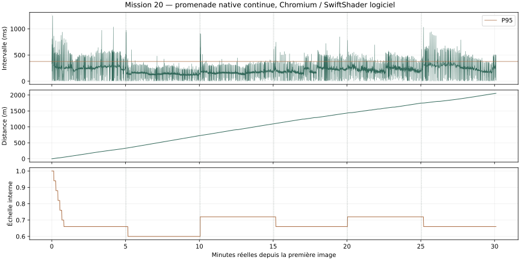

# Mission 20 — Le monde sensible et vivant

**Livraison pour revue artistique dans la [PR brouillon #29](https://github.com/sebastienleidgens-lab/endless-earth/pull/29). Plusieurs objectifs restent partiels, notamment la qualité sur matériel physique, certains reflets et la faune.** Base : Mission 19 fusionnée, `8073e46` / PR #28. Code de la promenade finale : `d611636`. Aucune fusion, aucun déploiement, aucune modification de Living Paintings / LP-01. Dépense supplémentaire : **0 €**.

[Galerie comparative et films natifs](mission-20-evidence/index.html) · [mesures](mission-20-evidence/performance.json) · [promenade](mission-20-evidence/soak.json) · [inspection automobile](mission-20-evidence/traffic-native.json).

## 1. Audit initial

Les consignes, l’ADN artistique, les rapports des missions précédentes, les budgets et les propriétaires de lumière, forêt, météo, audio, navigation et décor ont été examinés. La base distante et l’ascendance de M19 ont été vérifiées avant création de `mission/20-monde-sensible-vivant`. La première mesure reproduit les coûts logiciels élevés : ce ne sont pas des mesures Android. Les ombres synchronisées de M19 sont conservées ; réintroduire une cadence lente aurait risqué de rétablir son décalage de pose.

## 2. Optimisations

La préparation des triangles de détail, l’orientation des façades et les identités des vitrages deviennent des générateurs coopératifs. Une cellule n’est ajoutée à la scène qu’après préparation complète ; les replis et l’annulation des demandes restent actifs. Une petite tranche demeure indivisible : le budget demandé n’est pas une garantie de temps mural maximal. Les allocations/transferts GL et compilations initiales ne deviennent pas préemptibles pour autant.

Les batches forestiers dont l’ordre et les membres n’ont pas changé conservent leurs attributs ; les plages d’envoi sont bornées aux instances utilisées. L’échantillonnage du même vent demi-précision évite une fermeture par individu. Le calcul de l’ombre du personnage réutilise ses tableaux et matrices, en conservant vraie pose, squelette partagé, résolution et exclusion de l’auto-réception. L’audio évite de reprogrammer un auditeur immobile et réduit les gardes redondantes.

L’adaptation change uniquement la résolution interne : estimation lissée sur trois secondes, déclenchement conservateur, intervalle minimal de huit secondes, baisse de 0,06 et récupération de 0,03 après 24 secondes favorables. Planchers : 0,60 Éco, 0,66 Équilibré, 0,72 Qualité. Elle conserve profil, FOV, distances, individus et vitesses. Le basculement automatique unique de profil après six secondes est retiré.

## 3. Avant / après

Les rendus fixes sont appariés par caméra, position, date et météo, avec douze échantillons chauds synchronisés et ordre alterné. Les trois cellules Équilibré gagnent dans cette campagne. Des régressions restent présentes, surtout Qualité en vallée. Les P95 de groupes de douze échantillons coïncident ici avec leurs pics ; ce n’est pas une distribution matérielle exhaustive.

| Scène | Profil | M19 médiane ms | M20 médiane ms | Écart | M20 P95 / pic ms | M20 échelle 0,72 ms |
| --- | --- | ---: | ---: | ---: | ---: | ---: |
| sous-bois | eco | 174.4 | 181.6 | +4.1 % | 194.7 / 194.7 | 129.1 |
| sous-bois | balanced | 237.4 | 212.3 | -10.6 % | 230.1 / 230.1 | 165.9 |
| sous-bois | quality | 281.0 | 248.7 | -11.5 % | 274.2 / 274.2 | 189.3 |
| rue | eco | 273.3 | 281.4 | +3.0 % | 306.9 / 306.9 | 208.6 |
| rue | balanced | 400.3 | 390.0 | -2.6 % | 405.7 / 405.7 | 312.7 |
| rue | quality | 406.2 | 396.3 | -2.4 % | 413.6 / 413.6 | 298.2 |
| vallee | eco | 201.1 | 203.3 | +1.1 % | 239.7 / 239.7 | 165.0 |
| vallee | balanced | 242.3 | 241.7 | -0.2 % | 277.9 / 277.9 | 181.7 |
| vallee | quality | 225.2 | 241.7 | +7.3 % | 260.5 / 260.5 | 176.1 |

La dernière colonne modifie explicitement la résolution interne. Elle ne démontre pas que le même rendu serait plus rapide à définition identique. SwiftShader varie aussi entre campagnes : les deux candidats précédents sont conservés dans `performance-initial.json.gz` et `performance-fragment-candidate.json.gz`. Une brume ajoutée à tous les matériaux régressait même hors brume ; elle a été remplacée par deux voiles locaux et aucun changement des shaders forestiers. La campagne finale conserve ce chemin de rendu ; les corrections ultérieures portent sur un identifiant du voile rare, la forme des insectes et des gardes sans effet sur les cellules fixes sans événement.

## 4. Brume géographique

Humidité artistique, heure civile, mois, vent, état de séchage, altitude relative à la berge et distance aux polygones de l’Anglin proviennent du calendrier et des données existants. Une occasion déterministe par jour permet des matins sans brume. La densité converge et se dissipe progressivement. Deux voiles doux, bornés près de la berge et testés en profondeur, remplacent le candidat global coûteux. C’est une approximation locale, pas un volume météorologique ni une prévision.

L’inspection choisit le 1er octobre 2026 à 06 h 30 UTC, une brise simulée faible et un poste bas. La densité obtenue vient du modèle ; elle n’est pas forcée. Les trois profils sont rendus et vérifiés. Le premier matin de la galerie reste sans brume nouvelle : la rareté n’est pas supprimée pour la démonstration.

## 5. Profondeur atmosphérique

La perspective et les distances existantes sont préservées. Les voiles partagent la couleur d’horizon du ciel et s’effacent sur leurs bords ; ils ne servent pas à cacher la limite du pilote. La perspective des objets lointains repose toujours principalement sur le brouillard de M11. Une nouvelle diffusion volumétrique complète n’est pas livrée.

## 6. Lumière rasante

La réponse de l’éclairage direct près de l’horizon et sa chaleur sont ajustées, sans filtre orange appliqué à l’image. Soleil astronomique, ombres, matériaux et transition nocturne conservent leurs propriétaires. Les paires coucher / nuit sont issues du moteur, à cadrage et date communs. L’appréciation de la lumière appartient au propriétaire.

## 7. Rivière et reflets

Le reflet analytique échantillonne maintenant le même champ mobile de nuages que le ciel et les ombres. Ondulations, courant aval OSM, turbulence des seuils documentés et zones calmes sont conservés. Aucune cible de réflexion ni nouveau rendu de scène n’est ajouté. Les reflets des arbres, berges et bâtiments ne sont pas reconstruits : cet objectif reste partiel.

## 8. Berges

**89 touffes interprétées**, limitées à 96, enrichissent certains abords des contours d’eau avec contrôle du support, des obstacles et de l’habitat existant. Ce ne sont pas 89 observations botaniques. Herbes et formes génériques de roseaux partagent saison et vent ; leur couverture et leurs triangles sont sélectionnés à courte distance. Éco les retire. Après un coût sensible en gros plan, le vent simplifié et la réception solaire grossière existants sont retenus pour ces petits détails seuls, sans changer leur géométrie, calendrier ou propriétaire de vent : 126,9 → 120,7 ms sur le contrôle apparié logiciel. Galets, racines et mousse géométrique de berge ne font pas l’objet d’un nouveau système complet.

## 9. Occlusion acoustique

Les empreintes OSM alimentent un index de cellules de 40 m. Chaque contexte traite au plus deux voix spatiales puis la rivière ; une requête est bornée à 64 obstacles. Un filtre et une atténuation progressifs remplacent les changements secs. Les hauteurs inconnues restent des enveloppes inférées ; l’index ne prétend pas connaître portes ouvertes, matériaux acoustiques exacts ou diffraction. Aucun raycast sur chaque source à chaque image.

## 10. Acoustique des environnements

Une réflexion précoce courte et très discrète, sans retour en boucle, varie avec l’enclosure des bâtiments proches et l’absorption forestière. Trois nœuds audio s’ajoutent au bus ; aucun fond sonore permanent n’est créé. Les lieux ouverts, sous-bois et rues gardent les mélanges antérieurs. Une acoustique complète sous ouvrage, des réponses impulsionnelles locales et une simulation de réverbération ne sont pas livrées.

## 11. Voix des feuillages

Les captations et familles antérieures, leurs saisons, silences et variations avec le vent sont préservés. Aucune nouvelle captation CC0 spécialisée de conifères ou de roseaux n’a été acquise ; ces familles ne sont pas prétendues acoustiquement identifiées. Ce volet reste partiel.

## 12. Petite faune

Les silhouettes d’oiseaux reçoivent des battements individuels irréguliers et des phases de plané, sur les trajectoires géographiques antérieures. Un pool d’un insecte propose ailes arrondies, corps et antennes de papillon générique, ou ailes plus fines d’insecte humide. Calendrier, habitat, pluie, vent, rareté et budget global conditionnent l’événement ; il n’est pas créé par la rotation de caméra. L’inspection de papillon est déclarée et utilise un poste admissible. Aucun poste public humide admissible n’a été trouvé dans cet échantillon pour la libellule : sa galerie locale reste non atteinte. Repos des oiseaux, modèles détaillés et comportement zoologique complet restent ouverts.

## 13. Réactions à la pluie

Les matériaux poreux et toitures gardent l’humidité du propriétaire commun après l’averse. Des projections réutilisent au plus 16 segments en Équilibré, 28 en Qualité, aucun en Éco. Un champ local 32 × 32, à un mètre par texel, masque la pluie sous une enveloppe conservative des toits cartographiés. Les hauteurs inférées et la résolution limitent ce masque ; il ne garantit pas chaque avant-toit. Les gouttes d’égout et un système de ruissellement ne sont pas livrés.

## 14. Rosée et séchage

Le matin calme et humide module discrètement teintes des sols et matières, sans gouttes macroscopiques. La pluie conserve humidification rapide et séchage partagé. La rosée est une réponse artistique à la simulation ; aucune mesure météorologique réelle n’est revendiquée.

## 15. Murs et ruines

Des variations minérales et une patine localisée très légère utilisent les coordonnées métriques des matières et l’humidité commune. Les volumes patrimoniaux, ouvertures et photographies sources ne sont pas réinterprétés en nouvelles données. Il n’y a pas de végétation grimpante universelle ; la mousse géométrique et les plantes d’interstices précisément confrontées aux photos restent partielles.

## 16. Micro-mouvements

Herbes, roseaux et feuilles utilisent toujours le vent M11. Les feuilles d’événement ne rebouclent plus en hauteur après huit secondes ; elles atteignent le support disponible. Les phases spatiales restent distinctes. Aucun second moteur climatique ou armature CPU par arbre n’est ajouté.

## 17. Caméra

Le menu propose **Caméra à mouvement réduit**, mémorisée localement, qui retire le retard vertical supplémentaire. Aucun head bob n’est imposé. Les balayages de collision et la rétraction du suivi restent conservés. La mission ne prétend pas avoir entièrement refondu le suivi troisième personne ; le naturel perceptif reste à évaluer.

## 18. Contemplation

L’arrivée à une destination documentée laisse six secondes de pause au lieu de trois, puis réutilise le choix varié de M19. Le contrôle manuel interrompt toujours immédiatement la promenade. Aucun belvédère ou accès public supplémentaire n’est inventé ; aucune rotation spectaculaire n’est imposée.

## 19. Nuit

La Lune astronomique, l’occultation par les nuages, les étoiles et fenêtres existantes sont conservées. Humidité, eau et feux des voitures prolongent la cohérence nocturne, sans nouvel éclairage dynamique coûteux. Aucun nouveau catalogue nocturne ni relighting complet du village n’est livré. Les phares automobiles sont émissifs, sans portée projetée au sol : limite explicite.

## 20. Événements rares

Un événement d’insecte occupe une courte fenêtre admissible d’une époque de 210 s, avec tirage déterministe de session et silences. Les voitures suivent leur propre attente rare mais le même calendrier et la même météo ; leur admission évite les contraintes fortes et les autres événements actifs. Les observations ordinaires et les inspections provoquées restent séparées. La séance ordinaire a rendu 0 images avec insecte et 0 avec véhicule ; ces nombres ne garantissent aucune rencontre future.

## 21. Circulation automobile

Sur **138 voies OSM examinées**, un seul trajet dirigé est admis : **rue Blancoise, OSM 647696734, 364.6 m**, côté droit français. La largeur de 5,5 m est l’estimation de la politique routière existante, pas une mesure de terrain. Les autres voies sont refusées par accès, largeur, longueur continue, support, pente, virage ou obstacle. Ponts et raccords incompatibles restent exclus ; aucune route ni collision géographique n’est corrigée pour obtenir une démonstration.

L’enveloppe du véhicule est contrôlée le long de toute la voie à intervalles d’au plus un mètre, y compris largeur, avant/arrière, support commun, pente ≤ 14 % et rayon de virage ≥ environ 9 m. Les sens uniques documentés sont respectés ; les directions conditionnelles/réversibles restent exclues. Les restrictions de largeur, hauteur, poids et accès sont conservatrices. Les intersections entre voies ne deviennent pas des raccords de trafic.

Un pool d’une citadine générique, géométries et matières partagées, propose roues animées, suivi altimétrique et deux détails de silhouette. Vitesse modeste, accélération, freinage, pluie et arrêt sous forte neige sont bornés. Une enveloppe légère empêche le personnage d’entrer dans le véhicule ; il n’est ni poussé ni heurté. Le véhicule ralentit et attend lorsqu’un piéton occupe sa trajectoire.

Le planificateur choisit ses occasions sans dépendre de la direction regardée. Il annule l’entrée si les deux extrémités ne sont pas assez loin et hors champ ; il ne crée pas une voiture proche après une rotation. Un véhicule visible n’est pas téléporté : en fin de trajet, il attend si la sortie n’est pas masquée. Quelques passages par heure simulée constituent une interprétation, pas une statistique locale. Aucun nouveau départ en Éco ; une voiture déjà présente termine sans disparition artificielle.

La captation native dure **78.4 s** : trajet complet, arrêt, attente d’au moins six secondes et reprise. Le véhicule n’est jamais relocalisé pendant le film. L’observateur est volontairement placé sur puis hors de la voie pour inspecter la sécurité : ce n’est pas une rencontre spontanée. Le seul son vient du moteur audio, avec un extrait CC0 existant, position mobile, régime modéré et atténuation. Pas de klaxon systématique, marque commerciale ou simulation complète de pneus. Les silhouettes restent stylisées et les transitions de détail approximatives.

## 22. Licences et provenance

Aucun asset acheté, API payante ou service permanent. IGN / ASP : Licence Ouverte 2.0 ; OSM : ODbL ; Three.js : MIT. Modèles d’insectes, voiture, voiles et détails créés dans le projet. Les captations audio et crédits antérieurs restent inchangés ; la voiture réutilise `traffic-fs-873189-m11-1` (Anya_Media, Freesound 873189, CC0) avec extraits, fondus et variation de lecture. [Crédits des sons](../public/audio/credits.html) et [matières](../public/materials/authentic/credits.html) conservés. Aucune espèce présente, occupation d’une maison ou mesure de trafic n’est affirmée.

## 23. Benchmarks et budgets

[Échantillons complets](mission-20-evidence/performance.json) : médiane, P95, pics, appels, triangles, géométries, textures, heap, installation et pose. Les coûts avec/sans effets sont des ablations déclarées lorsqu’elles sont disponibles ; ils se recouvrent et ne s’additionnent pas. Les mesures GL synchronisées incluent attentes logicielles : ce ne sont pas des temps CPU purs. Aucun GPU physique ni Android n’a été mesuré.

| Traitement pendant la nouvelle séance | Pic mural observé ms |
| --- | ---: |
| Sélection forestière | 27.2 |
| Cache de vent | 21.5 |
| Ombre du personnage | 307.2 |
| Installation de décor | 6.0 |
| Tranche de préparation | 25.3 |
| Audit automobile, tranche | 24.1 |
| Mise à jour automobile | 24.1 |
| Ensemble local brume/faune/berges/projections | 25.4 |
| Champ de protection contre la pluie | 64.5 |
| Mise à jour audio, échantillons de contrôle | 17.9 |

Les anciens pics de M19 étaient 26,1 / 19,9 / 442,2 / 256,1 / 25,1 ms pour forêt / vent / ombre / installation / audio. Les deux séances prolongées ne sont pas des campagnes appariées : parcours, ressources résidentes, enregistrement et résolution effective varient. Une diminution ne prouve donc pas un gain équivalent sur matériel. Les bornes algorithmiques, les traces et les régressions fixes priment sur une moyenne favorable.

## 24. Promenade continue de trente minutes

**1806.5 secondes réelles**, **1805.7 secondes entre première et dernière image**, **2052.7 m**, **9191 images natives**. Clavier réel course puis marche, arrêt et reprise AutoWalk, rotation complète, premières/troisièmes personnes et aérien, trois profils, quatre mois, pluie/neige, jour/nuit et streaming. Aucun événement rare forcé, déplacement réparateur, accélération d’horloge ou reconstruction d’images. Les seules reprises depuis la même position sont consignées : 0.

Intervalles logiciels : médiane **180.7 ms**, P95 **377.6 ms**, pic **1251.3 ms**. L’échelle interne varie de 0.60 à 1.00 ; la résolution CSS de référence est 480 × 320. Ces valeurs ne valident pas une fluidité Android. Écart maximal au support : **0.000000 m** ; déplacement maximal entre images : **0.798 m**. Les erreurs de pieds sont des repères du rig, pas chaque sommet de chaussure.

Voix simultanées observées : **6** ; cache audio maximal observé : **22.51 Mio**, budget 24 Mio. Géométries : 193–404 ; textures : 15–21, en changeant lieux et profils. Les snapshots après GC et allocations logiques sont dans les preuves, sans assimilation à toute la VRAM. Le contexte audio est fermé à la fin et laisse zéro nœud. Source et données suivies sont inchangées pendant la séance.

## 25. Tests techniques et preuves sonores

299 tests Node, TypeScript/Vite, égalité des graphes et contrôles du navigateur. La première tentative prolongée a détecté `INVALID_OPERATION` : le voile rarement activé utilisait le mot réservé GLSL `patch`. Il a été renommé, le serveur figé redémarré et les trois profils explicitement rendus avant la nouvelle séance. Un autre essai a été interrompu pour reprendre les ailes trop schématiques après inspection. Ces essais ne sont pas comptés comme trente minutes réussies.

Huit films natifs séparés couvrent prairie, forêt, rivière, rue, mur, feuillages, pluie et nuit ; le film automobile couvre approche, passage et éloignement. La voix derrière un bâtiment est une inspection déclarée. Aucun habillage musical ni bande-son externe. Les tests de lecture et de format n’équivalent pas à l’appréciation acoustique du propriétaire.

La correction finale de typage est effacée du JavaScript. Le placement permanent des berges est aussi indépendant de la graine des événements ; avec la graine 20 de la séance, sa géométrie reste identique. Une garde réattribue le quota d’un insecte actif lors des changements de profil ; elle est contrôlée par un test de cycle, et aucun insecte n’était actif pendant la séance ordinaire. La politique de shading des touffes de berge a ensuite été simplifiée et mesurée séparément, sans changement géographique. [Portée de compatibilité](mission-20-evidence/runtime-equivalence.json).

## 26. Non-régressions

Les graphes historiques **919 / 896** et de découverte **1 104 / 1 109** restent identiques octet pour octet. Les **2 898 points de collision et vingt déplacements** comparés donnent les mêmes réponses hors nouvel obstacle automobile. Les données IGN/OSM, surfaces, pont, forêts et 3 889 ancrages, Lune, bibliothèques audio et matières historiques ne changent pas. Seules quatre métadonnées publiques de générateurs sont renouvelées après ces contrôles ; aucun pack géographique ou audio n’est remplacé. [Preuve](mission-20-evidence/preservation.json).

## 27. Limites restantes

La fluidité matérielle, le jugement artistique et l’absence de tout scintillement perceptif ne sont pas certifiés. Transferts GL, shaders à froid et reconstruction de cartes locales peuvent encore provoquer des pointes. La brume reste un voile local, les reflets sont analytiques, les abris de pluie approximatifs et le patrimoine stylisé. Faune détaillée, libellule locale démontrée, perchoirs, enregistrements de végétation spécialisés, égouttement des toits et éclairage projeté des phares restent ouverts. Une seule route dirigée est admise ; les autres sont intentionnellement absentes du trafic. Le coût isolé exact de chaque sous-effet n’est pas déduit des compteurs globaux.

## 28. Reproduction et recommandations

Priorité suivante : une campagne sur GPU physique et Android, aux mêmes stations et commandes, puis examen des derniers pics GL ; ne pas rétablir une ombre désynchronisée pour gagner du temps. La revue artistique peut ensuite arbitrer la densité de brume, la silhouette automobile et la discrétion des insectes. Pour étendre le trafic, documenter d’abord largeur, accès et support ; ne pas assouplir les exclusions pour multiplier les voitures.

    npm ci --cache work/npm-cache
    npm test
    npm run build
    npm run dev -- --port 5340
    # Base M19 8073e46 sur 5319, copie figée de cette mission sur 5341.
    node scripts/prepare-mission-20.mjs
    node scripts/benchmark-mission-20.mjs
    MISSION20_PORT=5341 node scripts/gallery-mission-20.mjs
    MISSION20_PORT=5341 node scripts/inspect-mission-20.mjs
    MISSION20_PORT=5341 node scripts/record-mission-20-traffic.mjs
    MISSION20_PORT=5341 node scripts/audio-mission-20.mjs
    MISSION20_SOAK_PORT=5341 node scripts/soak-mission-20.mjs
    python scripts/report-mission-20.py

La galerie se consulte sur le serveur local à `/endless-earth/docs/mission-20-evidence/index.html`. La publication de cette PR ne déploie pas le jeu. **Aucun test automatisé n’est présenté comme une approbation artistique du propriétaire.**

## État des objectifs d’acceptation

| # | Objectif | État | Portée / réserve |
| --- | --- | --- | --- |
| 1 | Promenade plus fluide et régulière | Partiellement atteint | Gains Équilibré et résolution progressive ; logiciel seulement, pics restants. |
| 2 | Moins de pics de chargement | Partiellement atteint | Préparation répartie ; transferts et compilations non préemptibles. |
| 3 | Ombres plus stables | Partiellement atteint | Synchronisation M19 conservée, allocations réduites ; coût GL et appréciation perceptive ouverts. |
| 4 | Atmosphère plus profonde | Partiellement atteint | Accord du voile et du ciel ; perspective lointaine principalement antérieure. |
| 5 | Brume naturelle de vallée | Atteint | Modèle conditionnel et inspection de trois profils ; voile local approximatif. |
| 6 | Lumière rasante | Atteint | Réponse directe révisée, paires natives ; appréciation artistique ouverte. |
| 7 | Meilleurs reflets | Partiellement atteint | Ciel et nuages communs ; pas de reflet des bâtiments/arbres reconstruits. |
| 8 | Berges plus riches | Partiellement atteint | 89 touffes interprétées ; racines, galets et mousse détaillés incomplets. |
| 9 | Sons derrière les obstacles | Atteint | Index de murs, filtres et transitions ; diffraction et portes non simulées. |
| 10 | Différences acoustiques des lieux | Partiellement atteint | Enclosure/reflet précoce et mélange d’habitats ; sous-ouvrages non complets. |
| 11 | Feuillages acoustiquement variés | Non atteint | Aucune nouvelle différenciation par famille ; bibliothèque et vent M19 conservés. |
| 12 | Petite faune plus naturelle | Partiellement atteint | Ailes/plané et papillon ; libellule locale et perchoirs non démontrés. |
| 13 | Pluie sur les objets | Partiellement atteint | Humidité, projections, enveloppes de toit ; pas de ruissellement complet. |
| 14 | Rosée et humidité | Atteint | État subtil partagé, pas de météo observée revendiquée. |
| 15 | Détails près des murs | Partiellement atteint | Patine de matière ; nouvelles plantes d’interstices non complètes. |
| 16 | Micro-mouvements | Atteint | Vent partagé, feuilles atteignant le support, périodes calmes. |
| 17 | Caméra agréable | Partiellement atteint | Option de confort et collisions conservées ; suivi non entièrement refondu. |
| 18 | Pauses contemplatives | Atteint | Six secondes, interruption manuelle, destinations documentées. |
| 19 | Nuits nuancées | Partiellement atteint | Lune et étoiles préservées ; pas de refonte nocturne complète. |
| 20 | Événements rares cohérents | Atteint | Garde saison/habitat/météo, session déterministe, silences. |
| 21 | Voitures occasionnelles admissibles | Atteint | Un trajet, un modèle, arrêt/reprise/son natif ; style et phares limités. |
| 22 | Monde vivant à l’arrêt | Atteint | Vent, ciel, eau, météo et événements continuent. |
| 23 | Propriétaires partagés | Atteint | Même calendrier, météo, vent et support géographique. |
| 24 | Ressources stables | Partiellement atteint | Budgets/pools et trace bornés ; durée/matériel limités à cette campagne. |
| 25 | Immersion sans régression majeure | Partiellement atteint | Gains et réserves publiés ; jugement artistique et matériel ouverts. |
