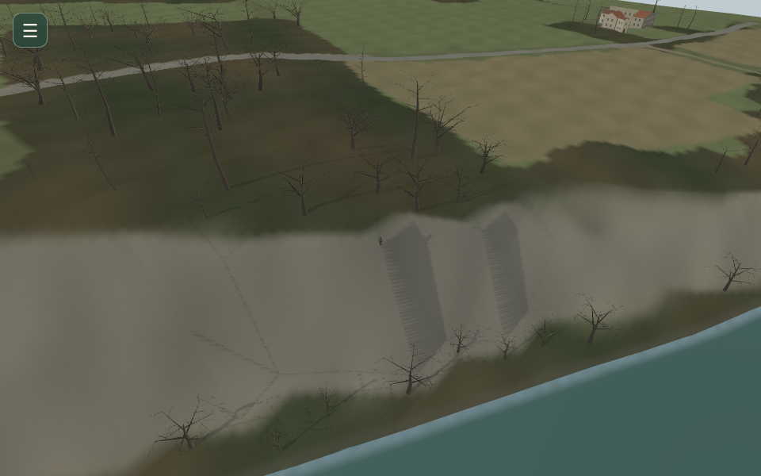
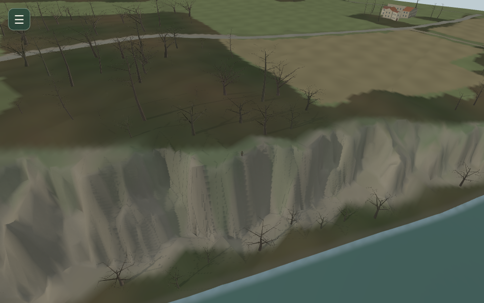
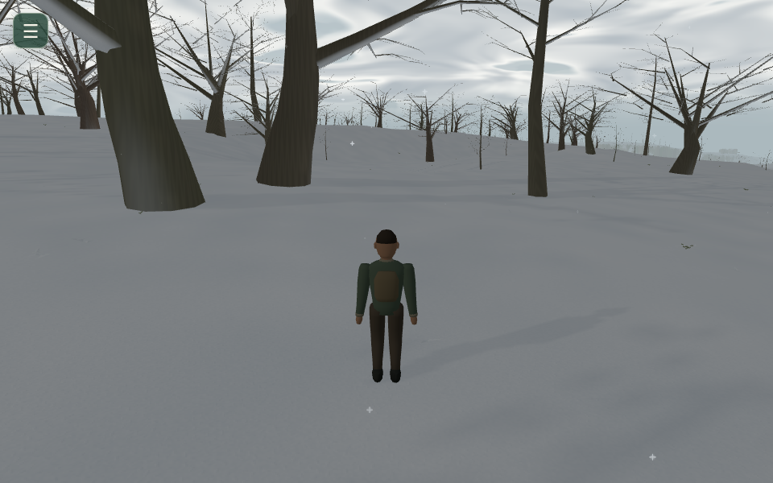
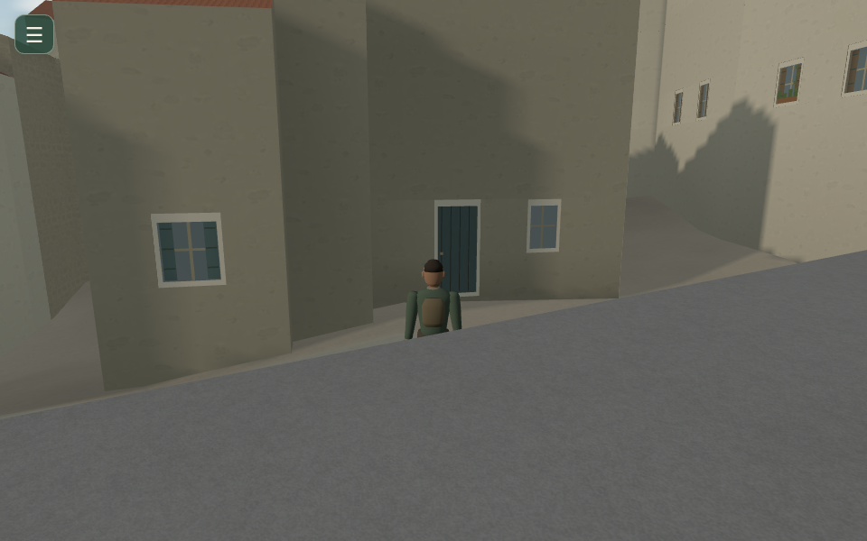
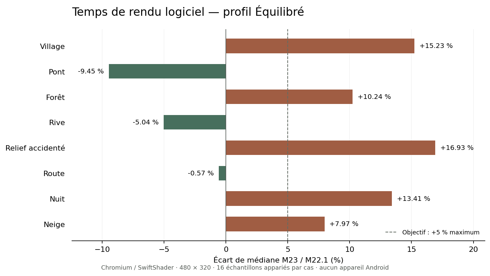

# Mission 23 — La vérité du terrain

Branche `mission/23-verite-du-terrain`, depuis le `main` vérifié
`6b17ce324319716cb15859d2195bd5362f603fbe`, fusion de la Mission 22.1 par
la PR #32. [PR #33 en brouillon](https://github.com/sebastienleidgens-lab/endless-earth/pull/33).
Budget supplémentaire : **0 €**. Aucune fusion, aucun déploiement, aucun
changement de Living Paintings / LP-01. Un seul jalon autonome.

**La validation complète des sept captures n’est pas atteinte : leurs originaux
ne sont pas joints.** Les réparations et preuves ci-dessous concernent des
zones effectivement auditées, sans prétendre retrouver ces sept caméras.
**L’acceptation globale reste partielle** : les bords de la chaussée inférée
Rue du Pont conservent des discontinuités proches d’un mètre ; les talus bâtis
restent approximatifs ; l’objectif de +5 % en Équilibré est dépassé dans cinq
scènes sur huit. Les succès de tests et de parcours ne ferment pas ces réserves.
[Galerie native](mission-23-evidence/index.html).

## 1. Les sept captures du propriétaire

Seul `Texte collé.txt` était fourni. Aucun original n’a été retrouvé dans les
pièces jointes ou le dépôt. Les horaires **18.32.44, 18.28.25, 18.24.18,
18.21.43, 18.21.13, 18.21.00, 18.15.17** ont chacun une fiche explicite dans
[owner-cases/cases.json](mission-23-evidence/owner-cases/cases.json).
Symptôme propre à l’image, géométrie candidate, matériau, caméra, coordonnées
et cause restent inconnus ; reproduction et correction restent `false`.
Les descriptions générales du texte ne sont pas attribuées arbitrairement
à un horaire. Aucune capture n’est présentée comme corrigée.

## 2. Inventaire géométrique et chaîne complète

Lecture d’AGENTS.md, de l’ADN artistique, des rapports 12–22.1 et des parties
géographiques, collisions, locomotion, budgets et chargements associées.
Les scripts et contrats historiques de préparation sont conservés.

| Étape | Propriétaire et risque de divergence |
| --- | --- |
| Source | Grille IGN API à 10 m, MNT LiDAR HD à 0,5 m, OSM ; repère X est/Z sud, IGN69. Le raster fin et la grille grossière n’ont pas la même résolution. |
| Préparation | `prepare-road-surface`, raffinement M14, sous-sol des ouvrages, correction M16/M22.1 puis dérivé M23 lié aux empreintes. Les anciens dérivés restent des replis. |
| Triangulation | Diagonale commune de grille, Delaunay local, partition routes/eau, quantification Float32 ; les résidus de découpe peuvent devenir dégénérés ou inversés. |
| Rendu | Un maillage terrain/routes/eau par tuile, ouvrages séparés et LOD fins/lointains. La neige et les matières ne déplacent pas les sommets. |
| Support | Anciennement exact seulement dans les limites de correction locale, puis retour à `sampleGrid`. M23 indexe tous les triangles visibles admis, sans copier leurs sommets. |
| Collision | Capsule de 30 cm, emprises OSM, murs patrimoniaux, eau, accès et garde-corps documentés. Les toitures ne sont pas des sols admis. |
| Navigation | Axes OSM et règles d’accès inchangés ; validation des segments dans les deux sens avec le vrai noyau. Aucun passage ni sommet de connexion inventé. |
| Animation | Racine au support commun ; pieds à portée de jambe, repos recentré, bassin borné. Un ancien appui hors de portée ne doit pas abaisser tout le squelette. |

Avant : **130 673 triangles fins**, dont 13 dégénérés et 10 inversés dans le
dérivé actif. Après : **149630 triangles fins**, zéro
face dégénérée/inversée, zéro sommet hors emprise de tuile dans l’audit.
23 résidus de quantification sont retirés, pour
0.000101152 m² projetés. Les fortes pentes ne sont pas supprimées.
[Inventaire avant](mission-23-evidence/geometry-before.json),
[après](mission-23-evidence/geometry-after.json).

## 3. Sources de hauteur et contrat commun

Chaque résultat détaillé fournit identifiant tuile/face, catégorie, hauteur,
normale, pente, géométrie, support, restriction, priorité, provenance,
empreintes et confiance. Les catégories terrain/route/eau restent distinctes.
L’eau n’est pas praticable ; un tablier validé possède un propriétaire séparé
au-dessus du terrain. Un toit n’est jamais sélectionné comme support piéton.
Les limites de précision source sont indépendantes de l’accord numérique rendu/support.

`Terrain.supportAt`, `walkingHeight`, `inspectCollision` et `inspectGround`
réutilisent les fournisseurs et buffers du monde. Le MNT reste consultable
comme référence de préparation, sans remplacer silencieusement un trou du
maillage actif par un ancien plan physique invisible.

## 4. Diagnostic des triangles aberrants

L’audit parcourt tous les triangles fins/lointains des quatre générations
historiques, puis le nouveau dérivé. Aire, orientation, normale géométrique,
allongement, dénivelé, cellule, emprise, matériau, eau, source et écart au
référentiel sont conservés. Une face de 20–30 m de dénivelé issue de la grille
grossière n’est pas automatiquement une erreur : certaines falaises sont réelles.
Les suspicions sont classées et gardées dans les JSON, sans filtre de pente destructeur.

L’[audit complémentaire des raccords](mission-23-evidence/seam-audit.json) examine
toutes les arêtes fines, les doublons projetés, les catégories de matériau et les
normales quantifiées. Les normales nulles/non unitaires passent de 1 825/2 815
à 0/0 après compaction et recalcul ; certains zéros antérieurs appartenaient à
des sommets inutilisés, donc ils ne prouvent pas à eux seuls un défaut visible.
Les arêtes exactes non manifold passent de 10 à 0 ; aucun triangle projeté
strictement dupliqué n’est trouvé. Une arête isolée n’est pas nécessairement
un trou : des partitions avec sommets intermédiaires sont continues.

**Le maillage n’est pas déclaré étanche ni tous ses raccords corrigés.** Les
sondes bilatérales conservent 112 arêtes avec un côté sans support terrain,
150 arêtes dont les plans voisins diffèrent de plus de 2 cm, et 12 paires
coïncidentes avec des hauteurs différentes. 271 des 274 suspicions sont dans
l’emprise héritée pont/approche ; une partie du sous-sol y est volontairement
découpée et le tablier reste un propriétaire distinct. Les bords de la chaussée
inférée de Rue du Pont conservent des discontinuités approchant **0,996 m**.
Les trois autres arêtes entourent un micro-vide préexistant d’environ 3 mm près
de X=-37, Z=194. Ces nombres sont des arêtes suspectes, pas un nombre de trous
ou de défauts tous confirmés. Les collisions refusent un support inconnu ; aucun
ancien MNT invisible n’est ajouté pour remplir ce micro-vide. Une reconstruction
transversale et les niveaux des accotements exigent une référence suffisante ;
ils ne sont pas inventés pour valider les tests de l’axe.

Les points hauts/bas du MNT à 10 m peuvent produire de grands plans artificiels
entre échantillons ; l’absence de résolution fine autour d’une rupture demeure
une limite. Les résidus inversés observés sont confirmés comme défauts de
topologie quantifiée, sans les assimiler aux triangles blancs des images absentes.

## 5. Grandes géométries : réparation à la source

**Neuf dalles IGN officielles** déjà référencées sont récupérées sans API payante,
avec leurs SHA-256 bruts inchangés. Acquisition 9 avril 2023, édition 24 janvier
2025, Lambert-93/IGN69, Licence Ouverte 2.0. Aucun nouveau nuage de points ou
relevé centimétrique n’est revendiqué.

Les **40 000 cellules** du pilote sont comparées au raster natif sur 16 sondes
par cellule. Une sélection fondée sur le dénivelé natif et l’erreur par rapport
à la grille prépare **758 cellules**, soit 75 800 m².
Les routes, bâtiments, patrimoine, eau et marges sont protégés. Les sommets
intérieurs sont confrontés au MNT ; les coins ne changent que si leurs quatre
cellules incidentes participent. Les limites extérieures restent raccordées.
Les arêtes partagées sont déterministes et simplifiées à 0,25 m de résidu.

Dans les cellules sélectionnées, sur des points réservés à la validation et distincts des nœuds de construction :
erreur moyenne **0.678 → 0.197 m**,
P95 **2.481 → 0.567 m**,
maximum **19.010 → 11.833 m**.
Le maximum restant aux raccords conservés interdit de revendiquer un relief
globalement exact. La scène nord-ouest montre la reconstruction native ; le
talus bâti protégé reste une limite visible. Aucun rocher, brouillard, texture
uniforme ou réduction de distance ne sert à cacher ces défauts.

## 6. Terrain visible et support physique

L’index réutilise les Float32/indices du rendu. Des sous-cellules sont préparées
uniquement dans les zones denses ; les triangles grossiers ne sont pas dupliqués
sur une grille fine globale. Stockage des références : **4549536 octets**,
sans nouvelle copie des sommets. Les réparations restent exactement au même LOD
fin à distance. Autour de la caméra et du joueur, le mécanisme existant conserve
la représentation fine ; la physique reste indépendante des changements de profil.

Le test exhaustif des centres de triangles vérifie l’accord du support avec le
maillage à moins d’un millimètre numérique. Cette concordance ne mesure pas
l’exactitude absolue du paysage. Les trous et surfaces non admises restent des refus. Les falaises naturelles sont aussi contrôlées transversalement, avec leur normale exacte et l’amplitude locale sur 60 cm ; une petite bordure biseautée reste franchissable. Les classes de route et d’escalier cartographiées gardent leur politique directionnelle documentée : une forte normale du MNT grossier ne suffit pas à annuler un escalier.

Hors des cellules réparées, les anciens LOD lointains conservent leur tolérance annoncée de 0,35 m. Cette approximation n’est pas une concordance centimétrique à distance ; le retour au maillage fin intervient autour de la caméra et du joueur avant tout contact.

## 7. Audit des collisions invisibles

**119831 sondes d’axe**, pas maximal 25 cm, et
**2424 parcours dirigés** sont contrôlés sur les
segments OSM admissibles dans le pilote. Avant/après :
**2313 / 2313 parcours physiquement achevés**.
Aucun nouveau segment n’a été inventé pour changer ces comptes.

Les refus échantillonnés sont attribués à bâtiments, accès, eau, maçonnerie
patrimoniale, garde-corps ou pont non validé. Aucun collider injustifié n’est
confirmé dans cette matrice ; cela ne prouve pas l’absence de tout obstacle
invisible dans des images ou positions inconnues. Les formes et identifiants
du collider sont maintenant inspectables. Les collisions légitimes sont conservées.

## 8. Contrôleur de terrain

Le balayage garde ses sous-pas de 10 cm, sa capsule de 30 cm et ses limites de
pente **0,7**, ou **1,2** sur les escaliers documentés. La marche maximale reste
**18 cm** : le contrôleur distingue le dénivelé du raccord de la progression
déjà effectuée sur la pente du palier. Cette séparation corrige un refus qui
variait avec la cadence ou la diagonale. La régression de la capsule future est également corrigée : un cas synthétique s’arrêtait à 0,40 m avant une marche alors que la capsule pouvait atteindre 0,60 m ; la marche est maintenant atteinte sans traverser le mur. La pente du palier est estimée seulement dans la partie libre, sans ajouter une seconde capsule au-delà de la cible. Le test M16 correspondant, qui imposait l’ancien arrêt anticipé, conserve ses cas mur/falaise et vérifie désormais la vraie limite du corps.

Une rampe durablement trop raide,
un mur, une grande rupture et un support inconnu restent bloquants.

Un petit cache de seize coordonnées exactes réutilise accès/support/pente
pendant un sous-pas. Il est réinitialisé avec la topologie ; aucune quantification
ne peut déplacer une limite de mur ou de tablier.

## 9. Montées et descentes

Tests en montée/descente, diagonale, 30/60/120 Hz, temps irréguliers et frames de
250 ms. Les mouvements suivent le support après acceptation. La descente
n’autorise pas de saut dans un vide ou de franchissement artificiel d’une falaise.
Le contrôleur ne possède pas une nouvelle simulation de chute ou de saut.

## 10. Escaliers, marches et bordures

Les petites marches, raccords inclinés, escaliers synthétiques, ruptures répétées
et fortes rampes sont séparés dans les tests. Le réseau réel comprend des axes
OSM `steps` : les parcours natifs utilisent leur support effectivement chargé.
Le MNT ne constitue pas un relevé de chaque contremarche. Les contraintes d’accès
des escaliers restent celles des sources ; aucun escalier décoratif n’est inventé.

## 11. Posture du promeneur

L’audit retrouve une cause reproductible dans le rig : un pied planté loin après
une course, un virage ou une frame lente pouvait abaisser le bassin pour rester
atteignable ; au repos seul Y revenait au sol. Les pieds reviennent désormais
à une position neutre en X/Z, les appuis hors de portée sont replacés sur un
support proche avant l’IK et le bassin reste entre 0,72 et 0,91 m dans ce rig.
Une hauteur inconnue ne devient pas une cible de jambe aberrante.

Les tests existants de semelle/appui à 4/8/30/60 Hz restent conservés et passent.
Une première tentative de simple borne de bassin a révélé une semelle hors cible
en course à 8 Hz ; le replacement préalable du contact corrige ce problème.
Le lien avec la capture assise absente reste **non établi**.

## 12. Objets et supports

La racine du joueur, les habitants, véhicules, animaux et placements runtime
réutilisent le fournisseur chargé. Les pieds de fondation gardent leur correction
bornée ; emprises, ouvertures et hauteurs architecturales ne sont pas déplacées.
Les détails naturels préparés reçoivent, une seule fois lors de leur installation,
le delta entre leur ancien support et le nouveau maillage. Leur préparation est
découpée en tranches de 1 024 sommets. Les formes surplombantes ne sont pas classées
comme des flottements sur la seule base de leur boîte englobante.

L’identification sémantique individuelle de chaque herbe, pierre, racine, lanterne
ou détail fusionné n’existe pas dans les anciens packs. Leur contact exhaustif
reste une limite ; aucun objet n’est supprimé pour masquer son ancrage.

## 13. Ancrage des végétaux

Les **2 500 identités initiales et 1 389 ajouts forestiers** sont conservés,
avec X/Z, échelle et catégories d’origine. Les packs sont validés avant toute
adaptation d’altitude. Arbres et sous-bois interrogent le sol actif ; changer
de LOD, de mois ou de neige ne change pas leurs coordonnées physiques.
L’inspection native trouve **165 altitudes adaptées**, zéro support inconnu et **0 m** d’écart aux 3 889 points d’ancrage. Les racines restent une géométrie artistique simplifiée, pas une fouille du sol.

## 14. Routes

Les axes, largeurs, classes, droits d’accès et surfaces routières précédentes
restent conservés. La Rue du Pont et le tablier gardent leur reconstruction
M22.1 et leurs fournisseurs exacts. La mission ne reconstitue pas une route
absente et ne remplace pas une restriction privée par une voie publique.

## 15. Raccords et pont

Les minuscules faces invalides de quantification sont éliminées du nouveau
dérivé, y compris celles de l’eau ; aucune paroi de forte pente valide n’est
retirée sur ce critère. Le sous-sol ne reprend pas une ancienne rampe au-dessus
du tablier. Les tests M22.1 de la Rue du Pont et des garde-corps restent présents.

Traversée native aller/retour : **310.826 s**, fin atteinte : True, 0 frame(s) invalide(s), écart support maximal 0.000000 m. Un seul placement initial sur l’axe source ; le script règle le cap, les déplacements utilisent W puis Shift+W. [Film](mission-23-evidence/pont-native.webm) et [trace](mission-23-evidence/pont-native.json).

## 16. Textures et matériaux

Atlas, UV métriques, affectations de matériaux, albédo de façade, filtres et
mipmaps restent ceux des missions précédentes. Les normales du dérivé réparé
sont régénérées sur sa vraie géométrie. Le décodeur vérifie les types des
attributs/indices et l’orientation des faces du nouveau dérivé. Aucun shader
de camouflage ou nouvelle palette n’est ajouté. Les triangles blancs des
sept images ne peuvent pas recevoir de cause certaine sans leurs originaux.

## 17. Avec et sans neige

**24 paires**, 12 stations : pont, Rue du Pont, rue/façade, forêt, berge,
pente, château, talus, relief nord-ouest, raccord, objets et vallée.
Caméra absolue, heure, date, profil Équilibré et résolution 960 × 600 sont
appariés avant/après. Le dépôt est verrouillé à 0 puis 1 en mode diagnostic
pour empêcher une neige résiduelle de fausser le cas « sans neige ».
La neige ne déplace aucun sommet ou collider. Exposition et éclairage sont
recalculés sur le vrai nouveau maillage ; les anciens dérivés incompatibles
ne sont pas simplement réétiquetés. Les scènes manquantes du propriétaire
ne sont pas remplacées par ces stations. La galerie statique peut aussi être
ouverte directement depuis `docs/mission-23-evidence/index.html` après récupération
du dépôt, sans hébergement ni déploiement.

| Station de contrôle | Avant M22.1 | Après M23 |
| --- | --- | --- |
| Relief nord-ouest, confrontation au MNT |  |  |
| Forêt sous neige |  |  |
| Raccord, occlusion conservée |  |  |

## 18. Audit géographique général et navigation

La sélection couvre tout le pilote et respecte les exclusions spatiales.
Les graphes publics gardent **916 nœuds / 893 arêtes** pour la marche et
**1 103 / 1 106** pour les destinations, comme la référence M22.1.
Ils sont régénérés avec contrôle bidirectionnel par le vrai moteur et liés
aux nouvelles empreintes. Les habitants réutilisent les corrections de
support et du noyau qui leur sont applicables ; leurs règles d’admission
particulières restent conservées.

## 19. Diagnostic de blocage et export

Uniquement avec `?perf=1`, le menu propose **Inspecter le terrain**, **Inspecter
le dernier blocage** et **Exporter le diagnostic**. Activer l’inspection, fermer
le menu, cliquer sur une face puis rouvrir le menu pour lire/exporter.
La sélection montre face, sommets, normale, LOD, matériau, provenance, support
et collider ; le dernier refus inclut position précédente/demandée/autorisée,
direction, vitesse, dénivelé, pente et règle exacte. Les lignes affichent le
collider et les trajectoires. Export JSON local seulement, sans télémétrie externe.
L’interface ordinaire ne reçoit pas de panneau technique permanent.

## 20. Benchmarks

Chromium / **SwiftShader logiciel**, 480 × 320, DPR 1 ; huit scènes × trois
profils, seize échantillons alternés appariés par cas/version après chauffe,
caméra/temps/météo/lumière identiques, synchronisation `gl.finish`. Aucune autre
campagne graphique pendant ce benchmark. CPU support/collisions/mouvement,
allocations logiques, appels, triangles, tas et démarrages locaux sont conservés
dans [performance.json](mission-23-evidence/performance.json). Les allocations
WebGL instrumentées ne sont pas de la VRAM physique ; les démarrages de
développement ne sont pas un débit Internet ou une mesure Android.

| Scène | Profil | M22.1 médiane ms | M23 médiane ms | Écart | P95 M23 ms |
| --- | --- | ---: | ---: | ---: | ---: |
| village | eco | 247.0 | 267.2 | +8.18 % | 294.9 |
| village | balanced | 316.5 | 364.7 | +15.23 % | 404.9 |
| village | quality | 307.0 | 341.8 | +11.34 % | 452.4 |
| pont | eco | 192.8 | 191.2 | -0.83 % | 240.0 |
| pont | balanced | 293.1 | 265.4 | -9.45 % | 364.5 |
| pont | quality | 306.6 | 314.1 | +2.45 % | 380.6 |
| foret | eco | 118.7 | 144.7 | +21.90 % | 173.3 |
| foret | balanced | 205.0 | 226.0 | +10.24 % | 262.0 |
| foret | quality | 223.9 | 248.8 | +11.12 % | 298.4 |
| rive | eco | 313.6 | 325.3 | +3.73 % | 406.8 |
| rive | balanced | 422.6 | 401.3 | -5.04 % | 482.4 |
| rive | quality | 413.3 | 448.0 | +8.40 % | 520.7 |
| terrain | eco | 110.3 | 126.2 | +14.42 % | 154.0 |
| terrain | balanced | 173.1 | 202.4 | +16.93 % | 236.5 |
| terrain | quality | 166.8 | 193.4 | +15.95 % | 223.9 |
| route | eco | 227.0 | 234.9 | +3.48 % | 264.7 |
| route | balanced | 331.8 | 329.9 | -0.57 % | 370.7 |
| route | quality | 362.6 | 342.4 | -5.57 % | 410.9 |
| nuit | eco | 249.8 | 263.7 | +5.56 % | 314.5 |
| nuit | balanced | 359.5 | 407.7 | +13.41 % | 448.9 |
| nuit | quality | 308.2 | 307.9 | -0.10 % | 397.5 |
| neige | eco | 95.2 | 110.2 | +15.76 % | 135.3 |
| neige | balanced | 148.1 | 159.9 | +7.97 % | 196.7 |
| neige | quality | 162.5 | 186.9 | +15.02 % | 269.6 |

Objectif de +5 % en Équilibré : **non atteint**. 5/8 scènes dépassent ce seuil ; médiane des écarts +9.11 %, pire cas +16.93 %. Ces rendus logiciels ne permettent pas de conclure sur Android. Le relief fin ajoute des triangles et le support exact ajoute du travail CPU ; la simplification des arêtes a déjà réduit de 22 606 faces le premier candidat. Les résultats initiaux restent archivés séparément.



| Scène Équilibré | Appels avant → après | Triangles avant → après | Buffers Mio avant → après | Textures Mio avant → après | Tas Mio après |
| --- | ---: | ---: | ---: | ---: | ---: |
| village | 95 → 95 | 184335 → 198953 | 22.45 → 22.74 | 23.95 → 23.95 | 258.9 |
| pont | 87 → 87 | 149491 → 156986 | 38.41 → 38.77 | 23.95 → 23.95 | 209.1 |
| foret | 45 → 45 | 143313 → 158686 | 40.47 → 40.90 | 23.95 → 23.95 | 221.4 |
| rive | 165 → 165 | 304920 → 310149 | 53.19 → 53.56 | 23.95 → 23.95 | 218.8 |
| terrain | 39 → 39 | 45301 → 54990 | 51.48 → 53.19 | 23.95 → 23.95 | 229.7 |
| route | 96 → 96 | 180551 → 188046 | 52.02 → 52.45 | 23.95 → 23.95 | 219.1 |
| nuit | 102 → 102 | 234489 → 249107 | 54.90 → 55.33 | 22.62 → 22.62 | 228.9 |
| neige | 46 → 46 | 97539 → 112912 | 52.85 → 56.21 | 25.96 → 25.96 | 225.3 |

| Scène Équilibré | Support µs/requête avant → après | Collision µs/requête avant → après | Déplacement µs/essai avant → après |
| --- | ---: | ---: | ---: |
| village | 36.95 → 27.10 | 29.20 → 28.20 | 149.50 → 1.50 |
| pont | 31.40 → 33.30 | 33.75 → 31.40 | 150.00 → 0.50 |
| foret | 29.65 → 33.90 | 29.30 → 30.20 | 150.50 → 2.50 |
| rive | 29.70 → 34.90 | 30.40 → 31.65 | 182.50 → 36.00 |
| terrain | 29.85 → 31.05 | 33.75 → 33.60 | 257.00 → 36.00 |
| route | 29.05 → 29.50 | 27.15 → 30.30 | 133.50 → 3.00 |
| nuit | 26.40 → 28.20 | 25.40 → 26.50 | 125.50 → 1.50 |
| neige | 26.55 → 28.10 | 26.50 → 29.35 | 128.50 → 1.00 |

Les lots CPU utilisent cinq répétitions de 2 000 requêtes de support/collision et
200 essais de déplacement au même point initial. Les petits déplacements répétés
bénéficient fortement du cache exact ; ils ne représentent pas un coût CPU par
frame de promenade et n’établissent pas une hausse de vitesse du joueur.
Le temps `gl.finish` inclut le rendu logiciel ; aucun compteur GPU matériel
indépendant n’est disponible. P95 et pic coïncident pour ce quantile sur seize
échantillons ; les échantillons bruts sont conservés.
Démarrage local de développement apparié : 8774 → 7723 ms, une seule ouverture par version, sans extrapolation à un chargement réseau.

## 21. Parcours physiques et films complémentaires

Matrice des axes : pont, rue, chemin étroit, raccord, pentes et escaliers
documentés, dans les deux sens. Trois compléments ciblent aussi une berge sur un axe OSM existant, une forêt OSM et une cellule naturelle réellement réparée. Le dernier est un segment de déplacement libre, sans création d’un chemin public ou d’une arête de graphe. Les autres traversées du territoire se trouvent
dans la promenade et les stations visuelles ; aucune caméra fixe n’est présentée
comme un parcours physiquement accompli.

- **pente-marche-course** : 74.24 s, fin atteinte : True, frames invalides : 0, écart support : 0.000000 m.
- **escalier-documente** : 44.67 s, fin atteinte : True, frames invalides : 0, écart support : 0.000000 m.
- **sentier-neige** : 114.67 s, fin atteinte : True, frames invalides : 0, écart support : 0.000000 m.
- **raccord-arret-reprise** : 55.99 s, fin atteinte : True, frames invalides : 0, écart support : 0.000000 m.
- **berge-admissible** : 73.50 s, fin atteinte : True, frames invalides : 0, écart support : 0.000000 m.
- **foret-aller-retour** : 104.82 s, fin atteinte : True, frames invalides : 0, écart support : 0.000000 m.
- **terrain-naturel-repare** : 32.44 s, fin atteinte : True, frames invalides : 0, écart support : 0.000000 m.

Les scénarios sont distincts de la promenade principale. Les films sont issus
du canvas et de l’AudioContext natifs ; MediaRecorder puis indexation WebM sans
création d’images ni accélération. Les sources brutes restent dans `work/`.

## 22. Promenade native prolongée

**1811.429 s réelles, 1809.961 s natives, 1390.82 m, 6526 frames**. Trois profils et trois vues ; montées/descentes, arrêts/reprises, course au clavier, AutoWalk, forêt, terrains ouverts, pluie, neige et nuit. Erreurs JS : 0, erreurs GL : 0, frames de collision invalide : 0, écart maximal au support : 0.000000 m. Cadence instrumentée SwiftShader, médiane / P95 / pic : 167.2 / 794.5 / 2231.2 ms. Les travaux de validation concurrents et la lecture des pixels font partie de cette mesure ; elle n’est pas le benchmark isolé. Les sources sont vérifiées inchangées : 0 différence(s), candidat `8d9a5ccde1af18a8f124ce5b5b0929259701a7e4`. Immobilisations demandées d’au moins vingt secondes : 0. Le bassin reste entre 0.720 et 0.886 m ; ces mesures du rig ne prouvent pas la disparition de la posture de l’image absente.

Analyse indépendante de la trace : **48.52 m de montée cumulée, 27.74 m de descente**, 11 arrivées, 3362 frames à moins de 40 m de la rivière, distance minimale 2.65 m. Demandes manuelles : 6 frames, dont 2 de course ; cette brève séquence complète les films de pente et de pont, plus longs. Aucun blocage demandé de vingt secondes. Tas après GC : 217.8 → 230.1 Mio, plage 207.1–235.8 ; buffers WebGL logiques : 17.3 → 59.3 Mio, maximum échantillonné 59.3 Mio. Streaming, profils et populations évoluent pendant la marche ; cette hausse ne suffit pas à démontrer une fuite ou son absence. Les événements LOD individuels ne sont pas exportés par ce journal : leur invariance est vérifiée par les tests et stations, sans inventer un compteur de bascules. [Analyse complète](mission-23-evidence/walk-analysis.json).

Un [premier lancement de scénario](mission-23-evidence/initial-off-corridor.webm) est resté immobile après une course manuelle au cap constant, puis a été écarté ; il ne sert pas de preuve de trente minutes. Le scénario final suit les sommets source pendant cette séquence au clavier. Un lancement exploratoire ultérieur a été interrompu volontairement avant la correction finale de capsule ; aucune de ses minutes n’est ajoutée à la session finale.

La couverture réelle est vérifiable dans [walk.json](mission-23-evidence/walk.json)
et sa trace. La traversée du pont est une session complémentaire explicitement
séparée : elle n’est pas revendiquée dans les trente minutes si la trace ne la
contient pas. Les redémarrages d’AutoWalk partent de la même position ; aucune
téléportation de réparation n’est autorisée. Une immobilisation n’est pas
convertie en distance parcourue. Les refus et phases actives sont conservés
pour rechercher des arrêts prolongés.

## 23. Compatibilité mobile

Chromium tactile **390 × 844** : déplacement réel de **9.658 m**, regard, menu et profil ; débordement horizontal : False, erreurs JS : 0. [Mesure et film](mission-23-evidence/mobile.json). Aucun appareil Android physique disponible.

## 24. Tests, préservation et reproduction

**342 tests Node réussis, zéro échec**, TypeScript/Vite réussis sur le candidat
runtime. La galerie, ses liens, ses 24 paires et les 13 vidéos sont vérifiés dans [evidence-validation.json](mission-23-evidence/evidence-validation.json) ; les paquets vidéo et leurs timestamps sont identiques aux captures natives brutes. Le bundle de production est testé localement sur quatre formats dans [compiled-validation.json](mission-23-evidence/compiled-validation.json), sans déploiement. Les contrôles finaux et journaux sont archivés avec la livraison dans [checks.json](mission-23-evidence/checks.json), [tests](mission-23-evidence/tests-final.txt) et [build](mission-23-evidence/build-final.txt).
Les nouveaux tests couvrent chaque centre de triangle actif, orientation,
LOD, sources, trous, eau, superpositions, types, marches selon la cadence,
refus légitimes, navigation bidirectionnelle et repos du rig. Les tests
historiques restent présents, y compris appuis à cadence très basse. Une assertion M16 qui imposait précisément l’arrêt anticipé erroné devant une bordure est corrigée pour exiger la progression jusqu’à la vraie limite ; les cas de mur, falaise et pente restent bloquants et testés.

Les fichiers IGN/OSM, raffinement antérieur, ouvrages et assets audio historiques
restent inchangés. La vérification indépendante inspecte 605 fichiers publics historiques, dont 599 strictement protégés ; les graphes décodés restent identiques et les trois fichiers de terrain régénérés sont identiques octet pour octet. Voir [préservation](mission-23-evidence/preservation.json) et [déterminisme](mission-23-evidence/determinism.json). Les anciens packs de décor restent disponibles ; seuls leurs
contrats de transformation runtime et les caches effectivement régénérés évoluent.
L’éclairage, soleil, Lune, météo, familles, voitures, son, profils adaptatifs et
commandes gardent leurs propriétaires. Aucune nouvelle fonctionnalité artistique.
Le bundle conserve son avertissement Vite de taille supérieur à 500 ko.

```sh
npm ci
npm test
npm run build
npm run dev -- --port 5373
# Jeu : /endless-earth/?perf=1
# Galerie : /endless-earth/docs/mission-23-evidence/index.html
python scripts/fetch-mission-23-mnt.py
# Python : numpy, rasterio, pyproj, scipy, shapely
python scripts/prepare-mission-23-terrain.py
node scripts/prepare-mission-23-surface.mjs
node scripts/prepare-mission-23-bindings.mjs
node scripts/prepare-mission-23-graph.mjs
node scripts/prepare-mission-23-light.mjs
node scripts/prepare-mission-23-snow.mjs
node scripts/audit-mission-23-traversal.mjs
```

Pour la référence, `git archive 6b17ce3` de src/public/build/config/package
dans `work/mission-23/base`, dépendances communes, Vite 5371. Captures via
`capture-mission-23.mjs before/after`, benchmark isolé via `bench:mission-23`.
La promenade utilise une copie **figée** du candidat servie sur 5375 ; les
empreintes sont vérifiées avant/après. Les scripts ne fusionnent ni ne déploient.

## 25. Limites et tableau d’acceptation

Les sept originaux manquent. Les bords de Rue du Pont conservent des discontinuités géométriques héritées approchant un mètre, même si son axe est praticable. Certains raccords de relief conservent plus de onze mètres
d’erreur locale au raster natif ; les zones bâties/protégées et les formes
2,5D sans surplomb ne deviennent pas un relevé fidèle par un succès numérique.
La scène du talus protégé reste clairement visible et n’est pas déclarée corrigée. La station fixe de raccord conserve aussi une forte occlusion du bas du personnage par la chaussée au premier plan ; l’accord de hauteur au centre de l’avatar ne démontre pas la correction de cette vue ni de toute la caméra. Les deux images restent dans la galerie.
L’audit des axes ne prouve pas l’absence de tout obstacle hors réseau. Le contact
de chaque objet fusionné et la beauté sur appareil physique restent à vérifier.

| Objectif | État | Preuve et limite |
| --- | --- | --- |
| Sept captures originales retrouvées, reproduites et corrigées | **Non atteint** | Originaux absents ; sept fiches honnêtes, aucune caméra inventée. |
| Audit systématique des maillages et du territoire | **Atteint** | Quatre générations, fin/lointain, 40 000 cellules et neuf dalles source. |
| Réparation des grandes approximations géométriques | **Partiellement atteint** | 758 cellules confrontées au MNT, rendu natif ; limites protégées et erreurs de raccord restantes. |
| Suppression des faces invalides confirmées | **Atteint** | 23 résidus, aucune face dégénérée/inversée du nouveau dérivé ; pas de suppression par pente. |
| Concordance visible/support, ponts et LOD | **Atteint** | Buffers partagés, propriétaires explicites, trous conservés, tests exhaustifs et parcours natifs. |
| Suppression de tous les obstacles invisibles du propriétaire | **Partiellement atteint** | Audit attribué et diagnostics livrés ; aucune association possible aux positions absentes. |
| Locomotion pentes/marches et protections légitimes | **Atteint** | Cadences, diagonales, descentes, ruptures, murs/eau et marches ; seuils conservés. |
| Suppression de la posture anormale de la capture | **Partiellement atteint** | Cause de rig reproduite et corrigée en tests ; lien avec cette capture non établi. |
| Arbres et objets ancrés | **Partiellement atteint** | 3 889 identités conservées et supports adaptés ; contact exhaustif des détails fusionnés non démontré. |
| Raccords et triangles blancs des images | **Partiellement atteint** | Topologie invalide nettoyée ; bords hérités jusqu’à 0,996 m et micro-vide conservés ; pixels des originaux inconnus. |
| Neige sans nouvelle géométrie et comparaisons natives | **Atteint** | 24 paires appariées, exposition réellement recalculée. |
| Navigation et habitants | **Atteint** | Graphes physiques régénérés, comptes conservés, support commun et noyau partagé. |
| Objectif de +5 % Équilibré | **Non atteint** | Matrice logicielle détaillée ; dépassements mesurés et expliqués, aucun GPU physique. |
| Parcours natifs et promenade de trente minutes | **Atteint** | Durées et couvertures réelles dans les traces ; pont complémentaire distingué. |
| Tactile et Android physique | **Partiellement atteint** | Flux Chromium tactile ; matériel Android indisponible. |
| Compilation, tests et sources protégées | **Atteint** | 342 tests, build, contrats et dérivés reproductibles ; aucune fusion ou production. |
| Confiance globale et agrément artistique | **Partiellement atteint** | Réparation vérifiable, mais originaux manquants, raccords incertains et validation humaine restante. |
