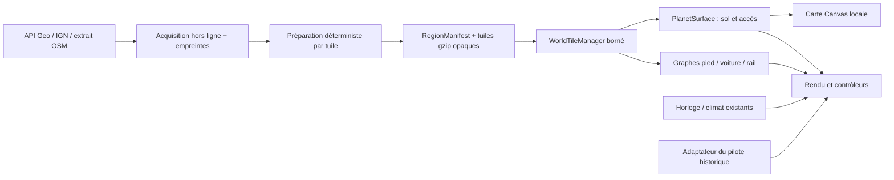

# Mission 26 — architecture et audit de réutilisation

Le nouveau moteur consomme des coordonnées et des données déclaratives. La Vienne est une configuration et un jeu de données ; le pilote conserve son adaptateur historique. **L’architecture mondiale complète n’est pas validée** : origine flottante intégrée, hiérarchie de relief lointain, préparation entièrement coopérative et transport continu restent ouverts.



## Contrats et responsabilités

| Module | Classement | Responsabilité / dépendances / risque |
| --- | --- | --- |
| `src/planet/contracts.ts` | Universel, contrats | Manifeste et fournisseurs substituables : relief, sol, eau, routes, rail, aviation, bâtiments, biome, climat, trafic, graphe, carte. Toutes les implémentations spécialisées ne sont pas livrées. |
| `coordinates.mjs` | Universel + adaptateurs | Lambert-93 et projection tangentielle limitée ; conservation du repère X est / Z sud du pilote. Altitudes typées, refus du mélange implicite des références. Projection locale hors France démontrée sur données synthétiques. |
| `FloatingOrigin` | Universel, testé séparément | Notifications atomiques et rollback. **Non raccordé à toutes les entités du jeu existant** ; aucune stabilité Float32 mondiale prétendue. |
| `tile-manager.mjs` | Universel | Deux requêtes simultanées, sélection sous budget, empreintes avant installation, annulation, déchargement et reprise explicite. Échec = absence de support. Pas de cache disque persistant. |
| `surface.mjs` | Universel | Même diagonale de grille pour hauteur et terrain, normales, index spatial, accès, obstacles, eau et provenance. Les transformations et la quantification du rendu du pilote restent des adaptations à auditer. |
| `network.mjs` | Universel | Identités de nœuds source, sens uniques, propriétaires multiples, fermeture des ouvrages non vérifiés. Itinéraires seulement dans les graphes chargés ; pas de réseau départemental fin chargé intégralement. |
| `car.mjs` | Universel | Modèle bicyclette léger, inertie, freinage, marche arrière et balayage de coque ; support inconnu et rupture verticale arrêtent le véhicule. Simplifications : adhérence uniforme, pas de suspension détaillée ni vraie boîte de vitesses. |
| `render.ts` | Universel, adaptation visuelle | Terrain échantillonné, voies, bâtiments de hauteur documentée ou inférée, végétation sur occupation cartographiée ; géométries regroupées. Le bâti proche reste une extrusion simple ; toiture/façade fidèle non revendiquée. |
| `transport-motion.mjs`, `transport.ts` | Universel, partiel | Trains régionaux/fret sur rails admis, arrêt avant fin de corridor ou croisement inconnu ; aéronef original sur un scénario synthétique lié à une piste source. Exploitation complète, gares, taxiways et audio dédiés non livrés. |
| `map.ts`, `save.mjs` | Universel, partiel | Carte sans hôte externe, position WGS84, couches, zoom, déplacement et sauvegarde validée. Reprise bateau refusée si non revalidable ; itinéraires cartographiques et état complet du camp non livrés. |
| `runtime.ts` | À adapter / intégration | Raccord au pilote, voiture, carte et résidence. URL, projection, datum et emprise historique passent par configuration. La représentation 3D reste dans le repère historique adapté : ce n’est pas encore un moteur mondial à origine mobile. |
| `src/main.ts` | Spécifique au pilote, adapté | Conserve le propriétaire du joueur, du climat, des sons et des activités. Délègue les appuis extérieurs, les actions et le streaming ; ne remplace pas les collisions M23 dans le pilote. |
| `src/world/*`, `src/living/*` | Mixte, conservé | Terrain fin, supports/ouvrages validés et navigation historique gardés ; limites à ±1 km spécifiques au pilote derrière l’adaptateur. Une migration universelle exhaustive n’a pas été réalisée. |
| `src/character/*` | Universel, corrigé | Phase liée à la distance acceptée ; raccord de pied Hermite entre appui et récupération, contrainte de portée des deux côtés de la transition. Squelette et géométrie originaux conservés. Naturel perceptif à valider. |
| `src/earthlife/fauna*`, `src/nature/sky.ts` | Universel, corrigé | Trajectoires analytiques par image, phase par identité, suppression de l’extrapolation par tick, orientation tangentielle et individualité. Découverte de l’habitat reste à cadence bornée. |
| `src/lighting/*`, matériaux de nature | Universel, corrigé / à mesurer | Réception identique entre LOD, caster canonique, vent partagé et rafraîchissement plus fréquent, projection stabilisée au texel. Coût supplémentaire et qualité visuelle non validés sur GPU. |
| `src/player/packraft*`, `water-*` | Universel, étendu | Suivi par commandes de pagaie/lacet, reprise manuelle, refus des obstacles, pose/contact partagés et effets poolés. Le réseau utilisé demeure celui des eaux admises du pilote. |
| Scripts d’acquisition France | Adaptateurs source | HTTP ouvert, cache brut hors dépôt, empreintes et reprise. Le script France n’est pas présenté comme un acquéreur mondial universel. |

Ce tableau est un audit des systèmes touchés et de leurs contrats, **pas une certification ligne par ligne de chaque module historique**. Aucun module historique complet n’a été réécrit pour créer un second village.

## Budgets et limites

Le manifeste permet 16 tuiles ; l’intégration en demande au plus 12, sous **32 Mio de JSON décodé**, avec deux téléchargements actifs. Les graphes et objets se libèrent avec leurs propriétaires. Ce plafond ne mesure ni toute la heap, ni les buffers de rendu, ni la VRAM. Les coûts de préparation et de reconstruction des lots peuvent encore bloquer le thread principal ; l’objectif de quelques millisecondes par tranche n’est pas considéré atteint.

Les bâtiments sont émis directement dans des buffers par cellule, sans créer un `ExtrudeGeometry` et un objet par maison. Leur génération graphique est limitée au voisinage pertinent. Les empreintes source restent propriétaires des collisions ; aucune route ou permission n’est inventée pour terminer un trajet.

Le fixture `fixtures/planet.html` emploie les mêmes chargeur, surface et rendu sur quatre tuiles synthétiques près de 47°N / 71°O, avec une projection locale et un datum de test distinct. Il prouve une substitution technique, **pas la reconstruction d’une deuxième région réelle**.

## Reproduction

```sh
node scripts/prepare-planet-fixture.mjs
node --test tests/planet.test.mjs
npm run dev -- --port 5380
# /endless-earth/fixtures/planet.html
```
