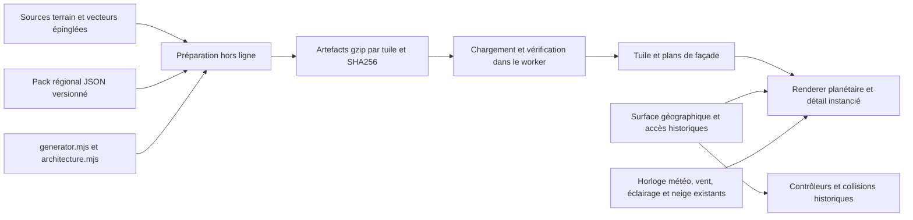

# M27 — Architecture réalisée et limites

La base vérifiée est `1d330cab93847a4026194088c60d378c71c0b8f7`, fusion de la PR #38 dans `main`. L'enrichissement est une couche artistique additionnelle. Les sources géographiques M26.4, le support, les refus d'accès et le propriétaire historique d'Angles restent les autorités existantes. La portabilité complète du jeu reste **PARTIELLE** : les nouveaux générateurs sont paramétrables, mais le point d'entrée de l'application conserve le cadre historique d'Angles.

## Chaîne active et contrats

La source physique n'est jamais dérivée d'une fenêtre ou d'une plante décorative. Un artefact artistique manquant ou corrompu produit un état explicite de fallback ; il ne crée aucun support et n'ouvre aucun passage. Le manifeste artistique séparé référence le SHA du pack géographique correspondant. Il n'est pas nécessaire de modifier le manifeste de source historique pour ajouter une version artistique.

| Contrat | Implémentation | Portée et limite |
|---|---|---|
| `regional-enrichment-pack-v1` | `src/enrichment/contracts.ts`, packs JSON | Palette, façade, toiture, habitats, densité et types de détails déclaratifs. Les champs climat décrivent le contexte ; ils ne constituent pas un nouveau moteur climatique. |
| `world-enrichment-v1` | `generator.mjs` | Plans de bâtiments et décorations à coordonnées métriques canoniques, provenance et audit. Aucun collider ou droit de passage. |
| Plans d'architecture | `buildArchitecture`, `architectureTriangles` | Empreinte source conservée ; volumes, ouvertures visuelles et toit générés. Hauteur/style inférés lorsque les attributs manquent ; aucun intérieur visitable certifié. |
| `world-enrichment-manifest-v1` | `manifest.mjs`, préparation | Entrées avec SHA source/artefact, tailles comprimée/décodée et dépendances. |
| Vérification et chargement | `load.mjs`, worker existant | Limites d'octets, SHA256, schéma, état `verified` ou `fallback`. La présence d'un plan ne prouve pas qu'il a été rendu. |
| Détails de proximité | `src/enrichment/render.ts` | Géométries partagées, instances, même vent/horloge et casters. Ancrage sur le support rendu existant ; pas de collision pour l'herbe ou les petits débris. |
| Coordonnées historiques | `src/planet/coordinates.mjs` | Lambert93/IGN69 et adaptateur fixe du pilote préservés. |
| Coordonnées mondiales nouvelles | ECEF/ENU WGS84 et cellules angulaires | Contrats numériques testés, sans migration automatique des données Vienne ni de la boucle du jeu. |

Le vocabulaire canonique de preuve est `observed`, `source-derived`, `inferred`, `procedural-decorative`, `unverified`, `restricted`. Un toit ou une ouverture procédurale ne devient pas une observation parce que sa position dépend d'une empreinte OSM.

## Identité, génération et propriétaires

L'identifiant du bâtiment reprend la clé source ; le plan possède une identité versionnée distincte de sa représentation. Les détails utilisent une grille métrique canonique et des grappes le long des voies/berges sources. Les ancres de corridor suivent l'abscisse curviligne complète de l'objet source, avec jitter déterministe et propriétaire dans l'emprise semi-ouverte de la tuile. Le profil graphique et le LOD ne participent pas à la graine. Le namespace de coordonnées doit identifier le CRS, son origine lorsque nécessaire et le datum ; les mêmes valeurs métriques dans deux repères différents ne désignent pas le même endroit.

Les candidats sont rejetés près des bâtiments, routes, voies ferrées, surfaces d'aviation, barrières et eau, ainsi que dans les emprises protégées et accès connus interdits. Le pipeline utilise les habitats effectivement cartographiés. Une zone sans habitat connu conserve une lacune explicite. Un champ ouvert n'est pas rempli artificiellement de bâtiments ou de plantes urbaines. Les grappes ont jusqu'à 16 éléments dans un rayon de 3,2 m ; le plafond de 512 détails et le compteur `unprocessedCorridorAnchors` rendent explicites les omissions. Ce premier enrichissement n'est pas une couverture dense et continue des sols.

La préparation calcule les dépendances source/règles/pack/options. Une entrée non modifiée peut être réutilisée après vérification du fichier. `--verify` compare deux générations de chaque tuile et vérifie aussi l'égalité du cache réutilisé. Modifier une règle partagée invalide légitimement toutes les tuiles dépendantes ; modifier une seule source ne doit pas invalider les autres. La couverture produite reste distincte de la couverture observée dans le navigateur.

Les géométries du pilote sont exclues de cette couche. Les variantes décoratives ne remplacent ni les arbres/colliders historiques, ni les supports routiers ou aquatiques, ni les monuments déjà présents. Les fenêtres sont un détail visuel de façade et ne promettent aucun accès intérieur. Les activités existantes continuent à consulter les mêmes propriétaires physiques.

## Streaming et mémoire

Le gestionnaire M26.4 conserve sa file de chargement annulable, ses délais, ses erreurs, son installation sérialisée et ses limites de résidence. Les plans de bâtiments suivent les lots de features acquittés du worker afin de ne pas envoyer tout un centre-ville dans un seul message. Le sidecar artistique ajoute sa taille décodée au budget déclaré ; ce compteur de taille JSON ne mesure pas le tas réel de JavaScript.

Le budget historique est de 12 tuiles et 96 Mio de géographie résidente, deux requêtes concurrentes. Il exclut notamment le pic du worker, les objets JavaScript, les tableaux intermédiaires, les géométries, textures, audio et mémoire GPU. Le nouveau coût artistique s'ajoute donc au coût du monde, et les cibles de fluidité ne sont pas acquises par ce seul plafond.

Les détails sont plafonnés par tuile et groupés par famille. Une matrice d'instance occupe 64 octets sur le GPU : 512 détails représentent environ 32 Kio de matrices par tuile, soit 384 Kio pour 12 tuiles. Cette estimation exclut géométries partagées, buffers CPU, objets, ombres et pilote. Une géométrie non indexée à positions/couleurs/normales Float32 représente 108 octets par triangle ; les attributs de fondu ajoutés (`enrichmentFacade`, `enrichmentWall`) portent le buffer de bâtiment actuel à environ 156 octets par triangle, hors tableaux temporaires et driver. Ces formules sont des estimations techniques, pas des mesures de RAM ou de VRAM.

Le pipeline ne rend pas les préparations atomiques de durée arbitrairement courte. Un générateur coopératif conserve des opérations indivisibles ; un budget de file ne prouve pas l'absence de tâches >50 ms. Le renderer historique conserve aussi ses seuils de visibilité et son préchargement temporel simple. La continuité perceptive des façades, détails et ombres doit encore être examinée en mouvement ; aucune case « artefact généré » ne valide le popping.

## Géodésie mondiale testée

Le nouveau provider `createProjection({type:'ecef-tangent', origin, maxDistanceM})` utilise l'ellipsoïde WGS84 (`a = 6 378 137 m`, `f = 1 / 298,257223563`), puis une base locale est/nord/haut. Il accepte les deux pôles et un voisinage traversant l'antiméridien. La longitude est normalisée dans `[-180°, 180°)`. Aux pôles exacts, la longitude n'est pas observable par ECEF ; l'inverse choisit zéro. L'orientation du repère local reste définie par la longitude déclarée de l'origine.

Le provider exige `height` finie et `datum: 'WGS84-ellipsoid'`. Il retourne `{x, y, up, datum}`. La composante `up` conserve la courbure de l'ellipsoïde : l'omettre empêche l'inversion exacte et provoque un refus. Ce repère est borné à un rayon déclaré, 250 km par défaut et 1 000 km au maximum. Ce n'est pas une projection plane de toute la planète. Les fonctions `toECEF`/`fromECEF` conservent les coordonnées canoniques en double précision.

Il n'existe aucune conversion implicite entre hauteur ellipsoïdale, IGN69 et EGM2008. Les fonctions Lambert93, son inverse, `local-tangent`, `legacyAdapter` et `FloatingOrigin` historiques conservent leurs calculs. Le nouveau dispatch ne change pas le provider utilisé par la Vienne.

Les cellules `earth-angular-v1/L/X/Y` divisent latitude et longitude en une hiérarchie indépendante des limites politiques. Les intervalles sont semi-ouverts, les longitudes +180°/−180° ont le même propriétaire et chaque pôle exact a une colonne canonique unique. Ces cellules sont angulaires, pas métriques ni d'aire égale ; leur taille se resserre avec la latitude. Elles servent de contrat d'adressage, pas de nouveau tuilage physique activé dans le jeu. L'ascendance de cellule est testée. Les changements de projection/propriétaire de support entre deux frames ne sont pas démontrés par cette API.

`node scripts/audit-mission-27-geodesy.mjs` rejoue les tests et produit [les mesures numériques](mission-27-evidence/geodesy-audit.json). Les 308 conversions comprennent pôles, hautes latitudes, antiméridien et haute montagne ; l'erreur de round-trip ECEF maximale mesurée est inférieure à 4 nm en double précision. Les tests spécifiques couvrent aussi sauvegarde JSON, rebase, retour et refus de datum. Cette précision numérique n'améliore pas l'exactitude des sources terrain.

## Dépendances régionales restantes

| Hypothèse | Localisation | État |
|---|---|---|
| Point d'entrée, manifeste `fr-86`, origine et nom Angles, datum IGN69 | `src/main.ts` | Conservés pour préserver le jeu ; changement de territoire complet par simple manifeste non démontré. |
| Adaptateur est/sud avec cosinus constant de l'origine du pilote | `src/planet/runtime.ts`, `legacyAdapter` | Toujours la conversion utilisée par rendu/joueur ; pas de marche mondiale entre frames validée. |
| Altitude IGN69 renvoyée par le raster fin | `src/planet/fine-grid.mjs` | Source française explicite ; un autre provider vertical reste à intégrer. |
| Position du ciel fournie depuis Angles | Appel `naturalSky` dans `main.ts` | L'algorithme solaire accepte lat/lon, mais la boucle n'actualise pas encore cette origine lors d'un voyage mondial. |
| Bibliothèque végétale tempérée et phénologie annuelle | `src/nature/library.mjs` | Bibliothèque héritée préservée ; ne prétend pas décrire savane, toundra ou mousson. |
| Oiseaux et sons d'Europe tempérée | `src/audio/profiles.mjs`, contexte audio | Les restrictions d'aire évitent d'en faire un catalogue mondial. Aucun son tropical réel acquis. |
| Palette et arbres départementaux existants | `src/planet/render.ts` | Le pack paramètre la nouvelle couche, pas encore l'ensemble des matériaux/faunes/habitats historiques. |
| Calendrier et heure locale | `src/nature/climate.mjs`, contexte audio | Saisons hémisphériques et calcul solaire préexistants ; fuseaux civils, changements d'heure, moussons et calendriers mondiaux non validés dans cette mission. |

Les fixtures montagne et tropicale changent les packs de la même génération. `node scripts/prepare-mission-27-fixtures.mjs` prépare deux secteurs de quatre tuiles et appelle le pipeline commun avec `--verify`. Les hauteurs sont synthétiques et explicitement ellipsoïdales ; les tags d'accès publics sont inventés uniquement pour les tests, sans droit réel associé à leurs coordonnées d'ancrage. Les tests `enrichment-fixtures.test.mjs` chargent les vrais packs gzip et sidecars avec le gestionnaire existant, vérifient les collisions de bâtiment/supports, quatre évictions et deux rechargements, identités, sauvegarde et bandes communes. Ils n'utilisent pas un second gestionnaire simplifié. Ils restent des essais CPU et ne prouvent pas le rendu/audio/carte/météo complets dans ces régions. Les observations navigateur doivent être ajoutées séparément. Les états précis figurent dans [l'audit de portabilité](mission-27-evidence/planet-portability-audit.json).

## Capacité et distribution

La planète n'est pas préparée ou téléchargée en bloc. Les artefacts sont publiables par emprise indépendante et leurs octets sont mesurés par les reçus de préparation. Aucun service, abonnement, nouvelle dépendance ou coût récurrent n'est créé. Le pipeline utilise les sources et l'hébergement existants ; sa création locale n'est pas un déploiement de ces nouveaux fichiers.

Pour estimer une extension, multiplier les octets observés par km² dans un habitat comparable, puis ajouter terrain, vecteurs, textures, audio, réplication et fréquence de mise à jour. Les taux d'une campagne rurale ne prédisent pas un centre dense ou un désert. L'audit de portabilité conserve des projections chiffrées clairement séparées des benchmarks. Le stockage, les licences, la génération distribuée, les frontières de fournisseur et le coût réseau de la Terre entière restent ouverts.
